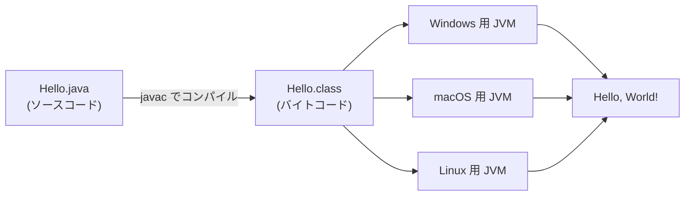

## 「Javaを入れる」って、何を入れるの?

::: haru
先輩!Java を学び直します!…で、何を入れるんでしたっけ。JRE?JDK?JVM?
:::

::: sensei
三文字略語の洗礼だね ☕ 開発するなら答えは **JDK** 一択。ただ三つの関係は後で必ず効いてくるから、最初に押さえよう。
:::

| 名前 | 中身 |
| --- | --- |
| **JVM**(Java Virtual Machine) | バイトコードを読み込んで実行する「仮想的なコンピュータ」 |
| **JRE**(Java Runtime Environment) | JVM + 標準ライブラリ。**実行するだけ** ならこれで足りる |
| **JDK**(Java Development Kit) | JRE + 開発ツール(`javac`、`jshell`、`javadoc` など)。**開発者が入れるのはこれ** |

包含関係は **JDK ⊃ JRE ⊃ JVM**。なお Java 11 以降、Oracle は単体の JRE を配布していません。

Java は書いたソースを直接実行する言語ではありません。まず **`javac`(Java コンパイラ)** が `.java` を **バイトコード**(`.class` ファイル)に変換し、それを **JVM** が実行します。



バイトコードは特定の CPU・OS の機械語ではなく **JVM 向けの命令列** です。だから同じ `.class` が、その OS 用の JVM さえあればどこでも動く。これがスローガン **Write once, run anywhere** の正体です。

::: trivia JVMは「遅いインタプリタ」ではない
JVM はバイトコードを解釈実行しつつ、何度も通る部分を **JIT コンパイラ** で実行中に機械語へ変換します。「Java はインタプリタ言語」は不正確な説明です。
:::

### なぜ JDK 21 なのか

Java は半年ごとに新バージョンが出て、2年に1回のものが **LTS(Long Term Support:長期サポート版)** になります。LTS 以外は次が出ると更新が止まるので、業務システムはほぼ LTS(8 / 11 / 17 / 21 / 25)で作られます。本講座が **21** を使うのは、LTS で長く使えること、Spring Boot 3 系(Java 17 以上が必須)や STS の対応が成熟していること、`record` やパターンマッチングなどモダン Java の主要機能がそろっていることが理由です。最新 LTS は 25 ですが、21 で学んだことはそのまま通用します。

## Windows に JDK 21 を入れる

JDK には複数の配布元があり、どれも中身は OpenJDK ベースです。ここでは無償で広く使われる **Eclipse Temurin** を使います。

1. Adoptium の公式サイトで **Temurin 21 (LTS)**・Windows・x64・**JDK** の `.msi` をダウンロード
2. インストーラの機能選択で **Add to PATH** と **Set JAVA_HOME variable** を有効にする(後者は初期状態で無効のことが多い)
3. **新しく** コマンドプロンプトを開いて確認(開きっぱなしの画面には反映されない)

```text
C:\> java -version
openjdk version "21.0.x" 2025-xx-xx LTS
OpenJDK Runtime Environment Temurin-21.0.x+x (build 21.0.x+x-LTS)
OpenJDK 64-Bit Server VM Temurin-21.0.x+x (build 21.0.x+x-LTS, mixed mode, sharing)

C:\> javac -version
javac 21.0.x

C:\> echo %JAVA_HOME%
C:\Program Files\Eclipse Adoptium\jdk-21.0.x.x-hotspot\
```

`java -version` は実行環境、`javac -version` はコンパイラの確認です。`java` は動くのに `javac` が「認識されていません」なら、Path が JDK 以外の Java を指しています。

- **`JAVA_HOME`** … JDK のフォルダ(`bin` の **一つ上**)。Maven などのツールが「どの JDK を使うか」をここで判断する
- **`Path`** … コマンド名だけで実行できるよう OS が探すフォルダの一覧。`%JAVA_HOME%\bin` を入れる

手動で設定するなら、Windows の検索で「環境変数」→「システム環境変数の編集」→「環境変数(N)...」から。

::: sensei
Path は **上から順に** 探される。古い Java が上にいるとそっちが呼ばれるよ。迷ったら `where java` で犯人探しだ。
:::

## Hello World を一行ずつ分解する

`C:\work` に `Hello.java` という名前で保存します(文字コードは UTF-8)。

```java
public class Hello {
    public static void main(String[] args) {
        System.out.println("Hello, World!");
    }
}
```

**① `public class Hello {`** … **クラス**(Java のプログラムを入れる箱)の宣言。`public` は「どこからでも使える」を表す **アクセス修飾子**。そして **`public` なクラスはクラス名と同じ名前のファイル(`Hello.java`)に書く** のがルールです。大文字小文字も完全一致。

**② `public static void main(String[] args) {`** … **main メソッド** = プログラムの入口。`java Hello` と打つと、JVM は `Hello` クラスからこの形のメソッドを探して呼びます。

| 部品 | 意味 |
| --- | --- |
| `public` | JVM(クラスの外)から呼べるよう公開する |
| `static` | オブジェクトを作らずクラスから直接呼べる(詳しくはクラスのレッスンで) |
| `void` | 戻り値なし |
| `main` | JVM が探す名前。`Main` では見つからない |
| `String[] args` | コマンドライン引数(文字列の配列)。`args` という名前は変えてもよい |

**③ `System.out.println("Hello, World!");`** … `System` は標準ライブラリのクラス(`java.lang` にあるので import 不要)、`out` は **標準出力**、`println` は「表示して改行する」メソッド。`"` で囲んだ `"Hello, World!"` は **文字列リテラル** です。

**④ `;`** … **文の終わり**。改行は文の終わりになりません。

**⑤ `{ }`** … クラス本体・メソッド本体などの **ブロック** の範囲。インデントは Python と違って文法上の意味はありませんが、現場では必ずそろえます(STS なら `Ctrl+Shift+F` で自動整形)。

::: haru
`public static void main(String[] args)` って呪文すぎません?毎回書くんですか…
:::

::: sensei
書く。現場でも書く。でも STS なら `main` と打って `Ctrl+Space` で一発。意味はこの先のレッスンで一つずつ回収するよ。
:::

## 動かし方は3通り

### javac → java

```text
C:\work> javac Hello.java
C:\work> dir /b
Hello.class
Hello.java
C:\work> java Hello
Hello, World!
```

`javac` には **ファイル名**、`java` には **クラス名** を渡します。`java Hello.class` と打つと「`Hello.class` という名前のクラス」を探して失敗します。

```text
エラー: メイン・クラスHello.classを検出およびロードできませんでした
原因: java.lang.ClassNotFoundException: Hello.class
```

### java Hello.java(Java 11+)

ファイル1つで完結するなら、`java` にソースを直接渡せます。裏でメモリ上にコンパイルしてから実行するので、`.class` は作られません。ちょっとした動作確認に便利です。

```text
C:\work> java Hello.java
Hello, World!
```

### JShell

JDK 9 から付属する対話環境(REPL)。クラスも main も書かずに1行ずつ試せ、行末の `;` も省略できます。この教材の「サンプル」も JShell で動いています。

```text
C:\work> jshell
jshell> System.out.println("Hello, JShell!")
Hello, JShell!

jshell> /exit
```

## print と println、文字列、コメント

`println` は表示の後に改行し、`print` は改行しません。

```java
System.out.print("ラーメン");
System.out.print("と");
System.out.println("餃子");
System.out.println("お願いします");
// 出力:
// ラーメンと餃子
// お願いします
```

文字列リテラルの中では `\n`(改行)、`\t`(タブ)、`\"`(`"` そのもの)、`\\`(`\` そのもの)といった **エスケープシーケンス** が使えます(日本語フォントでは `\` が `¥` に見えることも)。

コメントは3種類です。

```java
// 1行コメント:行末まで無視される
/* 複数行コメント:範囲がまるごと無視される(入れ子は不可) */
/**
 * Javadoc コメント:クラスやメソッドの説明。
 * javadoc コマンドで HTML の API ドキュメントになる。
 */
```

::: genba コメントは「なぜ」を書く
`// 1を足す` のようなコードを読めば分かることは書かない。喜ばれるのは「なぜこうしたか」(`// 締め日の翌日扱いにするため +1`)です。
:::

## よくあるミス図鑑

日本語環境のエラーは日本語で出ます。**1行目のメッセージと `^` の位置** を読むクセをつけましょう。

**ファイル名とクラス名の不一致**(`hello.java` に `public class Hello`)

```text
hello.java:1: エラー: クラス Helloはpublicであり、ファイルHello.javaで宣言する必要があります
public class Hello {
       ^
```

**`println` を `printIn` と書く**(小文字のエルと大文字のアイ。フォントによってはほぼ同じ見た目)

```text
Hello.java:3: エラー: シンボルを見つけられません
        System.out.printIn("Hello, World!");
                  ^
  シンボル:   メソッド printIn(String)
  場所: タイプPrintStreamの変数 out
```

**全角スペース・全角セミコロンの混入**(日本語入力のまま打つと入る)

```text
Hello.java:3: エラー: '\u3000'は不正な文字です
Hello.java:3: エラー: '\uff1b'は不正な文字です
```

`\u3000` は全角スペース、`\uff1b` は全角 `;` の文字コード。見た目で気づきにくいので、この番号が手がかりです(文字列リテラルの **中** の全角は問題なし)。

**大文字小文字の間違い**(Java は完全に区別する)

```text
Hello.java:3: エラー: パッケージsystemは存在しません
        system.out.println("Hello, World!");
              ^
```

`system` を「パッケージ名」と解釈した結果です。セミコロンを忘れれば `エラー: ';'がありません` と出ます。

**main のシグネチャ間違い** … これは厄介で、**コンパイルは通り、実行時に** 怒られます(`static` を忘れた例)。

```text
C:\work> java Hello
エラー: メイン・メソッドがクラスHelloのstaticではありません。次のようにメイン・メソッドを定義してください。
   public static void main(String[] args)
```

`Main` と大文字にした場合は「メイン・メソッドがクラスHelloで見つかりません」になります。

::: warn コンパイルエラーと実行時エラーは別物
`javac` が出すのは **コンパイルエラー**(文法や名前の誤り。`.class` は作られない)。`java` が出すのは **実行時のエラー**。どの段階で出たかを見分けるだけで、原因の候補がぐっと絞れます。
:::

::: trivia main の形は変わりつつある
JDK 21 では `static` や `String[] args` を省略できる main が **プレビュー機能**(`--enable-preview` が必要なお試し版)として入り、JDK 25 で正式機能になりました。ただ既存コードはすべて従来の形。まずは `public static void main(String[] args)` を確実に書けるようにしましょう。
:::

## STS では?

STS での手順は下の「STSでやってみよう」にまとめました。違いは一つだけ。**STS は保存した瞬間に自動でコンパイルする** ので `javac` を打つ場面はなく、エラーは赤い波線で即表示されます。画面構成は第2部で詳しくやります。

::: sensei
IDE は便利だけど、「裏で javac 相当が走って、JVM が main を呼んでいる」という感覚を持っておくと、トラブルのときに強いよ。
:::

::: point まとめ
- 開発に入れるのは **JDK**(JDK ⊃ JRE ⊃ JVM)。本講座は LTS の **JDK 21**
- `javac` で `.java` → `.class`(バイトコード)、JVM が実行。だから **Write once, run anywhere**
- `JAVA_HOME` は JDK フォルダ、`Path` には `%JAVA_HOME%\bin`。確認は `java -version` と `javac -version`
- `public class` 名とファイル名は **完全一致**。入口は `public static void main(String[] args)`
- `javac Hello.java` → `java Hello`。`java Hello.java` や JShell でも試せる
- `println` は改行あり、`print` は改行なし。コメントは `//`・`/* */`・`/** */`
- エラーは **1行目と `^` の位置** を読む。全角文字・`l` と `I`・大文字小文字に注意
:::

次のレッスン「変数と型」では、値に名前を付けて計算します。Hello World から一歩、プログラムらしくなりますよ。
