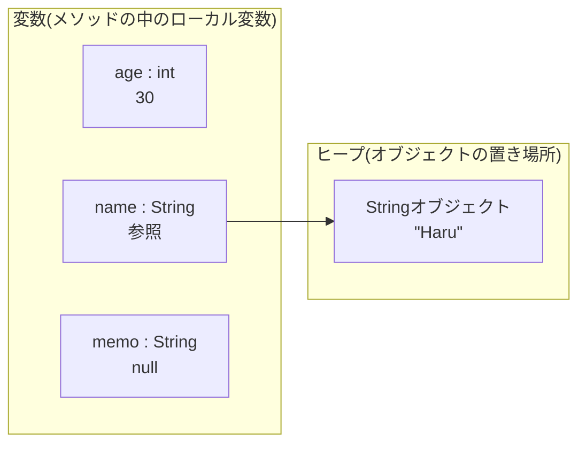
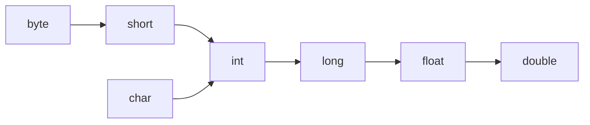

::: haru
先輩!Hello World 出せました!次は何をやるんですか?
:::

::: sensei
次は「変数と型」。地味に見えるけど、本番障害の原因ランキングでけっこう上位に来る分野なんだよね。
:::

::: haru
え、変数でバグるんですか?`x = 1` みたいなやつですよね?
:::

::: sensei
そう、その `x` が **何型か** で運命が変わる。21億を超えた瞬間に売上がマイナスになったりね。今日はそこを押さえよう。
:::

## 変数:宣言・初期化・代入

**変数**とは、値を入れておくための「名前付きの箱」です。Java では箱を使う前に「この箱には何型の値を入れるか」を必ず決めます。これを**宣言**といいます。

```java
int age;            // 宣言:int型の変数 age を用意する
age = 30;           // 代入:age に 30 を入れる
int price = 1980;   // 宣言と同時に値を入れる = 初期化
price = 2480;       // 再代入:中身を上書き(古い 1980 は消える)
```

- **宣言**:`型 変数名;` の形で、変数の型と名前を決めること
- **代入**:`=` の右辺の値を左辺の変数に入れること。`=` は数学の「等しい」ではなく「右から左へ入れる」という意味
- **初期化**:変数に最初の値を入れること。宣言と同時に書くのが普通

Java は**静的型付け言語**です。変数の型はコンパイル時に決まり、あとから変えられません。`int` で宣言した変数に文字列を入れようとすると、実行する前にコンパイラが止めてくれます。JavaScript や Python から来た人には窮屈に感じますが、「間違いを実行前に見つける」ための仕組みです。

### 命名規則

言語のルール(守らないとコンパイルエラー)と、現場の慣習(守らないとレビューで指摘される)は分けて覚えましょう。

**言語のルール**
- 使える文字は英字・数字・`_`・`$` など。**数字で始めてはいけない**(`1st` はNG)
- 大文字と小文字は区別される(`count` と `Count` は別物)
- `int` や `class` などの**キーワード**は使えない。`_` 1文字だけの名前も不可(Java 9 以降)

**現場の慣習**
- 変数名は **lowerCamelCase**:`totalPrice`、`userName`、`isActive`
- 定数は **UPPER_SNAKE_CASE**:`MAX_RETRY_COUNT`、`TAX_RATE`(定数はクラスの `static final` フィールドとして書くのが普通。クラスは後のレッスンで扱います)
- `a`、`tmp`、`data2` のような意味のない名前は避ける。日本語の変数名も文法上は書けるが、現場ではまず使わない

### final:再代入を禁止する

`final` を付けた変数は、一度値を入れたら二度と代入できません。

```java
final int maxLogin = 5;
maxLogin = 10;   // コンパイルエラー
```

```text
エラー: final変数maxLoginに値を割り当てることはできません
```

::: sensei
「この値は途中で変わらない」とコードで宣言できるのが `final` のうまみ。読む人が「どこかで書き換わってないかな」と追いかけなくて済む。
:::

## プリミティブ型8種

Java の型は大きく **プリミティブ型(基本データ型)** と **参照型** に分かれます。プリミティブ型は言語に組み込まれた8種類だけで、変数の中に値そのものが入ります。

| 型 | サイズ | 範囲(目安) | リテラルの例 |
|---|---|---|---|
| `byte` | 8bit | -128 〜 127 | `10`(範囲内の定数ならそのまま代入できる) |
| `short` | 16bit | -32,768 〜 32,767 | `1000` |
| `int` | 32bit | -2,147,483,648 〜 2,147,483,647(約±21億) | `100`、`0x1F`、`0b1010`、`1_000_000` |
| `long` | 64bit | 約 ±922京(±9.22×10^18) | `100L` |
| `float` | 32bit | 約 ±3.4×10^38、有効桁 約7桁 | `3.14f` |
| `double` | 64bit | 約 ±1.8×10^308、有効桁 約15〜16桁 | `3.14`、`1e3` |
| `char` | 16bit | `'\u0000'` 〜 `'￿'`(0〜65535) | `'A'`、`'あ'`、`'\n'` |
| `boolean` | 規定なし | `true` / `false` のみ | `true` |

**現場ではこう使い分ける**
- 整数はまず `int`。21億を超えうるもの(金額の合計、ファイルサイズ、ミリ秒のタイムスタンプ、ID)は `long`
- 小数は `double`。`float` はメモリを極限まで節約したい場面(大量の数値配列など)以外ではほぼ使わない
- `byte` はバイナリデータ(ファイルや通信の生データ)を扱うとき。`short` は正直あまり出番がない

### リテラルのルール

**リテラル**とは、ソースコードに直接書いた値のことです。リテラルにも型があります。

```java
int a = 100;              // 整数リテラルは int 型
long b = 3_000_000_000L;  // int に収まらない値には L が必要(小文字 l は 1 と紛らわしいので大文字で)
double c = 3.14;          // 小数リテラルは double 型
float d = 3.14f;          // float にしたいなら f が必要
int hex = 0x1F;           // 16進数 → 31
int bin = 0b1010;         // 2進数 → 10
int million = 1_000_000;  // _ で桁区切り(Java 7 以降)。値は 1000000
char ch = 'A';            // char はシングルクォート。1文字だけ
String s = "A";           // ダブルクォートは String(文字列)
boolean ok = true;
```

::: trivia 0 で始めると8進数
`int code = 010;` の中身は **8** です。先頭の `0` は8進数の印。郵便番号や社員番号を数値で持とうとして先頭ゼロを付けると事故ります。「先頭ゼロに意味がある番号」は数値ではなく `String` で持つのが正解です。
:::

### なぜサイズが決まっているのか

C 言語の `int` は環境によってサイズが変わりますが、Java の `int` は**どの OS・CPU でも必ず32bit**と言語仕様で決まっています。JVM 上で動く Java は、Windows でも Linux でも同じ計算結果になる必要があるからです。

## 参照型の入口:String と null

プリミティブ型8種以外は、すべて**参照型**です。代表が文字列を表す `String` です。`String` は頭が大文字なことからも分かるとおり、プリミティブ型ではなく**クラス**です。

参照型の変数には、オブジェクトそのものではなく、**オブジェクトがどこにあるかを指し示す値(参照)** が入ります。

```java
int age = 30;
String name = "Haru";
String memo = null;   // どのオブジェクトも指していない
```



- `age` には **値 30 そのもの** が入っている
- `name` には **"Haru" という String オブジェクトの場所(参照)** が入っている。オブジェクト本体は**ヒープ**と呼ばれる領域に作られる
- `memo` には **null** が入っている。null は「どのオブジェクトも指していない」という特別な値

`null` が入った変数でオブジェクトの機能を使おうとすると、実行時に `NullPointerException`(通称ぬるぽ)が発生します。

```java
String memo = null;
System.out.println(memo);           // null と表示されるだけ(これはOK)
System.out.println(memo.length());  // 実行時に NullPointerException
```

なお、プリミティブ型の変数に `null` は入れられません(`int x = null;` はコンパイルエラー)。

::: warn 「Javaは参照渡し」ではない
Java でメソッドに引数を渡すときは、**常に値渡し**です。参照型の場合は「参照という値」がコピーされて渡されます。「参照渡し」と呼ぶのは誤りなので、面接やレビューで言わないように。詳しくはメソッドのレッスンで確かめます。
:::

## 型変換:拡大変換と縮小変換

違う型の間で値を移すとき、Java は**安全な方向だけ自動で**変換してくれます。



矢印の向き(範囲が広い型への変換)は**拡大変換**と呼ばれ、何も書かなくても自動で行われます(暗黙の型変換)。

```java
int count = 100;
long big = count;      // int → long:自動でOK
double rate = count;   // int → double:自動でOK。rate は 100.0
```

逆向き(範囲が狭い型への変換)は**縮小変換**です。値が壊れる可能性があるので、`(型)` と書いて明示する**キャスト**が必要です。

```java
double price = 3.99;
int yen = (int) price;          // 3(小数点以下は切り捨て。四捨五入ではない)
int minus = (int) -3.99;        // -3(0に近い方向へ切り捨て)
byte broken = (byte) 200;       // -56(入りきらない上位ビットが捨てられる)
int wrapped = (int) 3_000_000_000L; // -1294967296
```

キャストは「壊れてもいいから変換して」という**プログラマの宣言**。コンパイラは黙って従います。

::: trivia long → float は「拡大」なのに精度が落ちる
`long` は64bit、`float` は32bit。それでも `long → float` は拡大変換です。範囲(最大値)は float の方が広いからです。ただし有効桁は約7桁しかないので、`123456789012345678L` を `float` に入れると `1.2345679E17` になり、下の桁は失われます。「拡大変換=絶対安全」ではない、という硬派ポイントです。
:::

### 計算すると int になる

`byte`・`short`・`char` 同士で計算すると、結果は **int** になります(二項数値昇格)。CPU が32bit単位で計算するのが効率的だった、という歴史的な事情があります。

```java
byte a = 1;
byte b = 2;
byte c = a + b;   // コンパイルエラー:a + b は int なので byte に入らない
```

また、`int` 同士の計算結果は `int` です。`7 / 2` は `3.5` ではなく `3` になります(割り算の詳細は次の「演算子」レッスンで)。どちらかが `double` なら結果も `double` です(`7 / 2.0` は `3.5`)。

### オーバーフロー:黙って一周する

`int` の最大値を超えると、Java は**エラーを出さずに**最小値側へ一周します。

```java
System.out.println(Integer.MAX_VALUE);      // 2147483647
System.out.println(Integer.MAX_VALUE + 1);  // -2147483648
```

これを**オーバーフロー**といいます。例外も警告も出ないので、テストで大きな値を試さない限り気づきません。特に罠なのがこれです。

```java
long total = 100000 * 100000;
System.out.println(total);  // 1410065408(100億にならない!)
```

左辺が `long` でも、右辺の `100000 * 100000` は **int 同士の計算** なので、計算した時点で溢れています。溢れた結果が `long` に拡大変換されて入るだけです。正しくは、計算の**前に**片方を `long` にします。

```java
long total = 100000L * 100000;  // 10000000000
```

::: genba 溢れたら止めたいときは Math.addExact
「黙って一周」が困る場面(金額計算など)では、`Math.addExact(a, b)` や `Math.multiplyExact(a, b)` を使うと、溢れた瞬間に `ArithmeticException: integer overflow` が投げられます。静かに間違うより、大きな音で落ちる方がずっとマシです。
:::

### double の誤差と BigDecimal

```java
System.out.println(0.1 + 0.2);  // 0.30000000000000004
```

バグではありません。`double` は値を**2進数の浮動小数点数**(IEEE 754 という規格)で持っています。10進数の 0.1 は2進数だと 0.000110011… と無限に続くので、どこかで丸めるしかありません。実際に入っている値を見てみると:

```java
System.out.println(new java.math.BigDecimal(0.1));
// 0.1000000000000000055511151231257827021181583404541015625
```

この小さなズレが計算で積み重なって表に出てくるわけです。

そこで現場の常識:**お金の計算に double を使わない。**代わりに `java.math.BigDecimal`(10進数で正確に計算できるクラス)を使うか、「円」や「セント」の整数(`long`)で持ちます。

```java
import java.math.BigDecimal;

BigDecimal x = new BigDecimal("0.1");   // 文字列で渡すのがポイント
BigDecimal y = new BigDecimal("0.2");
System.out.println(x.add(y));           // 0.3
```

`new BigDecimal(0.1)` と double で渡すと、誤差を含んだ値から作られてしまいます。**文字列で渡す**のが鉄則。細かい使い方は今は不要で、「お金は double で計算しない」だけ覚えておきましょう。

## var:ローカル変数の型推論

Java 10 から、ローカル変数の宣言で型の代わりに `var` と書けるようになりました。右辺から型をコンパイラが推論します。

```java
var count = 10;              // int
var name = "Haru";           // String
var total = 10000000000L;    // long
var list = new java.util.ArrayList<String>();  // ArrayList<String>
```

大事なのは、`var` は**動的型付けではない**ということ。型はコンパイル時に決まっていて、`count` は最後まで `int` です。`count = "ten";` と書けば普通にコンパイルエラーになります。

`var` には制限があります。

- 使えるのは**ローカル変数だけ**(フィールドやメソッドの引数には使えない)
- **初期化が必須**:`var x;` はエラー(何型か推論できない)
- `var x = null;` もエラー(null だけでは型が決まらない)

::: genba var は使う?使わない?
現場の意見は割れています。

- **賛成派**:`var map = new HashMap<String, List<Integer>>();` のように右辺に型が書いてあるなら、左にもう一度書くのはただのノイズ
- **反対派**:`var result = service.execute();` だと、result が何型か IDE で調べないと分からない。コードレビューは GitHub の画面で読むことも多いので困る

落としどころとしてよくあるのは「**右辺を見れば型が一目で分かるときだけ var**」というルールです。チームのコーディング規約に従いましょう。
:::

## ラッパークラスとオートボクシング(ちょっとだけ)

プリミティブ型にはそれぞれ対応するクラスがあり、**ラッパークラス**と呼ばれます。

`int` → `Integer`、`long` → `Long`、`double` → `Double`、`char` → `Character`、`boolean` → `Boolean`(残りは `Byte` / `Short` / `Float`)。

ラッパークラスは参照型なので `null` を入れられます。後で習うコレクション(`List` など)にはプリミティブ型を直接入れられないので、そこで出番が来ます。相互の変換はコンパイラが自動でやってくれます。

```java
Integer boxed = 10;   // int → Integer(オートボクシング)
int raw = boxed;      // Integer → int(アンボクシング)
```

ただし `null` の `Integer` をアンボクシングすると `NullPointerException` になります。なお `Integer.MAX_VALUE` のような定数もラッパークラスが持っています。

## よくあるミス5連発

実際のエラーメッセージで覚えておくと、出会ったときに一瞬で直せます。下は JDK 21 の `javac`(日本語環境)のメッセージで、STS(Eclipse)は独自のコンパイラを使うので文言が少し違います。

::: warn JShell で試すときの注意
この画面のサンプル実行に使っている JShell は、いちばん外側に書いた変数を特別扱いします。**未初期化でも 0 になり、`final` も無視される**ので、ミス1や `final` の再代入エラーは再現しません。試すときは STS でクラスの `main` メソッドの中に書きましょう。
:::

### 1. 初期化していない変数を使う

```java
int count;
System.out.println(count);
```

```text
エラー: 変数countは初期化されていない可能性があります
STS: The local variable count may not have been initialized
```

ローカル変数には**デフォルト値がありません**。「値を入れてからでないと読めない」ことをコンパイラが保証する仕様(確実な代入)なので、C 言語のように未初期化のゴミ値を読む事故は起きません。

### 2. long リテラルの L 忘れ

```java
long population = 8000000000;   // 世界人口
```

```text
エラー: 整数が大きすぎます。
STS: The literal 8000000000 of type int is out of range
```

リテラル `8000000000` は左辺に関係なく `int` として解釈されるので範囲外。`8_000_000_000L` と書きます。

### 3. int のオーバーフロー(コンパイルは通る)

```java
long monthMillis = 1000 * 60 * 60 * 24 * 30;   // 30日分のミリ秒
System.out.println(monthMillis);               // -1702967296
```

これが一番怖い。**コンパイルも通るし、実行時エラーも出ない**。正解は `1000L * 60 * 60 * 24 * 30`(2592000000)。

### 4. float の f 忘れ

```java
float rate = 3.14;
```

```text
エラー: 不適合な型: 精度が失われる可能性があるdoubleからfloatへの変換
STS: Type mismatch: cannot convert from double to float
```

小数リテラルは `double` なので縮小変換になる。`3.14f` と書きます(大抵は `double` を使えば済む話)。

### 5. char と String の取り違え

```java
char initial = "H";
String grade = 'A';
```

```text
エラー: 不適合な型: Stringをcharに変換できません:
エラー: 不適合な型: charをStringに変換できません:
STS: Type mismatch: cannot convert from String to char
```

`'A'` は `char`(プリミティブ型)、`"A"` は `String`(参照型)。全く別物です。

::: haru
オーバーフローだけコンパイラが助けてくれないの、ひどくないですか……
:::

::: sensei
だから「21億を超えるかも?」と毎回自問するクセが大事。迷ったら `long` にしておけば、だいたい助かるよ。
:::

::: point まとめ
- 変数は `型 名前 = 値;` で宣言・初期化する。ローカル変数は初期化しないと読めない
- 命名は lowerCamelCase、定数は UPPER_SNAKE_CASE。`final` で再代入を禁止できる
- プリミティブ型は8種。整数はまず `int`、21億を超えうるなら `long`、小数は `double`
- `String` は参照型。変数には「オブジェクトの場所(参照)」が入り、`null` は何も指していない状態
- 拡大変換は自動、縮小変換はキャストが必要。キャストは切り捨て・値の破壊が起きうる
- `int` 同士の計算は `int`。溢れても黙って一周する。掛け算の前に `long` にする
- `double` は誤差がある。お金は `BigDecimal`(文字列で生成)か整数で扱う
- `var` は型推論であって動的型付けではない。右辺から型が明らかなときに使う
:::
