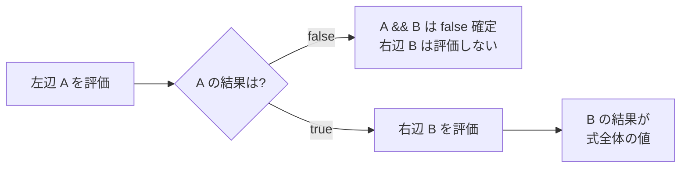

::: haru
先輩、演算子って `+` とか `-` ですよね? さすがに小学生でも分かりますって。今日は早上がりでいいですか?
:::

::: sensei
じゃあクイズ。`-7 / 2` と `"1" + 2 + 3` と、`i = i++` の後の `i`。全部即答できたら帰っていいよ ☕
:::

::: haru
……(-3.5? 6? 1増える?)……座ります。
:::

**演算子(operator)** は、値(**オペランド**、operand)に対して計算や比較を行う記号です。`a + b` なら `+` が演算子、`a` と `b` がオペランド。演算子と値を組み合わせて1つの値になるものを **式(expression)** と呼びます。

見た目は算数そのものですが、Java の演算子には「型」と「評価順」というルールが乗っています。ここを曖昧にしたまま進むと、金額計算や集計で静かに間違った値が出ます。例外が出ないぶんタチが悪い。今日はそこを潰します。

## 算術演算子 ─ 整数の割り算は「切り捨て」

| 演算子 | 意味 | 例 | 結果 |
|---|---|---|---|
| `+` | 加算 | `7 + 2` | `9` |
| `-` | 減算 | `7 - 2` | `5` |
| `*` | 乗算 | `7 * 2` | `14` |
| `/` | 除算 | `7 / 2` | `3` |
| `%` | 剰余(割った余り) | `7 % 2` | `1` |

`7 / 2` が `3.5` ではなく `3` になるのが最初の関門です。**オペランドが両方とも整数型なら、計算も整数で行われ、結果も整数** になります。小数部分は **0 の方向へ切り捨て**(truncate)られます。

```java
System.out.println(7 / 2);     // 3
System.out.println(-7 / 2);    // -3  (-4 ではない! 0 に近い方へ切り捨て)
System.out.println(7 / 2.0);   // 3.5 (片方が double なら double で計算)
System.out.println(-7 % 2);    // -1
System.out.println(7 % -2);    // 1
```

剰余 `%` の結果の符号は **割られる数(左側)と同じ** です。これは言語仕様(JLS 15.17.3)で「`(a / b) * b + (a % b) == a` が必ず成り立つ」と決まっているから。`/` が 0 方向に切り捨てる以上、`%` は左側の符号に揃うしかないわけです。

::: warn 偶数判定の落とし穴
`n % 2 == 1` で奇数判定すると、負の奇数(`-3 % 2` は `-1`)を取りこぼします。奇数判定は **`n % 2 != 0`** と書くのが定石です。
:::

### ゼロ除算 ─ int は例外、double は特殊な値

```java
System.out.println(10 / 0);     // 実行時に例外!
System.out.println(10.0 / 0);   // Infinity
System.out.println(-10.0 / 0);  // -Infinity
System.out.println(0.0 / 0);    // NaN
```

```text
Exception in thread "main" java.lang.ArithmeticException: / by zero
	at Main.main(Main.java:3)
```

整数のゼロ除算(`%` も同じ)は **`ArithmeticException`** という例外でプログラムが止まります。一方 `double` は IEEE 754 という浮動小数点の国際規格に従っていて、ゼロで割ると **`Infinity`(無限大)** や **`NaN`(Not a Number、非数)** という「特別な値」になり、**エラーにならずに計算が続きます**。

::: sensei
`double` の方が優しい……と思ったら大間違い。`NaN` は黙って後続の計算を全部 `NaN` に染めていく。平均値の画面に「NaN」って出てる障害、現場でほんとに見るからね。
:::

ちなみに `NaN` は自分自身とも等しくありません(`Double.NaN == Double.NaN` は `false`)。判定には `Double.isNaN(x)` を使います。

## 複合代入とインクリメント

### 複合代入演算子

`x = x + 5` は `x += 5` と短く書けます。`-=` `*=` `/=` `%=` なども同様で、これらを **複合代入演算子** と呼びます。ただし、単なる省略形ではありません。

```java
byte b = 10;
b += 1;      // OK
b = b + 1;   // コンパイルエラー!
```

```text
Main.java:4: error: incompatible types: possible lossy conversion from int to byte
        b = b + 1;
              ^
```

(STS では「型の不一致: int から byte には変換できません」/ "Type mismatch: cannot convert from int to byte" と表示されます。)

なぜか。Java では **`byte` / `short` / `char` 同士の算術演算は、まず `int` に格上げ(二項数値昇格)してから行う** ルールがあります。だから `b + 1` の結果は `int`。それを `byte` 変数に入れようとして「情報が落ちるかも」と怒られるわけです。

一方の複合代入は、仕様上 **`b = (byte)(b + 1)` と同じ意味** と定められています(JLS 15.26.2)。つまり **暗黙のキャストが入っている**。便利ですが、前回やったオーバーフローも黙って起きます。

```java
byte b = 127;
b += 1;
System.out.println(b);   // -128 (エラーも警告も出ない)
```

### インクリメント/デクリメント

`++` は 1 増やす、`--` は 1 減らす演算子です。変数の前に置く **前置**(`++i`)と、後ろに置く **後置**(`i++`)があり、**式としての値** が違います。

| 書き方 | 変数の変化 | 式の値 |
|---|---|---|
| `++i`(前置) | 1 増える | **増えた後** の値 |
| `i++`(後置) | 1 増える | **増える前** の値 |

```java
int i = 5;
int a = i++;   // a = 5, i = 6 (先に値を渡してから増やす)
int b = ++i;   // b = 7, i = 7 (先に増やしてから値を渡す)
```

単独の文 `i++;` として書く分には前置でも後置でも結果は同じです。問題は式の中に混ぜたとき。

::: haru
じゃあ `i = i++;` は、i が 1 増えるんですよね?
:::

::: sensei
増えない。5 なら 5 のまま。順番に追ってみよう。
:::

```java
int i = 5;
i = i++;
System.out.println(i);   // 5
```

1. 右辺 `i++` を評価する。式の値は **増やす前の 5**。この時点で `i` は 6 になる。
2. 代入 `i = 5` が実行され、`i` は 5 に **上書きされる**。

コンパイルエラーにも警告にもならないのが怖いところです。

::: genba 現場ルール
`++` / `--` は **単独の文としてだけ使う**(`count++;` やループの `i++`)。`arr[i++] = x;` や `k++ + ++k` のような「式の中で変数を書き換えつつ読む」コードは、読む人の脳内メモリを消費するので、コードレビューでほぼ確実に指摘されます。
:::

## 比較演算子と論理演算子

比較演算子は2つの値を比べ、結果を **`boolean`(`true` / `false`)** で返します。

| 演算子 | 意味 |
|---|---|
| `==` | 等しい |
| `!=` | 等しくない |
| `<` `<=` `>` `>=` | 大小比較 |

論理演算子は `boolean` 同士を組み合わせます。

| 演算子 | 意味 | 例 |
|---|---|---|
| `&&` | かつ(AND) | `age >= 20 && age < 30` |
| `\|\|` | または(OR) | `day == 0 \|\| day == 6` |
| `!` | 否定(NOT) | `!isEmpty` |

```java
int age = 25;
System.out.println(age >= 20 && age < 30);  // true
System.out.println(!(age >= 20));           // false
```

::: warn 「0 < age < 30」とは書けない
Python などから来た人がやりがちです。`0 < age` がまず `boolean` になり、その `boolean` と `30` を比べようとしてエラーになります。

```text
error: bad operand types for binary operator '<'
  first type:  boolean
  second type: int
```

`0 < age && age < 30` と、`&&` で2つの比較に分けて書きます。
:::

### 短絡評価(ショートサーキット)

`&&` と `||` は、**左側だけで結果が決まったら右側を評価しません**。これを **短絡評価** と言います。



`||` は逆で、左辺が `true` なら右辺を評価しません。これは「速くなる」以上に、**安全のためのガード** として現場で多用されます。

```java
int count = 0;
int total = 100;
// count が 0 なら右側の割り算は実行されない → 例外にならない
System.out.println(count != 0 && total / count > 10);  // false
```

### `&` と `&&` は別物

`&` と `|` も `boolean` に使えますが、こちらは **短絡しません**。左右を必ず両方評価します。

```java
System.out.println(count != 0 & total / count > 10);
// → ArithmeticException: / by zero (右側も実行されてしまう)
```

`&` `|` の本業は後で出てくるビット演算です。**条件を組み合わせるときは `&&` と `||`** と覚えておけば OK です。

## 文字列連結と評価順

`+` は、どちらかのオペランドが `String` だと **文字列連結** になります。そして `+` は **左から右へ** 順に評価されます(左結合)。

```java
System.out.println("1" + 2 + 3);   // 123
System.out.println(1 + 2 + "3");   // 33
```

- `"1" + 2 + 3` → `("1" + 2) + 3` → `"12" + 3` → `"123"`
- `1 + 2 + "3"` → `(1 + 2) + "3"` → `3 + "3"` → `"33"`

一度 `String` になったら、そこから右はずっと連結です。ログ出力でありがちな事故がこれ。

```java
System.out.println("合計: " + 1 + 2);     // 合計: 12  ← 3 じゃない!
System.out.println("合計: " + (1 + 2));   // 合計: 3
```

もう1つ、`char` 同士の `+` は文字列連結ではなく **数値の足し算** です。`'a' + 'b'` は `"ab"` ではなく `195`(`'a'` の文字コード 97 + `'b'` の 98)になります。

## 三項演算子

`条件 ? 値1 : 値2` は、条件が `true` なら値1、`false` なら値2 になる **式** です。オペランドを3つ取るので三項演算子(条件演算子)と呼ばれます。

```java
int score = 72;
String result = score >= 60 ? "合格" : "不合格";
System.out.println(result);   // 合格

int stock = 0;
System.out.println("在庫" + (stock > 0 ? "あり" : "なし"));  // 在庫なし
```

「どちらかの値を選んで変数に入れる」場面で簡潔に書けます。一方、三項演算子を入れ子にしすぎると一気に読めなくなります。現場の目安は **入れ子は1段まで**。それ以上は次回やる `if` / `switch` で書きましょう。

## 優先順位と結合規則

`1 + 2 * 3` が `7` になるように、演算子には **優先順位** があります。同じ優先順位が並んだときにどちらから計算するかが **結合規則** です。

| 優先度 | 演算子 | 結合 |
|---|---|---|
| 高 | `x++` `x--`(後置) | 左→右 |
|  | `++x` `--x` `+x` `-x` `!` `~` `(型)` | **右→左** |
|  | `*` `/` `%` | 左→右 |
|  | `+` `-`(文字列連結も) | 左→右 |
|  | `<<` `>>` `>>>` | 左→右 |
|  | `<` `<=` `>` `>=` `instanceof` | 左→右 |
|  | `==` `!=` | 左→右 |
|  | `&` → `^` → `\|`(この順に高い) | 左→右 |
|  | `&&` | 左→右 |
|  | `\|\|` | 左→右 |
|  | `? :` | **右→左** |
| 低 | `=` `+=` `-=` など | **右→左** |

代入が右結合なので、`a = b = c = 5;` は `a = (b = (c = 5))` と解釈され、3つとも 5 になります。また `&&` は `||` より優先度が高いので、`a || b && c` は `a || (b && c)` です。

::: sensei
で、この表を暗記しろとは言わない。現場のルールは一つ。**迷ったら括弧**。
:::

括弧は実行速度に一切影響しません(コンパイル時に式の構造が決まるだけ)。`a || (b && c)` と書けば、次に読む人が表を引かずに済みます。

## == と equals ─ 文字列の比較は equals

`==` は **プリミティブ型(int や double など)なら値** を比べます。しかし `String` のような **参照型** に使うと、「中身が同じか」ではなく **「同じオブジェクトを指しているか」** を比べてしまいます。

```java
String a = "hello";
String b = new String("hello");
System.out.println(a == b);        // false (別のオブジェクト)
System.out.println(a.equals(b));   // true  (中身は同じ)
```

厄介なのは、`String a = "hello"; String c = "hello";` のようにリテラル同士だと、JVM が同じオブジェクトを使い回すため `a == c` が `true` になること。**テストでは通るのに本番で失敗する** 典型パターンです。文字列の比較は **必ず `equals`**。仕組みの詳細は「文字列」のレッスンで扱います。

## ビット演算とシフト(豆知識)

整数をビット(2進数の各桁)単位で操作する演算子もあります(ほかに XOR の `^`、反転の `~` もあります)。

| 演算子 | 意味 | 例(2進数) |
|---|---|---|
| `&` | ビットAND | `0b0110 & 0b0011` → `0b0010` |
| `\|` | ビットOR | `0b0110 \| 0b0011` → `0b0111` |
| `<<` | 左シフト | `1 << 3` → `8` |
| `>>` | 右シフト(符号を保つ) | `-8 >> 1` → `-4` |
| `>>>` | 右シフト(符号なし) | `-8 >>> 1` → `2147483644` |

業務アプリで見かけるのは主に **フラグ管理** です。権限やオプションを1つの `int` にまとめて持ちます。

```java
int READ = 1, WRITE = 2, EXEC = 4;    // 0b001, 0b010, 0b100
int perm = READ | WRITE;              // 読み書き可能 (0b011)
System.out.println((perm & WRITE) != 0);  // true  → 書き込み可
System.out.println((perm & EXEC) != 0);   // false → 実行不可
```

`(perm & WRITE) != 0` の括弧は必須です。`==` / `!=` の方が `&` より優先度が高いからです。まさに「迷ったら括弧」。

## Math クラスの便利メソッド

演算子だけでは書きにくい計算は、標準ライブラリの `Math` クラスに揃っています(`import` 不要)。

| メソッド | 内容 | 例 → 結果 |
|---|---|---|
| `Math.abs(x)` | 絶対値 | `Math.abs(-5)` → `5` |
| `Math.max(a, b)` / `Math.min(a, b)` | 大きい方/小さい方 | `Math.max(3, 7)` → `7` |
| `Math.pow(a, b)` | a の b 乗(**double** を返す) | `Math.pow(2, 10)` → `1024.0` |
| `Math.round(x)` | 四捨五入(double → **long**) | `Math.round(2.5)` → `3` |
| `Math.floorDiv(a, b)` | 負の無限大方向へ切り捨てる除算 | `Math.floorDiv(-7, 2)` → `-4` |
| `Math.floorMod(a, b)` | 結果が割る数と同じ符号の剰余 | `Math.floorMod(-7, 2)` → `1` |

`floorMod` は「曜日や時計のように、マイナスでも 0〜N-1 に収めたい」ときの定番です。

### 小数第1位で四捨五入する

`Math.round` は整数に丸めるメソッドなので、「小数第1位まで」にしたいときは **10倍して丸め、10.0 で割る** のが定番です。

```java
double bmi = 22.49134;
System.out.println(Math.round(bmi * 10) / 10.0);  // 22.5
System.out.println(Math.round(bmi * 10) / 10);    // 22   ← long / int で整数除算!
```

`10` と `10.0` の違いだけで結果が変わります。今日の内容が全部つながっていますね。

::: trivia Math.round は「四捨五入」ではない?
`Math.round(-2.5)` は `-3` ではなく **`-2`** です。`Math.round` は「0.5 を足して床関数(floor)」に相当する動きで、ちょうど .5 のときは **常に正の無限大方向** に丸めます。正の数なら学校の四捨五入と一致しますが、マイナスの金額などを扱うときは注意しましょう。
:::

## よくあるミスまとめ

::: warn 現場で本当に見るやつ
- **進捗率が 0% のまま**:`done / total * 100` は `done < total` だと整数除算で 0。`done * 100 / total` か `100.0 * done / total` にする。
- **ログの数値がおかしい**:`"合計: " + a + b` で連結されてしまう。足し算部分は括弧で囲む。
- **奇数判定が負数で外れる**:`n % 2 == 1` ではなく `n % 2 != 0`。
- **`i = i++` で増えない**:`++` は単独の文で使う。
- **`&` で条件をつないで例外**:条件の結合は `&&` / `||`。
- **文字列を `==` で比較**:`equals` を使う。
:::

::: point まとめ
- 整数同士の `/` は **0 方向へ切り捨て**。`%` の符号は **左側(割られる数)** に従う。
- 整数のゼロ除算は `ArithmeticException`。`double` は `Infinity` / `NaN` になり、黙って進む。
- `b += 1` には **暗黙のキャスト** が入る。`byte` / `short` / `char` の演算結果は `int`。
- 後置 `i++` の式の値は **増える前**。`i = i++` では増えない。`++` は単独の文で使う。
- `&&` / `||` は **短絡評価**。ゼロ除算や null のガードに使う。`&` / `|` は両方評価する。
- `+` は左から評価。一度 `String` になると以降は連結。
- 三項演算子 `条件 ? A : B` は値を選ぶ式。入れ子は1段まで。
- 優先順位は覚えるより **迷ったら括弧**。
- 文字列の比較は `==` ではなく **`equals`**。
:::
