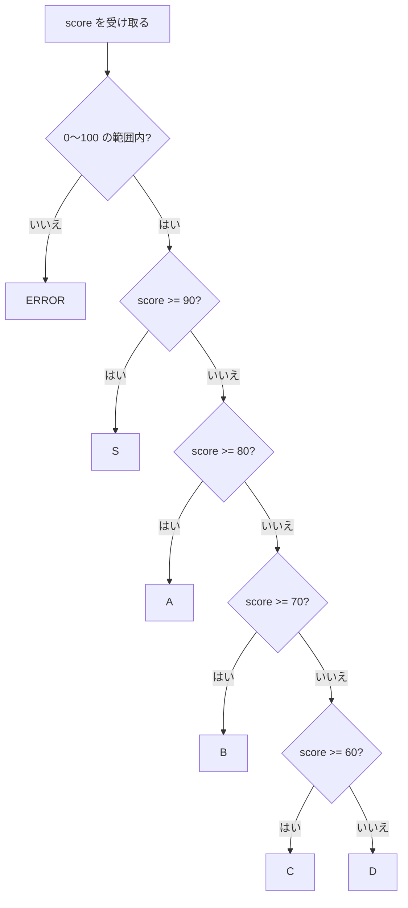

::: haru
先輩、条件分岐って `if` 書くだけですよね? 他の言語でさんざん書いてきたんで、今日は楽勝っす!
:::

::: sensei
その油断がバグを生む。Java の分岐には「波括弧の省略」「switch のフォールスルー」「文字列を `==` で比べる」っていう三大地雷がある。今日は全部踏ませてから避け方を教えるよ。
:::

::: haru
踏ませるんすか……。
:::

前回の「演算子」で、比較演算子・論理演算子・三項演算子を覚えました。今回はそれらが作る **boolean の値** を使って、プログラムの流れを分ける方法を学びます。

## if / else if / else の基本

`if` 文は「条件が `true` のときだけ、ブロックを実行する」構文です。

```java
int stock = 3;

if (stock == 0) {
    System.out.println("在庫切れです");
} else if (stock < 5) {
    System.out.println("残りわずか!");
} else {
    System.out.println("在庫あり");
}
// 出力: 残りわずか!
```

- `if (条件式)` の **条件式は必ず `boolean` 型** でなければなりません。C や JavaScript のように「0 は偽、それ以外は真」という暗黙の変換は **Java には一切ありません**。`if (count)` と書くとコンパイルエラーです。
- `else if` は何個でも続けられます。上から順に評価し、**最初に `true` になった1つだけ** が実行され、残りは評価すらされません。
- `else` は「どれにも当てはまらなかったとき」の受け皿です。省略可能です。

`{ }` で囲まれた部分を **ブロック** と呼びます。ブロックの中で宣言した変数は、そのブロックの中でしか使えません(変数の **スコープ**)。`if` の中で作った変数を `if` の外で使おうとすると `シンボルを見つけられません` というコンパイルエラーになります。

### 波括弧は省略しない(現場ルール)

文法上は、実行する文が1つだけなら `{ }` を省略できます。

```java
if (stock == 0) System.out.println("在庫切れ"); // 文法上はOK
```

でも現場では **ほぼ例外なく「1行でも波括弧を書く」** ルールです。理由は、省略すると「インデントの見た目」と「実際の動き」がズレるからです。次のコードを見てください。

```java
int x = 7;
if (x > 5)
    if (x > 10)
        System.out.println("大きい");
else
    System.out.println("5以下");
```

インデントだけ見ると「`x` が 5 以下なら `5以下`」に見えますが、実行すると……

```text
5以下
```

`x` は 7 なのに「5以下」と出ました。Java の仕様では **`else` は直前の(一番近い)`if` に結びつく** ので、この `else` は内側の `if (x > 10)` の `else` なんです。コンパイラはインデントなんて見ていません。これを **ぶら下がり else 問題(dangling else)** と呼びます。

::: sensei
波括弧を省略すると、あとから誰かが1行足したときに一発で壊れる。Apple が実際にそれで大事故を起こしてる(詳しくはコラムで)。だから「書かない理由がない」んだ。
:::

多くのチームは Checkstyle の `NeedBraces` ルールなどで「波括弧必須」を機械的に強制しています。人間の注意力に頼らないのが現場流です。

## 条件の並べ方とネストを浅くするコツ

### 範囲判定は「端から順に」

点数から成績を出すような **範囲判定** では、条件を並べる順番が命です。

```java
int score = 95;
String rank;
if (score >= 60) {
    rank = "C";
} else if (score >= 90) {
    rank = "S";
} else {
    rank = "D";
}
System.out.println(rank); // 出力: C  ← 95点なのに!
```

95 は `score >= 60` にも当てはまるので、そこで決まってしまい、`score >= 90` は評価すらされません。`else if` は「上で外れたものだけが下に来る」構造なので、**大きい方から(`>=` で)順に** か、**小さい方から(`<` で)順に** か、どちらかに揃えて並べます。

```java
if (score >= 90) {
    rank = "S";
} else if (score >= 80) {   // ここに来る時点で score < 90 は確定している
    rank = "A";
} else if (score >= 70) {
    rank = "B";
} else if (score >= 60) {
    rank = "C";
} else {
    rank = "D";
}
```

2つ目の条件に `score >= 80 && score < 90` と上限まで書く必要はありません。上の条件で外れた時点で「90 未満」は保証されているからです。書いても動きますが、境界値を2か所で管理することになり、修正漏れの元になります。

流れを図にするとこうなります。



ひし形が1つ下に進むたびに「上の条件は全部外れた」という前提が積み上がっていく、というのが `else if` の正体です。

### 早期 return(ガード節)でネストを浅く

まず「範囲外の値」をはじく、という処理を素直に書くとこうなりがちです。

```java
static String grade(int score) {
    if (score >= 0 && score <= 100) {
        if (score >= 90) {
            return "S";
        } else {
            // ……さらにネストが続く
        }
    } else {
        return "ERROR";
    }
}
```

ネスト(入れ子)が深くなると、「今どの条件の中にいるのか」を頭で追い続ける必要があり、読むのも直すのも大変です。そこで現場では **ガード節(guard clause)** を使います。異常系・例外的なケースを **先に `return` で追い返してしまう** 書き方です。

```java
static String grade(int score) {
    if (score < 0 || score > 100) {
        return "ERROR";          // ガード節:ダメな値はここで帰ってもらう
    }
    if (score >= 90) {
        return "S";
    }
    if (score >= 80) {
        return "A";
    }
    // ……以下、正常系だけを平らに書ける
    return "D";
}
```

`return` は「メソッドの処理をそこで終えて、値を呼び出し元に返す」命令です(メソッド自体は「メソッド」のレッスンで詳しくやります)。`return` した時点で処理が終わるので、`else` を書かなくても後ろには来ません。結果として **インデントが1段で済み、「本筋」が左端にまっすぐ並ぶ** のがガード節の効果です。

::: haru
`else` が消えるだけで、こんなにスッキリするんすね。
:::

::: sensei
ネストを浅くするコツは3つ。①異常系は先に return、②`&&` で条件をまとめる、③それでも深いならメソッドに切り出す。「ネスト3段を超えたら黄信号」くらいに思っておくといい。
:::

## 従来の switch 文とフォールスルーの罠

1つの値が「どれと等しいか」で分岐するなら `switch` が使えます。まず Java 1.0 からある **従来の switch 文** から。

```java
int day = 6; // 1=月 … 7=日
switch (day) {
    case 6:
        System.out.println("土曜日");
        break;
    case 7:
        System.out.println("日曜日");
        break;
    default:
        System.out.println("平日");
        break;
}
// 出力: 土曜日
```

- `switch (式)` の値と一致する `case` に **ジャンプ** し、そこから下を実行します。
- `break` で switch を抜けます。
- どの `case` にも一致しなければ `default` に飛びます。
- 使える型は `byte` / `short` / `char` / `int`(とそのラッパー型)、`String`(Java 7〜)、`enum` です。`long` や `double`、`boolean` は使えません(`long` を渡すと `selector type long is not allowed` というエラー)。

問題は `break` を忘れたときです。

```java
int day = 6;
switch (day) {
    case 6:
        System.out.println("土曜日");
    case 7:
        System.out.println("日曜日");
        break;
    default:
        System.out.println("平日");
}
```

```text
土曜日
日曜日
```

土曜日なのに「日曜日」まで出ました。従来の switch は `case` を **ジャンプ先のラベル** として扱うだけなので、`break` がなければ **次の case の処理にそのまま落ちていきます**。これを **フォールスルー(fall-through)** と呼びます。C 言語から受け継いだ仕様です。

意図的に使う場面もあります(`case 6: case 7:` と並べて「6 か 7 なら」を表すなど)が、`break` の書き忘れによるバグのほうがはるかに多いのが実情です。`javac -Xlint:fallthrough` を付けると `warning: [fallthrough] possible fall-through into case` と警告してくれますが、デフォルトでは無言です。

## switch 式(Java 14+)――現場の新標準

Java 14 で正式に入った **switch 式(switch expression)** は、これらの問題をまとめて解決します。

```java
int day = 6;
String type = switch (day) {
    case 1, 2, 3, 4, 5 -> "平日";
    case 6, 7 -> "休日";
    default -> "不正な曜日";
};
System.out.println(type); // 出力: 休日
```

ポイントは4つです。

1. **アロー構文 `case X ->`**:矢印の右側だけが実行され、**フォールスルーしません**。`break` は不要です。
2. **複数ラベル `case 1, 2, 3 ->`**:カンマで並べて「どれかに一致したら」を表せます。フォールスルーを使う必要がなくなりました。
3. **値を返す「式」である**:`switch` 全体が1つの値になるので、変数に代入したり `return` したりできます。最後の `};` のセミコロンを忘れずに(代入文の終わりだからです)。
4. **網羅性(exhaustiveness)のチェック**:switch 式は **必ず何かの値を返さなければならない** ので、すべての入力をカバーしていないとコンパイルエラーになります。

```java
String type = switch (day) {
    case 1, 2, 3, 4, 5 -> "平日";
    case 6, 7 -> "休日";
};   // default がない!
```

```text
error: the switch expression does not cover all possible input values
(日本語環境: switch式がすべての可能な入力値をカバーしていません)
```

`int` は 8 や -1 も取りうるので、`default` が必要です。一方 `enum` で全定数を `case` に書いた場合は、`default` なしでも網羅していると認められます。

### 処理が複数行なら yield

アローの右側に複数の文を書きたいときはブロック `{ }` にし、返す値を **`yield`** で指定します。

```java
int score = 85;
String rank = switch (score / 10) {
    case 10, 9 -> "S";
    case 8 -> {
        System.out.println("あと少しでS!");
        yield "A";            // switch 式の値として "A" を返す
    }
    default -> "B以下";
};
```

`return` ではなく `yield` なのは、`return` だと「メソッドから抜ける」意味と区別がつかないからです。`yield` は「この switch 式の値はこれ」という専用のキーワードです。

なお、アロー構文は値を返さない **switch 文** でも使えます(`case 6 -> System.out.println("土曜");`)。ただし1つの switch の中で `->` と `:` を混ぜることはできません(`different case kinds used in the switch`)。

::: haru
じゃあもう、昔の `case X:` + `break` は使わなくていいんすか?
:::

::: sensei
新規コードなら「アロー構文、値が欲しいなら switch 式」が現場の推奨。break 忘れが構造的に起きないし、default 漏れはコンパイラが見つけてくれる。ただ古いコードは `case:` だらけだから、読めるようにはしておくこと。
:::

## 文字列の分岐:equals と null に注意

### 文字列を == で比べてはいけない

会員ランクのような文字列で分岐するとき、まずやりがちなのがこれです。

```java
String s = "GOL";
String rank = s + "D";              // 実行時に組み立てた "GOLD"
System.out.println(rank == "GOLD");      // false !?
System.out.println(rank.equals("GOLD")); // true
```

`String` は **参照型** です。`==` は参照型に対しては「**同じオブジェクトを指しているか**」を比べるだけで、中身の文字列が同じかどうかは見ません。中身を比べるのは **`equals` メソッド** です。

厄介なのは、ソースに直接書いた文字列リテラル同士(`"GOLD" == "GOLD"`)は、JVM が同じオブジェクトを使い回すので(文字列の **インターン**)`true` になることです。だから簡単なテストでは通ってしまい、ユーザー入力やDBの値が来た本番で初めて壊れます。**文字列は必ず `equals`**、と体に叩き込んでください。

さらに現場では、`rank.equals("GOLD")` ではなく **`"GOLD".equals(rank)`** と書くことがよくあります。`rank` が `null` だと前者は `NullPointerException` ですが、後者はリテラル側のメソッドを呼ぶので、単に `false` が返るだけです。

### String の switch と null

`switch` は内部で `equals` 相当の比較をしてくれるので、文字列の分岐を安全に書けます。

```java
String rank = "SILVER";
int fee = switch (rank) {
    case "GOLD" -> 0;
    case "SILVER" -> 300;
    default -> 500;
};
```

ただし **`switch` に `null` を渡すと `NullPointerException`** です。`default` にも行きません。

```text
Exception in thread "main" java.lang.NullPointerException:
  Cannot invoke "String.hashCode()" because "<local3>" is null
```

`<local3>` はコンパイラが裏で作った一時変数の名前です(番号は場合によって変わります)。メッセージに `hashCode()` が出ているのは、String の switch が内部で `hashCode()` を使ってジャンプ先を絞り込んでいるからです(コラム参照)。`null` の可能性があるなら、switch の前にガード節で `null` チェックをしておきます。

::: trivia Java 21 なら case null も書ける
Java 21 で正式になった「switch のパターンマッチング」では、`case null -> "未入力";` のように **null 専用の case** を書けるようになりました。`case null` を書いた switch だけは null で NPE になりません。パターンマッチングは「モダンJava」の章で詳しくやります。
:::

## よくあるミス集

### `if (x = 5)` はなぜコンパイルエラー?

```java
int x = 3;
if (x = 5) { ... }
```

```text
error: incompatible types: int cannot be converted to boolean
(日本語環境: 不適合な型: intをbooleanに変換できません)
```

`=` は代入演算子で、`x = 5` という式の値は代入された `5`(`int`)です。C 言語では「0 以外は真」なので通ってしまい、「比較のつもりが代入」という有名なバグの温床でした。Java は **条件に `boolean` 以外を許さない** という言語設計で、このミスをコンパイル時に止めてくれます。

ただし、**変数が `boolean` だと止まりません**。

```java
boolean done = false;
if (done = true) {           // 代入! 式の値は true
    System.out.println("完了"); // 毎回ここに来てしまう
}
```

### `== true` と書かない

```java
if (done == true) { ... }   // 冗長
if (done) { ... }           // 現場ではこう書く
if (!done) { ... }          // false の判定は ! で
```

`done` はすでに `boolean` なので、`== true` と比べても同じ値が出るだけです。冗長なうえ、上のように `=` を1つ打ち間違えると「常に true」の代入になるのに **コンパイルが通ってしまいます**。`if (done)` と書けば、そもそもこの事故は起こりません。変数名を `isEmpty` `hasStock` `canShip` のように「はい/いいえ」で読める名前にすると、`if (hasStock)` が英文のように読めて一石二鳥です。

### if の後ろにセミコロン

```java
if (stock == 0); {
    System.out.println("在庫切れ"); // stock がいくつでも必ず出る
}
```

`if (...);` の `;` は「何もしない文(空文)」とみなされ、`if` はそれで終わります。後ろの `{ }` は条件と無関係なただのブロックとして毎回実行されます。コンパイルエラーにならないのでタチが悪いミスです。

::: point まとめ
- `if` の条件は **必ず `boolean`**。`if (x = 5)` がエラーになるのは「0 は偽」のような変換が Java にないから
- **波括弧は1行でも省略しない**。`else` は一番近い `if` に結びつく(ぶら下がり else)
- 範囲判定は **大きい方から/小さい方から順に**。異常系は **ガード節で先に return** してネストを浅く
- 従来の switch 文は `break` を忘れると **フォールスルー**。新規コードは **アロー構文・switch 式** が推奨
- switch 式は `case 1, 2 ->` の複数ラベル、ブロックでは `yield`、**網羅していないとコンパイルエラー**
- 文字列は **`equals`** で比較(`"GOLD".equals(rank)` で null 安全に)。**null を switch に渡すと NPE**
- boolean は `== true` と書かず `if (done)` / `if (!done)`
:::

::: sensei
次は「ループ」。条件分岐と組み合わせて「同じことを何度もやる」を覚えたら、もうたいていのロジックは書けるようになるよ。
:::
