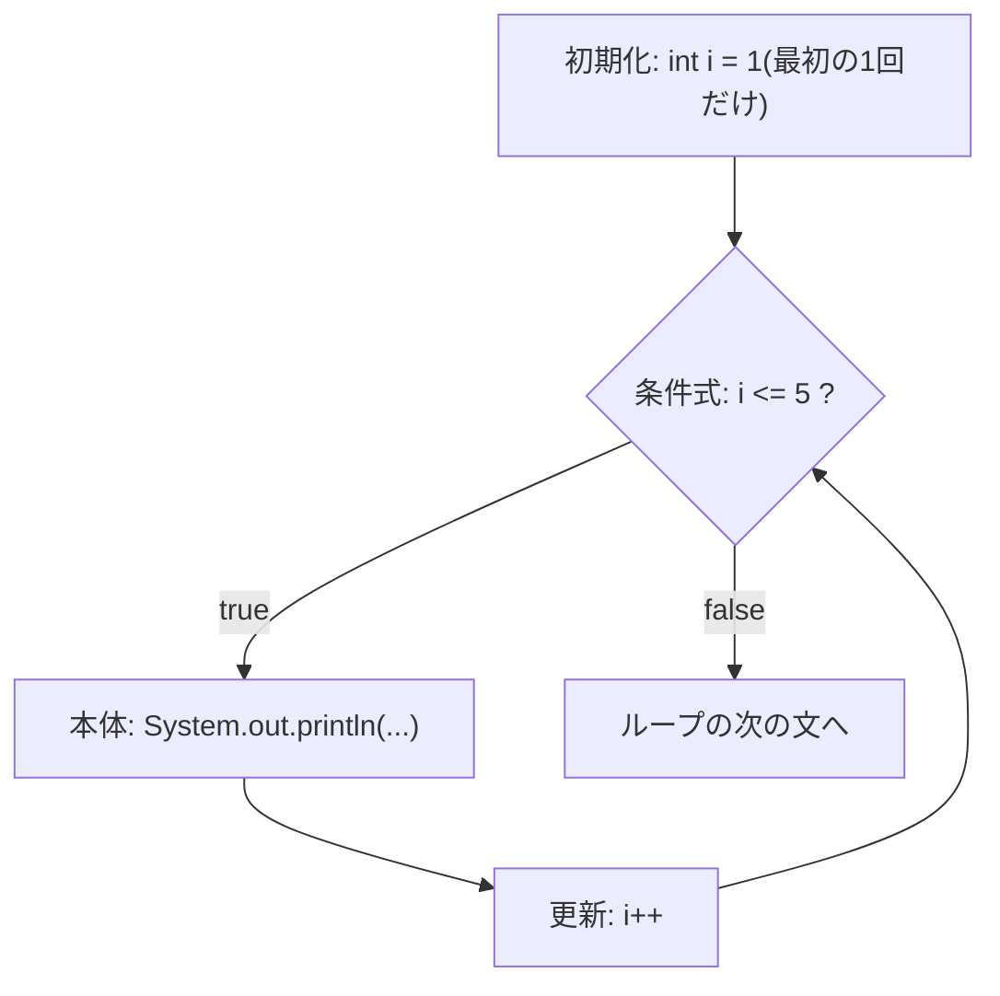

::: haru
先輩、請求書を100件出力する処理を書いてたら、同じ `System.out.println` を100行コピペしてました……。
:::

::: sensei
コピペは101件目の請求書が来た瞬間に破綻するよ。今日は「同じ処理を、条件が満たされている間くり返す」仕組み、**ループ**をやろう。
:::

前回の「条件分岐」で、プログラムの流れを**枝分かれ**させる方法を学んだ。今回は流れを**巻き戻す**方法だ。Java のループ文は `for`・`while`・`do-while` の3種類(+ 次回の配列で使う「拡張for文」)。どれも「条件式が `true` の間、本体をくり返す」という点は同じで、違うのは**条件をいつ・どこで判定するか**だけだ。

## for 文:3つの部分と実行順

まずは一番よく使う `for` 文。回数が決まっているくり返しはほぼこれで書く。

```java
for (int i = 1; i <= 5; i++) {
    System.out.println(i + "回目");
}
// 1回目
// 2回目
// 3回目
// 4回目
// 5回目
```

`for (` の後ろはセミコロンで3つに区切られている。

| 部分 | 例 | いつ実行される? |
|---|---|---|
| 初期化部 | `int i = 1` | ループに入るとき **1回だけ** |
| 条件式 | `i <= 5` | 毎回、本体を実行する **前** に評価。`false` ならループ終了 |
| 更新部 | `i++` | 毎回、本体を実行した **後** |

くり返しを数えるために使う `i` のような変数を**ループ変数**(カウンタ変数)と呼ぶ。実行順を図にするとこうなる。



ポイントは「**条件判定 → 本体 → 更新 → 条件判定 → …**」の順で、**更新は本体の後**ということ。だからループが終わった直後の `i` は 5 ではなく、条件を初めて満たさなくなった 6 になっている(後で使えるなら、の話。次の項を参照)。また、最初の条件判定で `false` なら本体は**1回も実行されない**。

3つの部分はどれも省略でき、条件式を省略すると「常に `true`」扱い(`for (;;)` は無限ループ)。初期化部と更新部はカンマで複数書ける(`for (int i = 0, j = 10; i < j; i++, j--)`)。

### ループ変数のスコープ

初期化部で宣言した変数は、**その for 文の中(条件式・更新部・本体)でしか使えない**。変数が使える範囲を**スコープ**という。

```java
for (int i = 0; i < 3; i++) {
    System.out.println(i);
}
System.out.println(i);   // ← ここでコンパイルエラー
```

```text
Main.java:6: エラー: シンボルを見つけられません
        System.out.println(i);
                           ^
  シンボル:   変数 i
  場所: クラス Main
```

STS(Eclipse)だと `i cannot be resolved to a variable` と赤線が出る。ループの後でも値を使いたいなら、ループの**前**で宣言しておく。

```java
int i;
for (i = 0; i < 3; i++) { /* ... */ }
System.out.println(i);   // 3
```

::: sensei
スコープが狭いのは不便じゃなくて**安全装置**。ループの外で `i` をうっかり使い回すバグを、コンパイラが止めてくれるんだ。
:::

## while と do-while:使い分け

`while` 文は「条件式が `true` の間くり返す」だけのシンプルな形。初期化と更新は自分で書く。

```java
// 100万円を年利5%で預けたら、何年で120万円を超える?(利息は1円未満切り捨て)
long balance = 1_000_000;
int years = 0;
while (balance < 1_200_000) {
    balance += balance * 5 / 100;
    years++;
}
System.out.println(years + "年後に " + balance + "円");   // 4年後に 1215506円
```

この例は**何回くり返すか事前に分からない**。「目標額に達したら止まる」という**条件で止まる**くり返しには `while` が自然だ。

`do-while` 文は本体を先に実行して、**後から**条件を判定する。だから**最低1回は必ず実行**される。末尾のセミコロンを忘れやすいので注意。

```java
// 整数の桁数を数える
int n = 0;
int digits = 0;
do {
    digits++;
    n /= 10;
} while (n != 0);          // ← セミコロン必須
System.out.println(digits); // 1
```

`n` が 0 のとき、桁数は「1」が正しい。これを `while (n != 0) { ... }` で書くと、最初の判定で `false` になって **0桁** と答えてしまう。「0 も1桁として扱う」=「最低1回は処理する」なので `do-while` がピッタリはまる。

| ループ | 条件判定 | 向いている場面 |
|---|---|---|
| `for` | 本体の前 | **回数が決まっている**(1〜n、n件など) |
| `while` | 本体の前 | **条件で止まる**(目標に達するまで、データがある間) |
| `do-while` | 本体の後 | **最低1回は実行したい**(入力を受けてから判定、桁数の計算) |

`for (初期化; 条件; 更新) { 本体 }` は、スコープと `continue` の挙動を除けば `初期化; while (条件) { 本体; 更新; }` と同じ意味。迷ったら「ループ変数がループの外で不要なら `for`」が基本だ。

## break と continue

ループの途中で流れを変えたいときに使う。

- `break` … いちばん内側のループを**即座に抜ける**
- `continue` … 本体の残りを飛ばして**次の回へ進む**(`for` なら更新部へ、`while` なら条件判定へ)

```java
// 在庫チェック: 商品番号 1〜10 のうち、3の倍数は欠番(スキップ)、8番で棚卸し打ち切り
for (int id = 1; id <= 10; id++) {
    if (id % 3 == 0) {
        continue;            // 欠番は飛ばす
    }
    if (id == 8) {
        break;               // ここでループ終了
    }
    System.out.print(id + " ");
}
// 1 2 4 5 7
```

::: warn switch の中の break はループを抜けない
ループの中に `switch` 文を書いて `break` すると、抜けるのは**switch だけ**。ループは続く。前回学んだ `case ... :` の `break` は、まさに switch を抜けるための break だからだ(アロー形式 `case ... ->` のブロック内で書いた `break` も同じく switch を抜けるだけ)。ループごと抜けたいなら、フラグ変数を使うか、次のラベル付き break を使う。
:::

### ラベル付き break(豆知識)

ループが二重になっていると、内側の `break` では外側のループを抜けられない。Java には**ラベル**を付けて、抜ける先を指定する構文がある。

```java
// 掛けて 30 を超える最初の組み合わせを探す
outer:
for (int i = 1; i <= 9; i++) {
    for (int j = 1; j <= 9; j++) {
        if (i * j > 30) {
            System.out.println(i + " x " + j);   // 4 x 8
            break outer;                         // 外側のループごと抜ける
        }
    }
}
```

`continue outer;` なら「外側ループの次の回へ」になる。ただし、ラベルは `goto` 風で流れを追いにくく、**現場ではあまり好まれない**。多重ループから脱出したくなったら、その部分を**メソッドに切り出して `return` で抜ける**のが定石だ(メソッドは後のレッスンでやる)。

## 多重ループ:九九表

ループの中にループを書くと、2次元のくり返しになる。外側が1回まわる間に、内側が最後までまわりきる。

```java
for (int i = 1; i <= 9; i++) {          // 行(段)
    for (int j = 1; j <= 9; j++) {      // 列
        System.out.printf("%3d", i * j); // 3桁幅で右寄せ(書式指定は「文字列」のレッスンで)
    }
    System.out.println();               // 1段終わったら改行
}
```

```text
  1  2  3  4  5  6  7  8  9
  2  4  6  8 10 12 14 16 18
  ...
  9 18 27 36 45 54 63 72 81
```

内側の本体は 9 × 9 = **81回**実行される。多重ループは**回数が掛け算で増える**ので、1万件 × 1万件のデータで安易にネストすると1億回になる。ループ変数名は外側から `i`、`j`、`k` が慣例だ。

## 無限ループ:わざと書くもの、うっかり書くもの

条件がずっと `true` のままのループを**無限ループ**という。実は**わざと**書くこともある。

```java
int attempt = 0;
while (true) {
    attempt++;
    boolean ok = (attempt == 3);   // 3回目で成功したことにする
    if (ok) {
        System.out.println(attempt + "回目で成功");
        break;
    }
    if (attempt >= 5) {            // 上限を必ず設ける
        System.out.println("あきらめた");
        break;
    }
}
```

「終了条件がループの途中で決まる」ときは `while (true)` + `break` が素直に書ける。ただし**抜け道(`break`)を必ず用意する**こと。

ちなみに `break` のない `while (true)` の直後に文を書くと、コンパイラが「そこには絶対に到達しない」と見抜いてエラーにする。

```text
Main.java:6: エラー: この文に制御が移ることはありません
        System.out.println("end");
        ^
```

怖いのは**うっかり**無限ループだ。

```java
int i = 0;
while (i < 10) {
    System.out.println(i);
    // i++ を書き忘れ → i はずっと 0。永遠に 0 を出力し続ける
}
```

::: haru
あっ、さっき画面のサンプルで試したら、いつまでも結果が返ってきませんでした……!
:::

::: sensei
このアプリは**10秒でタイムアウト**して止めてくれるから安心して。STS なら、コンソールビューの赤い四角(終了ボタン)で止められるよ。
:::

`while` を書いたら「**条件式に出てくる変数が、本体の中で必ず変化するか**」を指差し確認する習慣をつけよう。

## 定番パターン:累積・カウンタ・文字列の組み立て

ループで書く処理の多くは、次の3つの型の組み合わせだ。

**累積(合計・最大値)**:ループの**前**に入れ物を用意し、ループの**中**で更新する。

```java
int total = 0;                     // 合計の入れ物
int max = Integer.MIN_VALUE;       // 最大値の入れ物(int の最小値から始める)
for (int day = 1; day <= 7; day++) {
    int sales = (day * 37) % 50;   // 日ごとの売上(ダミー計算)
    total += sales;
    if (sales > max) {
        max = sales;
    }
}
System.out.println("合計 " + total + " / 最大 " + max);   // 合計 186 / 最大 48
```

最大値の初期値を `0` にすると、全部マイナスのデータで間違える。`Integer.MIN_VALUE`(int の最小値)から始めるのが安全だ。

**カウンタ**:条件に合うものを数える。`if (条件) count++;` の形。

**文字列の組み立て**:ここで登場するのが `StringBuilder` だ。

```java
StringBuilder sb = new StringBuilder();
for (int i = 1; i <= 5; i++) {
    if (i > 1) {
        sb.append(",");    // 2個目以降の前にだけ区切りを付ける
    }
    sb.append(i);
}
String csv = sb.toString();
System.out.println(csv);   // 1,2,3,4,5
```

`append` で末尾に追加し、最後に `toString()` で `String` にする。

### なぜループ内の + 連結は遅いのか

Java の `String` は**不変(immutable)**で、一度作った文字列の中身は変えられない。`s += "a";` は「`s` の後ろに足す」のではなく、「`s` の全文字 + `"a"` をコピーした**新しい String**を作り、`s` をそちらに付け替える」操作だ。ループで n 回やると、コピー量は 1 + 2 + … + n で **n² に比例**して増える。

`StringBuilder` は内部に**書き換え可能なバッファ**を持っていて、末尾に追記するだけ(足りなくなったら大きく確保し直す)なので、ほぼ n に比例する時間で済む。手元の計測では、1文字ずつ10万回つなげると `+=` は約1.5秒、`StringBuilder` は数ミリ秒だった(マシンによって変わる)。

::: trivia JDK 9 以降の + は賢い。でも…
`a + b + c` のような**1つの式の中**の連結は、JDK 9 以降コンパイラが効率的なコード(`StringConcatFactory`)に変換する。だから1行の連結に `StringBuilder` は不要。最適化が効かないのは**ループをまたいで**つなげる場合で、こちらは自分で `StringBuilder` を使う必要がある。
:::

## よくあるミス

### off-by-one エラー(< と <= の取り違え)

「1〜10 の合計」を書いたつもりが……

```java
int sum = 0;
for (int i = 1; i < 10; i++) {   // 10 が含まれない!
    sum += i;
}
System.out.println(sum);   // 45(正しくは 55)
```

ループ回数が1回ずれるバグを **off-by-one エラー**という。対策は「**最初の1回と最後の1回で、ループ変数がいくつになるか**」を必ず確かめること。慣例として、`0` から始めて `< n` で n 回(`for (int i = 0; i < n; i++)`)、`1` から始めて `<= n` で 1〜n、のどちらかに揃えると間違えにくい。

### ループ内での変数の初期化位置ミス

九九の各段の合計を出したいのに……

```java
int rowSum = 0;                    // ← ループの外で初期化してしまった
for (int i = 1; i <= 3; i++) {
    for (int j = 1; j <= 9; j++) {
        rowSum += i * j;
    }
    System.out.println(i + "の段の合計: " + rowSum);
}
// 1の段の合計: 45
// 2の段の合計: 135   ← 正しくは 90
// 3の段の合計: 270   ← 正しくは 135
```

`rowSum` が前の段の値を引きずっている。「段ごとにリセットしたい」なら、`int rowSum = 0;` を**外側ループの中・内側ループの前**に置く。累積用の変数は「**どの単位でリセットしたいか**」で置き場所が決まる。

### 浮動小数点でループ回数を制御する

```java
int count = 0;
for (double x = 0.0; x < 1.0; x += 0.1) {
    count++;
}
System.out.println(count);   // 11(10 ではない!)
```

`0.1` は2進数で正確に表せないので、10回足しても `1.0` ちょうどにならず `0.9999999999999999` になる。だから `x < 1.0` がもう1回 `true` になってしまう。`x != 1.0` と書いた日には**永遠に一致せず無限ループ**だ。

::: point 現場ではこう書く
ループ回数は**整数**で数え、小数は中で計算する。
`for (int i = 0; i < 10; i++) { double x = i / 10.0; ... }`
:::

## まとめ

::: point このレッスンのポイント
- `for` は「初期化(1回)→ 条件 → 本体 → 更新 → 条件 …」の順。初期化部で宣言した変数のスコープは for 文の中だけ
- 回数が決まっていれば `for`、条件で止まるなら `while`、最低1回なら `do-while`
- `break` は内側のループを抜ける、`continue` は次の回へ。多重ループの脱出はラベルより「メソッドに切り出して return」
- `while (true)` には必ず `break` の出口を。条件の変数が本体で変化するか確認する
- off-by-one、累積変数の初期化位置、浮動小数点のループ制御に注意
- ループで文字列をつなぐなら `StringBuilder`
:::

::: sensei
次回は「配列」。たくさんの値をまとめて持てるようになると、ループが一気に本領発揮するよ。配列専用の**拡張for文**もそこでやろう。
:::
