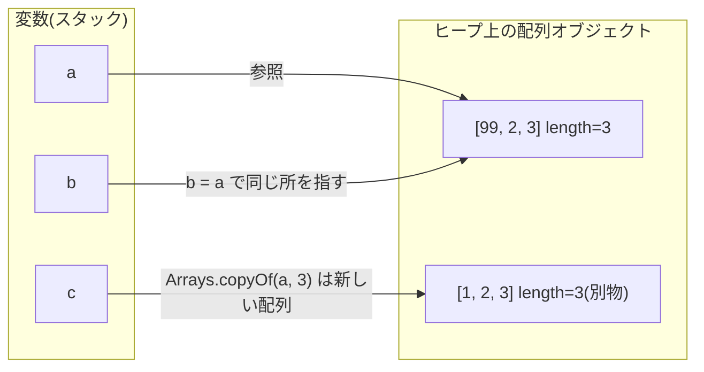

::: haru
先輩、1週間分の売上を変数に入れたいんですけど、`sales1`、`sales2`、…`sales7` って7個作ればいいですか?
:::

::: sensei
それ、1年分だと `sales365` まで作るの? 合計を出すコードも365個の足し算になるよ。こういうときに使うのが **配列** だね。
:::

::: haru
ループで回せるやつですね! 前回やった for と組み合わせるんだ。
:::

## 配列の基本:宣言・生成・初期化

**配列(array)** は、**同じ型の値を決まった個数だけ、連続した番号付きで並べたもの** です。一つひとつの値を **要素(element)**、要素の番号を **インデックス(index、添字)** と呼びます。インデックスは **0 から始まります**。

```java
int[] sales = new int[7];   // int を7個入れられる配列を「生成」して、変数 sales に入れる
sales[0] = 12000;           // 先頭(0番目)に代入
sales[6] = 31000;           // 最後(6番目)に代入
System.out.println(sales[0]);      // 12000
System.out.println(sales.length);  // 7
```

`int[]` は「int の配列」という **型** です。`new int[7]` で要素7個分の配列が実際に作られます。宣言と生成は分けて書くこともできます。

```java
int[] scores;            // 宣言だけ(まだ配列は存在しない)
scores = new int[3];     // ここで生成
```

最初から中身が決まっているなら **配列初期化子** `{ ... }` が便利です。要素数は数えて自動で決まります。

```java
int[] primes = {2, 3, 5, 7};                  // 宣言と同時なら {} だけでOK
String[] days = {"月", "火", "水"};
int[] later;
later = new int[]{1, 2, 3};                   // 宣言と別の行なら new int[] が必要
```

宣言と別の行で `later = {1, 2, 3};` と書くとコンパイルエラーになります。javac のメッセージは少し不親切です。

```text
error: illegal start of expression
    later = {1, 2, 3};
            ^
```

`new int[3]{1, 2, 3}` のように「サイズ指定」と「初期化子」を両方書くのもエラーです(`array creation with both dimension expression and initialization is illegal`)。サイズは中身から決まるので、二重指定は許されません。

### 要素の既定値

`new` で作った直後の要素には、型ごとの **既定値(デフォルト値)** が自動で入っています。ローカル変数は初期化しないと使えませんでしたが、配列の要素は必ず初期化済みです。

| 要素の型 | 既定値 |
|---|---|
| `int` / `long` / `short` / `byte` | `0` |
| `double` / `float` | `0.0` |
| `boolean` | `false` |
| `char` | `'\u0000'`(コード0の文字。表示しても見えない) |
| 参照型(`String` など) | `null` |

`String[] names = new String[3];` の直後は `[null, null, null]` です。空文字 `""` ではないので、`names[0].length()` を呼ぶと `NullPointerException` になります。

### length はフィールド

配列の要素数は `配列.length` で取れます。**カッコは付けません**。`length` はメソッドではなく、配列が持つ `final` なフィールド(値)だからです。

```text
error: cannot find symbol
    System.out.println(sales.length());
                            ^
  symbol:   method length()
  location: variable sales of type int[]
```

STS(Eclipse のコンパイラ)だと `Cannot invoke length() on the array type int[]` と表示されます。文字列の `"abc".length()` はメソッドなのでカッコが必要。ここは本当によく混ざります。

::: sensei
配列の長さは **生成したときに決まって、あとから変えられない**。これは後で大事になるから覚えておいて。
:::

::: trivia なぜ 0 から数えるのか
インデックスは「先頭から何個ぶんずれた位置か」という **オフセット** だと考えると自然です。先頭要素は0個ずれた位置なので `[0]`。C 言語以来の伝統で、Java もそれを引き継いでいます。
:::

## インデックスの範囲外アクセス

要素数 n の配列で使えるインデックスは **0 〜 n-1** です。範囲外を触ると、実行時に `ArrayIndexOutOfBoundsException` が発生します。

```java
int[] n = {10, 20, 30};
for (int i = 0; i <= n.length; i++) {   // <= になっている!
    System.out.println(n[i]);
}
```

```text
10
20
30
Exception in thread "main" java.lang.ArrayIndexOutOfBoundsException: Index 3 out of bounds for length 3
	at Main.main(Main.java:3)
```

メッセージに「インデックス3にアクセスしたが長さは3」と書いてあるので、読めばすぐ原因が分かります。**`i < n.length` が正解** で、`<=` は典型的な「1つ多すぎる」ミス(off-by-one エラー)です。

::: genba 例外メッセージは最後まで読む
`Index -1` なら「0 の手前まで戻りすぎ」、`Index 7 ... for length 7` なら「`<=` か `+1` が怪しい」。数字と、スタックトレースの `(Main.java:3)` の行番号を見るだけで当たりが付きます。
:::

**なぜ Java は例外にするのか。** C 言語では範囲外に書き込んでもチェックされず、隣のメモリを壊して「たまに変な値になる」バグや、セキュリティ上の穴(バッファオーバーフロー)の原因になってきました。Java の JVM は **配列アクセスのたびに範囲チェック** を行い、範囲外なら必ず例外で止めます。少しのコストと引き換えに「黙って壊れる」を防いでいるわけです(JIT コンパイラが不要なチェックを最適化で消すので、実用上の遅さはほぼ気になりません)。

## 配列をループで回す:for と拡張 for

配列はループと組み合わせて真価を発揮します。書き方は2通りあります。

```java
int[] sales = {12000, 8000, 15000};

// ① 普通の for:インデックスが使える
for (int i = 0; i < sales.length; i++) {
    System.out.println((i + 1) + "日目: " + sales[i]);
}

// ② 拡張 for 文(for-each):要素を先頭から1つずつ取り出す
for (int s : sales) {
    System.out.println(s);
}
```

拡張 for 文 `for (型 変数 : 配列)` は「配列の要素を先頭から順に変数に入れてループ」します。インデックスの書き間違いが起きないので、**読むだけなら拡張 for が第一候補** です。

ただし拡張 for の変数は **要素のコピー** です。代入しても配列の中身は変わりません。

```java
int[] prices = {100, 200, 300};
for (int p : prices) {
    p = p * 2;          // ローカル変数 p が変わるだけ
}
System.out.println(Arrays.toString(prices));  // [100, 200, 300] のまま!
```

| やりたいこと | 使うループ |
|---|---|
| 全要素を読むだけ(合計、表示、カウント) | 拡張 for |
| 要素を書き換える | 普通の for(`prices[i] = ...`) |
| 「何番目か」が必要(最大の日、見つかった位置) | 普通の for |
| 逆順・1つおき・隣の要素と比較 | 普通の for |

### 典型アルゴリズム

現場でも演習でも、この6つの型はそのまま何度も出てきます。

```java
int[] sales = {12000, 8000, 15000, 8000, 21000};

// 合計:long で受けるとオーバーフローしにくい
long total = 0;
for (int s : sales) total += s;

// 平均:double にキャストしてから割る(int同士の割り算は小数点以下が消える)
double avg = (double) total / sales.length;

// 最大値とその位置:初期値は「先頭要素」にする
int maxIndex = 0;
for (int i = 1; i < sales.length; i++) {
    if (sales[i] > sales[maxIndex]) maxIndex = i;
}

// 線形探索:先頭から順に探し、見つかったら break
int target = 8000, found = -1;          // -1 = 見つからなかった
for (int i = 0; i < sales.length; i++) {
    if (sales[i] == target) { found = i; break; }
}

// カウント:条件に合う要素を数える
int over10k = 0;
for (int s : sales) if (s >= 10000) over10k++;

// 逆順:新しい配列に後ろから詰める(元の配列は変えない)
int[] rev = new int[sales.length];
for (int i = 0; i < sales.length; i++) {
    rev[i] = sales[sales.length - 1 - i];
}
// total=64000, avg=12800.0, maxIndex=4, found=1, over10k=3, rev=[21000, 8000, 15000, 8000, 12000]
```

最大値の初期値を `0` にすると、全要素がマイナスの配列で間違えます。**「先頭要素を仮の最大」にする** のが定石です。ただしこの書き方は空配列だと `sales[0]` で例外になるので、空の可能性があるなら先に `length == 0` をチェックします。

## 配列は参照型:代入はコピーではない

ここがこのレッスンの山場です。

```java
int[] a = {1, 2, 3};
int[] b = a;        // 配列をコピーした……つもり
b[0] = 99;
System.out.println(a[0]);   // 99 !?
```

配列は **参照型** です。変数 `a` に入っているのは配列そのものではなく、**ヒープ領域にある配列オブジェクトを指す「参照」** です。`b = a` で複製されるのは参照の値だけなので、`a` と `b` は **同じ1つの配列** を指します。このように、1つのオブジェクトを複数の変数が指している状態を **エイリアス(別名)** と呼びます。



本当に別の配列が欲しいときは **コピーを作ります**。

```java
int[] a = {1, 2, 3};
int[] c = Arrays.copyOf(a, a.length);  // 新しい配列に中身をコピー
int[] d = a.clone();                   // これも新しい配列
int[] e = Arrays.copyOf(a, 5);         // 長くすると残りは既定値 → [1, 2, 3, 0, 0]
c[0] = 99;
System.out.println(a[0]);              // 1(元は無事)
```

::: sensei
ちなみに「Java は参照渡し」っていう説明はよく見るけど、正確じゃない。Java は常に **値渡し** で、配列の場合は「参照という値」がコピーされて渡るだけ。だから結果として同じ配列を触れる、ってこと。メソッドのレッスンでもう一度やるよ。
:::

### == で中身は比べられない

`==` は参照型に使うと「**同じオブジェクトを指しているか**」を比べます。中身が同じでも、別々に作った配列は `false` です。

```java
int[] x = {1, 2, 3};
int[] y = {1, 2, 3};
System.out.println(x == y);               // false(別の配列)
System.out.println(Arrays.equals(x, y));  // true(長さと全要素が等しい)
```

中身の比較は **`Arrays.equals`** を使います。`x.equals(y)` も `==` と同じ判定になるので注意(配列は `equals` を中身比較に作り替えていません)。

## Arrays クラスの便利メソッド

`java.util.Arrays` は配列を扱う道具箱です。ファイル先頭に `import java.util.Arrays;` を書いて使います(STS なら `Ctrl+Shift+O` で自動追加)。

```java
import java.util.Arrays;

int[] nums = {5, 3, 9, 1};
System.out.println(nums);                    // [I@659e0bfd ← 中身じゃない!
System.out.println(Arrays.toString(nums));   // [5, 3, 9, 1]

Arrays.sort(nums);                           // 昇順に並べ替え(元の配列を書き換える)
System.out.println(Arrays.toString(nums));   // [1, 3, 5, 9]

int[] flags = new int[4];
Arrays.fill(flags, -1);                      // 全要素を同じ値で埋める
System.out.println(Arrays.toString(flags));  // [-1, -1, -1, -1]
```

配列を `println` に直接渡すと `[I@659e0bfd` のような謎の文字列が出ます。`[I` は「int の配列」を表す JVM 内部の型名、`@` の後ろはハッシュ値(実行ごとに変わる)です。**中身を見たいときは `Arrays.toString`**、と体で覚えましょう。

`Arrays.sort` は **戻り値を返さず、渡した配列そのものを並べ替えます**。元の順番も残したいなら、先に `copyOf` でコピーしてからソートします。

## 二次元配列とジャグ配列

表のようなデータ(社員×曜日の勤務時間など)は **二次元配列** で表せます。Java の二次元配列の正体は **「配列の配列」** です。

```java
int[][] hours = {
    {8, 8, 7, 8, 9},   // 社員0
    {6, 6, 6},         // 社員1(パートで3日だけ)
    {8, 9, 8, 8, 8}    // 社員2
};
System.out.println(hours.length);      // 3(行の数)
System.out.println(hours[1].length);   // 3(社員1の列の数)
System.out.println(hours[2][1]);       // 9(社員2の2日目)

for (int i = 0; i < hours.length; i++) {
    int sum = 0;
    for (int h : hours[i]) sum += h;   // 行ごとに長さが違っても大丈夫
    System.out.println("社員" + i + ": " + sum + "時間");
}
System.out.println(Arrays.deepToString(hours));
// [[8, 8, 7, 8, 9], [6, 6, 6], [8, 9, 8, 8, 8]]
```

`hours[1]` だけ長さが違いますね。各行が独立した配列なので、**行ごとに長さがバラバラでもOK** です。こういう配列を **ジャグ配列(jagged array、ギザギザ配列)** と呼びます。だから内側のループは `hours[0].length` ではなく **`hours[i].length`** を使うのが鉄則です。

- `new int[3][5]` … 3行×5列をまとめて生成(全要素0)
- `new int[3][]` … 行の入れ物だけ生成。各行は `null` なので、`hours[0] = new int[5];` のように後から作る

`new int[3][]` のまま `hours[0].length` を読むと `NullPointerException: Cannot read the array length because "hours[0]" is null` になります。二次元配列の表示は `Arrays.toString` ではなく **`Arrays.deepToString`**、比較は **`Arrays.deepEquals`** です(`toString` だと `[[I@..., [I@...]` になる)。

::: warn clone と copyOf は「浅いコピー」
二次元配列に `clone()` を使うと、外側の配列だけが新しくなり、各行は元と **共有** されたままです。行の中身まで別にしたいなら、行ごとに `copyOf` しましょう。
:::

## 配列の長さは変えられない → だからコレクションがある

配列は生成時に長さが決まり、**後から伸び縮みできません**。`Arrays.copyOf(a, 10)` も「長い新しい配列を作って中身を写す」だけで、元の配列が伸びたわけではありません。

::: haru
じゃあ「お客さんが何人来るか分からない」みたいなときはどうするんですか?
:::

::: sensei
いい質問。そこで `ArrayList` みたいな **コレクション** の出番。要素を足すと自動で伸びてくれる。現場の業務コードは、配列より `List` を使うことのほうが多いよ。コレクションのレッスンでじっくりやろう。
:::

それでも配列を学ぶ価値は大きいです。`ArrayList` の中身は実は配列で、容量が足りなくなると「大きな配列を作ってコピー」を内部でやっています。`main(String[] args)` や `"a,b,c".split(",")` の戻り値など、標準APIのあちこちに配列が出てきますし、要素数が固定で速さが欲しい処理(画像のピクセル、バイト列)では今も配列が主役です。

## よくあるミス

::: warn 現場でよく見る配列のミス
- `i <= a.length` で最後に `ArrayIndexOutOfBoundsException` → `i < a.length`
- `a.length()` でコンパイルエラー → 配列は `length`、String は `length()`
- `println(a)` で `[I@1b6d3586` → `Arrays.toString(a)`
- `a == b` で中身を比較 → `Arrays.equals(a, b)`
- `int[] copy = a;` でコピーしたつもり → `Arrays.copyOf` か `clone()`
- 拡張 for の変数に代入して書き換えたつもり → 普通の for で `a[i] = ...`
- `total / a.length`(int同士)で平均の小数が消える → `(double) total / a.length`
:::

## まとめ

::: point このレッスンのポイント
- 配列は **同じ型の値を固定個数並べたもの**。`new int[5]` か `{1, 2, 3}` で作り、要素は既定値(0 / false / null)で初期化済み。
- インデックスは **0 〜 length-1**。範囲外は `ArrayIndexOutOfBoundsException`。メッセージの `Index 3 out of bounds for length 3` を読む。
- 要素数は `length`(フィールド、カッコなし)。
- 読むだけなら拡張 for、書き換え・位置が必要なら普通の for。
- 配列は **参照型**。代入は同じ配列を指すだけ。コピーは `Arrays.copyOf` / `clone()`、比較は `Arrays.equals`、表示は `Arrays.toString`。
- 二次元配列は「配列の配列」。行ごとに長さが違ってよい(ジャグ配列)。表示は `Arrays.deepToString`。
- 長さは変えられない。可変長が必要なら、後で学ぶ `List`(コレクション)を使う。
:::
