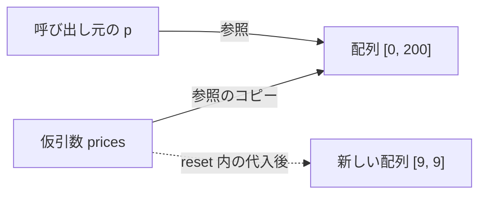

::: haru
先輩、`public static void main` の呪文、そろそろ意味を教えてくださいよ。
:::

::: sensei
今日が回収日。メソッドを自分で作れるようになると、あの呪文が全部読めるようになる。
:::

main に全部書くと、同じ計算のコピペが増えて追えなくなります。**メソッド** は「処理のまとまりに名前を付け、何度でも呼べるようにしたもの」です。

## メソッドの定義と呼び出し

```java
public class Invoice {
    // 税込金額を返すメソッド
    static int withTax(int price) {
        return price * 110 / 100;
    }

    public static void main(String[] args) {
        int a = withTax(1000);       // 呼び出し
        System.out.println(a);       // 1100
        System.out.println(withTax(250)); // 275
    }
}
```

| 部品 | 意味 |
|---|---|
| `int` | **戻り値の型**(返す値の型) |
| `withTax` | メソッド名(動詞で始める) |
| `(int price)` | **引数**(受け取る値の型と名前) |
| `return 式;` | 値を返してメソッドを終える |

定義側の `price` を **仮引数**、呼び出し側の `1000` を **実引数** と呼びます。実引数の値が仮引数にコピーされて本体が動き、`return` の値が呼び出し元に戻ります。値を返さないなら戻り値の型は **`void`**。引数の数・型・順番が合わなければコンパイルエラー(`cannot be applied to given types`)です。

### public static の正体

- **`public`** … アクセス修飾子。どのクラスからでも呼べる。
- **`static`** … メソッドが **クラスそのものに属する**。オブジェクトを作らずに `クラス名.メソッド名()` で呼べる。`Math.max(3, 5)` や `Arrays.toString(a)` が呼べたのはこれ。同じクラス内ならクラス名は省略可。
- **`main`** … JVM はオブジェクトを作らずに入口を呼ぶので、`static` が必須。

`static` を付け忘れたメソッドを main から呼ぶと、こう怒られます。

```text
error: non-static method greet() cannot be
  referenced from a static context
```

`static` のないメソッドは **インスタンスメソッド** といい、オブジェクトに属します。次の「クラスとオブジェクト」でやるので、今は「main から直接呼ぶなら `static`」で十分です。

## return と早期 return

戻り値の型があるメソッドは、**どの経路を通っても** `return` しなければなりません。

```java
static String judge(int score) {
    if (score >= 60) {
        return "合格";
    }
}   // error: missing return statement
```

60 点未満の経路で何も返さないからです。逆に `return` の直後に文を書くと `unreachable statement` エラーです。

`void` でも `return;` で途中終了できます(**ガード節**)。

```java
static void ship(int qty) {
    if (qty <= 0) {
        System.out.println("数量エラー");
        return;                 // ここで終了
    }
    System.out.println(qty + "個 出荷");
}
```

## オーバーロード

**引数の型・数・並び** が違えば、同じ名前のメソッドを複数定義できます(**オーバーロード**)。

```java
static int total(int price, int qty) {
    return total(price, qty, 0); // 多い版に委ねる
}
static int total(int price, int qty, int off) {
    return price * qty - off;
}
// total(500, 3) → 1500 / total(500, 3, 200) → 1300
```

どれを呼ぶかは実引数の型と数から **コンパイル時に** 決まります。`println` が int も String も受け取れるのも、オーバーロードされているからです。Java にはデフォルト引数がないので、「少ない版が多い版を呼ぶ」のが定番です。

戻り値の型だけが違うのは **NG** です。

```java
static int parse(String s) { ... }
static long parse(String s) { ... }
// error: method parse(String) is already defined
```

メソッドを区別するのは「名前+引数の型の並び」(**シグネチャ**)で、戻り値の型は含みません。`parse("1");` からはどちらか決められないからです。

## スコープとローカル変数

メソッド内で宣言した変数と仮引数は **ローカル変数** です。呼び出しのたびに作られ、`return` で消え、他のメソッドからは見えません(同名でも別物)。既定値がないので、代入前に読むと `variable x might not have been initialized` です。

## Java は値渡し

ここが山場です。Java の引数渡しは **常に値渡し(pass by value)**、つまり実引数の値をコピーして仮引数に入れます。

```java
static void addTen(int n) {
    n = n + 10;    // コピーを書き換えただけ
}
// main で
int x = 5;
addTen(x);
System.out.println(x);   // 5
```

配列などの参照型では、変数に入っているのは「参照」なので、**参照の値がコピー** されます。コピーも同じ配列を指すので、中身の書き換えは呼び出し元から見えます。

```java
static void clear(int[] prices) {
    prices[0] = 0;               // 指す先の中身を変更
}
static void reset(int[] prices) {
    prices = new int[]{9, 9};    // 仮引数に別の配列
}
// main で
int[] p = {100, 200};
clear(p);
System.out.println(Arrays.toString(p)); // [0, 200]
reset(p);
System.out.println(Arrays.toString(p)); // [0, 200]
```



`reset` の代入は、コピーである `prices` の向き先を変えただけ。`p` は元の配列を指したままです。もし **参照渡し** なら `p` まで新しい配列を指すはずなので、Java は参照渡しではありません。正確には「参照を値渡ししている」です。

::: haru
中身はいじれるけど、呼び出し元の変数そのものは差し替えられない、ってことっすね。
:::

## 可変長引数

`型...` と書くと、0個以上の引数を受け取れます(**可変長引数**)。

```java
static int sum(int... nums) {   // nums は int[]
    int total = 0;
    for (int n : nums) {
        total += n;
    }
    return total;
}
// sum() → 0 / sum(1, 2, 3) → 6
```

中身はただの配列で、コンパイラが呼び出し側で配列を作って渡します。置けるのは **1つだけ、最後の引数** です。

## 再帰の入口

メソッドが自分自身を呼ぶことを **再帰** といいます。階乗 n! = n × (n−1)! はそのまま書けます。

```java
static long factorial(int n) {
    if (n <= 1) {
        return 1;               // 終了条件
    }
    return n * factorial(n - 1);
}
// factorial(5) → 120
```

呼び出しのたびに JVM は **スタック** に「1回分の作業場(スタックフレーム:引数・ローカル変数・戻り先)」を積みます。終了条件を忘れると積み続けてあふれます。

```text
Exception in thread "main"
  java.lang.StackOverflowError
	at Main.factorial(Main.java:5)
	at Main.factorial(Main.java:5)
	...
```

既定の設定だと深さ数千〜数万で起きます。現場ではループで書けるものはループで書き、再帰はフォルダ階層のような **木構造** をたどるときに使います。

## 良いメソッドの条件

- **1つのことだけをする**。名前に `And` が入ったら分割の合図(`validateAndSave`)。
- **名前は動詞から**。`calcTax`、`findUser`。boolean を返すなら `isValid`、`hasStock`。
- **引数は少なく**。目安は3つまで。それ以上は設計を見直す(後でクラスにまとめる方法を学ぶ)。

::: sensei
長い main を見たら「この塊に名前を付けるなら?」と考えて切り出す。名前が付けられない塊は、たいてい2つ以上のことをしてる。
:::

::: point まとめ
- メソッドは `戻り値の型 名前(引数) { … }`。値を返さないなら `void`
- `static` はクラスに属するメソッド。オブジェクトなしで呼べるので main にも必須
- 戻り値ありのメソッドは **全経路で return**。ガード節で早期 return
- オーバーロードは引数の型・数・並びで区別。**戻り値の型だけの違いは不可**
- Java は **常に値渡し**。参照型は「参照の値」が渡るので中身は変えられるが、呼び出し元の変数は差し替えられない
- 可変長引数 `int...` の正体は配列。再帰は終了条件を忘れると `StackOverflowError`
:::

::: sensei
次は「文字列」。今日覚えた「メソッドを呼ぶ」感覚で、`String` の豊富なメソッドを使い倒すよ。
:::
