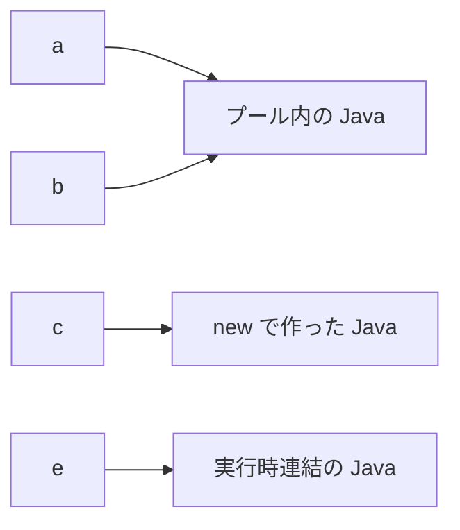

::: haru
文字列なんて `"…"` で囲んで `+` でつなぐだけっすよね?
:::

::: sensei
業務システムの入力・CSV・帳票、ぜんぶ文字列だよ。バグの温床ランキングでも常に上位。今日は「不変」「equals」「split」の3つで痛い目を見てもらう。
:::

`String` はクラス(参照型)です。`"abc"` と書くと `String` オブジェクトが作られ、変数にはその参照が入ります。前回学んだメソッドを、今回は `文字列.メソッド名()` の形で呼んでいきます。

## String は不変(immutable)

一度作った `String` の中身は **絶対に変わりません**。変換系のメソッドは、すべて **新しい String を返す** だけです。

```java
String s = "java";
s.toUpperCase();          // 結果を捨てている!
System.out.println(s);    // java
s = s.toUpperCase();      // 受け取って代入する
System.out.println(s);    // JAVA
```

`s.toUpperCase();` だけ書いてもコンパイルエラーにならないので、ハマる人が続出します。`replace`・`strip`・`substring` も同じです。

なぜ不変なのか。同じ文字列を複数の変数やスレッドで **安全に共有** できるからです。誰かが勝手に書き換える心配がないので、次の「文字列プール」で使い回せ、ファイルパスや接続先を渡しても途中で改ざんされません。

## == と equals、文字列プール

文字列の中身の比較は **`equals`**、大文字小文字を無視するなら **`equalsIgnoreCase`** です。`==` は「同じオブジェクトか」を比べます。

```java
String a = "Java";
String b = "Ja" + "va";        // コンパイル時に "Java" に
String c = new String("Java"); // 必ず新しいオブジェクト
String d = "Ja";
String e = d + "va";           // 実行時に連結
System.out.println(a == b);    // true
System.out.println(a == c);    // false
System.out.println(a == e);    // false
System.out.println(a.equals(e)); // true
```



ソースに書いたリテラルは JVM の **文字列プール** に1つだけ置かれ、使い回されます。`"Ja" + "va"` のような定数同士の連結もコンパイル時に `"Java"` になるのでプール行き。一方、`new String(...)` や実行時の連結は別オブジェクトです。入力やDBの値は常に後者なので、**文字列は必ず equals**。`new String("…")` は無駄なので、現場では書きません。

::: haru
リテラル同士だと `==` でも true になるから、テストをすり抜けちゃうんすね……。
:::

`null` かもしれない変数は、**固定値の側から** 呼ぶのが定石です。

```java
String rank = null;
"GOLD".equals(rank);   // false(安全)
rank.equals("GOLD");   // NullPointerException
```

## よく使うメソッド

インデックスは配列と同じく **0 始まり** です。

| 式 | 結果 |
|---|---|
| `"Hello".length()` | `5`(メソッドなので `()` 必須) |
| `"Hello".charAt(1)` | `'e'`(char 型) |
| `"Hello".substring(1, 3)` | `"el"`(終了位置は含まない) |
| `"Hello".indexOf("l")` | `2`(なければ `-1`) |
| `"Hello".contains("ell")` | `true` |
| `"EMP-001".startsWith("EMP-")` | `true` |
| `"a-b-c".replace("-", "/")` | `"a/b/c"`(全部置換) |
| `"ab".repeat(3)` | `"ababab"` |
| `"  ".isBlank()` | `true`(空白だけでも true) |

`substring(開始, 終了)` は「開始以上・終了未満」。範囲外だと例外です。

```text
java.lang.StringIndexOutOfBoundsException:
  Range [2, 5) out of bounds for length 3
```

### trim と strip

どちらも前後の空白を除きますが、`trim` は ASCII の空白(コード 32 以下)しか消しません。Java 11 の **`strip`** は全角スペースなど Unicode の空白も消します。日本語の入力を扱うなら `strip` 一択です。

```java
"　山田　".trim();   // "　山田　"(残る!)
"　山田　".strip();  // "山田"
```

### split は正規表現

```java
String[] cols = "A001,コーヒー,1200".split(",");
// cols[0]="A001" cols[1]="コーヒー" cols[2]="1200"
"a.b.c".split(".").length;    // 0 !?
"a.b.c".split("\\.").length;  // 3
```

`split` の引数は **正規表現** です。`.` は「任意の1文字」なので全部が区切りになり、空の要素は末尾から捨てられて 0 個。`.` や `|` で区切るときは `\\` でエスケープします。

## 書式:format / formatted / テキストブロック

```java
String.format("%-8s|%5d|%,10d円", "Coffee", 3, 1234567);
// "Coffee  |    3| 1,234,567円"
"%s さん %d 歳".formatted("ハル", 22);   // Java 15〜
```

| 指定 | 意味 |
|---|---|
| `%s` / `%d` | 文字列 / 整数 |
| `%5d` / `%-8s` | 幅5で右寄せ / 幅8で左寄せ |
| `%05d` | 0 埋め(`00042`) |
| `%,d` / `%.1f` | 3桁区切り / 小数1桁 |

複数行の文字列は **テキストブロック**(Java 15〜)が便利です。

```java
String mail = """
    %s 様
      ご注文ありがとうございます。
    """.formatted("山田");
```

閉じの `"""` の位置(または最も浅い行)を基準に、共通のインデントが自動で取り除かれます。`\n` を手書きする必要もありません。

## 連結:+、StringBuilder、String.join

1つの式の中の `+` は JDK 9 以降コンパイラが最適化するので、そのままで構いません。**ループで少しずつつなぐなら `StringBuilder`**(ループのレッスンで見たとおり、不変の String に `+=` すると毎回コピーが走る)。区切り文字でつなぐだけなら `String.join` が最短です。

```java
String.join(" / ", "東京", "大阪", "福岡");
// "東京 / 大阪 / 福岡"
```

## 文字列と数値の変換

```java
int qty = Integer.parseInt("42");      // 文字列 → int
String s = String.valueOf(qty);        // int → 文字列
Integer.parseInt(" 42");               // 例外!
```

```text
java.lang.NumberFormatException: For input string: " 42"
```

`parseInt` は前後の空白も `"1,000"` のカンマも許しません。CSV の値は **`strip()` してから parse** が現場の型です。例外を受け止める方法は「例外処理」のレッスンでやります。

## よくあるミス

**char と String を混ぜる**。`'E'`(シングルクォート)は `char`、`"E"`(ダブルクォート)は `String` で、別の型です。

```java
if (id.charAt(0) == "E") { }   // コンパイルエラー
if (id.charAt(0) == 'E') { }   // OK(char 同士は == で比較)
```

```text
error: bad operand types for binary operator '=='
  first type:  char
  second type: String
```

**length のカッコ**。配列は `arr.length`、String は `s.length()`。逆に書くと `cannot find symbol` です。

**ループの中で `s += …`**。動くけれど、件数が増えると急に遅くなります。レビューで真っ先に指摘されるので `StringBuilder` へ。

::: trivia char と Unicode
`char` は 16 ビットの UTF-16 の1単位で、正体は数値です。`'A' + 1` は `66`、`(char) ('A' + 1)` は `'B'`。「𠮷」のような一部の文字は char 2つ(**サロゲートペア**)で表すので、`"𠮷野家".length()` は 3 ではなく `4` になります。
:::

::: point まとめ
- String は **不変**。`s = s.toUpperCase();` のように戻り値を受け取る
- 中身の比較は `equals` / `equalsIgnoreCase`。null かもしれないなら `"固定値".equals(変数)`
- リテラルと定数連結はプールで共有、`new String` と実行時連結は別物。だから `==` は使わない
- `substring` の終了位置は含まない。`split` は正規表現(`.` は `\\.`)
- 日本語入力の空白除去は `trim` より `strip`
- 書式は `String.format` / `formatted`、複数行はテキストブロック
- ループ連結は `StringBuilder`、区切り連結は `String.join`
- `Integer.parseInt` は空白・カンマで `NumberFormatException`。先に `strip`
:::

::: sensei
次からはいよいよ「クラスとオブジェクト」。`String` みたいな「データ+メソッド」の型を、自分で作る番だよ。
:::
