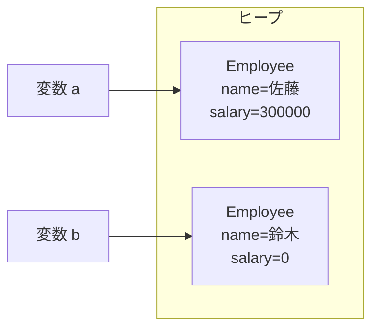

::: haru
先輩、社員データを配列3本で管理してたら、並べ替えた瞬間に名前と給料がズレました……。
:::

::: sensei
あるある。それは「1人分のデータ」がバラバラに散らばってるのが原因。今日はそれを1つの型にまとめる **クラス** の話だよ。
:::

前回の「文字列」で、`String` が `length()` や `equals()` を持つ **オブジェクト** だと見てきました。今回は、そういう型を自分で作ります。

## なぜクラスが要るのか

社員の名前・部署・給料を、配列で持つとこうなります。

```java
String[] names = {"佐藤", "鈴木", "高橋"};
String[] depts = {"営業", "開発", "営業"};
int[] salaries = {300000, 350000, 280000};
```

「i 番目の社員」は3本の配列の同じ位置に散らばっています。並べ替えや削除で1本だけ操作し忘れたら、データが壊れても誰も気づきません。項目が増えるたびに配列も引数も増えていきます。

**クラス** は、関連するデータ(と処理)をひとまとめにした **自作の型** です。

```java
class Employee {
    String name;     // フィールド
    String dept;
    int salary;
}
```

クラスの中で宣言した変数を **フィールド**(インスタンス変数)と呼びます。これで「社員1人」を `Employee` 型の値1個で扱えます。並べ替えても名前と給料は離れません。

クラス名は `Employee` のように **大文字始まりの名詞**(UpperCamelCase)にするのが Java の慣習です。また `public class` は1ファイルに1つまでで、ファイル名はそのクラス名と一致させる決まりです(`public class Employee` なら `Employee.java`)。コンパイラがクラス名からファイルを探せるようにするための仕様です。

## クラスとインスタンス

クラスは **設計図**、そこから `new` で作った実体を **インスタンス**(オブジェクト)と呼びます。

```java
Employee a = new Employee();
a.name = "佐藤";
a.salary = 300000;
Employee b = new Employee();
b.name = "鈴木";
System.out.println(b.salary); // 0
```

インスタンスはそれぞれ自分のフィールドを持ちます。`new` した直後のフィールドは、配列の要素と同じく **既定値**(数値は `0`、`boolean` は `false`、参照型は `null`)で初期化されています。

一方、メソッドの中の **ローカル変数** には既定値がなく、代入前に読むと `variable x might not have been initialized` というコンパイルエラーです。フィールドに既定値があるのは、JVM が `new` のときにメモリをゼロで埋めてから渡すから。ローカル変数は「入れ忘れ」をコンパイラが確実に検出できるので、あえてエラーにしています。

インスタンスは **ヒープ** という領域に作られ、変数 `a` に入っているのは実体ではなく **参照**(実体を指し示す値)です。どの変数からも参照されなくなったインスタンスは、JVM の **ガベージコレクション(GC)** が自動で片付けます。C++ の `delete` のような解放処理は書きません。



## コンストラクタと this

毎回フィールドに1つずつ代入するのは面倒だし、入れ忘れも起きます。そこで **コンストラクタ** を書きます。クラス名と同じ名前で、戻り値の型を書かない特別なブロックです。

```java
class Employee {
    String name;
    int salary;

    Employee(String name, int salary) {
        this.name = name;
        this.salary = salary;
    }
}

Employee a = new Employee("佐藤", 300000);
```

`new` は「①ヒープに領域を確保し既定値で埋める → ②コンストラクタを実行 → ③参照を返す」という順に動きます。

`this` は「今まさに処理しているインスタンス自身」への参照です。引数の `name` とフィールドの `name` が同名なので、フィールドの方を `this.name` と書いて区別します。

### オーバーロードと this(...)

引数の違うコンストラクタは複数書けます(**オーバーロード**)。共通処理は `this(...)` で別のコンストラクタに任せます。

```java
Employee(String name) {
    this(name, 200000); // 初任給で作る
}
```

`this(...)` は **コンストラクタの先頭の文** でなければなりません。途中に書くと `call to this must be first statement in constructor` です。

### デフォルトコンストラクタが消える罠

コンストラクタを1つも書かなければ、コンパイラが引数なしの **デフォルトコンストラクタ** を自動で用意します。しかし **1つでも書くと用意されなくなります**。

```text
error: constructor Employee in class Employee
  cannot be applied to given types;
  required: String,int
  found:    no arguments
```

`new Employee()` も使いたいなら、引数なしのコンストラクタを自分で書きます。

## インスタンスメソッドと static

クラスにはメソッドも書けます。`static` を付けないメソッドは **インスタンスメソッド** で、「どのインスタンスに対して呼んだか」によって `this` が変わります。

```java
class Employee {
    String name;
    int salary;
    static int count = 0; // クラスに1つだけ

    Employee(String name, int salary) {
        this.name = name;
        this.salary = salary;
        count++;
    }
    void raise(int amount) {
        salary += amount; // this.salary と同じ
    }
}
```

`a.raise(10000)` なら `a` の、`b.raise(10000)` なら `b` の給料が上がります。一方 `static` のフィールドやメソッドはインスタンスではなく **クラスに属し**、全インスタンスで1つを共有します。呼ぶときは `Employee.count` のようにクラス名で書きます。

`static` メソッドには `this` がないので、インスタンスのフィールドを直接触れません。`main` から書くとよく出るエラーです。

```text
error: non-static variable count cannot be referenced
  from a static context
```

::: sensei
目安は「インスタンスの状態を使う処理はインスタンスメソッド、使わない計算は static」。`Math.max` みたいにね。
:::

## 参照の代入と null

```java
Employee a = new Employee("佐藤", 300000);
Employee b = a;      // 参照をコピーしただけ
b.salary = 999999;
System.out.println(a.salary); // 999999
```

代入でコピーされるのは **参照の値** で、インスタンスは1つのままです。`a` と `b` は同じ実体を指す **エイリアス**(別名)になります。`a == b` が `true` になるのも「同じインスタンスを指しているか」を比べているからです。

メソッドの引数も同じです。Java は常に **値渡し** ですが、渡る「値」が参照なので、メソッド内でフィールドを変えると呼び出し元からも見えます。ただし引数の変数に別のインスタンスを代入しても、呼び出し元の変数は変わりません。

```java
static void reset(Employee e) {
    e.salary = 0;            // 呼び出し元のインスタンスが変わる
    e = new Employee("仮", 1); // 引数 e の向き先が変わるだけ
}
```

::: haru
フィールドが変わるなら、Java って「参照渡し」なんすね!
:::

::: sensei
惜しい、値渡し。渡っているのは参照の「コピー」だ。本物の参照渡し(C++ の `&` や C# の `ref`)なら、2行目の代入で呼び出し元の変数まで差し替わる。Java ではそうならない。
:::

どこも指していない参照が **`null`** です。`null` のフィールドやメソッドを使うと `NullPointerException`(NPE)が起きます。オブジェクトの配列は、作った直後は全要素が `null` なので要注意です。

```java
Employee[] staff = new Employee[3];
staff[0].raise(1000);
```

```text
Exception in thread "main"
  java.lang.NullPointerException:
  Cannot invoke "Employee.raise(int)"
  because "staff[0]" is null
```

Java 14 以降はこのように「何が null だったか」まで教えてくれます(Helpful NullPointerExceptions)。

## toString で中身を表示する

インスタンスをそのまま `println` すると `Employee@2a139a55` のような表示になります。`クラス名@ハッシュ値` という既定の形式です。中身を出したいなら **`toString` メソッドを上書き(オーバーライド)** します。

```java
@Override
public String toString() {
    return name + "(" + salary + "円)";
}
```

`println` や文字列連結は内部で `toString()` を呼ぶので、`佐藤(300000円)` と出るようになります。`@Override` と `public` の意味は「継承」と「カプセル化」のレッスンで説明します。

::: genba 手書きしないで生成する
コンストラクタや `toString` は、STS ならエディタ上で右クリック →「ソース」→「フィールドを使用してコンストラクターを生成」「toString() を生成」で一発です。手書きは `this.` の付け忘れなど凡ミスの元。ログに出したときに中身が読めるよう、業務クラスには `toString` を用意しておくのが現場の定番です。
:::

::: warn よくあるミス
- `name = name;` と書いて **フィールドに入らない**(引数に引数を代入しているだけ。フィールドは `null` のまま)→ `this.name = name;`
- コンストラクタに `void` を付けて **ただのメソッドになる**(`void Employee(...)` はコンストラクタではない)
- `Employee[]` を作っただけで要素も作ったつもり → 各要素に `new` が必要
:::

::: point まとめ
- クラスは関連するデータと処理をまとめた **自作の型**。`new` で作った実体が **インスタンス**
- フィールドは既定値(0 / false / null)で初期化される
- コンストラクタで初期値を受け取る。`this.x = x` でフィールドと引数を区別、`this(...)` は先頭に
- コンストラクタを1つでも書くと **デフォルトコンストラクタは消える**
- `static` はクラスに1つ。static メソッドからインスタンスのフィールドは直接使えない
- 変数に入っているのは **参照**。代入はエイリアスを作るだけ。`null` を使うと NPE
- 表示用には `toString` をオーバーライドする
:::

::: sensei
ただ、今のままだと `a.salary = -1;` も外から書けちゃう。次の「カプセル化」で、それを防ぐ方法をやろう。
:::
