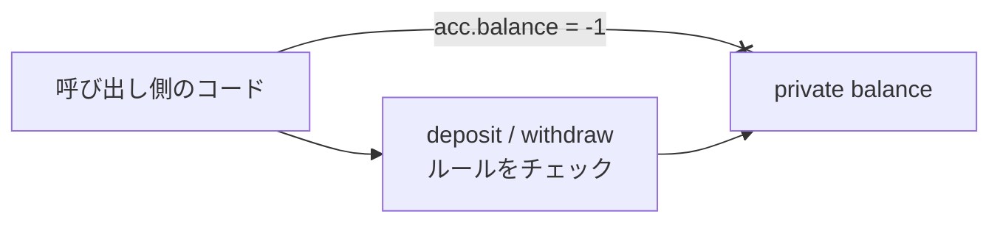

::: haru
先輩、口座クラスの残高がマイナス100万円になってます! 誰かが `acc.balance = -1000000;` って書いてました……。
:::

::: sensei
書けちゃう作りにしたのが悪い。今日は「そもそも書けないようにする」**カプセル化** の話だ。
:::

前回の「クラスとオブジェクト」で作ったクラスは、フィールドを外から自由に書き換えられました。つまり、どこからでも壊せます。

## カプセル化とは

**カプセル化** とは、オブジェクトの内部データを外から直接触らせず、決められた操作(メソッド)を通してだけ変更させる設計のことです。

目的は **不変条件(invariant)** を守ること。不変条件とは「そのオブジェクトで常に成り立つべきルール」で、口座なら「残高は0以上」です。



外から直接は触れず、ルールをチェックする窓口を必ず通る。これがカプセル化の形です。

## アクセス修飾子

Java では、フィールド・メソッド・コンストラクタに **アクセス修飾子** を付けて、見える範囲を制御します。

| 修飾子 | 見える範囲 | 主な用途 |
|---|---|---|
| `public` | どこからでも | 外に公開する操作 |
| `protected` | 同じパッケージ + サブクラス | 継承向けの部品 |
| なし | 同じパッケージだけ | パッケージ内の部品 |
| `private` | そのクラスの中だけ | フィールド・内部処理 |

修飾子なしは **パッケージプライベート** と呼ばれます。`protected` は「継承」のレッスンで改めて扱います。基本方針は **「フィールドは private、公開は必要最小限」** です。

```java
class Account {
    private int balance;
}
```

外から `acc.balance = -1;` と書くと、コンパイルの時点で止まります。

```text
error: balance has private access in Account
(日本語環境: balanceはAccountでprivateアクセスされます)
```

## getter / setter と「本当のカプセル化」

private にしたフィールドを読ませるには **getter**(`getXxx`。`boolean` なら `isXxx`)を用意します。

```java
public int getBalance() {
    return balance;
}
```

「public フィールドと何が違うの?」と思うかもしれませんが、getter を挟んでおけば、後で内部の持ち方(たとえば `int` を `long` に、あるいは明細から計算する方式に)を変えても、使う側のコードを1行も直さずに済みます。**外に約束するのはメソッドだけ、中身はいつでも変えられる**――これも隠す理由の1つです。

では書き換えは setter で……と、こう書くのはNGです。

```java
public void setBalance(int balance) {
    this.balance = balance; // -1000000 も入る
}
```

これでは `acc.balance = -1000000` が `acc.setBalance(-1000000)` になっただけ。**全フィールドに getter/setter を付けるのはカプセル化ではありません。** 公開すべきは「業務上の操作」で、その中で不変条件を守ります。

```java
public boolean withdraw(int amount) {
    if (amount <= 0 || amount > balance) {
        return false;   // ルール違反は受け付けない
    }
    balance -= amount;
    return true;
}
```

残高を変える道が `deposit` と `withdraw` だけなら、残高のバグを探す場所はこの2つに限られます。

::: haru
でも setter がないと、値を変えたいとき不便じゃないっすか?
:::

::: sensei
変えたい「理由」ごとにメソッドを作るんだ。`setStatus` じゃなくて `cancel()` や `ship()`。メソッド名がそのまま業務の仕様書になるし、ルールも1か所にまとまる。
:::

## コンストラクタで不正な値をはじく

不変条件は「作った瞬間」から守る必要があります。不正な引数はコンストラクタで **例外を投げて** 拒否します。

```java
public Account(int initial) {
    if (initial < 0) {
        throw new IllegalArgumentException(
            "初期残高は0以上: " + initial);
    }
    this.balance = initial;
}
```

`throw` すると処理はそこで中断し、インスタンスは作られません。`IllegalArgumentException` は「引数が不正」を表す標準の例外です。例外の仕組みは「例外処理」のレッスンで詳しくやります。

```text
Exception in thread "main"
  java.lang.IllegalArgumentException: 初期残高は0以上: -500
```

::: sensei
変な値は入口で即エラー。これを **フェイルファスト** って言う。間違った値を抱えたまま進むと、壊れた場所と気づく場所が離れて調査が地獄になるんだ。
:::

## final と不変オブジェクト

フィールドに **`final`** を付けると、コンストラクタで1回代入したら二度と変えられません。全フィールドが `final` で、状態を変えるメソッドがないクラスを **不変(イミュータブル)オブジェクト** と呼びます。

```java
final class Money {
    private final int amount;

    Money(int amount) {
        if (amount < 0) {
            throw new IllegalArgumentException(
                "金額は0以上: " + amount);
        }
        this.amount = amount;
    }
    Money plus(Money other) {
        return new Money(amount + other.amount);
    }
    int getAmount() { return amount; }
}
```

`plus` は自分を書き換えず、**新しいインスタンスを返します**。`String` も不変で、`s.toUpperCase()` が `s` を変えないのはこのためです。不変オブジェクトは共有しても勝手に変わらないので、安心して渡せて、複数スレッドから使っても壊れません。クラスの `final` は「継承禁止」で、サブクラスに不変性を崩させないためです。

ただし `final` が守るのは **変数の中身(参照)** だけです。`private final int[] scores;` でも、配列の **中身** は書き換えられます。

## 防御的コピー

配列のような変更可能なオブジェクトをフィールドに持つときは要注意です。

```java
class ScoreBook {
    private final int[] scores;
    ScoreBook(int[] scores) {
        this.scores = scores;
    }
    int[] getScores() { return scores; }
}

ScoreBook book = new ScoreBook(new int[] {80, 90});
book.getScores()[0] = 0;  // 中身が書き換わる!
```

getter が返したのは内部の配列への参照なので、外から書き換え放題です。コンストラクタに渡した元の配列を後で変えても同じです。対策は **受け取るときと渡すときにコピーする** こと。これを **防御的コピー** と呼びます。

```java
ScoreBook(int[] scores) {
    this.scores = scores.clone();
}
int[] getScores() { return scores.clone(); }
```

## パッケージと equals

**パッケージ** はクラスを入れるフォルダのような名前空間です。ファイル先頭に `package com.example.bank;` と書き、ソースは `com/example/bank/` に置きます。名前は世界で重複しないよう、自社ドメインを逆さにしたもの(`example.com` → `com.example`)で始めるのが慣習です。別パッケージのクラスは `import java.util.Arrays;` のように取り込んで使います。同名クラスの衝突を防ぐほか、修飾子なしのメンバーは **パッケージの外から見えない** ので、内部の部品を隠す境界にもなります。演習のパッケージなし(デフォルトパッケージ)は学習用です。

<figure class="figure"><svg viewBox="0 0 600 210" xmlns="http://www.w3.org/2000/svg" font-family="inherit"><text x="20" y="26" font-size="14" fill="var(--ink-muted)">ディスク上のフォルダ</text><rect x="20" y="38" width="230" height="150" rx="10" fill="var(--surface-2)" stroke="var(--line)" stroke-width="2"/><text x="36" y="64" font-size="14" fill="var(--ink)">src/</text><text x="52" y="88" font-size="14" fill="var(--ink)">com/</text><text x="68" y="112" font-size="14" fill="var(--ink)">example/</text><text x="84" y="136" font-size="14" fill="var(--ink)">shop/</text><text x="100" y="160" font-size="14" font-weight="700" fill="var(--accent)">Order.java</text><text x="100" y="180" font-size="14" fill="var(--ink)">OrderService.java</text><path d="M262 112 L318 112" stroke="var(--accent)" stroke-width="2.5" marker-end="url(#java-encapsulation-arrow11a)"/><defs><marker id="java-encapsulation-arrow11a" markerWidth="10" markerHeight="10" refX="8" refY="5" orient="auto"><path d="M0 0 L10 5 L0 10 z" fill="var(--accent)"/></marker></defs><text x="330" y="26" font-size="14" fill="var(--ink-muted)">Java から見た名前</text><rect x="330" y="38" width="250" height="60" rx="10" fill="var(--accent-soft)" stroke="var(--ink)" stroke-width="2"/><text x="345" y="62" font-size="13" fill="var(--ink-muted)">パッケージ名(フォルダを . でつなぐ)</text><text x="345" y="84" font-size="15" font-weight="700" fill="var(--ink)">com.example.shop</text><rect x="330" y="112" width="250" height="76" rx="10" fill="var(--accent-soft)" stroke="var(--ink)" stroke-width="2"/><text x="345" y="136" font-size="13" fill="var(--ink-muted)">完全修飾名(パッケージ + クラス)</text><text x="345" y="160" font-size="15" font-weight="700" fill="var(--ink)">com.example.shop.Order</text><text x="345" y="180" font-size="13" fill="var(--ink-muted)">「名字 + 名前」でクラスを一意に指す</text></svg><figcaption>フォルダの階層がそのままパッケージ名になり、パッケージ名 + クラス名が完全修飾名になる</figcaption></figure>

パッケージ名とクラス名をつないだ `com.example.shop.Order` を **完全修飾名** と呼びます。エラーメッセージやログにはこの形で出るので、「どこの何というクラスか」をここから読み取ります。なお `String` や `Math` を import せずに使えるのは、`java.lang` パッケージだけは自動で import 済みの扱いだからです。また `import java.util.*;` の `*` は **そのパッケージ直下だけ** が対象で、`java.util.stream.Stream` のようなサブパッケージのクラスは含みません。

もう1つ。不変な値クラスを作ると、中身で比べたくなります。

```java
Money a = new Money(100);
Money b = new Money(100);
System.out.println(a == b);      // false
System.out.println(a.equals(b)); // false !
```

`equals` を定義しないと、`Object` から受け継いだ「同じインスタンスか」(`==` と同じ)で比べます。中身で比べるには `equals` と **`hashCode`** をセットでオーバーライドします。書き方はコレクションのレッスンで扱います。

::: genba 「@Data 付けときました」
Lombok の `@Data` は getter/setter/equals などを自動生成する便利な注釈。でも全フィールドに **setter まで生える** ので、「private なのに何でも書き換えられる」クラスの完成です。必要な `@Getter` だけ付けるのが現場の作法。
:::

::: haru
現場のコードで `acc.getBalance()` を呼んでるのに、`Account.java` のどこにも `getBalance` が書いてないことがあって……。
:::

::: sensei
クラスに `@Getter` が付いてたら Lombok の仕業だ。Lombok は **コンパイルの途中で** メソッドを足すライブラリで、ソースファイルは短いまま、出来上がった `.class` にだけ getter が入る。書き忘れでもバグでもないから、まずクラスの頭のアノテーションを見るといい。
:::

<figure class="figure"><svg viewBox="0 0 600 190" xmlns="http://www.w3.org/2000/svg" font-family="inherit"><defs><marker id="java-encapsulation-ar30a" markerWidth="10" markerHeight="10" refX="8" refY="5" orient="auto"><path d="M0 0 L10 5 L0 10 z" fill="var(--accent)"/></marker></defs><rect x="10" y="55" width="170" height="90" rx="10" fill="var(--accent-soft)" stroke="var(--ink)" stroke-width="2"/><text x="95" y="80" font-size="13" font-weight="700" text-anchor="middle" fill="var(--ink)">Account.java</text><text x="95" y="100" font-size="11" text-anchor="middle" fill="var(--ink-muted)">@Getter @Setter</text><text x="95" y="116" font-size="11" text-anchor="middle" fill="var(--ink-muted)">フィールド2〜3個だけ</text><path d="M180 100 L215 100" stroke="var(--accent)" stroke-width="2.5" marker-end="url(#java-encapsulation-ar30a)"/><rect x="220" y="55" width="170" height="90" rx="10" fill="var(--surface-2)" stroke="var(--line)" stroke-width="2" stroke-dasharray="5 3"/><text x="305" y="85" font-size="12" font-weight="700" text-anchor="middle" fill="var(--ink)">javac + lombok.jar</text><text x="305" y="105" font-size="11" text-anchor="middle" fill="var(--ink-muted)">アノテーションを見て</text><text x="305" y="121" font-size="11" text-anchor="middle" fill="var(--ink-muted)">コードを追加生成</text><path d="M390 100 L425 100" stroke="var(--accent)" stroke-width="2.5" marker-end="url(#java-encapsulation-ar30a)"/><rect x="430" y="45" width="165" height="110" rx="10" fill="var(--accent-soft)" stroke="var(--ink)" stroke-width="2"/><text x="512" y="70" font-size="12" font-weight="700" text-anchor="middle" fill="var(--ink)">Account.class</text><text x="512" y="90" font-size="11" text-anchor="middle" fill="var(--ink-muted)">getBalance()</text><text x="512" y="106" font-size="11" text-anchor="middle" fill="var(--ink-muted)">setBalance(...)</text><text x="512" y="122" font-size="11" text-anchor="middle" fill="var(--ink-muted)">…実際に呼ばれるのはこちら</text><text x="300" y="178" font-size="12" text-anchor="middle" fill="var(--ink-muted)">ソースファイルの見た目は変わらない。増えるのはコンパイル後の中身</text></svg><figcaption>Lombok はコンパイル時にメソッドを足す。ソースには見えないが .class には入っている</figcaption></figure>

::: warn よくあるミス
- 「とりあえず全部 public」「とりあえず全部 getter/setter」→ 不変条件を守る操作だけ公開する
- 配列やリストを getter でそのまま返す → コピーを返す
- `final` を付けたから中身も不変、と思い込む → `final` は参照の付け替えを禁じるだけ
:::

::: point まとめ
- カプセル化 = 内部を隠し、**不変条件を守る操作だけを公開する** こと
- アクセス修飾子は `public` / `protected` / なし / `private`。フィールドは private が基本
- setter の乱造はカプセル化ではない。`withdraw` のような業務の操作を公開する
- 不正な引数はコンストラクタで `IllegalArgumentException` を投げて拒否(フェイルファスト)
- `final` フィールド + 変更メソッドなし = 不変オブジェクト。変更したいときは新しいインスタンスを返す
- 変更可能なオブジェクトは **防御的コピー** で受け取り・渡す
- 中身で比べたい値クラスは `equals` と `hashCode` をオーバーライドする(詳細はコレクションで)
:::

::: sensei
次は「継承」。今日ちらっと出た `protected` や、クラスの `final` の意味がつながってくるよ。
:::
