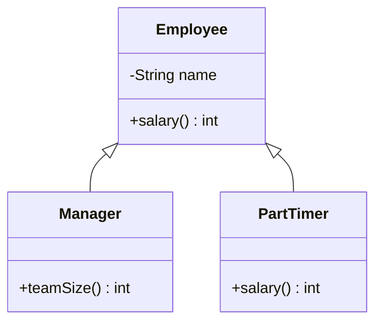

::: haru
継承って「親のコードを子が全部もらえる」やつですよね? コピペ不要とか最高じゃないすか!
:::

::: sensei
半分正解、半分危険。使いどころを間違えると一番ほどきにくい設計ミスになる。今日は「使わない判断」までセットだ。
:::

前回の「カプセル化」に続き、今回は既存のクラスを土台に新しいクラスを作る **継承(inheritance)** です。

## extends と is-a 関係

```java
class Employee {
    private final String name;
    Employee(String name) { this.name = name; }
    String getName() { return name; }
    int salary() { return 200_000; }
}

class Manager extends Employee {
    Manager(String name) { super(name); }
    int teamSize() { return 5; }
}
```

`class 子 extends 親` で、子クラス(**サブクラス**)は親クラス(**スーパークラス**)のフィールドとメソッドを引き継ぎます。`new Manager("佐藤").getName()` は Manager に書いていないのに呼べます。

ただし `private` メンバーは、子のオブジェクトの中に **存在はするが子のコードからは直接触れません**(`getName()` 経由で使う)。また **コンストラクタは継承されません**。

継承してよいのは「子 **is-a** 親(子は親の一種)」が自然に言えるときだけ。「マネージャーは社員の一種」は OK、「社員はロガーの一種」は NG です。

白抜き三角の矢印が「継承(子 → 親)」です。



## コンストラクタは「親から先に」

子のコンストラクタは、最初に必ず親のコンストラクタを呼びます。それを書くのが `super(...)` です。

```java
class A {
    A() { System.out.println("A"); }
}
class B extends A {
    B() {
        super();  // 省略しても自動で挿入される
        System.out.println("B");
    }
}
class C extends B {
    C() { System.out.println("C"); }
}
new C();  // 出力: A → B → C
```

`super(...)` はコンストラクタの **先頭** に書きます。省略すると引数なしの `super()` が自動挿入されるので、親に引数なしコンストラクタがないとエラーです。

```java
class Manager extends Employee {
    Manager() { }  // 自動の super() → Employee() がない!
}
```

```text
error: constructor Employee in class Employee
  cannot be applied to given types;
```

親が先なのは、子が親の部分を土台にしているから。土台の初期化前に子の処理が走ると、未初期化の状態を触ってしまいます。

## オーバーライドと @Override

親と **同じシグネチャ(名前+引数の型)** のメソッドを子で定義し直すことを **オーバーライド(override)** と呼びます。

```java
class PartTimer extends Employee {
    private final int hours;
    PartTimer(String name, int hours) {
        super(name);
        this.hours = hours;
    }
    @Override
    int salary() { return hours * 1_200; }
}
```

`@Override` は「上書きするつもりです」とコンパイラに伝える **アノテーション** です。省略しても動きますが、現場では **必ず付けます**。理由はこれ。

```java
int salaly() { return hours * 1_200; } // typo!
```

これは「新メソッド `salaly` の追加」として通ってしまい、`salary()` は親の 200000 を返します。パートさんに月20万円払う事故です。`@Override` があればコンパイルで止まります。

```text
error: method does not override or implement
  a method from a supertype
```

なお、オーバーライドでアクセス範囲を **親より狭くはできません**(public → private など)。

### super.メソッド() で親の処理を再利用

```java
@Override
int salary() {
    return super.salary() + 50_000; // 親の計算+役職手当
}
```

`super.` を付け忘れて `salary()` と書くと自分自身を呼び続け、`StackOverflowError` で落ちます。

## protected / final / Object

| 修飾子 | 見える範囲 |
|---|---|
| `public` | どこからでも |
| `protected` | 同じパッケージ+別パッケージの子クラス |
| (なし) | 同じパッケージだけ |
| `private` | そのクラスの中だけ |

`protected` は **同じパッケージからも見えます**。現場ではフィールドは `private` のまま、必要なら protected メソッドで子に公開します。

`final class` は継承できず、`final` メソッドはオーバーライドできません。`String` は final で、`extends String` は `cannot inherit from final String`。上書きされると不変性やセキュリティの前提が崩れるからです。

`extends` を書かないクラスは自動的に **`java.lang.Object`** を継承します。だから全オブジェクトが `toString()` や `equals()` を持っています。

```java
class Point {
    private final int x, y;
    Point(int x, int y) { this.x = x; this.y = y; }
}
var p = new Point(1, 2);
System.out.println(p);  // Point@4e50df2e のような表示
System.out.println(p.equals(new Point(1, 2))); // false
```

Object の `toString()` は「クラス名@ハッシュ値」、`equals()` は `==` と同じ判定です。中身で比べたいならオーバーライドします。

```java
@Override
public String toString() {
    return "Point(" + x + ", " + y + ")";
}
@Override
public boolean equals(Object o) {
    if (!(o instanceof Point)) {
        return false;
    }
    Point other = (Point) o;  // キャストは次回詳しく
    return x == other.x && y == other.y;
}
@Override
public int hashCode() {
    return java.util.Objects.hash(x, y);
}
```

引数は必ず `Object` 型。`equals(Point o)` と書くと **オーバーロード(別メソッドの追加)** になり上書きされません(これも `@Override` が検出)。`equals` を変えたら **`hashCode` もセットで** 上書きするのが鉄則です(HashMap などが誤動作するため。コレクションの章で)。

Java のクラスの親は **1つだけ**(単一継承)です。2つの親が同名メソッドを持つと曖昧になる「ダイヤモンド問題」を避ける設計で、複数の型を名乗りたいときは後で学ぶ **インターフェース** を使います。

## オーバーロードとオーバーライド

| | オーバーロード | オーバーライド |
|---|---|---|
| 何をする | 同名・引数違いを **追加** | 親のメソッドを **上書き** |
| シグネチャ | 引数の型・数が違う | 完全に同じ |
| 選ばれる時 | コンパイル時 | 実行時(次回) |

## 継承より委譲(コンポジション)

::: haru
ログを使いたいんで `OrderService extends Logger` にしました!
:::

::: sensei
それは「注文サービスはロガーの一種」という宣言だ。部品として **持てば** いい。
:::

```java
class OrderService {
    private final Logger logger = new Logger();
    void order(String item) {
        logger.info("注文: " + item); // 仕事を任せる
    }
}
```

部品をフィールドに持ち仕事を任せることを **委譲(delegation)**、部品の組み合わせでクラスを作ることを **コンポジション** と呼びます。現場の原則は **「継承より委譲」**。継承には弱点があるからです。

- 子が親の **実装の細部** に依存し、親の修正が全部の子を壊しうる(壊れやすい基底クラス問題)
- 親の public メソッドが子の API に全部漏れる
- 単一継承なので親は一度しか選べない

継承を使ってよいのは、**本当に is-a で、親が継承前提で設計されている** とき。自チームで管理する社員クラスの階層、自作の例外クラス(例外処理の章で)、フレームワークが継承を指定している場合などです。

::: point まとめ
- `extends` は **is-a が言えるときだけ**。コンストラクタは継承されない
- 子は先頭で `super(...)`(省略時は `super()` 自動挿入)。**親→子の順** に初期化
- オーバーライドには **必ず `@Override`**。typo や `equals(Point)` を検出できる
- `protected` は同じパッケージにも見える。`final` は継承/上書き禁止
- 全クラスの祖先は `Object`。`equals(Object)` と `hashCode` はセットで上書き
- 迷ったら **継承より委譲**
:::

::: sensei
次は「ポリモーフィズム」。継承が本領を発揮するのはそこからだ。
:::
