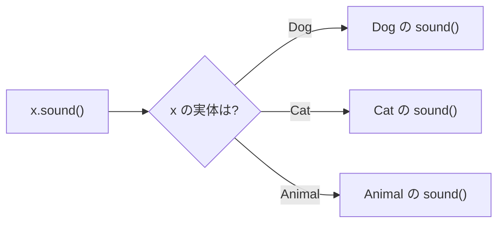

::: haru
給与計算なんて `if (パートなら) … else if (マネージャーなら) …` で書けば済みません?
:::

::: sensei
社員の種類が10個に増えたら、その if をシステム中で直して回ることになるぞ。今日はその if を「消す」技だ。
:::

前回の「継承」で、子クラスが親のメソッドをオーバーライドできることを学びました。それが本領を発揮するのが **ポリモーフィズム(polymorphism、多態性)** です。

## 親の型の変数に、子のインスタンス

```java
class Animal {
    String sound() { return "……"; }
}
class Dog extends Animal {
    @Override
    String sound() { return "ワン"; }
    void fetch() { System.out.println("取ってきた"); }
}
class Cat extends Animal {
    @Override
    String sound() { return "ニャー"; }
}

Animal a = new Dog();  // 親の型の変数に子を代入
System.out.println(a.sound());  // ワン
```

Dog は Animal の一種(is-a)なので、`Animal` 型の変数に入れられます。ここで2つの「型」を区別してください。

- **変数の型(静的な型)**:`Animal`。コンパイラが見る型で、**呼べるメソッドを決める**
- **実体の型(実行時の型)**:`Dog`。`new` したクラスで、**実際に動くメソッドを決める**

だから `a.fetch()` はコンパイルエラーです。実体は Dog でも、コンパイラは「`a` は Animal」としか知りません。

```text
error: cannot find symbol
  symbol:   method fetch()
  location: variable a of type Animal
```

<figure class="figure"><svg viewBox="0 0 600 240" xmlns="http://www.w3.org/2000/svg" font-family="inherit"><defs><marker id="java-polymorphism-arr10c" markerWidth="10" markerHeight="10" refX="8" refY="5" orient="auto"><path d="M0 0 L10 5 L0 10 z" fill="var(--accent)"/></marker></defs><text x="20" y="26" font-size="14" fill="var(--ink-muted)">Animal a = new Dog();</text><rect x="20" y="44" width="200" height="120" rx="12" fill="var(--accent-soft)" stroke="var(--ink)" stroke-width="2"/><text x="120" y="68" font-size="15" font-weight="700" text-anchor="middle" fill="var(--ink)">変数 a(型: Animal)</text><text x="120" y="96" font-size="13" text-anchor="middle" fill="var(--ink)">呼べるメソッド:</text><text x="120" y="116" font-size="13" text-anchor="middle" fill="var(--ink)">sound() のみ</text><text x="120" y="146" font-size="12" text-anchor="middle" fill="var(--ink-muted)">コンパイル時にここを見る</text><path d="M224 104 L346 104" stroke="var(--accent)" stroke-width="2.5" marker-end="url(#java-polymorphism-arr10c)"/><text x="285" y="94" font-size="12" text-anchor="middle" fill="var(--ink-muted)">参照</text><rect x="350" y="44" width="230" height="120" rx="12" fill="var(--surface-2)" stroke="var(--ink)" stroke-width="2"/><text x="465" y="68" font-size="15" font-weight="700" text-anchor="middle" fill="var(--ink)">実体(型: Dog)</text><text x="465" y="96" font-size="13" text-anchor="middle" fill="var(--ink)">sound() → ワン</text><text x="465" y="116" font-size="13" text-anchor="middle" fill="var(--ink-muted)">fetch()(a からは見えない)</text><text x="465" y="146" font-size="12" text-anchor="middle" fill="var(--ink-muted)">実行時にここの sound が動く</text><text x="300" y="200" font-size="14" text-anchor="middle" fill="var(--ink)">a.sound() → 「Animal に sound はある?」→ ある → 実体 Dog の sound を実行</text><text x="300" y="224" font-size="13" text-anchor="middle" fill="var(--ink-muted)">この「実行時に実体を見て決める」仕組みを動的ディスパッチと呼ぶ</text></svg><figcaption>呼べるかどうかは「変数の型」、どれが動くかは「実体の型」で決まる</figcaption></figure>

## 動的ディスパッチ

`a.sound()` では、変数の型 Animal の `……` ではなく、実体 Dog の `ワン` が返りました。オーバーライドされたメソッドを **実行時の実体の型で選ぶ** 仕組みを **動的ディスパッチ(動的束縛)** と呼びます。ポリモーフィズムの心臓部です。

威力が出るのは、異なる子クラスをまとめて扱うときです。

```java
Animal[] zoo = { new Dog(), new Cat(), new Dog() };
for (Animal x : zoo) {
    System.out.println(x.sound());
}
// ワン / ニャー / ワン
```

ループの中は `x.sound()` の1行だけ。どの動物かを判定する if はありません。分岐は JVM が実行時にやってくれます。



::: trivia JVM の中では
HotSpot JVM はクラスごとに **vtable**(仮想メソッド表)を持ち、`x.sound()` は「実体のクラスの表の sound 欄」を引くだけ。よく呼ばれる箇所は JIT コンパイラがインライン化までするので、動的ディスパッチは十分速いです。
:::

## 型の if 連鎖を「消す」

配送方法ごとの送料を、種類で分岐して書くとこうなります。

```java
// NG: 呼ぶ側で種類ごとに分岐
static int fee(Delivery d) {
    if (d instanceof Express) {
        return 800;
    } else if (d instanceof StorePickup) {
        return 0;
    }
    return 500;
}
```

ポリモーフィズムなら、**各クラスが自分の送料を知っている** 形にします。

```java
class Delivery {
    int fee() { return 500; }
}
class Express extends Delivery {
    @Override
    int fee() { return 800; }
}
class StorePickup extends Delivery {
    @Override
    int fee() { return 0; }
}

int total = amount + d.fee();  // 分岐なし
```

違いは種類が増えたときに出ます。「ドローン便」を足すなら、後者はクラスを1つ追加するだけで、呼ぶ側は1行も変わりません(**拡張に開いて、修正に閉じる** = 開放閉鎖原則)。前者は同じ分岐があるすべての場所を直す必要があり、1か所でも漏れると黙って `500` が返ります。

::: sensei
「同じ型分岐が2か所以上に出てきたら、そのロジックは各クラスのメソッドに引っ越すサイン」。これが現場の嗅覚だ。
:::

## アップキャストとダウンキャスト

- **アップキャスト**:子 → 親の型への変換。`Animal a = new Dog();` は常に安全なので **暗黙に** 行われます。
- **ダウンキャスト**:親 → 子の型への変換。`Dog d = (Dog) a;` と **明示** が必要で、実体が違えば失敗します。

```java
Animal a = new Cat();
Dog d = (Dog) a;  // コンパイルは通る
```

```text
Exception in thread "main"
  java.lang.ClassCastException:
  class Cat cannot be cast to class Dog
```

コンパイラは「Animal 型の中身は Dog かもしれない」ので通しますが、実行時に JVM が実体を検査して **ClassCastException** を投げます。この検査があるので、Java では間違ったキャストでメモリが壊れることはありません。継承関係がまったくないクラスへのキャスト(`(String) a`)は、ありえないのでコンパイルエラーです。

### instanceof とパターンマッチング

ダウンキャストの前には `instanceof` で実体の型を確かめます。

```java
// 昔の書き方
if (a instanceof Dog) {
    Dog d = (Dog) a;
    d.fetch();
}

// Java 16+ のパターンマッチング
if (a instanceof Dog d) {
    d.fetch();  // d は Dog 型として使える
}
```

`a instanceof Dog d` は「実体が Dog なら、Dog 型の変数 `d` に入れて true」。検査とキャストが1つになり、キャスト先の書き間違いが起きません。`a` が `null` なら単に false です。Java 21 では `switch` でも `case Dog d ->` と書けます(モダンJavaの章で)。

`instanceof` 自体は悪ではありません。`equals` の中のように型の確認が本質な場所では堂々と使います。ただ、業務ロジックで型分岐が並び始めたら、前節の「引っ越し」を考えましょう。

## ポリモーフィズムが効かないもの

### フィールドは変数の型で決まる

```java
class Parent {
    String name = "親";
    String getName() { return name; }
}
class Child extends Parent {
    String name = "子";  // 親の name を「隠す」
    @Override
    String getName() { return name; }
}

Parent p = new Child();
System.out.println(p.name);       // 親
System.out.println(p.getName());  // 子
```

フィールドはオーバーライドされません。子の同名フィールドは親のものを **隠す(hiding)** だけで、どちらを使うかは **コンパイル時に変数の型で** 決まります。Child のオブジェクトの中には `name` が2つ存在しているのです。対策は簡単で、同名フィールドを作らない、フィールドは `private` にしてメソッド経由で触る、です。

### static メソッドは「隠蔽」

```java
class Parent {
    static String hello() { return "親"; }
}
class Child extends Parent {
    static String hello() { return "子"; }
}

Parent p = new Child();
System.out.println(p.hello());  // 親
```

static メソッドはインスタンスではなくクラスに属するので、動的ディスパッチの対象外です。子の同名 static メソッドはオーバーライドではなく **隠蔽(hiding)** で、`@Override` を付けると `static methods cannot be annotated with @Override` になります。インスタンス経由で static を呼ぶのは誤解の元なので、`Parent.hello()` とクラス名で呼びましょう。

## クラス図の読み方

::: haru
配属先の設計書に、箱と矢印だらけの図が載ってました。継承の回に出てきたやつの仲間っすか?
:::

::: sensei
そう、**UML のクラス図**。クラスどうしの関係を1枚で見せる図だ。コードを1行ずつ追う前にこれを読むと、「誰が誰を継承して、誰を使っているか」が先に分かる。読み方は箱と線の2つだけ覚えればいい。
:::

1つのクラスは3段の箱で描きます。上段がクラス名、中段が **属性**(フィールド)、下段が **操作**(メソッド)です。

<figure class="figure"><svg viewBox="0 0 340 200" xmlns="http://www.w3.org/2000/svg" font-family="inherit"><rect x="70" y="20" width="200" height="150" fill="var(--surface-2)" stroke="var(--ink)" stroke-width="2"/><line x1="70" y1="56" x2="270" y2="56" stroke="var(--ink)" stroke-width="1.5"/><line x1="70" y1="104" x2="270" y2="104" stroke="var(--ink)" stroke-width="1.5"/><text x="170" y="43" font-size="14" font-weight="700" text-anchor="middle" fill="var(--ink)">User</text><text x="84" y="75" font-size="12" fill="var(--ink)">- name : String</text><text x="84" y="93" font-size="12" fill="var(--ink)">- age : int</text><text x="84" y="124" font-size="12" fill="var(--ink)">+ getName() : String</text><text x="84" y="142" font-size="12" fill="var(--ink)">+ isAdult() : boolean</text><text x="170" y="185" font-size="12" text-anchor="middle" fill="var(--ink-muted)">上段=クラス名 / 中段=属性 / 下段=操作</text></svg><figcaption>クラス図の箱:上段がクラス名、中段が属性(フィールド)、下段が操作(メソッド)</figcaption></figure>

先頭の記号は可視性で、`+` が public、`-` が private、`#` が protected。書き順は `名前 : 型` で、Java の `String name` とは **型と名前が逆** なので注意します。`isAdult() : boolean` なら「`boolean` を返す `isAdult()`」です。

クラスどうしの関係は、線の種類(実線か点線か)と先端の形で見分けます。

<figure class="figure"><svg viewBox="0 0 560 300" xmlns="http://www.w3.org/2000/svg" font-family="inherit"><defs><marker id="java-polymorphism-u1" markerWidth="9" markerHeight="9" refX="7" refY="4.5" orient="auto"><path d="M0 0 L8 4.5 L0 9" fill="none" stroke="var(--ink)" stroke-width="1.5"/></marker></defs><text x="20" y="18" font-size="11" fill="var(--ink-muted)">依存</text><rect x="20" y="24" width="120" height="28" rx="5" fill="var(--surface-2)" stroke="var(--ink)" stroke-width="1.5"/><text x="80" y="43" font-size="11" text-anchor="middle" fill="var(--ink)">OrderService</text><path d="M140 38 L380 38" stroke="var(--ink)" stroke-width="1.5" fill="none" stroke-dasharray="5 3" marker-end="url(#java-polymorphism-u1)"/><rect x="380" y="24" width="150" height="28" rx="5" fill="var(--surface-2)" stroke="var(--ink)" stroke-width="1.5"/><text x="455" y="43" font-size="11" text-anchor="middle" fill="var(--ink)">OrderRepository</text><text x="260" y="30" font-size="10" text-anchor="middle" fill="var(--ink-muted)">点線+矢印</text><text x="20" y="78" font-size="11" fill="var(--ink-muted)">集約</text><rect x="20" y="84" width="120" height="28" rx="5" fill="var(--surface-2)" stroke="var(--ink)" stroke-width="1.5"/><text x="80" y="103" font-size="11" text-anchor="middle" fill="var(--ink)">CarShop(全体)</text><polygon points="149,98 160,90 171,98 160,106" fill="none" stroke="var(--ink)" stroke-width="1.5"/><path d="M171 98 L380 98" stroke="var(--ink)" stroke-width="1.5" fill="none"/><rect x="380" y="84" width="120" height="28" rx="5" fill="var(--surface-2)" stroke="var(--ink)" stroke-width="1.5"/><text x="440" y="103" font-size="11" text-anchor="middle" fill="var(--ink)">Car(部分)</text><text x="260" y="90" font-size="10" text-anchor="middle" fill="var(--ink-muted)">白抜き菱形(全体側)</text><text x="20" y="138" font-size="11" fill="var(--ink-muted)">コンポジション</text><rect x="20" y="144" width="120" height="28" rx="5" fill="var(--surface-2)" stroke="var(--ink)" stroke-width="1.5"/><text x="80" y="163" font-size="11" text-anchor="middle" fill="var(--ink)">Order(全体)</text><polygon points="149,158 160,150 171,158 160,166" fill="var(--ink)" stroke="var(--ink)" stroke-width="1.5"/><path d="M171 158 L380 158" stroke="var(--ink)" stroke-width="1.5" fill="none"/><rect x="380" y="144" width="120" height="28" rx="5" fill="var(--surface-2)" stroke="var(--ink)" stroke-width="1.5"/><text x="440" y="163" font-size="11" text-anchor="middle" fill="var(--ink)">OrderItem(部分)</text><text x="260" y="150" font-size="10" text-anchor="middle" fill="var(--ink-muted)">黒塗り菱形(全体側)</text><text x="20" y="198" font-size="11" fill="var(--ink-muted)">継承</text><rect x="20" y="204" width="120" height="28" rx="5" fill="var(--surface-2)" stroke="var(--ink)" stroke-width="1.5"/><text x="80" y="223" font-size="11" text-anchor="middle" fill="var(--ink)">Dog(サブ)</text><path d="M140 218 L378 218" stroke="var(--ink)" stroke-width="1.5" fill="none"/><polygon points="378,208 400,218 378,228" fill="var(--surface-2)" stroke="var(--ink)" stroke-width="1.5"/><rect x="400" y="204" width="120" height="28" rx="5" fill="var(--surface-2)" stroke="var(--ink)" stroke-width="1.5"/><text x="460" y="223" font-size="11" text-anchor="middle" fill="var(--ink)">Animal(スーパー)</text><text x="260" y="210" font-size="10" text-anchor="middle" fill="var(--ink-muted)">白抜き三角+実線(スーパークラス側)</text><text x="20" y="258" font-size="11" fill="var(--ink-muted)">実現</text><rect x="20" y="264" width="120" height="28" rx="5" fill="var(--surface-2)" stroke="var(--ink)" stroke-width="1.5"/><text x="80" y="283" font-size="11" text-anchor="middle" fill="var(--ink)">Bird(実装)</text><path d="M140 278 L378 278" stroke="var(--ink)" stroke-width="1.5" fill="none" stroke-dasharray="5 3"/><polygon points="378,268 400,278 378,288" fill="var(--surface-2)" stroke="var(--ink)" stroke-width="1.5"/><rect x="400" y="264" width="120" height="28" rx="5" fill="var(--surface-2)" stroke="var(--ink)" stroke-width="1.5"/><text x="460" y="283" font-size="11" text-anchor="middle" fill="var(--ink)">Flyable(IF)</text><text x="260" y="270" font-size="10" text-anchor="middle" fill="var(--ink-muted)">白抜き三角+点線(インターフェース側)</text></svg><figcaption>クラス間の5つの関係。線が実線か点線か、先端が矢印・三角・菱形のどれかで見分ける</figcaption></figure>

| 関係 | 図の形 | Java ではこう現れる |
|---|---|---|
| 継承 | 白抜き三角+実線(親の側) | `class Dog extends Animal` |
| 実現 | 白抜き三角+点線(インターフェースの側) | `class Bird implements Flyable`(次のレッスン) |
| 依存 | 点線+矢印(使われる側) | 引数やメソッドの中で一時的に使う |
| 集約 | 白抜き菱形(全体の側) | 外で作られた部品を受け取ってフィールドに持つ |
| コンポジション | 黒塗り菱形(全体の側) | 自分の中で `new` して持ち、一緒に生まれて一緒に消える |

集約とコンポジションの差は「部品を作ったのは誰か」です。コンストラクタの引数で受け取るだけなら集約、自分の初期化子やコンストラクタで `new` しているならコンポジション。迷ったらコードのコンストラクタを見れば決まります。

::: genba 図とコードが食い違ったら
設計書の図は、改修のたびに更新されるとは限りません。図とコードがずれていたら、実際に動いているのはコードの方。図で全体をつかみ、細部はコードで確かめる、という順番で読みます。
:::

::: point まとめ
- 親の型の変数に子のインスタンスを入れられる。**呼べるメソッドは変数の型、動くメソッドは実体の型** で決まる
- オーバーライドされたメソッドは **動的ディスパッチ** で実体の型のものが選ばれる。配列でまとめて処理すると威力を発揮
- 型の if 連鎖は、各クラスのメソッドに引っ越せば **消せる**
- アップキャストは暗黙で安全。ダウンキャストは明示が必要で、外れると **ClassCastException**
- キャスト前の確認は **`if (a instanceof Dog d)`**(Java 16+)
- **フィールドと static メソッドはポリモーフィックでない**(変数の型で決まる。隠蔽)
:::

::: sensei
次は「抽象クラスとインターフェース」。今日の Animal の `……` みたいな「意味のない親の実装」を書かずに済む方法だ。
:::
