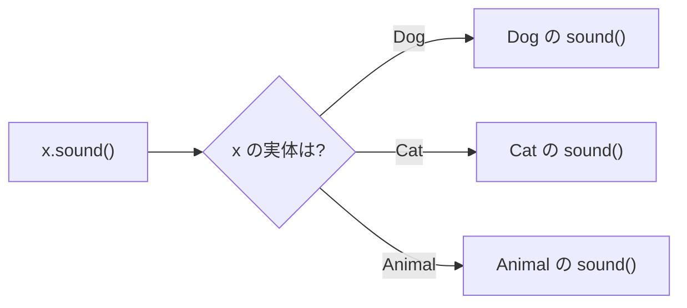

::: haru
給与計算なんて `if (パートなら) … else if (マネージャーなら) …` で書けば済みません?
:::

::: sensei
社員の種類が10個に増えたら、その if をシステム中で直して回ることになるぞ。今日はその if を「消す」技だ。
:::

前回の「継承」で、子クラスが親のメソッドをオーバーライドできることを学びました。それが本領を発揮するのが **ポリモーフィズム(polymorphism、多態性)** です。

## 親の型の変数に、子のインスタンス

```java
class Animal {
    String sound() { return "……"; }
}
class Dog extends Animal {
    @Override
    String sound() { return "ワン"; }
    void fetch() { System.out.println("取ってきた"); }
}
class Cat extends Animal {
    @Override
    String sound() { return "ニャー"; }
}

Animal a = new Dog();  // 親の型の変数に子を代入
System.out.println(a.sound());  // ワン
```

Dog は Animal の一種(is-a)なので、`Animal` 型の変数に入れられます。ここで2つの「型」を区別してください。

- **変数の型(静的な型)**:`Animal`。コンパイラが見る型で、**呼べるメソッドを決める**
- **実体の型(実行時の型)**:`Dog`。`new` したクラスで、**実際に動くメソッドを決める**

だから `a.fetch()` はコンパイルエラーです。実体は Dog でも、コンパイラは「`a` は Animal」としか知りません。

```text
error: cannot find symbol
  symbol:   method fetch()
  location: variable a of type Animal
```

## 動的ディスパッチ

`a.sound()` では、変数の型 Animal の `……` ではなく、実体 Dog の `ワン` が返りました。オーバーライドされたメソッドを **実行時の実体の型で選ぶ** 仕組みを **動的ディスパッチ(動的束縛)** と呼びます。ポリモーフィズムの心臓部です。

威力が出るのは、異なる子クラスをまとめて扱うときです。

```java
Animal[] zoo = { new Dog(), new Cat(), new Dog() };
for (Animal x : zoo) {
    System.out.println(x.sound());
}
// ワン / ニャー / ワン
```

ループの中は `x.sound()` の1行だけ。どの動物かを判定する if はありません。分岐は JVM が実行時にやってくれます。



::: trivia JVM の中では
HotSpot JVM はクラスごとに **vtable**(仮想メソッド表)を持ち、`x.sound()` は「実体のクラスの表の sound 欄」を引くだけ。よく呼ばれる箇所は JIT コンパイラがインライン化までするので、動的ディスパッチは十分速いです。
:::

## 型の if 連鎖を「消す」

配送方法ごとの送料を、種類で分岐して書くとこうなります。

```java
// NG: 呼ぶ側で種類ごとに分岐
static int fee(Delivery d) {
    if (d instanceof Express) {
        return 800;
    } else if (d instanceof StorePickup) {
        return 0;
    }
    return 500;
}
```

ポリモーフィズムなら、**各クラスが自分の送料を知っている** 形にします。

```java
class Delivery {
    int fee() { return 500; }
}
class Express extends Delivery {
    @Override
    int fee() { return 800; }
}
class StorePickup extends Delivery {
    @Override
    int fee() { return 0; }
}

int total = amount + d.fee();  // 分岐なし
```

違いは種類が増えたときに出ます。「ドローン便」を足すなら、後者はクラスを1つ追加するだけで、呼ぶ側は1行も変わりません(**拡張に開いて、修正に閉じる** = 開放閉鎖原則)。前者は同じ分岐があるすべての場所を直す必要があり、1か所でも漏れると黙って `500` が返ります。

::: sensei
「同じ型分岐が2か所以上に出てきたら、そのロジックは各クラスのメソッドに引っ越すサイン」。これが現場の嗅覚だ。
:::

## アップキャストとダウンキャスト

- **アップキャスト**:子 → 親の型への変換。`Animal a = new Dog();` は常に安全なので **暗黙に** 行われます。
- **ダウンキャスト**:親 → 子の型への変換。`Dog d = (Dog) a;` と **明示** が必要で、実体が違えば失敗します。

```java
Animal a = new Cat();
Dog d = (Dog) a;  // コンパイルは通る
```

```text
Exception in thread "main"
  java.lang.ClassCastException:
  class Cat cannot be cast to class Dog
```

コンパイラは「Animal 型の中身は Dog かもしれない」ので通しますが、実行時に JVM が実体を検査して **ClassCastException** を投げます。この検査があるので、Java では間違ったキャストでメモリが壊れることはありません。継承関係がまったくないクラスへのキャスト(`(String) a`)は、ありえないのでコンパイルエラーです。

### instanceof とパターンマッチング

ダウンキャストの前には `instanceof` で実体の型を確かめます。

```java
// 昔の書き方
if (a instanceof Dog) {
    Dog d = (Dog) a;
    d.fetch();
}

// Java 16+ のパターンマッチング
if (a instanceof Dog d) {
    d.fetch();  // d は Dog 型として使える
}
```

`a instanceof Dog d` は「実体が Dog なら、Dog 型の変数 `d` に入れて true」。検査とキャストが1つになり、キャスト先の書き間違いが起きません。`a` が `null` なら単に false です。Java 21 では `switch` でも `case Dog d ->` と書けます(モダンJavaの章で)。

`instanceof` 自体は悪ではありません。`equals` の中のように型の確認が本質な場所では堂々と使います。ただ、業務ロジックで型分岐が並び始めたら、前節の「引っ越し」を考えましょう。

## ポリモーフィズムが効かないもの

### フィールドは変数の型で決まる

```java
class Parent {
    String name = "親";
    String getName() { return name; }
}
class Child extends Parent {
    String name = "子";  // 親の name を「隠す」
    @Override
    String getName() { return name; }
}

Parent p = new Child();
System.out.println(p.name);       // 親
System.out.println(p.getName());  // 子
```

フィールドはオーバーライドされません。子の同名フィールドは親のものを **隠す(hiding)** だけで、どちらを使うかは **コンパイル時に変数の型で** 決まります。Child のオブジェクトの中には `name` が2つ存在しているのです。対策は簡単で、同名フィールドを作らない、フィールドは `private` にしてメソッド経由で触る、です。

### static メソッドは「隠蔽」

```java
class Parent {
    static String hello() { return "親"; }
}
class Child extends Parent {
    static String hello() { return "子"; }
}

Parent p = new Child();
System.out.println(p.hello());  // 親
```

static メソッドはインスタンスではなくクラスに属するので、動的ディスパッチの対象外です。子の同名 static メソッドはオーバーライドではなく **隠蔽(hiding)** で、`@Override` を付けると `static methods cannot be annotated with @Override` になります。インスタンス経由で static を呼ぶのは誤解の元なので、`Parent.hello()` とクラス名で呼びましょう。

::: point まとめ
- 親の型の変数に子のインスタンスを入れられる。**呼べるメソッドは変数の型、動くメソッドは実体の型** で決まる
- オーバーライドされたメソッドは **動的ディスパッチ** で実体の型のものが選ばれる。配列でまとめて処理すると威力を発揮
- 型の if 連鎖は、各クラスのメソッドに引っ越せば **消せる**
- アップキャストは暗黙で安全。ダウンキャストは明示が必要で、外れると **ClassCastException**
- キャスト前の確認は **`if (a instanceof Dog d)`**(Java 16+)
- **フィールドと static メソッドはポリモーフィックでない**(変数の型で決まる。隠蔽)
:::

::: sensei
次は「抽象クラスとインターフェース」。今日の Animal の `……` みたいな「意味のない親の実装」を書かずに済む方法だ。
:::
