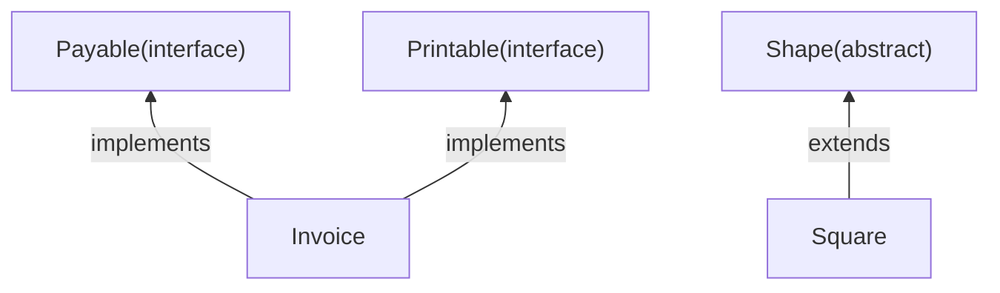

::: haru
先輩、前回のポリモーフィズムは分かりました。でも親クラス `Shape` の `area()` って、中身の書きようがなくないですか?
:::

::: sensei
いいところに気づいた。「ここは書けません」を正直に宣言するのが `abstract`。それと、現場では継承より出番が多い `interface` を今日まとめてやるよ。
:::

## 抽象クラス:未完成の設計図

`abstract` を付けたメソッドを **抽象メソッド** と呼びます。本体 `{ }` を持たず、名前・引数・戻り値の型だけを宣言します。抽象メソッドを1つでも持つクラスは **抽象クラス**(`abstract class`)にしなければなりません。

```java
abstract class Shape {
    abstract double area();      // 本体なし

    String describe() {          // 普通のメソッドもOK
        return "面積 " + area();
    }
}

class Square extends Shape {
    private final double side;
    Square(double side) { this.side = side; }

    @Override
    double area() { return side * side; }
}
```

抽象クラスのルールは2つです。

1. **`new` できない**。`new Shape()` は `Shape is abstract; cannot be instantiated` というコンパイルエラー。
2. 継承した **具象クラス**(abstract でないクラス)は、抽象メソッドを **全部実装しないとコンパイルエラー**。`Square is not abstract and does not override abstract method area() in Shape`。

親に `return 0;` のダミーを書く方式だと、子が書き忘れても「面積0の図形」が静かに生まれます。`abstract` なら書き忘れをコンパイラが止めます。なお抽象クラスもフィールドやコンストラクタを持てます(子の `super(...)` から呼ばれます)。

## テンプレートメソッドパターン

抽象クラスの代表的な使い道が **テンプレートメソッドパターン**。**処理の流れは親が決め、差分だけを子が埋める** 設計です。

```java
abstract class Report {
    // 流れは親が固定。final で上書き禁止
    final String print() {
        return "【" + title() + "】\n"
             + body() + "\n-- 以上 --";
    }
    abstract String title();   // 差分は子が埋める
    abstract String body();
}

class SalesReport extends Report {
    String title() { return "売上日報"; }
    String body()  { return "合計: 12000円"; }
}
// new SalesReport().print() の結果:
// 【売上日報】
// 合計: 12000円
// -- 以上 --
```

帳票が10種類あっても、順番を知っているのは `print()` だけ。フッター変更も1か所で済みます。`final` で子が流れを書き換えるのを防ぐのがお作法です。

## インターフェース:「できること」の約束

**インターフェース**(`interface`)は、「このメソッドを持っている」という **型の約束(契約)** を定義するものです。クラスは `implements` で約束を引き受けます。

```java
interface Payable {
    int TAX_RATE = 10;   // 定数になる
    int amount();        // 抽象メソッドになる
}
interface Printable {
    String toLine();
}

class Invoice implements Payable, Printable {
    public int amount() { return 5000; }
    public String toLine() {
        return "請求 " + amount() + "円";
    }
}
```

- 本体のないメソッドは暗黙に **`public abstract`**。フィールドは暗黙に **`public static final`(定数)** で、インスタンスごとの状態は持てません。
- `extends` は1つだけですが、`implements` は **カンマで複数** 書けます。
- 実装側のメソッドには **`public` が必須**。省略すると `attempting to assign weaker access privileges; was public`(約束より公開範囲を狭めるな)。



::: haru
親クラスは1つなのに、インターフェースは複数OKなのはなぜですか?
:::

::: sensei
クラスを2つ継承すると「どっちの親の状態や処理を使うの?」問題(菱形継承)が起きる。状態を持たないインターフェースなら起きにくいんだ。
:::

## default メソッドと static メソッド(Java 8+)

Java 8 から、インターフェースに **本体付きのメソッド** を書けるようになりました。

```java
interface Payable {
    int amount();

    default int withTax() {  // 実装クラスが引き継ぐ
        return amount() * 110 / 100;
    }
    static int sum(Payable a, Payable b) {
        return a.amount() + b.amount();
    }
}
```

**default メソッド** は実装クラスがそのまま使っても上書きしてもよく、**static メソッド** は `Payable.sum(x, y)` とインターフェース名で呼びます。

default が生まれた理由は後方互換です。Java 8 で `List` に `sort` を抽象メソッドとして足すと、世界中の `List` 実装クラスがコンパイルエラーになる。default なら **既存の実装を壊さずに進化できる** のです。

## 使い分けと「インターフェースに対してプログラムする」

| 観点 | 抽象クラス | インターフェース |
|---|---|---|
| 関係 | 〜の一種(is-a) | 〜ができる(can-do) |
| いくつ持てる | 1つだけ | いくつでも |
| 状態・コンストラクタ | 持てる | 持てない |
| 得意なこと | 共通処理と流れの固定 | 差し替え可能な部品 |

現場の方針は **「まずインターフェース。共通の実装や状態を共有したくなったら抽象クラス」**。`ArrayList` が `AbstractList` を継承しつつ `List` を実装しているように、併用も定番です。

もう1つの大原則が **インターフェースに対してプログラムする** です。

```java
List<String> names = new ArrayList<>();
```

変数の型は `List`(インターフェース)、実体は `ArrayList`(クラス)。使う側は `List` の約束しか知らないので、`LinkedList` に替えたくなっても右辺1か所の修正で済みます(コレクションは後の章で)。

料金計算なら `interface PriceRule { int apply(int price); }` を用意し、レジ側は `PriceRule` 型だけを相手にします。通常価格・セール・会員割引を **レジに触らず差し替え** られ、テストでは偽物も差し込めます。Spring の DI(依存性注入)は、この差し替えを自動化する仕組みです。

### Comparable:「並べ替えられる」という約束

```java
class Item implements Comparable<Item> {
    final int price;
    Item(int price) { this.price = price; }

    @Override
    public int compareTo(Item other) {
        return Integer.compare(price, other.price);
    }
}

Item[] items = { new Item(300), new Item(100) };
Arrays.sort(items);   // compareTo で安い順に
```

`compareTo` は「自分が相手より **前なら負、同じなら0、後なら正**」を返す約束です。`<Item>` は比べる相手の型(ジェネリクスの章で詳しく)。`Arrays.sort` は `Comparable` という約束だけを頼りに並べています。実装し忘れると、実行時に `ClassCastException: class Item cannot be cast to class java.lang.Comparable` で落ちます。

::: trivia sealed で実装クラスを限定する(Java 17+)
`sealed interface Shape permits Circle, Square {}` と書くと、実装できるのはその2つだけに。種類が確定するので switch の網羅性チェックが効きます(モダンJavaの章で再登場)。
:::

::: warn @Override は必ず付ける
`compareTo` を `compareto` と打ち間違えても、`@Override` がなければ「ただの新メソッド」として通ります。抽象メソッドなら未実装エラーで気づけますが、default メソッドの上書きミスは誰も教えてくれません。
:::

::: point まとめ
- 抽象クラスは **`new` できず**、子は抽象メソッドを **全部実装しないとコンパイルエラー**
- **テンプレートメソッド**:流れは親の `final` メソッド、差分は子の抽象メソッド
- `interface` のメソッドは暗黙に `public abstract`、フィールドは定数。**`implements` は複数可**
- **default / static メソッド**(Java 8+)。default は既存実装を壊さず機能を足す仕組み
- 迷ったら **まずインターフェース**。変数の型はインターフェースにして実体を差し替え可能に
- `compareTo` は「前なら負・同じなら0・後なら正」
:::

::: sensei
次は「例外処理」。作ったクラスが「失敗したとき」どう振る舞うべきか。現場で一番差がつくところだ。
:::
