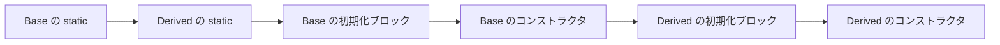

::: haru
先輩、既存コードを読んでいたら `new Mail.Builder()` とか、`new Comparator<Order>() { ... }` みたいに **クラスの中にクラス** がある書き方が出てきて、固まりました……。
:::

::: sensei
業務コードだと毎日見る形だよ。ややこしく見えるけど、種類は4つしかない。今日は「クラスの中のクラス」と、ついでに `new` したとき何がどの順で動くか、の2本立てでいこう。
:::

前回はインターフェースで「できること」を約束し、実装を差し替える設計を見ました。今回は、その実装クラスを **どこに・どれくらいの範囲で書くか** の話です。

## クラスの中にクラスを書ける:4つの形

クラスの中に書かれた別のクラスを、まとめて **ネストしたクラス**(入れ子のクラス)と呼びます。ただし書き方によって性質がまったく違い、次の **4種類** があります。

| 種類 | 書く場所 | 外側のインスタンスとの関係 | よく使う場面 |
|---|---|---|---|
| static ネストクラス | クラスの直下 + `static` | 結び付かない(外側なしで作れる) | Builder、その型専用の小さな DTO、複合キー |
| 内部クラス(インナークラス) | クラスの直下(`static` なし) | 外側のインスタンス1つに結び付く | 外側の状態を読む小さな部品 |
| ローカルクラス | メソッドの中 | そのメソッドの中でだけ使える | そのメソッド専用の一時的な部品 |
| 匿名クラス | 式の中で `new` と同時に定義 | 名前がなく、その場限り | Comparator、リスナー、古いコードのコールバック |

::: point 読むときの見分け方
1. まず **`static` が付いているか** を見る
2. 次に **クラスの直下か、メソッドの中か** を見る
3. 最後に **名前があるか**(`new 型名() { ... }` なら匿名クラス)

この3つで、4種類のどれかが必ず決まります。
:::

## static ネストクラス:置き場所を借りているだけ

**static ネストクラス** は、外側のクラスの中に **置き場所を借りているだけ** で、外側のインスタンスとは無関係です。外側を `new` していなくても、`外側.内側` という名前でそのまま `new` できます。「このクラスと関係が深い部品だけど、外側の実体は要らない型」を表すのに向いています。

いちばんの定番が **Builder(ビルダー)パターン** です。項目が多く、一部は省略してよいオブジェクトを、読みやすく組み立てるための書き方です。

```java
public class Mail {
    private final String to;
    private final String subject;
    private final String cc;

    private Mail(Builder b) {           // 外からは new Mail(...) させない
        this.to = b.to;
        this.subject = b.subject;
        this.cc = b.cc;
    }

    public static class Builder {
        private String to;
        private String subject = "(件名なし)";   // 省略時の値
        private String cc = "";

        public Builder to(String to) {
            this.to = to;
            return this;                 // 自分を返すので . でつなげられる
        }
        public Builder subject(String s) { this.subject = s; return this; }
        public Builder cc(String cc)     { this.cc = cc; return this; }

        public Mail build() {
            return new Mail(this);       // 外側の private コンストラクタを呼べる
        }
    }
}

// 使う側
Mail m = new Mail.Builder()
        .to("sato@example.com")
        .subject("見積もりの件")
        .build();
```

ポイントは3つです。

- `new Mail.Builder()` の **`Mail.Builder`** が「外側.内側」の名前。import するときも `import com.example.Mail.Builder;` のように書けます。
- 外側とネストクラスは **お互いの `private` に触れる**。`Builder` が `Mail` の private コンストラクタを呼び、`Mail` が `Builder` の private フィールドを読めるのはこのためです。
- `return this;` で自分自身を返すので、`.to(...).subject(...)` と **メソッドチェーン** で書けます。

::: haru
コンストラクタに `new Mail("sato@example.com", "見積もりの件", "")` って渡すのと、何が違うんですか?
:::

::: sensei
引数が3つならまだいい。でも項目が10個あって半分が省略可、しかも `String` ばかりだったら? 順番を1つ間違えても誰も気づかない。Builder なら `.subject(...)` と **名前付きで** 書けるし、省略したものは既定値になる。業務の「検索条件」や「帳票の設定」みたいな、項目の多いクラスでよく使うよ。
:::

## 内部クラス:外側のインスタンスに結び付く

`static` を付けずにクラスの直下に書くと **内部クラス**(インナークラス)になります。内部クラスのインスタンスは、必ず **外側のインスタンス1つとセット** で生まれ、外側の `private` フィールドもそのまま読めます。

```java
public class Car {
    private final String model;
    private int fuel;

    public Car(String model, int fuel) {
        this.model = model;
        this.fuel = fuel;
    }

    class FuelGauge {                 // static なし = 内部クラス
        String read() {
            return model + ": 残り " + fuel + "L";  // 外側のフィールドを直接読む
        }
    }

    FuelGauge gauge() {
        return new FuelGauge();       // 「この Car に結び付いた」メーターを作る
    }
}

Car car = new Car("Prius", 30);
Car.FuelGauge g = car.gauge();
System.out.println(g.read());   // Prius: 残り 30L
```

`FuelGauge` 自身は `model` も `fuel` も持っていません。内部クラスのインスタンスは、自分を作った外側インスタンスへの **隠れた参照** を持っていて、それを通って外側のフィールドを読みに行きます。

<figure class="figure"><svg viewBox="0 0 560 220" xmlns="http://www.w3.org/2000/svg" font-family="inherit"><defs><marker id="nested-inner-arrow" markerWidth="10" markerHeight="10" refX="8" refY="5" orient="auto"><path d="M0 0 L10 5 L0 10 z" fill="var(--accent)"/></marker></defs><rect x="30" y="30" width="200" height="120" rx="12" fill="var(--surface-2)" stroke="var(--ink)" stroke-width="2"/><text x="130" y="56" font-size="15" font-weight="700" text-anchor="middle" fill="var(--ink)">Car インスタンス</text><text x="50" y="86" font-size="14" fill="var(--ink)">model = "Prius"</text><text x="50" y="110" font-size="14" fill="var(--ink)">fuel = 30</text><rect x="330" y="70" width="200" height="100" rx="12" fill="var(--accent-soft)" stroke="var(--ink)" stroke-width="2"/><text x="430" y="96" font-size="15" font-weight="700" text-anchor="middle" fill="var(--ink)">FuelGauge インスタンス</text><text x="350" y="126" font-size="13" fill="var(--ink)">自分のフィールドは無い</text><text x="350" y="150" font-size="13" fill="var(--ink-muted)">隠れた参照 Car.this →</text><path d="M330 150 C 280 150, 260 110, 232 92" stroke="var(--accent)" stroke-width="2.5" fill="none" marker-end="url(#nested-inner-arrow)"/><text x="280" y="200" font-size="13" text-anchor="middle" fill="var(--ink-muted)">FuelGauge は Car.this 経由で model・fuel を読みに行く</text></svg><figcaption>内部クラスのインスタンスは、自分を作った外側インスタンスへの参照を持っている</figcaption></figure>

この隠れた参照は、コードでは **`外側クラス名.this`** と書けます。内部クラスにも同じ名前のフィールドがあると、ただの `fuel` や `this.fuel` は内部クラス自身のものを指すので、外側を指したいときは `Car.this.fuel` と明示します。

外側のクラスの **外** から内部クラスを作るときは、`car.new FuelGauge()` という特殊な形になります。ただ実務ではまず見かけません。上の `gauge()` のように、外側にメソッドを用意して隠すのが普通です。

::: warn 迷ったら static を付ける
外側のフィールドを使わないなら、ネストクラスには **`static` を付ける** のが定石です。内部クラスは外側への参照を握り続けるので、内部クラスのインスタンスが生きている限り外側も片付けられません。「外側の状態を読む必要があるときだけ内部クラス」と覚えておきましょう。
:::

## ローカルクラスと匿名クラス:その場限りの部品

**ローカルクラス** は、メソッドの中に書くクラスです。ローカル変数と同じく、そのメソッドの中でしか使えません。

```java
void checkOrder(int amount) {
    class Validator {                       // checkOrder の中だけのクラス
        boolean isValid() {
            return amount > 0;              // メソッドの引数も読める
        }
    }
    if (!new Validator().isValid()) {
        System.out.println("金額が不正です");
    }
}
```

実務でローカルクラスを見る機会は多くありません。ずっとよく見るのが **匿名クラス**(とくめいクラス)です。インターフェースや抽象クラスを実装したクラスを、**名前を付けずに `new` と同時にその場で** 定義します。

```java
Runnable task = new Runnable() {     // 「Runnable を実装した名無しのクラス」を作って new
    @Override
    public void run() {
        System.out.println("夜間バッチを実行します");
    }
};
task.run();
```

`new Runnable()` のあとに `{ ... }` が続いているのが目印です。インターフェースは `new` できないはずですが、これは「`Runnable` を `new`」しているのではなく、「`Runnable` を実装した **名前のないクラス** を定義して、すぐに1個 `new`」しています。`Runnable` は `run()` を1つだけ持つ、Java 標準のインターフェースです。

### 業務コードの定番:Comparator

前回の `Comparable` は「そのクラス自身が持つ、いつもの並べ方」でした。でも画面によって「価格の高い順」「名前順」と並べ方を変えたいことがあります。そこで使うのが **`Comparator`**(`java.util.Comparator`)。「2つを比べるルール」だけを表すインターフェースで、`Arrays.sort(配列, ルール)` に渡します。このルールを匿名クラスで書くのが、古くからの定番です。

```java
Arrays.sort(orders, new Comparator<Order>() {
    @Override
    public int compare(Order a, Order b) {
        return Integer.compare(b.amount, a.amount);   // 金額の高い順
    }
});
```

`compare(a, b)` の約束は `compareTo` と同じで、「`a` が前なら負、同じなら0、後なら正」です。そのメソッド呼び出しでしか使わないルールなので、わざわざ名前付きのクラスを作らず、その場に書いてしまうわけです。

匿名クラスは **抽象クラス** に対しても書けます。実装すべきメソッドが複数あってもかまいません。

```java
abstract class Shape {
    abstract double area();
    abstract double perimeter();
}

Shape square = new Shape() {
    double area()      { return 3 * 3; }
    double perimeter() { return 3 * 4; }
};
```

### 匿名クラスの中のルール

- 匿名クラスの中の **`this` は、匿名クラス自身** を指します。外側のインスタンスは内部クラスと同じく `外側クラス名.this` です。
- 外側の **ローカル変数** を使うときは、その変数が **実質的に final**(effectively final:一度代入したあと値を変えていない)でなければなりません。

```java
String label = "通常";
if (urgent) {
    label = "至急";            // 再代入している
}
Runnable r = new Runnable() {
    public void run() {
        System.out.println(label);   // コンパイルエラー
    }
};
```

`if` の中が実際には実行されなくても、**再代入する文がある時点で** `local variables referenced from an inner class must be final or effectively final` というコンパイルエラーです。ローカル変数はメソッドを抜けると消えますが、匿名クラスのインスタンスはその後も生き残れます。そこで Java は変数の **値をコピー** して持たせており、あとから値が変わると食い違うので禁止しているのです。直すなら、`String label = urgent ? "至急" : "通常";` のように代入を1回にまとめます。フィールドにはこの制限はありません。

## 匿名クラスとラムダ式(第7章の予告)

::: haru
`new Comparator<Order>() { @Override public int compare(...) { ... } }` って、やりたいことは1行なのに長いですね……。
:::

::: sensei
そう思った人が多かったから、Java 8 で **ラムダ式** ができた。抽象メソッドが1つだけのインターフェースなら、こう書ける。
:::

```java
// 匿名クラス
Arrays.sort(orders, new Comparator<Order>() {
    @Override
    public int compare(Order a, Order b) {
        return Integer.compare(b.amount, a.amount);
    }
});

// ラムダ式(第7章で習う)
Arrays.sort(orders, (a, b) -> Integer.compare(b.amount, a.amount));
```

ラムダ式は、**抽象メソッドが1つだけのインターフェース**(関数型インターフェース)を実装する匿名クラスの「短い書き方」だと思っておけば十分です。書き方は第7章でじっくりやります。逆に言えば、相手が **抽象クラス** だったり、**抽象メソッドが2つ以上** あったりすると、ラムダにはできず匿名クラスのままです。古いコードを読むと匿名クラスがたくさん残っているので、今のうちに読めるようになっておきましょう。

## 初期化ブロックと、new したときの順番

最後に、クラスの直下に書ける **初期化ブロック** を見ます。`static { ... }` の **static 初期化ブロック** と、`{ ... }` だけの **インスタンス初期化ブロック** の2つです。

```java
class Base {
    static { System.out.println("A: Base の static ブロック"); }
    { System.out.println("C: Base の初期化ブロック"); }
    Base() { System.out.println("D: Base のコンストラクタ"); }
}

class Derived extends Base {
    static { System.out.println("B: Derived の static ブロック"); }
    { System.out.println("E: Derived の初期化ブロック"); }
    Derived() { System.out.println("F: Derived のコンストラクタ"); }
}

new Derived();   // A B C D E F の順に出る
new Derived();   // 2回目は C D E F だけ
```

| 順番 | 何が動くか | 回数 |
|---|---|---|
| 1 | static フィールドの初期化と static 初期化ブロック(親 → 子) | クラスが最初に使われたとき **1回だけ** |
| 2 | インスタンスフィールドの初期化と初期化ブロック → コンストラクタ本体(**親の分が全部終わってから子**) | `new` の **たびに** |



「コンストラクタが一番最初に動く」わけではありません。コンストラクタ本体の1行目が動く前に、フィールドの初期化と初期化ブロックはもう終わっています。

業務コードで static 初期化ブロックを見るのは、主に **1行では書ききれない定数の準備** です。たとえば「ステータスコード → 画面表示名」の対応表を、クラスの読み込み時に1回だけ組み立てるといった使い方です。こうした定数や static メソッドだけを集めたクラスには、**`private` コンストラクタ** を書いて、うっかり `new` されないようにするのが定石です。

```java
public final class StatusLabels {
    private StatusLabels() { }        // new させない

    static final String[] LABELS = new String[3];
    static {                          // 読み込み時に1回だけ
        LABELS[0] = "受付";
        LABELS[1] = "出荷済み";
        LABELS[2] = "キャンセル";
    }
}
```

インスタンス初期化ブロックの出番はもっと少なく、「コンストラクタが複数あって、全部で共通の前処理をしたい」ときくらいです(多くは `this(...)` で別のコンストラクタを呼べば済みます)。書くより **読めること** が大事な機能です。

::: point まとめ
- クラスの中のクラスは **static ネストクラス・内部クラス・ローカルクラス・匿名クラス** の4種類
- **static ネストクラス** は外側と無関係に `new 外側.内側()` で作れる。Builder の定番
- **内部クラス** は外側のインスタンス1つに結び付き、外側のフィールドを読める。外側は `外側.this`
- 外側を使わないなら **`static` を付ける**
- **匿名クラス** は `new 型名() { ... }` でその場で実装する。Comparator が定番。中から使うローカル変数は **実質的 final**
- 抽象メソッドが1つのインターフェースならラムダ式で短く書ける(第7章)
- 初期化の順番は **static(親→子、1回だけ)→ 親の初期化ブロックとコンストラクタ → 子の初期化ブロックとコンストラクタ**
:::

::: sensei
これで第4章はおしまい。次の第5章は「例外処理」。作ったクラスが **失敗したとき** どう振る舞うべきか、現場で一番差がつくところだ。
:::
