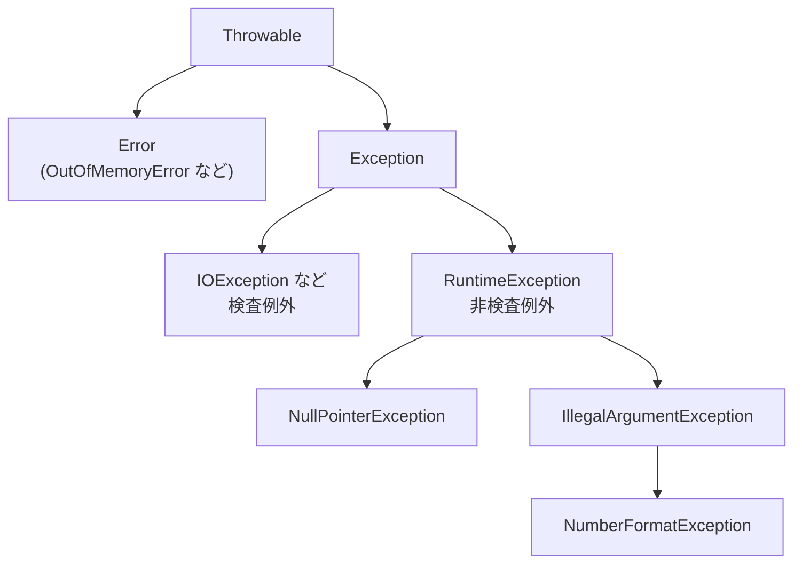

::: haru
先輩、エラーが出たら `try { ... } catch (Exception e) { }` で囲んでおけば、とりあえず止まらないから安心ですよね!
:::

::: sensei
……それは障害を「なかったこと」にする一番の罪だ。今日は正しい扱い方と、現場で嫌われる書き方を両方覚えよう。
:::

## 例外とは:try / catch / finally

**例外**(exception)は「処理を続けられない異常が起きた」ことを知らせるオブジェクトです。例外が **投げられる**(throw)と処理はそこで中断し、**捕まえる**(catch)場所まで呼び出し元をさかのぼります。誰も捕まえなければスレッドが終了し、スタックトレースが出力されます。

```java
String input = "12a";
try {
    int qty = Integer.parseInt(input);
    System.out.println("数量: " + qty);   // 実行されない
} catch (NumberFormatException e) {
    System.out.println("数値ではありません: "
        + e.getMessage());
} finally {
    System.out.println("入力チェック終了");
}
// 数値ではありません: For input string: "12a"
// 入力チェック終了
```

- `try`:例外が起きるかもしれない処理。例外が起きた行で中断し、残りは実行されません。
- `catch (型 変数)`:その型(とサブクラス)の例外を捕まえたときに実行。
- `finally`:例外の有無にかかわらず **必ず実行**。`try` の中で `return` しても実行されます。

## 例外クラスの階層と「検査例外」

例外はすべて `Throwable` を頂点とするクラス階層になっています。



- **Error**:メモリ不足など JVM レベルの深刻な問題。アプリでは catch しません。
- **検査例外**(checked exception):`Exception` のうち `RuntimeException` 系 **以外**。ファイルが無い・通信が切れたなど「コードが正しくても起きうる」失敗です。コンパイラが **catch するか `throws` で宣言するかを強制** します。
- **非検査例外**(unchecked exception):`RuntimeException` とそのサブクラス(と `Error`)。null 参照や不正な引数など、主に **プログラムのバグや前提違反** を表します。処理は強制されません。

検査例外を放置するとコンパイルエラーです。

```text
error: unreported exception FileNotFoundException;
  must be caught or declared to be thrown
```

## throw と throws

`throw` は例外を **投げる文**、`throws` はメソッドが例外を **投げうると宣言する** 部分です。

```java
static void reserve(int qty) {
    if (qty < 1) {
        throw new IllegalArgumentException(
            "数量は1以上: " + qty);
    }
    // ……予約処理
}

static String load(String path) throws IOException {
    return Files.readString(Path.of(path));
}
```

`load` を呼ぶ側は、catch するか、自分も `throws IOException` を書いて呼び出し元に任せるかを選びます。メッセージには「何が・どんな値で」ダメだったかを入れるのが現場の作法。`"エラー"` だけでは調査できません。

## スタックトレースの読み方

::: haru
`throws` で「呼び出し元に任せる」って、任された側も `throws` したらどうなるんすか?
:::

::: sensei
さらに上へ任される。例外は catch されるまで、呼び出しの階段を1段ずつ逆にのぼっていくんだ。これを **伝播** という。
:::

<figure class="figure"><svg viewBox="0 0 620 250" xmlns="http://www.w3.org/2000/svg" font-family="inherit"><defs><marker id="java-exceptions-arrow12a" markerWidth="10" markerHeight="10" refX="8" refY="5" orient="auto"><path d="M0 0 L10 5 L0 10 z" fill="var(--ink-muted)"/></marker><marker id="java-exceptions-arrow12b" markerWidth="10" markerHeight="10" refX="8" refY="5" orient="auto"><path d="M0 0 L10 5 L0 10 z" fill="var(--accent)"/></marker></defs><rect x="20" y="20" width="200" height="48" rx="8" fill="var(--accent-soft)" stroke="var(--ink)" stroke-width="2"/><text x="120" y="41" font-size="14" font-weight="700" text-anchor="middle" fill="var(--ink)">main()</text><text x="120" y="59" font-size="12" text-anchor="middle" fill="var(--ink-muted)">try { service.run(); } catch</text><rect x="20" y="100" width="200" height="48" rx="8" fill="var(--surface-2)" stroke="var(--ink)" stroke-width="2"/><text x="120" y="121" font-size="14" font-weight="700" text-anchor="middle" fill="var(--ink)">Service.run()</text><text x="120" y="139" font-size="12" text-anchor="middle" fill="var(--ink-muted)">catch なし → 素通り</text><rect x="20" y="180" width="200" height="48" rx="8" fill="var(--surface-2)" stroke="var(--ink)" stroke-width="2"/><text x="120" y="201" font-size="14" font-weight="700" text-anchor="middle" fill="var(--ink)">Repository.find()</text><text x="120" y="219" font-size="12" text-anchor="middle" fill="var(--ink-muted)">ここで throw</text><path d="M80 68 L80 98" stroke="var(--ink-muted)" stroke-width="2" marker-end="url(#java-exceptions-arrow12a)"/><path d="M80 148 L80 178" stroke="var(--ink-muted)" stroke-width="2" marker-end="url(#java-exceptions-arrow12a)"/><text x="92" y="88" font-size="12" fill="var(--ink-muted)">呼ぶ</text><text x="92" y="168" font-size="12" fill="var(--ink-muted)">呼ぶ</text><path d="M180 180 L180 150" stroke="var(--accent)" stroke-width="3" marker-end="url(#java-exceptions-arrow12b)"/><path d="M180 100 L180 70" stroke="var(--accent)" stroke-width="3" marker-end="url(#java-exceptions-arrow12b)"/><text x="192" y="170" font-size="12" fill="var(--accent)">例外が上がる</text><text x="192" y="90" font-size="12" fill="var(--accent)">まだ上がる</text><rect x="330" y="20" width="270" height="208" rx="10" fill="var(--surface-2)" stroke="var(--line)" stroke-width="2"/><text x="345" y="46" font-size="14" font-weight="700" fill="var(--ink)">読み方</text><text x="345" y="74" font-size="13" fill="var(--ink)">1. 一番深い所(下)で例外が生まれる</text><text x="345" y="98" font-size="13" fill="var(--ink)">2. catch が無い層は素通りして上へ</text><text x="345" y="122" font-size="13" fill="var(--ink)">3. 途中の finally は通過時に実行</text><text x="345" y="146" font-size="13" fill="var(--ink)">4. 型が合う catch で止まる</text><text x="345" y="170" font-size="13" fill="var(--ink)">5. main まで誰も捕まえなければ</text><text x="345" y="190" font-size="13" fill="var(--ink)">   スタックトレースを出して終了</text><text x="345" y="216" font-size="12" fill="var(--ink-muted)">Spring では 4 が @ControllerAdvice</text></svg><figcaption>例外の伝播:いちばん深い所で生まれ、catch のない層を素通りして、呼び出しの階段を逆にのぼる</figcaption></figure>

スタックトレースは、この「例外が通ってきた道」の記録です。だから上の行ほど深い(発生地点に近い)場所になります。

```text
Exception in thread "main" ConfigException: ポート番号が不正: 80a
	at OrderApp.readPort(OrderApp.java:9)
	at OrderApp.main(OrderApp.java:13)
Caused by: java.lang.NumberFormatException:
    For input string: "80a"
	at java.base/java.lang.Integer.parseInt(Integer.java:662)
	at OrderApp.readPort(OrderApp.java:7)
	... 1 more
```

1. **1行目**:例外のクラス名とメッセージ。まずここで「何が起きたか」を掴む。
2. **`at` の行**:上が例外の発生地点、下へ行くほど呼び出し元。`java.base/...` は標準ライブラリなので読み飛ばし、**最初に出てくる自分のコード**(`OrderApp.java:7`)を見る。
3. **`Caused by:`**:この例外の **原因** になった例外。複数あるときは **一番下の Caused by が根本原因** です。

::: sensei
ログを見たら「1行目」と「一番下の Caused by」。障害対応はまずこの2か所からだ。
:::

## マルチキャッチと try-with-resources

複数の例外を同じように処理するなら、`|` でまとめられます(**マルチキャッチ**)。

```java
try {
    int avg = total / Integer.parseInt(text);
} catch (NumberFormatException
         | ArithmeticException e) {
    System.out.println("計算できません");
}
```

`catch` を複数並べるときは **サブクラスを先に** 書きます。親(`IllegalArgumentException`)を先に書くと子(`NumberFormatException`)には絶対に届かず、`exception NumberFormatException has already been caught` というコンパイルエラーになります。

ファイルやDB接続のような **閉じる必要のあるリソース** は、**try-with-resources** で扱います。

```java
try (var in = Files.newBufferedReader(path);
     var out = Files.newBufferedWriter(dest)) {
    out.write(in.readLine());
}   // ここで out → in の順に自動で close()
```

`try (...)` に書けるのは **`AutoCloseable` を実装したクラス**。ブロックを抜けると、例外が起きても **宣言と逆の順番で** `close()` が呼ばれます(後に開いたものは先のものに依存しがちだから)。`finally` で手書きするより短く、閉じ忘れもありません。

## 独自例外と「ラップして再スロー」

業務上の失敗には、意味のある名前の **独自例外** を作れます。

```java
class StockShortageException extends Exception {
    StockShortageException(String message) {
        super(message);
    }
    StockShortageException(String message,
                           Throwable cause) {
        super(message, cause);   // 原因も保持
    }
}
```

`Exception` を継承すれば検査例外、`RuntimeException` なら非検査例外。呼び出し側に必ず対処させたい業務エラーなら前者、前提違反なら後者が目安です。

下位の例外を、自分の層に合った例外に包み直して投げることを **ラップして再スロー** と呼びます。このとき **必ず元の例外を `cause` として渡す** こと。

```java
} catch (NumberFormatException e) {
    // NG: 原因が消える
    // throw new ConfigException("ポート番号が不正");
    throw new ConfigException(
        "ポート番号が不正: " + text, e);  // OK
}
```

`cause` を渡さないとスタックトレースから `Caused by:` が消え、本当の失敗箇所が分からなくなります。

## 現場の二大罪

**① 例外の握りつぶし(空の catch)**

```java
try {
    sendMail(order);
} catch (Exception e) {
    // 何もしない ← 最悪
}
```

メールは送られていないのに、ログにも画面にも何も出ません。気づくのは何週間も後のお客様の問い合わせです。catch したら **ログに出す・利用者に伝える・上に投げ直す** のどれかを必ず。対処できないなら catch しないのが正解です。

**② 例外を制御フローに使う**

```java
try {
    return Integer.parseInt(s) > 0;
} catch (NumberFormatException e) {
    return false;  // 「数字じゃなければ false」の分岐に流用
}
```

文字列→数値の変換は事前判定が面倒なので許容範囲ですが、`if` で判定できること(配列の範囲チェックなど)を例外で分岐させてはいけません。例外はスタックトレースを記録するので **普通の分岐より桁違いに遅く**、読み手には「異常事態」に見えて意図が伝わりません。

::: point まとめ
- `try` で中断 → 型が合う `catch` へ → `finally` は **必ず実行**
- `Throwable` の下に `Error` と `Exception`。`RuntimeException` 系が **非検査例外**、それ以外の `Exception` が **検査例外**(catch か throws が強制)
- `throw` は投げる文、`throws` は宣言。メッセージには **値** を入れる
- スタックトレースは **1行目** と **一番下の Caused by**、そして最初の自分のコードの行を見る
- catch はサブクラスを先に。リソースは **try-with-resources**(逆順で自動 close)
- ラップするときは **cause を渡す**。**空の catch は厳禁**、例外を if 代わりにしない
:::

::: sensei
次は「コレクション」。`List` や `Map` の登場で、前回の「インターフェースに対してプログラムする」が本領発揮だ。
:::
