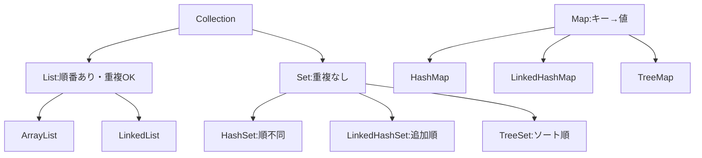

::: haru
先輩、前回の例外処理はバッチリっす。今日は配列の続きっすか?
:::

::: sensei
配列の「卒業式」だね。業務コードで毎日使うのは、配列よりコレクションのほうだ。
:::

## 配列の限界とコレクションの全体像

配列は作った時点で長さが固定です。「件数不明の CSV を読む」「重複を消す」「社員番号で引く」といった日常の要求に、配列だけで応えるのは骨が折れます。

**コレクション** は「複数のオブジェクトをまとめて扱う入れ物」の総称で、`java.util` にインターフェースと実装クラスの一式(**コレクションフレームワーク**)があります。



上段が **インターフェース**、下段が **実装クラス**。`Map` は `Collection` を継承しない別系統です。

```java
import java.util.*;

List<String> names = new ArrayList<>();
```

変数の型はインターフェース、`new` するのは実装クラス。こう書けば実装を差し替えても呼び出し側が壊れません(ポリモーフィズムの実践)。`<String>` は「中身は String」という指定(**ジェネリクス**)、右辺の `<>` は **ダイヤモンド演算子**。詳しくは次回です。

## List:ArrayList が主役

```java
List<String> names = new ArrayList<>();
names.add("佐藤");
names.add("鈴木");
names.add(0, "高橋");  // 先頭に挿入
System.out.println(names);  // [高橋, 佐藤, 鈴木]
System.out.println(names.get(1));  // 佐藤
names.set(1, "田中");  // 置き換え
names.remove("鈴木");  // 値で削除
System.out.println(names.size());  // 2
System.out.println(names.contains("田中")); // true
```

`contains` や `remove(Object)` は `equals` で探します。

`ArrayList` の中身は **配列** で、満杯になると約1.5倍の配列を作ってコピーします。`LinkedList` は要素を鎖でつないだ構造です。

| 操作 | ArrayList | LinkedList |
|---|---|---|
| get(i) | 速い(添字で一発) | 遅い(先頭からたどる) |
| 途中への挿入 | 後ろをずらす | つなぎ替え(位置探しは遅い) |
| メモリ | 小さい | 要素ごとにノード |

::: genba
現場では9割以上 `ArrayList`。理屈では LinkedList が速い場面でも、実測すると CPU キャッシュに優しい ArrayList が勝つことが多い。
:::

## Set と Map

**Set** は重複なしの集合。実装は「並び順」で選びます。

```java
List<String> tags =
    List.of("spring", "java", "sql", "java");
System.out.println(new LinkedHashSet<>(tags));
// [spring, java, sql]  ← 最初に出てきた順
System.out.println(new TreeSet<>(tags));
// [java, spring, sql]  ← 辞書順
```

`HashSet` は最速ですが順番は保証なし。「重複を消して順は保つ」なら `LinkedHashSet`。`add` は重複なら `false` を返します。

**Map** はキーと値のペアの「辞書」です。

```java
Map<String, Integer> stock = new HashMap<>();
stock.put("りんご", 10);
stock.put("みかん", 5);
stock.put("りんご", 8);  // 同じキーは上書き
System.out.println(stock.get("りんご"));  // 8
System.out.println(stock.get("ぶどう"));  // null
System.out.println(
    stock.getOrDefault("ぶどう", 0));  // 0
System.out.println(stock.containsKey("みかん")); // true

for (Map.Entry<String, Integer> e
        : stock.entrySet()) {
    System.out.println(e.getKey() + "=" + e.getValue());
}
```

キーと値を両方使うループは `entrySet()` が定番です。

出現回数のカウントはこう書きます。

```java
Map<String, Integer> count = new TreeMap<>();
for (String w : "a b a c b a".split(" ")) {
    count.put(w, count.getOrDefault(w, 0) + 1);
}
System.out.println(count);  // {a=3, b=2, c=1}
```

現場では `count.merge(w, 1, Integer::sum);` と1行で書きます(なければ1、あれば足す。`::` はラムダの回で)。

## 不変コレクションとループ中の削除

`List.of` / `Set.of` / `Map.of` は **不変**(変更不可)のコレクションを作ります。

```java
List<String> fixed = List.of("A", "B");
fixed.add("C");  // 実行時に例外
```

```text
java.lang.UnsupportedOperationException
```

型は普通の `List` なので、コンパイルは通って実行時に落ちます。変更したいなら `new ArrayList<>(List.of(...))` で詰め替えます。`null` を入れると NPE になる点も注意。

もう一つの地雷が、拡張 for の **中での remove** です。

```java
List<String> list =
    new ArrayList<>(List.of("A", "B", "C"));
for (String s : list) {
    if (s.equals("A")) {
        list.remove(s);  // ConcurrentModificationException
    }
}
```

拡張 for の裏では **Iterator**(要素を1つずつ取り出す係)が動いています。ArrayList は変更回数を数えていて、Iterator の知らない所で変わると「壊れたまま続けるより即死」を選びます(**fail-fast**)。正しくはこう。

```java
Iterator<String> it = list.iterator();
while (it.hasNext()) {
    if (it.next().equals("A")) {
        it.remove();  // Iterator 経由なら OK
    }
}
list.removeIf(s -> s.equals("B"));  // 現場はこっち
```

## equals と hashCode を正しく

`HashSet` / `HashMap` は `hashCode()`(オブジェクトから計算する int)で格納場所を決め、そこで `equals` で一致を確かめます。`Object` から継承したままでは、どちらも「同じインスタンスか」しか見ません。

```java
class Emp {
    String id;
    Emp(String id) { this.id = id; }
}
Set<Emp> set = new HashSet<>();
set.add(new Emp("E001"));
set.add(new Emp("E001"));
System.out.println(set.size());  // 2 !?
```

中身で同一視したいなら **両方** オーバーライドします。

```java
@Override
public boolean equals(Object o) {
    return o instanceof Emp e
        && Objects.equals(id, e.id);
}
@Override
public int hashCode() {
    return Objects.hash(id);
}
```

ルールは「`equals` が true なら `hashCode` も必ず同じ」。`equals` だけ直すと別の場所を探しに行き、`contains` が `false` になります。STS の「ソース → hashCode() および equals() の生成」を使うのが安全です。

::: haru
equals だけじゃダメなんすね……。
:::

::: sensei
表札だけ変えて住所を変えないようなもの。郵便(検索)は届かない。
:::

## 並べ替えと Comparator の入口

```java
List<String> fruits = new ArrayList<>(
    List.of("banana", "kiwi", "apple"));
Collections.sort(fruits);
System.out.println(fruits); // [apple, banana, kiwi]
```

String や Integer は **Comparable**(自然な順序)を実装しているので、そのまま並びます。別の基準なら **Comparator**(比べ方のオブジェクト)を渡します。

```java
fruits.sort(new Comparator<String>() {
    @Override
    public int compare(String a, String b) {
        return Integer.compare(a.length(), b.length());
    }
});
// [kiwi, apple, banana] 文字数順
```

これは **匿名クラス**(名前を付けずにその場でインターフェースを実装するクラス)での書き方。現場では `Comparator.comparing(String::length)` と1行で書きます(ラムダの回で解説)。

## よくあるミス

```java
List<Integer> nums =
    new ArrayList<>(List.of(10, 20, 30));
nums.remove(1);  // 値1ではなく「添字1」を削除
System.out.println(nums);  // [10, 30]
nums.remove(Integer.valueOf(10));  // 値で削除
```

コレクションに `int` は入らず、ラッパー型 `Integer` に自動変換(**オートボクシング**)されます。`remove(int)` と `remove(Object)` があり、`int` を渡すと添字版が選ばれます。

```java
int n = stock.get("ぶどう");  // NullPointerException
```

`null` を `int` に戻そうとして落ちます。`getOrDefault` を使いましょう。

::: point まとめ
- 順番あり → `List`(ほぼ `ArrayList`)、重複なし → `Set`、キーで引く → `Map`
- 変数はインターフェース型で受ける:`List<String> x = new ArrayList<>();`
- Set の順番は Hash=保証なし / LinkedHash=追加順 / Tree=ソート順
- `List.of` は不変。変更すると `UnsupportedOperationException`
- ループ中の削除は `Iterator.remove` か `removeIf`
- Hash系に自作クラスを入れるなら `equals` と `hashCode` をセットで
:::

::: sensei
次回は `<String>` の正体、ジェネリクスだ。
:::
