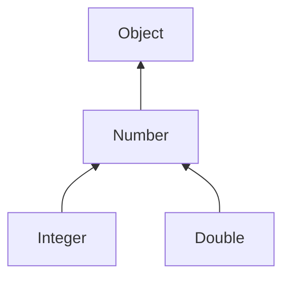

::: haru
前回から出てくる `List<String>` の `<>`、正直「おまじない」だと思ってました。
:::

::: sensei
おまじないどころか、Java の型安全の要だよ。今日は `<>` の中身を自分で書けるようになろう。
:::

## なぜジェネリクスか:raw 型時代の昔話

**ジェネリクス**(Java 5 で導入)は、クラスやメソッドに「型の引数」を渡せる仕組みです。それ以前のコレクションは何でも `Object` として入れていました。

```java
List list = new ArrayList();   // raw 型(型引数なし)
list.add("佐藤");
list.add(42);                  // 何でも入ってしまう
String s = (String) list.get(1);
```

```text
java.lang.ClassCastException: class java.lang.Integer
  cannot be cast to class java.lang.String
```

取り出すたびにキャストが必要で、間違いは **実行時** まで分かりません。しかも落ちるのは `get` した場所で、変な値を `add` した犯人の場所ではありません。ジェネリクスなら同じミスが **コンパイルエラー** になります。

```java
List<String> names = new ArrayList<>();
names.add(42);
// error: incompatible types:
//   int cannot be converted to String
String s = names.get(0);   // キャスト不要
```

型引数を付けない `List` のような書き方を **raw 型** と呼びます。互換性のため今もコンパイルできますが、`unchecked` 警告が出ます。新しいコードでは使いません。

## 型パラメータ付きクラスとダイヤモンド

自分でジェネリックなクラスを作ってみます。

```java
class Box<T> {
    private T value;
    Box(T value) { this.value = value; }
    T get() { return value; }
}

Box<String> b = new Box<>("りんご");
String s = b.get();          // キャスト不要
```

`<T>` が **型パラメータ**、使うときに `String` を渡すと、`T` が全部 `String` として扱われます。名前は慣習で1文字の大文字です(`T`=Type、`E`=Element、`K`=Key、`V`=Value)。

型パラメータは複数持てます。

```java
class Pair<K, V> {
    private final K key;
    private final V value;
    Pair(K key, V value) {
        this.key = key;
        this.value = value;
    }
    K getKey() { return key; }
    V getValue() { return value; }
}

Pair<String, Integer> p = new Pair<>("在庫", 12);
```

右辺の `<>` は **ダイヤモンド演算子**(Java 7〜)。左辺から型を推論してくれるので、`new Pair<String, Integer>(...)` と繰り返さずに済みます。`<>` を丸ごと消すと raw 型になってしまうので注意。

## ジェネリックメソッドと境界

メソッド単位でも型パラメータを持てます。戻り値の型の **前** に `<T>` を書きます。

```java
static <T> T first(List<T> list) {
    return list.isEmpty() ? null : list.get(0);
}

String s = first(List.of("A", "B"));   // T=String と推論
Integer n = first(List.of(3, 1, 2));   // T=Integer
```

では「リストの最大値」はどうでしょう。`T` のままだと、何が来るか分からないので `compareTo` を呼べません。そこで **境界付き型パラメータ** で「比較できる型だけ」に絞ります。

```java
static <T extends Comparable<T>> T max(List<T> list) {
    T best = list.get(0);
    for (T x : list) {
        if (x.compareTo(best) > 0) {
            best = x;
        }
    }
    return best;
}

max(List.of(3, 9, 4));          // 9
max(List.of("kiwi", "apple"));  // kiwi
```

`T extends Comparable<T>` は「T は Comparable を実装した型」という制約です。インターフェースでも `implements` ではなく `extends` と書くのが決まりです。比較できない型を渡すと **コンパイル時に** 弾かれます。

## ワイルドカードと PECS

まず大事な性質から。`Integer` は `Number` の子ですが、**`List<Integer>` は `List<Number>` の子ではありません**。

```java
List<Integer> ints = new ArrayList<>();
List<Number> nums = ints;   // コンパイルエラー
```

もし許すと、`nums.add(3.14)` で Integer のリストに Double が混ざってしまうからです。これを **不変(invariant)** と言います。とはいえ「数値のリストなら何でも合計したい」ことはあります。そこで **ワイルドカード** `?` を使います。

```java
static double sum(List<? extends Number> list) {
    double total = 0;
    for (Number n : list) {
        total += n.doubleValue();
    }
    return total;
}

sum(List.of(1, 2, 3));        // 6.0
sum(List.of(1.5, 2.5));       // 4.0
```

| 書き方 | 意味 | できること |
|---|---|---|
| `List<?>` | 何かのリスト | 読む(Object として) |
| `List<? extends Number>` | Number かその子 | Number として読む |
| `List<? super Integer>` | Integer かその親 | Integer を書く |



`? extends Number` は図の Number から **下**、`? super Integer` は Integer から **上** を受け入れます。

`? extends` のリストには `add` できません(`null` を除く)。中身が `Integer` なのか `Double` なのか分からないからです。逆に `? super Integer` なら、`List<Number>` でも `List<Object>` でも Integer は安全に入れられます。

覚え方は **PECS**(Producer Extends, Consumer Super)。値を **取り出す** 引数は `extends`、**入れる** 引数は `super`。

::: genba
PECS が効くのは「メソッドの引数」。`Collections.copy(List<? super T> dest, List<? extends T> src)` が典型だね。戻り値にワイルドカードを使うと、呼び出し側が扱いにくくなるだけだから避けよう。
:::

## 型消去:実行時には型引数が消えている

Java のジェネリクスはコンパイラのチェック機能で、コンパイル後のバイトコードからは型引数が消えます(**型消去**)。`List<String>` も `List<Integer>` も実行時はただの `List` です。

```java
List<String> a = new ArrayList<>();
List<Integer> b = new ArrayList<>();
System.out.println(a.getClass() == b.getClass()); // true
```

Java 5 以前のコードやライブラリと、そのまま混ぜて動かせるようにするための設計です。その代償として、次のことができません。

```java
class Factory<T> {
    T create() {
        return new T();    // コンパイルエラー
    }
}
Object obj = List.of("A");
if (obj instanceof List<String>) { } // エラー
```

実行時に `T` が何か分からないので `new T()` も `new T[10]` も書けず、`Object` が `List<String>` かどうかも判定できません(`instanceof List<?>` ならOK)。インスタンスが必要なら、`Class<T>` や「作り方」を引数で渡すのが定番です。

## プリミティブは型引数にできない

型引数に指定できるのは **参照型だけ** です。

```java
List<int> list;   // コンパイルエラー
List<Integer> list2 = new ArrayList<>();
list2.add(5);     // int → Integer(オートボクシング)
int x = list2.get(0); // Integer → int(アンボクシング)
```

型消去後は `Object` として扱うため、`Object` の子ではない `int` は入れられないのです。代わりに **ラッパー型**(`Integer`、`Long`、`Double` など)を使います。

## よくあるミス:Integer を == で比べる

```java
List<Integer> ids = List.of(127, 127, 1000, 1000);
System.out.println(ids.get(0) == ids.get(1)); // true
System.out.println(ids.get(2) == ids.get(3)); // false!
```

`Integer` は参照型なので `==` は「同じオブジェクトか」の比較です。-128〜127 はキャッシュされた同じオブジェクトが使い回されるので `true` になり、テストでは気づきにくいのが罠。ラッパー型は必ず `equals` で比べます。

::: point まとめ
- ジェネリクスは型の誤りを **実行時の ClassCastException からコンパイルエラーへ** 前倒しする仕組み
- raw 型は使わない。右辺は `new ArrayList<>()`(ダイヤモンド)
- クラスは `class Box<T>`、メソッドは `static <T> T first(...)`
- 比較などが必要なら `<T extends Comparable<T>>` で境界を付ける
- `List<Integer>` は `List<Number>` ではない。読むなら `? extends`、書くなら `? super`(PECS)
- 型消去のため `new T()` や `obj instanceof List<String>` は不可
- 型引数はラッパー型。`Integer` 同士は `equals` で比較
:::

::: sensei
次は「ラムダと Stream」。前回の `Comparator<T>` のような型付きのインターフェースが、ラムダで一気に書きやすくなるよ。
:::
