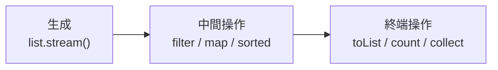

::: haru
先輩、`stream().filter(o -> ...)` って矢印だらけのコード、呪文にしか見えないっす。
:::

::: sensei
Java 8 の **ラムダ式** と **Stream** だね。正体は「メソッドに処理を渡す」仕組み。順番にほどこう。
:::

前回の「ジェネリクス」で覚えた `List<String>` などのコレクションを、**処理を渡して** 一気に加工する書き方を学びます。

## 匿名クラスからラムダ式へ

名前の長い順に並べ替えたいとき、Java 7 まではこう書きました。

```java
List<String> names =
    new ArrayList<>(List.of("Mika", "Bob", "Alice"));
names.sort(new Comparator<String>() {
    @Override
    public int compare(String a, String b) {
        return b.length() - a.length();
    }
});
```

`new Comparator<String>() { ... }` は **匿名クラス**(名前のないクラスをその場で定義・生成する構文)です。渡したいのは `b.length() - a.length()` だけなのに儀式が5行。**ラムダ式** ならこうです。

```java
names.sort((a, b) -> b.length() - a.length());
// [Alice, Mika, Bob]
```

`(引数) -> 式` がラムダ式の形です。引数の型は `Comparator<String>` から **推論** されます。引数1つなら括弧を省略でき(`s -> s.length()`)、複数行なら `{ ...; return 値; }` と書きます。

ラムダ式を書けるのは、**関数型インターフェース**(抽象メソッドがちょうど1つのインターフェース)型が期待される所だけです。1つだから「どのメソッドの実装か」が曖昧になりません。自作するなら `@FunctionalInterface` を付けると、抽象メソッドを2つにした瞬間コンパイルエラーで教えてくれます。

## 標準の関数型インターフェースとメソッド参照

よく使う形は標準で用意されています。

| 型 | メソッド | 形 |
|---|---|---|
| `Function<T,R>` | `apply` | T を受けて R を返す |
| `Predicate<T>` | `test` | T を受けて boolean |
| `Consumer<T>` | `accept` | T を受けて何も返さない |
| `Supplier<T>` | `get` | 何も受けずに T を返す |
| `Comparator<T>` | `compare` | T を2つ比べて int |

```java
Predicate<String> isLong = s -> s.length() >= 5;
System.out.println(isLong.test("Alice")); // true
```

ラムダが「既存メソッドを呼ぶだけ」なら **メソッド参照**(`::`)で書けます。

| 種類 | 例 | ラムダで書くと |
|---|---|---|
| static メソッド | `Integer::parseInt` | `s -> Integer.parseInt(s)` |
| 特定オブジェクトのメソッド | `System.out::println` | `x -> System.out.println(x)` |
| 任意オブジェクトのメソッド | `String::length` | `s -> s.length()` |
| コンストラクタ | `ArrayList::new` | `() -> new ArrayList<>()` |

紛らわしいのは3つ目。`String::length` は「渡された String 自身の `length()` を呼ぶ」意味です。`Comparator.comparing(String::length)` のように使います。

## Stream の3段階

**Stream** は要素の流れに処理をつなげる仕組みで、データ自体は持ちません。



5,000円以上の注文の顧客名を、重複なし・名前順で3人まで取り出します。

```java
List<String> top = orders.stream()      // 生成
    .filter(o -> o.getAmount() >= 5000) // 条件で絞る
    .map(o -> o.getCustomer())          // 別の値に変換
    .distinct()                         // 重複を除く
    .sorted()                           // 並べ替え
    .limit(3)                           // 先頭3件
    .toList();                          // 終端操作
```

for 文だと `Set` で重複を管理し、ソートし、件数を数えて……と10行を超え、意図が手順に埋もれます。Stream は **「何をするか」を宣言的に並べる** ので上から読めば意図がわかります。逆に `break` したい、インデックスが要る、検査例外を投げる、といった処理は for 文が素直です。

::: haru
`.toList()` と `collect(Collectors.toList())`、ネットで両方見るっす。
:::

::: sensei
`toList()` は Java 16 からで、**変更不可** のリストを返す(`add` すると `UnsupportedOperationException`)。`Collectors.toList()` は変更可否が仕様で保証されてない。後で足すなら `new ArrayList<>(...)` で包もう。
:::

## collect と数値の集計

終端操作 `collect` に `Collectors` のメソッドを渡すと、色々な形に集められます。

```java
// 部署 → 社員リスト
Map<String, List<Employee>> byDept = emps.stream()
    .collect(Collectors.groupingBy(Employee::getDept));
// 部署 → 人数(第2引数でグループごとに集計)
Map<String, Long> count = emps.stream()
    .collect(Collectors.groupingBy(
        Employee::getDept, Collectors.counting()));
// 社員ID → 名前
Map<String, String> idToName = emps.stream()
    .collect(Collectors.toMap(
        Employee::getId, Employee::getName));
// "佐藤, 鈴木, 田中"
String csv = emps.stream().map(Employee::getName)
    .collect(Collectors.joining(", "));
```

`toMap` はキーが重複すると `IllegalStateException: Duplicate key` で落ちます。重複しうるなら第3引数で合流方法を渡します。

合計や平均は `mapToInt` で **`IntStream`**(int 専用の Stream)に変換します。`Stream<Integer>` には `sum()` がありません。

```java
int total = orders.stream()
    .mapToInt(Order::getAmount).sum();
double avg = orders.stream()
    .mapToInt(Order::getAmount)
    .average().orElse(0); // 空なら 0
long n = orders.stream().count();
```

`IntStream` は **ボクシング**(int を `Integer` オブジェクトに包むこと)を避けるための専用型です。`average()` が `OptionalDouble` を返すのは「0件なら平均は存在しない」から。詳しくは次回の Optional で。

## よくあるミス

### 終端操作を呼ばないと何も起きない

```java
orders.stream()
    .filter(o -> {
        System.out.println("チェック中");
        return o.getAmount() > 0;
    }); // 何も出力されない!
```

中間操作は **遅延評価** です。`filter` や `map` は予定を組み立てるだけで、終端操作が呼ばれて初めて要素が流れます。だから `filter` → `limit(3)` なら、3件見つかった時点で残りの要素は調べません。

### Stream は再利用できない

```java
Stream<Order> s = orders.stream();
long a = s.count();
long b = s.count(); // 実行時エラー
```

```text
java.lang.IllegalStateException:
  stream has already been operated upon or closed
```

Stream は使い切りです。再処理は `orders.stream()` から作り直します。

### ラムダから外のローカル変数は書き換えられない

```java
int total = 0;
orders.forEach(o -> total += o.getAmount());
```

```text
error: local variables referenced from a lambda
  expression must be final or effectively final
(日本語環境: ラムダ式から参照されるローカル変数は、
  finalまたは事実上のfinalである必要があります)
```

ラムダから参照できるローカル変数は `final` か **実質 final**(値が一度決まったら二度と代入されない変数)だけです。ラムダは後で・別スレッドで実行されうるので、Java は変数の **値をコピー** して持たせます。コピーと元がずれないよう書き換えを禁止しているのです。合計なら `mapToInt(...).sum()` が正解。

::: genba Stream 書きすぎて読めない問題
覚えたてでやりがちなのが、`groupingBy` に `toMap` を入れ子にした20行の1文。3日後には本人も読めません。現場の定番は「1行1操作で改行」「ラムダが3行を超えたらメソッドに切り出してメソッド参照で呼ぶ」。for 文のほうが読みやすいなら、それが正解です。
:::

::: point まとめ
- ラムダ式 `(引数) -> 式` は **関数型インターフェース**(抽象メソッド1つ)の実装を短く書く構文
- `Function` / `Predicate` / `Consumer` / `Supplier` / `Comparator` が基本形。呼ぶだけなら **メソッド参照** `::`
- Stream は **生成 → 中間操作 → 終端操作**。中間操作は遅延評価で、終端操作がないと何も起きない
- 集めるのは `collect`(`groupingBy` / `toMap` / `joining`)、合計・平均は `mapToInt` で `IntStream` に
- Stream は使い切り。ラムダから触れるローカル変数は **実質 final** だけ
:::

::: sensei
次は「Optional」。`average()` の戻り値の正体と、null との付き合い方だ。
:::
