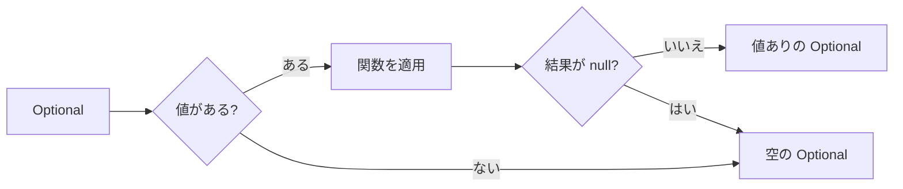

::: haru
先輩、本番ログに `NullPointerException` が出たっす……。テストでは動いてたのに。
:::

::: sensei
Java エンジニアが一生で一番見る例外だね。今日は「値がないかもしれない」を型で表す **Optional** で、null と上手に付き合う方法をやろう。
:::

前回の「ラムダとStream」で、`average()` が `OptionalDouble` を返すのを見ました。今回はその仲間、`Optional<T>` の正体です。

## null の問題(10億ドルの過ち)

```java
static String findName(int id) {
    return id == 1 ? "Sato" : null; // なければ null
}

int len = findName(2).length();
```

```text
java.lang.NullPointerException: Cannot invoke
  "String.length()" because the return value of
  "Main.findName(int)" is null
```

`null` は「どのオブジェクトも指していない」という参照の値です。null に対してメソッドを呼ぶと **NullPointerException(NPE)** が発生します。厄介なのは、`findName` の戻り値の型が `String` なので、**null が返るかどうかがシグネチャから読み取れない** ことです。呼ぶ側は Javadoc を読むか、全部に `if (x != null)` を書くしかありません。

null 参照を発明した Tony Hoare 自身が、2009年の講演で「**10億ドルの過ち**(billion-dollar mistake)」と呼んで後悔を語っています。

::: trivia Helpful NullPointerException
上のメッセージの `because the return value of ... is null` の部分は Java 14 で入り、15 から標準で有効になった機能(JEP 358)。それ以前は `NullPointerException` の1行だけで、どれが null か推理するしかありませんでした。
:::

## Optional の作り方

**`Optional<T>`** は「T 型の値が1つ入っているか、空か」を表す箱です。戻り値を `Optional<String>` にすれば「ないかもしれない」ことが **型で** 伝わり、呼ぶ側は空の場合を考えずには値を取り出せません。

```java
Optional<String> a = Optional.of("Sato");     // 値あり
Optional<String> b = Optional.empty();        // 空
Optional<String> c = Optional.ofNullable(s); // null なら空
```

`Optional.of(null)` は即座に NPE です。null かもしれない値を包むときは **`ofNullable`** を使います。

```java
static Optional<String> findName(int id) {
    return id == 1 ? Optional.of("Sato")
                   : Optional.empty();
}
```

## 値の取り出し方

| メソッド | 空のときの動き |
|---|---|
| `orElse(既定値)` | 既定値を返す |
| `orElseGet(() -> 値)` | ラムダを実行して返す |
| `orElseThrow(() -> 例外)` | 例外を投げる |
| `ifPresent(v -> 処理)` | 何もしない |
| `ifPresentOrElse(v -> 処理, () -> 処理)` | 2つ目を実行 |

```java
String name = findName(2).orElse("ゲスト");
findName(1).ifPresentOrElse(
    n -> System.out.println("こんにちは " + n),
    () -> System.out.println("見つかりません"));
String n = findName(id).orElseThrow(
    () -> new IllegalArgumentException("ID不明: " + id));
```

### orElse と orElseGet の評価タイミング

```java
// どちらも "Sato" だが……
String a = findName(1).orElse(loadDefault());
String b = findName(1).orElseGet(() -> loadDefault());
```

値があるので結果はどちらも `"Sato"` ですが、**`orElse` の行では `loadDefault()` が呼ばれています**。Java はメソッドを呼ぶ前に引数を必ず評価するので、`orElse(式)` の式は値の有無に関係なく毎回実行されるのです。`orElseGet` はラムダ(処理)を渡すだけなので、空のときしか実行されません。

既定値が定数なら `orElse`、DB アクセスや重い計算、ログ出力など **副作用のある処理** なら `orElseGet` を使います。

## map / filter / flatMap で null チェックを消す

社員 → 部署 → 部署名 と辿る処理を、null チェックで書くとこうなります。

```java
String deptName = "未所属";
if (emp != null) {
    Dept d = emp.getDept();
    if (d != null && d.getName() != null) {
        deptName = d.getName();
    }
}
```

Optional なら1本のチェーンです。`map` のたびに下の図の分岐が起きます。

```java
String deptName = Optional.ofNullable(emp)
    .map(Employee::getDept)   // null なら空になる
    .map(Dept::getName)
    .orElse("未所属");
```



- **`map(f)`**:値があれば `f` を適用し、結果を `ofNullable` で包み直します。結果が null なら空になるので、途中のどこで null が出てもチェーンは安全に素通りします。
- **`filter(条件)`**:条件を満たさなければ空にします。`.filter(s -> !s.isBlank())` で「空文字も未入力扱い」にできます。
- **`flatMap(f)`**:`f` 自体が `Optional` を返すときに使います。`map` だと `Optional<Optional<Dept>>` と二重に包まれてしまうからです。

```java
// findDept が Optional<Dept> を返すなら flatMap
Optional<String> name = findEmployee(id)
    .flatMap(e -> findDept(e.getDeptId()))
    .map(Dept::getName);
```

Stream の **`findFirst()`** も「見つからないかもしれない」ので Optional を返します。

```java
String first = emps.stream()
    .filter(e -> e.getSalary() >= 500)
    .map(Employee::getName)
    .findFirst()
    .orElse("該当なし");
```

## アンチパターンと、使う場所・使わない場所

### get() と isPresent() + get()

```java
String n = findName(2).get();
// java.util.NoSuchElementException: No value present
```

`get()` は空なら例外を投げるので、NPE が別の例外に変わっただけです。`isPresent()` で確かめてから `get()` するのも、`if (x != null)` と同じで Optional の意味がありません。`orElse` 系や `map` / `ifPresent` で書きましょう。Java 10 では、意図を明確にするため `get()` と同じ動きの **`orElseThrow()`**(引数なし)が追加されています。

### Optional は「戻り値」のための型

Optional は Java 8 で、**メソッドの戻り値で「結果なし」を表すため** に設計されました。それ以外の場所では使わないのが現場の定石です。

| 場所 | 推奨 | 理由 |
|---|---|---|
| 戻り値 | ◯ | 本来の用途 |
| フィールド | ✕ | Serializable でなく、箱の分メモリも食う |
| 引数 | ✕ | 呼ぶ側に包ませるうえ、Optional 自体が null で来うる |
| コレクションの中身 | ✕ | 「ない」は空リストや要素なしで表せる |

`List` を返すメソッドなら、Optional で包まず **空のリスト** を返しましょう。

::: warn Optional 型の変数に null を入れない
`Optional<String> x = null;` は最悪です。「Optional なら null チェック不要」と信じて `x.orElse(...)` を呼んだ瞬間に NPE。Optional を返すメソッドは、どんな場合も **null ではなく `Optional.empty()`** を返します。
:::

::: point まとめ
- null は型から「ないかもしれない」が読めないのが問題。**Optional は戻り値で不在を表す型**
- 作り方は `of`(null 不可)/ `ofNullable` / `empty`
- 取り出しは `orElse` / `orElseGet` / `orElseThrow` / `ifPresent` / `ifPresentOrElse`
- `orElse(式)` の式は **値があっても評価される**。重い処理は `orElseGet`
- `map` / `filter` / `flatMap` でネストした null チェックを1本のチェーンに
- `get()` や `isPresent()` + `get()` は避ける。フィールド・引数・コレクションには使わない
:::

::: sensei
次は「record と enum」。データを運ぶクラスを1行で書ける、モダン Java の目玉だよ。
:::
