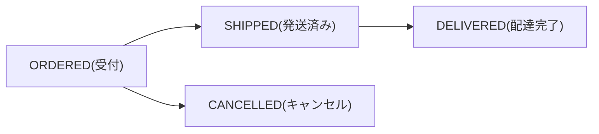

::: haru
先輩、金額を表すクラスを作ったら、フィールド2つなのに60行になりました……。
:::

::: sensei
getter も equals も手書きしたな? record なら1行だ。ついでに「状態を int で持つ」悪習も enum で卒業しよう。
:::

前回の「Optional」に続き、今回も「型で表す」話。**ただの値** を表す record と、**決まった選択肢** を表す enum です。

## record:データを運ぶクラスを1行で

**record**(Java 16 で正式導入)は、値をまとめて運ぶだけのクラスを簡潔に書く構文です。まず従来の書き方。

```java
final class Money {
    private final long amount;
    private final String currency;
    Money(long amount, String currency) {
        this.amount = amount;
        this.currency = currency;
    }
    long getAmount() { return amount; }
    String getCurrency() { return currency; }
    // equals / hashCode / toString でさらに30行
}
```

record ならこれだけです。

```java
record Money(long amount, String currency) {}
```

`(long amount, String currency)` を **レコードコンポーネント** と呼び、コンパイラが次のものを自動生成します。

| 自動生成されるもの | 中身 |
|---|---|
| private final フィールド | `amount`, `currency` |
| 正準コンストラクタ | 全コンポーネントを引数に取る |
| アクセサ | `amount()`(get は付かない) |
| equals / hashCode | 全コンポーネントの値で比較 |
| toString | `Money[amount=100, currency=JPY]` |

```java
var a = new Money(100, "JPY");
var b = new Money(100, "JPY");
System.out.println(a.amount());   // 100
System.out.println(a.equals(b));  // true(値が同じ)
System.out.println(a == b);       // false(別オブジェクト)
System.out.println(a);  // Money[amount=100, currency=JPY]
```

### record の制約:不変で、継承できない

- フィールドは全部 `final`。セッターは書けない(`cannot assign a value to final variable amount`)
- record は暗黙に `final`。継承しようとすると `cannot inherit from final Money`
- インスタンスフィールドの追加は不可(`field declaration must be static`)。static フィールド・メソッド追加・インターフェース実装は OK

::: sensei
値で比較するなら中身は変わっちゃダメ。HashSet に入れた後で変わったら、hashCode がズレて二度と見つからない。
:::

## コンパクトコンストラクタで検証する

不正な値を作らせないには **コンパクトコンストラクタ** を使います。引数リストを書かないコンストラクタで、本体の後にフィールドへの代入が自動で行われます。

```java
record Money(long amount, String currency) {
    Money {
        if (amount < 0) {
            throw new IllegalArgumentException(
                "金額が負: " + amount);
        }
        Objects.requireNonNull(currency, "通貨");
    }
    Money add(Money other) {
        if (!currency.equals(other.currency)) {
            throw new IllegalArgumentException("通貨違い");
        }
        return new Money(amount + other.amount, currency);
    }
}
```

`add` は自分を書き換えず **新しい Money を返す**。これが不変オブジェクトの流儀です。

::: genba 現場ではこう使う
- **DTO**:API のリクエスト/レスポンス。Spring も Jackson も record 対応済み
- **値オブジェクト**:金額・メールアドレスなど検証ルール付きの値
- **Map の複合キー**:equals/hashCode が正しいので安心

状態が変わっていく **エンティティ**(会員・注文)には向きません。
:::

注意:不変なのは **浅く** です。`record Cart(List<String> items)` に外から渡した List を後で書き換えると中身が変わります。コンパクトコンストラクタで `items = List.copyOf(items);` と防御コピーしておきましょう。

## enum:決まった選択肢を型にする

注文ステータスを、昔はこう書いていました。

```java
static final int ORDERED = 0;
static final int SHIPPED = 1;
void ship(int status) { ... }
ship(42);   // コンパイルが通ってしまう
```

ただの int なので何でも渡せ、ログにも `1` としか出ません。**enum(列挙型)** なら選択肢そのものが型になります。

```java
enum OrderStatus { ORDERED, SHIPPED, DELIVERED, CANCELLED }

void ship(OrderStatus s) { ... }
ship(OrderStatus.SHIPPED);  // これ以外はコンパイルエラー
```

enum は `java.lang.Enum` を継承した特別なクラスで、各定数は **唯一のインスタンス**。だから比較は `==` で安全です。

```java
for (OrderStatus s : OrderStatus.values()) {
    System.out.println(s.ordinal() + ":" + s.name());
}
// 0:ORDERED 1:SHIPPED 2:DELIVERED 3:CANCELLED
var s = OrderStatus.valueOf("SHIPPED"); // 文字列→定数
```

- `values()`:全定数を **宣言順** の配列で返す
- `valueOf(String)`:名前から定数を引く。一致しないと `IllegalArgumentException: No enum constant OrderStatus.shipped`(大文字小文字も区別)
- `ordinal()`:宣言順の番号(0始まり)

### ordinal を DB に保存してはいけない

`ordinal()` は **宣言の順番** にすぎません。`ORDERED` と `SHIPPED` の間に `PAID` を足した瞬間、保存済みの `1` は「発送済み」から「支払済み」に化け、エラーも出ません。保存するなら `name()` か、自前の **コード値** を使います。

## フィールド・メソッドを持つ enum

enum はクラスなので、フィールド・コンストラクタ・メソッドを持てます。

```java
enum TaxCategory {
    STANDARD(10), REDUCED(8);

    private final int rate;
    TaxCategory(int rate) { this.rate = rate; }

    long taxOf(long price) {
        return price * rate / 100;
    }
}
TaxCategory.REDUCED.taxOf(1000);  // 80
```

コンストラクタは暗黙に `private` で、外から `new` できません。定数はこのソースに書いたものだけ、と保証されるのが強みです。

## switch 式と EnumMap

enum は switch 式と相性抜群です。**全定数を case に書けば default は不要**で、コンパイラが網羅性をチェックします。

```java
String label = switch (status) {
    case ORDERED -> "受付";
    case SHIPPED -> "発送済み";
    case DELIVERED -> "配達完了";
    case CANCELLED -> "キャンセル";
};
```

定数を追加すると、この switch が `the switch expression does not cover all possible input values` で **コンパイルエラー** になり対応漏れを教えてくれます。だから現場ではあえて `default` を書きません。

状態遷移のルールも enum に持たせると見通しが良くなります。



enum をキーにする Map なら **EnumMap** を使います。内部は ordinal を添字にした配列なので HashMap より速く、反復は宣言順です。

```java
Map<OrderStatus, Integer> count =
    new EnumMap<>(OrderStatus.class);
for (OrderStatus s : orders) {
    count.merge(s, 1, Integer::sum);
}
// {ORDERED=2, SHIPPED=1}(宣言順)
```

::: haru
`static final int` の定数クラス、もう要らないんすか?
:::

::: sensei
選択肢を表すなら要らない。型安全、名前で表示、網羅性チェック、メソッドも持てる。int に勝ち目はないよ。
:::

## よくあるミス

```java
record User(String name) {}
user.getName();   // × cannot find symbol
user.name();      // ○ アクセサに get は付かない
```

```java
// 画面入力をそのまま valueOf
OrderStatus.valueOf(input);
// "shipped" → IllegalArgumentException
// null      → NullPointerException: Name is null
```

外部の文字列は null・空白・大文字小文字を整えてから変換します。

::: point まとめ
- record は **値を運ぶ不変クラス**。フィールド・コンストラクタ・アクセサ・equals/hashCode/toString を自動生成
- 検証は **コンパクトコンストラクタ** で。record は final で継承不可、浅い不変なので List は `List.copyOf`
- enum は選択肢そのものを型にする。比較は `==`、`values()` は宣言順
- **ordinal は永続化しない**。`name()` かコード値を保存する
- enum はフィールド・メソッドを持てる。switch 式は全定数を書けば **default なしで網羅性チェック**
- enum キーの Map は **EnumMap**
:::

::: sensei
次は「日付API」。日付も実は「不変の値」の代表選手だ。今日の record の感覚がそのまま効くよ。
:::
