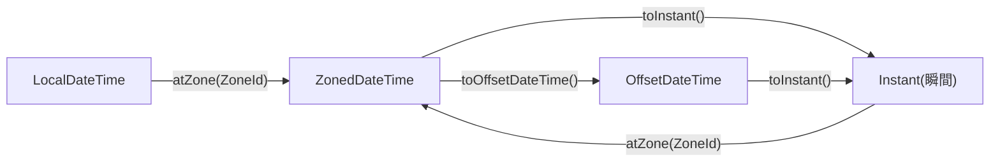

::: haru
先輩! `Calendar` で 2月1日を作ったのに、3月1日になってました……。
:::

::: sensei
月を `2` で指定したな? 古い API の月は **0始まり** なんだ。今日はその地雷原を卒業して、java.time に引っ越すぞ。
:::

前回の record で「不変の値」を学びました。日付こそ、不変の値の代表選手です。

## Date / Calendar はなぜ嫌われたか

Java 1.0 の `java.util.Date` と 1.1 の `Calendar` には、有名な欠陥があります。

```java
Calendar cal = Calendar.getInstance();
cal.clear();
cal.set(2024, 2, 1);   // 2月1日のつもり
System.out.println(cal.getTime());
// Fri Mar 01 00:00:00 JST 2024 ← 3月!
```

- **月が0始まり**(1月 = `0`)。年と日は普通なのに月だけズレる
- **可変**(`set` で中身が変わる)。メソッドに渡した日付を相手が書き換えられ、複数スレッドで共有すると壊れる
- 日付だけ・時刻だけを表すクラスがない。`Date` は名前に反して「ある瞬間」を表す

Java 8 で、人気ライブラリ Joda-Time の作者を中心に設計し直された **java.time パッケージ**(JSR-310)が入りました。クラスはすべて **不変** で、月は **1始まり** です。新しいコードで `Date` / `Calendar` を使う理由はありません。

## クラスの使い分け

| クラス | 表すもの | 例 |
|---|---|---|
| `LocalDate` | 日付だけ | 誕生日、締め日 |
| `LocalTime` | 時刻だけ | 始業 9:00 |
| `LocalDateTime` | 日付+時刻 | 予約日時(地域なし) |
| `ZonedDateTime` | +タイムゾーン | 東京の会議 |
| `OffsetDateTime` | +UTCとの時差 | API の日時 |
| `Instant` | 世界共通の瞬間 | ログ、DB の記録時刻 |

`Local〜` の「ローカル」は「どの地域のものか決まっていない」という意味です。「2024-03-10 09:00」だけでは、東京の9時かロンドンの9時か分からず、**世界の時間軸上の1点に決まりません**。

- **ZoneId**(`Asia/Tokyo`)は地域のルール。夏時間で時差が変わる地域も正しく扱える
- **ZoneOffset**(`+09:00`)はただの時差の数字
- **Instant** は 1970-01-01T00:00Z からの経過時間。地域に依存しない「瞬間」



::: genba 現場の使い分け
- 業務ロジック(締め日、営業日)は **LocalDate**
- ログ・作成日時は **Instant**(DB は UTC で持ち、表示時に `Asia/Tokyo` に変換)
- 外部 API とのやり取りは時差付きの **OffsetDateTime**(`2024-03-10T09:00+09:00`)
:::

## 作る・足す・比べる

```java
var d1 = LocalDate.of(2024, 4, 1);     // 月は1始まり
var d2 = LocalDate.parse("2024-04-01"); // ISO形式
var today = LocalDate.now();   // 今日(毎回変わる)
var t = LocalTime.of(9, 30);
var dt = d1.atTime(t);         // 2024-04-01T09:30
```

存在しない日付(`LocalDate.of(2023, 2, 29)`)は `DateTimeException` になります。Calendar のように黙って3月1日に繰り越したりしません。

加算・減算は `plusDays` / `plusMonths` / `minusWeeks` など。ここで **最大の罠** があります。

```java
LocalDate due = LocalDate.of(2024, 4, 1);
due.plusDays(7);              // × 戻り値を捨てている
System.out.println(due);      // 2024-04-01 のまま!

due = due.plusDays(7);        // ○ 新しいオブジェクトを受け取る
```

java.time は不変なので、`plusDays` は **自分を変えずに新しい LocalDate を返します**。String の `toUpperCase()` と同じです。

月の加算は、存在しない日なら **その月の末日に丸められます**。

```java
LocalDate.of(2024, 1, 31).plusMonths(1);  // 2024-02-29
```

比較は `isBefore` / `isAfter` / `isEqual`(または `equals`)。`<` や `>` は使えません。

## 期間:Period と Duration

| | 単位 | 使う相手 |
|---|---|---|
| `Period` | 年・月・日 | LocalDate |
| `Duration` | 時間・分・秒・ナノ秒 | 時刻、Instant |

```java
var a = LocalDate.of(2024, 1, 15);
var b = LocalDate.of(2024, 3, 10);
Period p = Period.between(a, b);
System.out.println(p);              // P1M24D
System.out.println(p.getDays());    // 24 ← 総日数ではない!
long days = ChronoUnit.DAYS.between(a, b);  // 55
```

`Period` は「1か月と24日」という **カレンダー上の期間** で、`getDays()` は「日」の部分だけです。総日数が欲しければ `ChronoUnit.DAYS.between` を使います。

```java
Duration work = Duration.between(
    LocalTime.of(9, 0), LocalTime.of(18, 30));
System.out.println(work);             // PT9H30M
System.out.println(work.toMinutes()); // 570
System.out.println(work.toHours() + "時間"
    + work.toMinutesPart() + "分");   // 9時間30分
```

`Duration.between` に `LocalDate` を渡すと、秒を扱えないので `UnsupportedTemporalTypeException: Unsupported unit: Seconds` です。

## 曜日と月末

```java
LocalDate d = LocalDate.of(2024, 2, 10);
DayOfWeek w = d.getDayOfWeek();       // SATURDAY
boolean holiday = w == DayOfWeek.SATURDAY
               || w == DayOfWeek.SUNDAY;
d.lengthOfMonth();                     // 29(うるう年)
d.with(TemporalAdjusters.lastDayOfMonth());
                                       // 2024-02-29
d.with(TemporalAdjusters.next(DayOfWeek.FRIDAY));
                                       // 次の金曜
```

`DayOfWeek` は前回学んだ **enum** です。だから `==` で比べられ、switch 式でも網羅性チェックが効きます。月末を「30日」や「31日」と決め打ちせず、`lengthOfMonth()` や `TemporalAdjusters` に任せましょう。

## DateTimeFormatter と大文字小文字の罠

```java
var f = DateTimeFormatter.ofPattern(
    "yyyy/MM/dd HH:mm");
String s = dt.format(f);           // 2024/04/01 09:30
var back = LocalDateTime.parse(s, f);  // 文字列→日時
```

パターン文字は **大文字と小文字で意味が違います**。

| 文字 | 意味 | よくある間違い |
|---|---|---|
| `yyyy` | 年 | `YYYY` は週基準の年 |
| `MM` | 月 | `mm` は分 |
| `dd` | 日 | `DD` は年内の通算日 |
| `HH` | 時(0〜23) | `hh` は12時間制 |

特に `YYYY`(week-based-year)は、年末の数日だけ **翌年** になります。

```java
LocalDate.of(2024, 12, 30)
    .format(DateTimeFormatter.ofPattern("YYYY/MM/dd"));
// 2025/12/30 ← 1年先!
```

普段のテストでは正しく見えて、12月末にだけ壊れる時限爆弾です。

## テストしやすくする:Clock の注入

`LocalDate.now()` を処理の中で直接呼ぶと、**実行した日によって結果が変わり**、テストが書けません。「月末だけ落ちるテスト」の正体はたいていこれです。対策は2つ。

1. 日付を **引数で受け取る**(一番シンプル。演習もこの形)
2. `Clock` を外から渡し、`now(clock)` を使う

```java
class Billing {
    private final Clock clock;
    Billing(Clock clock) { this.clock = clock; }
    boolean isOverdue(LocalDate due) {
        return LocalDate.now(clock).isAfter(due);
    }
}
// 本番: new Billing(Clock.systemDefaultZone())
// テスト: 時刻を固定する
Clock fixed = Clock.fixed(
    Instant.parse("2024-03-31T15:00:00Z"),
    ZoneId.of("Asia/Tokyo"));   // 東京では 4/1 0:00
```

::: sensei
Spring なら `Clock` を Bean にして注入するのが定番だ。「現在時刻」も外から渡す依存の1つ、と考えるといい。
:::

::: point まとめ
- `Date` / `Calendar` は **可変・月が0始まり**。新規コードは java.time
- 日付だけなら `LocalDate`、瞬間なら `Instant`、地域込みなら `ZonedDateTime`、時差込みなら `OffsetDateTime`
- java.time は **不変**。`d = d.plusDays(1)` と **戻り値を受け取る**
- `Period`(年月日)と `Duration`(時分秒)。総日数は `ChronoUnit.DAYS.between`
- パターンは `yyyy/MM/dd HH:mm`。**`YYYY` と `mm` の取り違えに注意**
- 月末は `lengthOfMonth()` / `TemporalAdjusters.lastDayOfMonth()`
- `now()` を直接呼ばず、**引数か Clock** で受け取るとテストできる
:::

::: sensei
次は「ファイルIO」。日付で名前を付けたログファイルを読み書きする、なんて実務の定番もできるようになるよ。
:::
