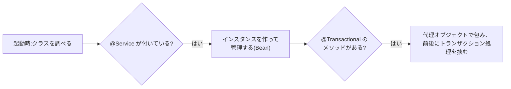

::: haru
先輩、研修で見せてもらった Spring のコード、`@Service` とか `@Transactional` とか `@` だらけでした。あれって全部、Java の文法なんですか?
:::

::: sensei
`@` の書き方は Java の文法。でも、`@Service` そのものは何もしないんだ。今日はその「何もしない目印」が、どうやって仕事をしているのかを覗くぞ。
:::

前回の日付API では、`Clock` を外から渡すと「今」を差し替えられる、という話の最後に Spring の名前が出てきました。今回はその Spring を読むときに避けて通れない **アノテーション** です。

## @ の正体:コードに貼る目印

`@Override` や `@Service` のような `@〜` を **アノテーション**(annotation:注釈)と呼びます。正体は、クラス・メソッド・フィールドなどに貼る **目印(メタデータ)** です。

大事なのは、**アノテーションそれ自体は一切の処理をしない** ことです。「この目印が付いていたら、こう扱う」と決めている **別の誰か** が読んで、初めて意味を持ちます。

<figure class="figure"><svg viewBox="0 0 600 220" xmlns="http://www.w3.org/2000/svg" font-family="inherit"><rect x="20" y="40" width="220" height="150" rx="10" fill="var(--surface-2)" stroke="var(--ink)" stroke-width="2"/><text x="130" y="30" font-size="14" text-anchor="middle" fill="var(--ink-muted)">あなたのクラス</text><rect x="36" y="56" width="90" height="26" rx="5" fill="var(--accent-soft)" stroke="var(--accent)" stroke-width="2"/><text x="81" y="74" font-size="13" text-anchor="middle" fill="var(--ink)">@Service</text><text x="36" y="106" font-size="13" fill="var(--ink)">public class OrderService {</text><rect x="52" y="118" width="110" height="26" rx="5" fill="var(--accent-soft)" stroke="var(--accent)" stroke-width="2"/><text x="107" y="136" font-size="13" text-anchor="middle" fill="var(--ink)">@Transactional</text><text x="52" y="166" font-size="13" fill="var(--ink)">public void place(...) {}</text><text x="36" y="184" font-size="13" fill="var(--ink)">}</text><defs><marker id="java-annotations-arr" markerWidth="10" markerHeight="10" refX="8" refY="5" orient="auto"><path d="M0 0 L10 5 L0 10 z" fill="var(--accent)"/></marker></defs><rect x="340" y="40" width="240" height="60" rx="10" fill="var(--accent-soft)" stroke="var(--ink)" stroke-width="2"/><text x="460" y="64" font-size="14" font-weight="700" text-anchor="middle" fill="var(--ink)">コンパイラ(javac)</text><text x="460" y="86" font-size="12" text-anchor="middle" fill="var(--ink)">@Override を検査 / Lombok がコード生成</text><rect x="340" y="130" width="240" height="60" rx="10" fill="var(--accent-soft)" stroke="var(--ink)" stroke-width="2"/><text x="460" y="154" font-size="14" font-weight="700" text-anchor="middle" fill="var(--ink)">実行時のフレームワーク(Spring)</text><text x="460" y="176" font-size="12" text-anchor="middle" fill="var(--ink)">リフレクションで目印を探して Bean 登録・AOP</text><path d="M250 70 L335 70" stroke="var(--accent)" stroke-width="2.5" marker-end="url(#java-annotations-arr)"/><path d="M250 150 L335 150" stroke="var(--accent)" stroke-width="2.5" marker-end="url(#java-annotations-arr)"/><text x="292" y="60" font-size="12" text-anchor="middle" fill="var(--ink-muted)">読む</text><text x="292" y="140" font-size="12" text-anchor="middle" fill="var(--ink-muted)">読む</text><text x="300" y="212" font-size="13" text-anchor="middle" fill="var(--ink)">目印そのものは何もしない。読む側が「付いていたらこうする」と決めている</text></svg><figcaption>アノテーションは付箋のようなもの。付箋を見て動くのは「読む側」</figcaption></figure>

読む側は大きく2種類です。

| 読む側 | いつ読む | 例 |
|---|---|---|
| コンパイラ(と、その拡張) | コンパイルするとき | `@Override` の検査、Lombok の `@Getter` がメソッドを生成 |
| 実行時のプログラム | 動いているとき | Spring の `@Service`、JUnit の `@Test`、JPA の `@Entity` |

::: haru
JUnit の `@Test` って、演習の採点テストに毎回付いてるやつですよね。
:::

::: sensei
そう。JUnit は実行時にテストクラスを調べて、`@Test` が付いたメソッドだけを探して呼んでいる。付け忘れたメソッドが実行されないのはそのせいだ。
:::

## Java 標準のアノテーション

まずは Java に最初から入っている4つです。どれも読むのは主に **コンパイラ** です。

```java
public class CsvExporter implements Exporter {

    @Override                                  // 親のメソッドを上書きしている
    public void export(List<Row> rows) { ... }

    @Deprecated(since = "2.0", forRemoval = true)  // 古いので使わないで
    public void exportOld(List<Row> rows) { ... }

    @SuppressWarnings("unchecked")             // この警告は分かって書いている
    private List<Row> castRows(Object raw) {
        return (List<Row>) raw;
    }
}

@FunctionalInterface                           // 抽象メソッドは1つだけ
interface RowMapper { Row map(String line); }
```

| アノテーション | 意味 | コンパイラがすること |
|---|---|---|
| `@Override` | 親のメソッドを上書きしている | 上書きになっていなければ **コンパイルエラー** |
| `@Deprecated` | 非推奨。いずれ消すかも | 呼んでいる側に警告を出す |
| `@SuppressWarnings` | この警告は承知の上 | 指定した種類の警告を出さない |
| `@FunctionalInterface` | ラムダの受け皿 | 抽象メソッドが1つでなければエラー |

`@Override` の威力は、綴りを間違えたときに分かります。

```java
class Child extends Base {
    @Override
    public String Name() { return "child"; }   // 親は name()。大文字の N で別メソッドに
}
```

`@Override` が無ければ「新しいメソッド `Name()` の定義」として静かにコンパイルが通り、親の `name()` が呼ばれ続けるバグになります。`@Override` があれば、コンパイラが「上書きする相手がいない」と止めてくれます。

::: point @Override は「上を見ろ」の合図
実務のコードを読むとき、`@Override` が付いたメソッドは「親クラスかインターフェースに同名のメソッドがある」という意味です。定義元を探す手がかりにしましょう。
:::

## アノテーションを自作する:@interface

アノテーションは自分でも作れます。`interface` の前に `@` を付けた **`@interface`** で定義します。Spring の `@Service` も、ソースを開けば同じ形で書かれています。

```java
import java.lang.annotation.*;

@Retention(RetentionPolicy.RUNTIME)       // いつまで残すか:実行時まで
@Target(ElementType.METHOD)               // どこに付けられるか:メソッドだけ
public @interface Audited {
    String value();                       // 要素(使うときに必須)
    String category() default "general";  // デフォルト値付きの要素
}
```

中に並んでいるのは **要素**(element)です。メソッドのような形で書き、戻り値の型が「値の型」になります。使える型は、プリミティブ型・`String`・`Class`・enum・アノテーション、それらの配列だけです。

使う側はこうなります。

```java
@Audited("ISSUE_KEY")                                   // value だけなら名前を省略できる
public Key issue(String userId) { ... }

@Audited(value = "REVOKE_KEY", category = "security")   // 複数なら 名前 = 値
public void revoke(String keyId) { ... }
```

- `default` が無い要素は、使うときに **必ず** 指定する(指定しないとコンパイルエラー)
- **`value` という名前の要素だけ** は、それしか指定しないとき `value =` を省略できる
- 要素が1つも無いアノテーション(`@interface Draft {}`)は、`@Draft` とだけ書く

Spring の `@GetMapping("/users")` や `@Qualifier("main")` が名前なしで書けるのも、要素名が `value` だからです。

::: warn 定義を読んでも処理は書いていない
`@Audited` の定義には要素の宣言しかなく、「監査ログを書く」処理はどこにもありません。**処理は必ず、このアノテーションを読む別のクラスにあります。**
:::

## @Retention と @Target

アノテーションの定義に付いていた `@Retention` と `@Target` は、「アノテーションに付けるアノテーション」(**メタアノテーション**)です。

**`@Retention`** は、目印を **いつまで残すか** を決めます。

| RetentionPolicy | 残る範囲 | 読める人 |
|---|---|---|
| `SOURCE` | ソースコードだけ。class ファイルには残らない | コンパイラ(`@Override`、Lombok) |
| `CLASS`(省略時の既定) | class ファイルには残るが、実行時は読めない | バイトコードを調べるツール |
| `RUNTIME` | 実行時まで残る | リフレクション(Spring、JPA、JUnit) |

注意したいのは、`@Retention` を **書かなかったときは `CLASS`** になることです。自作のアノテーションを実行時に読みたいなら、`RUNTIME` を明示しないと絶対に読めません。

**`@Target`** は、目印を **どこに付けられるか** を決めます。

| ElementType | 付けられる場所 |
|---|---|
| `TYPE` | クラス・インターフェース・enum・record |
| `METHOD` | メソッド |
| `FIELD` | フィールド |
| `PARAMETER` | メソッドの引数 |
| `CONSTRUCTOR` | コンストラクタ |

`@Target({ElementType.TYPE, ElementType.METHOD})` のように配列で複数指定もできます。`@Target(ElementType.METHOD)` のアノテーションをクラスに付けると、コンパイルエラーで教えてくれます。

## リフレクションで読む

実行時にアノテーションを読む道具が **リフレクション**(reflection:内省)です。「動いているプログラムが、**自分自身のクラスの構造を調べる** 仕組み」で、入口は `Class` オブジェクトです。

```java
Class<?> c1 = KeyService.class;         // クラス名から
Class<?> c2 = new KeyService().getClass(); // インスタンスから
```

`Class<?>` は「何かのクラスの型情報」。ここからメソッドやフィールド、付いているアノテーションを取り出せます。

| メソッド | 返すもの |
|---|---|
| `getDeclaredMethods()` | そのクラスで宣言した全メソッド(private も含む、継承分は含まない) |
| `getMethod(名前, 引数の型...)` | public メソッド1つ(継承分も探す) |
| `getDeclaredFields()` | そのクラスで宣言した全フィールド |
| `getAnnotation(X.class)` | 付いている `@X`。**付いていなければ `null`** |
| `isAnnotationPresent(X.class)` | `@X` が付いているか(`true` / `false`) |

前のセクションの `@Audited` を読んでみます。

```java
Method[] methods = KeyService.class.getDeclaredMethods();
Arrays.sort(methods, Comparator.comparing(Method::getName)); // 順番は保証されない
for (Method m : methods) {
    Audited a = m.getAnnotation(Audited.class);
    if (a == null) continue;                  // 目印なし
    System.out.println(m.getName() + " -> " + a.value() + " / " + a.category());
}
// issue -> ISSUE_KEY / general
// revoke -> REVOKE_KEY / security
```

要素の値は `a.value()` のように **メソッド呼び出しの形** で取り出します。省略した `category` には `default` の値が入っています。

`getDeclaredMethods()` が返す配列は **並び順が決まっていません**(Javadoc にそう書いてあります)。結果を毎回同じ順で出したいなら、名前などで並べ替えてから使いましょう。

### 目印を見て、前後に処理を挟む

ここからがフレームワークの考え方です。目印を見つけたら、本来のメソッドの前後に処理を挟んでから呼びます。メソッドを呼ぶのは `Method#invoke` です。

```java
Object call(Object target, String name, String arg) throws Exception {
    Method m = target.getClass().getMethod(name, String.class);
    Audited a = m.getAnnotation(Audited.class);
    if (a != null) System.out.println("[AUDIT start] " + a.value());
    Object result = m.invoke(target, arg);    // 本来のメソッドを呼ぶ
    if (a != null) System.out.println("[AUDIT end]   " + a.value());
    return result;
}
```

`KeyService` のコードには、ログを書く処理が1行もありません。それでも `@Audited` を付けたメソッドだけ、前後にログが出ます。**メソッド本体の外側で処理が動く**、これがアノテーションを使うフレームワークの基本の形です。

フィールドに付けた目印も同じように読めます。`private` フィールドの値を読むには `f.setAccessible(true)` してから `f.get(obj)` です。入力チェック(`@NotBlank`)や JSON 変換(`@JsonIgnore`)のライブラリは、こうしてフィールドの目印を読んでいます。

::: warn リフレクションは「最後の手段」
リフレクションは、名前を文字列で指定するのでタイプミスがコンパイル時に見つからず、`private` も覗けてしまい、普通の呼び出しより遅くなります。業務ロジックで多用するものではありません。**フレームワークの中身を理解するための道具** と考えてください。
:::

## Spring は裏でこう読んでいる(予告)

第3部で Spring を習うと、次のようなコードを毎日見ることになります。

```java
@Service
public class OrderService {

    @Transactional
    public void place(Order order) { ... }
}
```

Spring がやっていることを、今日の言葉で言い直すとこうなります。



- **`@Service`**:起動時にクラスを調べ、この目印が付いたクラスのインスタンスを作って管理します。必要な場所に自動で渡す(DI)のも Spring の仕事です
- **`@Transactional`**:サンプルの `call` と同じ発想で、メソッドの前に「トランザクション開始」、後に「コミット(失敗ならロールバック)」を挟みます
- **`@GetMapping("/users")`**:`value` に書いた URL と、このメソッドを結び付けます(演習3がその縮小版)

どれも定義は `@Retention(RetentionPolicy.RUNTIME)` です。実行時に読まなければ仕事ができないからです。

::: sensei
仕組みの詳細は第3部でやる。今日覚えてほしいのは一つ。「アノテーションが何をしているか知りたければ、**誰がそれを読んでいるか** を探せ」だ。
:::

::: haru
目印そのものじゃなくて、読む側を探す……。自作のアノテーションなら `Audited.class` で検索すればいいんですね。
:::

## import でライブラリを見分ける

業務コードには、いろいろなライブラリのアノテーションが同居しています。見たらまず **import 行** を確かめましょう。

| import の先頭 | ライブラリ | 読む側 |
|---|---|---|
| `org.springframework` | Spring | 実行時 |
| `lombok` | Lombok | コンパイル時(ソースに無いメソッドが生成される) |
| `jakarta.persistence` | JPA | 実行時 |
| `jakarta.validation` | Bean Validation | 実行時 |
| `com.fasterxml.jackson` | Jackson(JSON) | 実行時 |
| `org.junit.jupiter` | JUnit 5 | 実行時 |

Lombok だけは仕組みが違い、**コンパイル時** に getter やコンストラクタを書き足します。「ソースに `getName()` が無いのに呼べている」ときは Lombok を疑いましょう。

::: point まとめ
- アノテーションはコードに貼る **目印(メタデータ)**。それ自体は何もせず、**読む側** が意味と処理を決める
- 標準の `@Override` / `@Deprecated` / `@SuppressWarnings` / `@FunctionalInterface` は主にコンパイラが読む
- 定義は `@interface`。要素はメソッドの形で書き、`default` で既定値。**`value` だけは名前を省略できる**
- `@Retention` は残る範囲(`SOURCE` / `CLASS` / `RUNTIME`)、`@Target` は付けられる場所。**実行時に読むなら `RUNTIME`**(省略すると `CLASS`)
- リフレクション:`getDeclaredMethods()` / `getDeclaredFields()` で調べ、`getAnnotation`(無ければ `null`)・`isAnnotationPresent` で読む。並び順は保証されない
- Spring の `@Service` や `@Transactional` も、実行時に読まれて「本体の外側」で処理が動いている
:::

::: sensei
次は「ファイルIO」。ログや CSV を読み書きする、業務の基本だ。今日の `@Mask` みたいに、ログに何を出すかを気にするのもエンジニアの仕事だぞ。
:::
