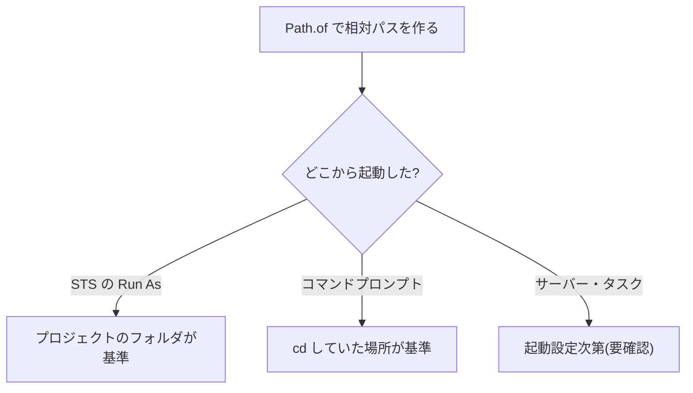

::: haru
先輩、売上CSVを読む処理、STSでは動いたのにコマンドプロンプトだと `NoSuchFileException` で落ちます……。
:::

::: sensei
ファイルIOの三大地雷のひとつ「相対パスの基準」だね。残り2つは「文字コード」と「閉じ忘れ」。今日は全部まとめて片付けよう。
:::

## Path と Files:今どきの書き方

Java のファイル操作は `java.nio.file` パッケージ(Java 7〜)の2つが主役です。

- **`Path`**:ファイルやフォルダの「場所」を表す値。作っただけではファイルに触りません
- **`Files`**:`Path` を受け取って実際に読み書きする static メソッド集

```java
Path dir = Path.of("data");
Path csv = dir.resolve("sales.csv"); // data/sales.csv
Files.createDirectories(dir); // 既存でもOK
Files.writeString(csv, "日付,金額\n");
String all = Files.readString(csv);
List<String> lines = Files.readAllLines(csv);
Files.write(csv, List.of("a", "b")); // 1要素=1行
System.out.println(Files.exists(csv)); // true
```

| やりたいこと | メソッド |
|---|---|
| 全体を1つの文字列で | `readString` / `writeString` |
| 行のリストで | `readAllLines` / `write` |
| 1行ずつ流す | `lines`(Stream) |
| フォルダの中身 | `list`(Stream) |

書き込みは **既定で上書き** です。追記したいなら `StandardOpenOption.APPEND` を付けます。区切りは `/` で書けば Windows でも通ります。

古い資料の `java.io.File` は Java 1.0 からの旧API です。`file.delete()` は失敗しても `false` を返すだけですが、`Files.delete(path)` は `NoSuchFileException` などの例外で原因を教えてくれます。旧APIとの橋渡しは `file.toPath()` / `path.toFile()`。

## 文字コード:UTF-8 を明示する理由

ファイルの中身はただのバイト列です。「どのバイトをどの文字とみなすか」の約束が **文字コード(charset)** で、読み書きで食い違えば文字化けか例外になります。

`Files` のメソッドは charset を省略すると **常に UTF-8** です。一方 `FileReader` などの旧APIは「OS の既定」を使い、日本語 Windows では長年 **MS932**(Shift_JIS の Microsoft 拡張)でした。Java 18 で既定は UTF-8 に統一されましたが(JEP 400)、古い JDK と混在する現場では「どっち?」が事故の元。だから **必ず明示** します。

```java
import java.nio.charset.StandardCharsets;
import java.nio.charset.Charset;

// UTF-8 を明示(意図がコードに残る)
Files.readAllLines(csv, StandardCharsets.UTF_8);
// Excel の「CSV(コンマ区切り)」は MS932
Files.readAllLines(csv, Charset.forName("MS932"));
```

MS932 のファイルを UTF-8 で読むと、こう落ちます。

```text
java.nio.charset.MalformedInputException:
  Input length = 1
```

「UTF-8 として不正なバイトがある」という意味。見たらまず文字コードを疑います。

::: genba Shift_JIS と MS932 は別物
`Charset.forName("Shift_JIS")` には `①` や `髙` などの機種依存文字がありません。Windows 由来のファイルは **`MS932`(別名 `windows-31j`)** を指定するのが正解です。
:::

## BufferedReader と try-with-resources

大きなファイルを `readAllLines` すると全行がメモリに載ります。数GBのログなら **1行ずつ** 読みます。

```java
try (BufferedReader r =
        Files.newBufferedReader(log)) {
    String line;
    while ((line = r.readLine()) != null) {
        // 1行ずつ処理(改行文字は含まない)
    }
}
```

`readLine()` は終端で `null` を返します。書き込みは `Files.newBufferedWriter(path)` で、`write(...)` と `newLine()` を使います。

ファイルを開くと OS の **ファイルハンドル** を占有します。`try (...)` の **try-with-resources** は、ブロックを抜けるとき(例外でも)自動で `close()` してくれる構文です。**`Files.lines` と `Files.list` も Stream の裏でファイルを開いている** ので、同じく try-with-resources が必須です。

```java
try (Stream<String> s = Files.lines(log)) {
    long n = s.filter(l -> l.contains("[ERROR]"))
              .count();
}
```

::: sensei
`Files.lines(log).count()` と書いて閉じないと、GC が拾うまでハンドルを掴みっぱなし。長時間動くサーバーだと、いつか「開いているファイルが多すぎる」で落ちるよ。
:::

Windows ではさらに、`FileReader` など java.io 系で開きっぱなしのファイルや、**Excel で開いているファイル** は削除・上書きできません。

```text
java.nio.file.FileSystemException: C:\data\out.csv:
  プロセスはファイルにアクセスできません。
  別のプロセスが使用中です。
```

Linux は開いているファイルも消せるので、CI では気づかず本番の Windows で発覚しがちです。

## 相対パスの基準は「作業ディレクトリ」

`Path.of("data/sales.csv")` のような **相対パス** は、ソースファイルの場所でも .class の場所でもなく、**JVM を起動したときの作業ディレクトリ(カレントディレクトリ)** を基準に解決されます。



STS は既定でプロジェクトのフォルダを作業ディレクトリにします。ハルのコードが片方でしか動かなかったのはこのため。迷ったら絶対パスを出力して確かめます。

```java
System.out.println(
    Path.of("data/sales.csv").toAbsolutePath());
```

現場では入出力のパスを **設定や引数で外から渡し**、メソッドは `Path` を引数で受け取ります。テストでは一時フォルダを渡すだけで検証できます。

## IOException の扱い

ファイル操作のほとんどは **`IOException`(チェック例外)** を投げます。ファイルが無い・権限が無い・ディスクが一杯など、コードが正しくても起きる失敗だからです。

```text
error: unreported exception IOException;
  must be caught or declared to be thrown
```

方針はシンプルです。

- 自分で回復できないなら `throws IOException` で呼び出し元に任せる
- 回復できる層(画面に「ファイルがありません」と出すなど)で `catch` する
- `catch (IOException e) {}` で **握りつぶさない**

ラムダの中ではチェック例外を投げられないので、`new UncheckedIOException(e)` で包みます。`Files.lines` も読み込み中のエラーを `UncheckedIOException` で投げてきます。

## CSV を読んで集計する

店舗ごとの売上合計を出す、実務の定番です。

```java
Map<String, Integer> total = new TreeMap<>();
List<String> lines = Files.readAllLines(csv);
for (String line : lines.subList(1, lines.size())) {
    if (line.isBlank()) {
        continue;                   // 空行対策
    }
    String[] c = line.split(",");   // 日付,店舗,金額
    total.merge(c[1].trim(),
        Integer.parseInt(c[2].trim()), Integer::sum);
}
```

`subList(1, ...)` でヘッダーを飛ばし、`Map.merge` で「無ければ追加、あれば加算」。

::: warn split(",") の限界
`"東京,本店",1200` のようにダブルクォートの中にカンマがある CSV は `split` では正しく分けられません。本番データでは OpenCSV や Apache Commons CSV などのライブラリを使います。
:::

## よくあるミス

- **ヘッダー行まで数値変換**:`NumberFormatException: For input string: "金額"`
- **MS932 のファイルを既定(UTF-8)で読む**:`MalformedInputException`
- **`Files.lines` の閉じ忘れ**:ハンドルが漏れ続け、いつか落ちる
- **出力先フォルダが無い**:`writeString` は親フォルダを作らないので `NoSuchFileException`。先に `createDirectories`

::: point まとめ
- 新規コードは **`Path` + `Files`**。`java.io.File` は旧API
- `Files` の既定は UTF-8。でも **charset は明示**、Windows 由来は **MS932**
- 開いたものは **try-with-resources** で閉じる。`Files.lines` / `list` も同じ
- 相対パスの基準は **作業ディレクトリ**。STS とコマンドラインで違う
- `IOException` は握りつぶさず、`throws` か回復できる場所で `catch`
- メソッドは **`Path` を引数で受け取る** とテストしやすい
:::

::: sensei
次はいよいよ第1部の最終回「JUnit入門」。この道場の採点の裏側をのぞいてみよう。
:::
