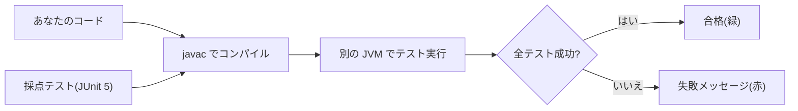

::: haru
先輩、テストって `main` で `println` して、目で見て確かめればよくないですか?
:::

::: sensei
この道場で「提出」を押すと、裏で JUnit が君のコードを採点してる。あれを毎回、人間が目でやる係になりたい?
:::

## なぜ自動テストか

**自動テスト** は「期待する結果」をコードで書いておき、機械に何度でも確かめさせる仕組みです。目視確認は直すたびに全部見直す必要があり、そのうち誰も見なくなります。自動テストなら、修正で別の場所が壊れる **デグレ(回帰バグ)** を数秒で見つけられ、「このメソッドはこう動く」という **動く仕様書** にもなります。

この道場の採点も、まさにこの仕組みです。



Java の定番テストフレームワークが **JUnit** で、現行は **JUnit 5**(テストを書くための部分は Jupiter と呼ばれます)。Spring Boot のプロジェクトには最初から入っています。

## JUnit 5 の基本

```java
import org.junit.jupiter.api.*;
import static org.junit.jupiter.api.Assertions.*;

class CartTest {
    Cart cart;

    @BeforeEach   // 各テストの直前に毎回実行
    void setUp() {
        cart = new Cart();
    }

    @Test
    @DisplayName("5000円以上は送料無料")
    void freeShipping() {
        cart.add(5000);               // Arrange(準備)
        int fee = cart.shippingFee(); // Act(実行)
        assertEquals(0, fee);         // Assert(検証)
    }
}
```

- `@Test` を付けた引数なし・`void` のメソッドが1つのテスト。JUnit 5 では `public` は不要です
- `main` は要りません。JUnit が **リフレクション**(実行時にクラスの中身を調べる仕組み)で `@Test` 付きメソッドを探して呼び出します
- JUnit は **テストメソッドごとにテストクラスのインスタンスを作り直します**。テスト同士で状態を共有しないための設計で、準備は `@BeforeEach` に書きます
- `@DisplayName` で結果画面に出る名前を付けられます

| アサーション | 確かめること |
|---|---|
| `assertEquals(期待, 実際)` | 等しい(`equals`) |
| `assertTrue(条件)` | 条件が true |
| `assertThrows(型, 処理)` | 例外が投げられる |
| `assertAll(...)` | 全部確かめてまとめて報告 |

```java
var e = assertThrows(
    IllegalArgumentException.class,
    () -> cart.add(-1));   // ラムダで「処理」を渡す
assertEquals("金額が負です", e.getMessage());
```

通常の assert は最初の失敗でそのテストを打ち切ります。`assertAll` に複数のラムダを渡すと全部実行し、失敗をまとめて報告してくれます。

## テストの書き方の型

**Arrange-Act-Assert(AAA)**:準備・実行・検証の3段に分けて書きます。どこまでが準備か一目で分かり、読む人が迷いません。

**1テスト1観点**:1つのテストで確かめることは1つに絞ります。テスト名を見ただけで「何が壊れたか」が分かるからです。

**テスト名は日本語でもよい**:Java の識別子には日本語が使えるので、`void 五千円以上は送料無料()` も合法です。英語名 + `@DisplayName` にするかはチームの規約次第です。

## 境界値と同値分割

入力を全部試すのは不可能です。そこで2つの技法を使います。

- **同値分割**:同じ扱いになる入力のグループ(**同値クラス**)に分け、各グループから代表を1つ選ぶ
- **境界値分析**:バグは `>=` と `>` の取り違えなど **境目** に集まるので、境目の両側を試す

例:「0円以下はエラー、1〜4999円は送料500円、5000円以上は無料」

| 同値クラス | 代表値 | 境界値 |
|---|---|---|
| エラー | -100 | 0 |
| 有料 | 2000 | 1, 4999 |
| 無料 | 8000 | 5000 |

## @ParameterizedTest で表のように書く

境界値のテストは入力と期待値の組が並ぶので、`@ParameterizedTest` と `@CsvSource` で表のように書けます。

```java
@ParameterizedTest
@CsvSource({
    "0,    -1",
    "1,    500",
    "4999, 500",
    "5000, 0"
})
void 送料(int amount, int expected) {
    assertEquals(expected, Shipping.fee(amount));
}
```

1つの文字列が1回分のテストになり、カンマ区切りの値が引数の型に自動変換されます(前後の空白は無視)。`junit-jupiter-params` というモジュールの機能で、Spring Boot や STS の JUnit 5 ライブラリには含まれています。

::: warn assertEquals の引数の順番
`assertEquals(期待値, 実際の値)` の順です。逆にしても成否は同じですが、失敗時の `expected: <0> but was: <500>` が **逆の意味** になり、調査する人を混乱させます。
:::

## テストしやすい設計

```java
// テストしにくい:結果が実行日で変わる
static boolean isExpired(LocalDate limit) {
    return LocalDate.now().isAfter(limit);
}
// テストしやすい:「今日」を引数で受け取る
static boolean isExpired(LocalDate limit,
                         LocalDate today) {
    return today.isAfter(limit);
}
```

`LocalDate.now()` のような static 呼び出しをメソッドの奥に埋めると、結果が実行日で変わり、「月末だけ落ちるテスト」が生まれます。「今」は呼ぶ側から渡すか、`java.time.Clock` を受け取るようにします。

同じように、ファイル入出力や画面表示といった **副作用** と、計算ロジックは分けます。「読む」「集計する」「書く」を別メソッドにすれば、集計は `List` を渡すだけでテストできます。前回、メソッドが `Path` を引数で受け取ったのも同じ考え方です。

## TDD:テストを先に書く

**テスト駆動開発(TDD)** は、①失敗するテストを先に書く(**Red**)②それを通す最小限のコードを書く(**Green**)③緑のまま整理する(**Refactor**)を小さく繰り返す開発スタイルです。先にテストを書くと「何ができたら完成か」が実装前にはっきりし、自然とテストしやすい形になります。

STS では **Run As > JUnit Test** で実行し、JUnit ビューのバーが緑なら全部成功、赤なら失敗です(手順は下の「STSでやってみよう」)。

::: genba テストはリファクタリングの命綱
テストの無い古いコードは「動いているから触るな」と誰も直せなくなりがちです。テストがあれば、中身を書き換えても緑のままなら振る舞いは壊れていないと確かめられます。
:::

## よくあるミス

- **assert を書き忘れる**:何も検証していないのに緑になる
- **double をそのまま比べる**:`assertEquals(0.3, 0.1 + 0.2)` は失敗。誤差を渡して `assertEquals(0.3, x, 1e-9)`
- **テストの実行順に頼る**:JUnit は実行順を保証しません。各テストは単独で動くように

::: point まとめ
- 自動テストはデグレを数秒で見つける **動く仕様書**。この道場の採点も JUnit 5
- `@Test`、`assertEquals(期待, 実際)`、`assertThrows`、`assertAll`、`@BeforeEach`
- **AAA** の3段、**1テスト1観点**、名前は日本語でも OK
- テストケースは **同値分割 + 境界値**。表は `@ParameterizedTest` + `@CsvSource`
- `now()` や入出力をロジックの奥に埋めない。**外から渡す** と テストしやすい
:::

::: sensei
これで第1部は卒業。演習ではテストが先にある開発(TDD)も体験してみよう。赤を緑にする快感、クセになるよ。
:::
