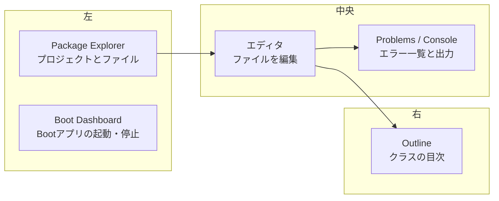

::: haru
先輩、第2部は STS っすね! とりあえず「次へ」連打で入れときます!
:::

::: sensei
その連打で、日本語フォルダに入れて、JRE で動かして、文字コードが MS932 のまま……という三重苦の新人を何人も見てきた。最初の30分をちゃんとやれば、あとの数か月が楽になるよ。
:::

第1部では `javac` と JShell が主役でした。第2部からは、現場で毎日使う **IDE(統合開発環境:エディタ・コンパイラ・実行・デバッガを1つにまとめた道具)** を使い込みます。今回は導入と画面の見方です。

## STS ってなに?

**STS(Spring Tool Suite 4)** は、Java の定番 IDE **Eclipse** に、Spring 開発用の拡張を最初から入れて配布したものです。中身は Eclipse なので、Eclipse の操作・ショートカット・ネット上の情報はほぼそのまま通用します。

Spring 向けに足されているのは主にこの3つです。

- **Spring Starter Project** ウィザード:Spring Boot の雛形を数クリックで作る(次回)
- **Boot Dashboard**:Spring Boot アプリを一覧で起動・停止するビュー
- `application.properties` などの設定ファイルの入力補完

::: trivia VS Code 版もある
Spring Tools 4 には VS Code 用の拡張もあります。この道場では、Spring の現場で長く使われてきた Eclipse 版の STS で説明します。
:::

## Windows へのインストール

インストーラはありません。**展開して置くだけ** です。

1. **spring.io/tools** から Windows(x86_64)用をダウンロード。配布形式は版によって **zip** か **自己展開 jar**(`...self-extracting.jar`)です
2. 自己展開 jar はダブルクリック、または `java -jar ファイル名.jar` で展開(Java 21 が入っていれば動きます)
3. できたフォルダ(`sts-4.xx.x.RELEASE`)を **`C:\dev\` のような短いパス** に置く
4. 中の **`SpringToolSuite4.exe`** を起動

置き場所は **日本語・スペースを含まないフォルダ** にします。`C:\Users\山田\ダウンロード` や `C:\Program Files` は避けてください。古いツールやスクリプトの中には、スペースや非 ASCII 文字を含むパスを正しく扱えないものがあるからです。`Program Files` は管理者権限がないと書き込めず、STS の更新やプラグイン追加で失敗する原因にもなります。

起動すると **ワークスペース** を聞かれます。ワークスペースとは「STS の設定(`.metadata` フォルダ)と、新しく作るプロジェクトの既定の置き場所」です。こちらも `C:\dev\workspace` のような場所にしましょう。あとから **File > Switch Workspace**(ファイル > ワークスペースの切り替え)で変えられます。

## 「STS を動かす Java」と「プロジェクトの JDK」は別物

ここが一番の落とし穴です。STS には **STS 自身を動かすための JRE** が同梱されています。一方、あなたのプロジェクトを **コンパイル・実行する Java** は、STS の設定で選んだものです。

| 役割 | 何が使われるか | 設定場所 |
|---|---|---|
| STS 本体の起動 | 同梱の JRE | `SpringToolSuite4.ini` |
| プロジェクトの実行 | 登録した JDK | Installed JREs |

プロジェクト側には **JDK 21** を登録して既定にします。

1. **Window > Preferences**(ウィンドウ > 設定)
2. **Java > Installed JREs**(Java > インストール済みの JRE)→ **Add...** → **Standard VM** → JDK 21 のフォルダを選ぶ
3. 追加した JDK 21 に **チェック** を入れる(チェック = 既定)
4. **Java > Installed JREs > Execution Environments**(実行環境)で `JavaSE-21` に JDK 21 が対応していることを確認

::: sensei
なぜ JRE じゃダメか。JRE には `javac` や `jshell` が無い。この道場アプリは採点に `javac`、サンプル実行に `jshell` を使うから、JRE で起動すると「javac が見つかりません」で止まる。
:::

**実行環境(Execution Environment)** は「Java 21 相当の何か」という抽象的な名前です。プロジェクトの設定には `C:\Program Files\...\jdk-21` のような具体的なパスではなく `JavaSE-21` という名前だけが記録され、各 PC の STS がそれを自分の JDK に対応づけます。だから JDK の置き場所が人によって違っても、同じプロジェクトを開けるわけです。

STS 本体がどの Java で動いているかは、**Help > About Spring Tool Suite 4 > Installation Details > Configuration**(ヘルプ > Spring Tool Suite 4 について > インストール詳細 > 構成)の `java.home` で確かめられます。`plugins` フォルダの中の JRE が出てきたら、それが同梱 JRE です。

ちなみに STS は保存時のコンパイルに Eclipse 独自のコンパイラ(ECJ)を使います。エラーメッセージの文言がコマンドラインの `javac` と少し違うのはこのためです。

## 画面構成:パースペクティブ・ビュー・エディタ

Eclipse 系の画面は3つの言葉で説明できます。

- **エディタ**:中央の、ファイルを編集する領域。タブで複数開ける
- **ビュー**:エディタの周りに並ぶ小窓。ファイル一覧、エラー一覧、出力など
- **パースペクティブ**:「どのビューをどこに置くか」の配置セット。Java 用、デバッグ用などがあり、右上のボタンで切り替える



| ビュー | 日本語表記 | 役割 |
|---|---|---|
| Package Explorer | パッケージ・エクスプローラー | プロジェクトのツリー |
| Outline | アウトライン | 開いているクラスのフィールド・メソッド一覧 |
| Problems | 問題 | コンパイルエラー・警告の一覧 |
| Console | コンソール | `System.out` やログの出力 |
| Boot Dashboard | Boot ダッシュボード | Spring Boot アプリの起動・停止 |

### ビューを閉じてしまったら

うっかり × で閉じても、再インストールは不要です。

- 1つ戻す:**Window > Show View**(ウィンドウ > ビューの表示)。一覧に無ければ **Other...**(その他)から探す。Boot Dashboard は **Spring** の下
- 全部初期状態に戻す:**Window > Perspective > Reset Perspective...**(ウィンドウ > パースペクティブ > パースペクティブのリセット)

エディタのタブをダブルクリック(または **Ctrl+M**)すると最大化/元に戻すができます。「ビューが消えた!」の正体が、実は最大化だった、というのもよくある話です。

## 文字コードを UTF-8 にする

**Window > Preferences > General > Workspace**(ウィンドウ > 設定 > 一般 > ワークスペース)の **Text file encoding**(テキスト・ファイルのエンコード)を **UTF-8** にします。最近の STS は新規ワークスペースなら最初から UTF-8 ですが、古い設定を引き継いだ環境では **MS932**(Windows の日本語 Shift_JIS)になっていることがあります。

ずれると何が起きるか。UTF-8 で保存されたファイルを MS932 として開くと、エディタやコンソールがこうなります。

```text
縺薙ｓ縺ｫ縺｡縺ｯ   ← 本当は「こんにちは」
```

逆に MS932 で保存したソースを、`pom.xml` で UTF-8 指定のビルド(Maven)にかけると、コンパイルエラーです。

```text
Hello.java:3: error: unmappable character (0x93)
  for encoding UTF-8
```

**ファイルの中身はただのバイト列で、文字コードは「どう読むか」の約束** にすぎません。書く側と読む側の約束がずれると化けます。なお Maven プロジェクトは、`pom.xml` の `project.build.sourceEncoding` を STS(m2e)が読んでプロジェクト単位で設定してくれますが、Maven を使わないプロジェクトやテキストファイルはワークスペースの設定に従います。

## 日本語化(Pleiades)は任意

**Pleiades** は Eclipse のメニューを日本語にするプラグインです。入れると **Window > Preferences** が **ウィンドウ > 設定** のように変わります。この道場は英語表記+括弧で日本語を併記しているので、どちらでも進められます。

::: genba 英語のままにする派が多い理由
エラーの解決策をネットで探すと、手順はたいてい英語メニューで書かれています。日本語化すると毎回「これは日本語で何だっけ」と翻訳が要ります。最初は日本語で安心したいなら入れて、慣れたら外す、でも構いません。
:::

## よくあるトラブル

**起動しない**

- `Java was started but returned exit code=13`:32bit/64bit の違う Java を使おうとしている。`.ini` の `-vm` 指定を見直す
- `Workspace in use or cannot be created`:そのワークスペースを別の STS が開いている。タスクマネージャーで残っている STS を終了する

**重い・`OutOfMemoryError: Java heap space`**

STS 本体のメモリ上限は、exe と同じフォルダの **`SpringToolSuite4.ini`** の `-Xmx` で決まります。

```text
-vmargs
-Dosgi.requiredJavaVersion=21
-Xms256m
-Xmx2048m      ← ここを 3072m などに増やす
```

`-Xmx` などの JVM オプションは **`-vmargs` の行より後ろ** に書きます。前に書くと JVM に渡らず、黙って無視されます。編集後は STS を再起動してください。

::: warn ここで増やすのは STS 本体のメモリ
`.ini` の `-Xmx` は **STS 自体** の上限です。あなたが作ったアプリのメモリは、実行構成(Run Configurations)の VM arguments で別に指定します。「STS」と「プロジェクト」は別の JVM、という話がここでも出てきます。
:::

::: point まとめ
- STS = Eclipse + Spring 向け拡張。**日本語・スペースなしの短いパス** に展開し、`SpringToolSuite4.exe` で起動
- ワークスペースは設定とプロジェクトの置き場所。`C:\dev\workspace` のような場所に
- **STS を動かす JRE とプロジェクトの JDK は別物**。Installed JREs で **JDK 21 を登録して既定** に
- 画面は **パースペクティブ(配置)> ビュー(小窓)+ エディタ**。閉じたら **Show View**、崩れたら **Reset Perspective**
- Text file encoding は **UTF-8**。文字コードは「バイト列の読み方の約束」
- STS のメモリ不足は `SpringToolSuite4.ini` の `-Xmx`(`-vmargs` より後ろ)
:::

::: sensei
次は「プロジェクトの作成とインポート」。Spring Boot の雛形を作って、Boot Dashboard から起動するところまでやるよ。
:::
