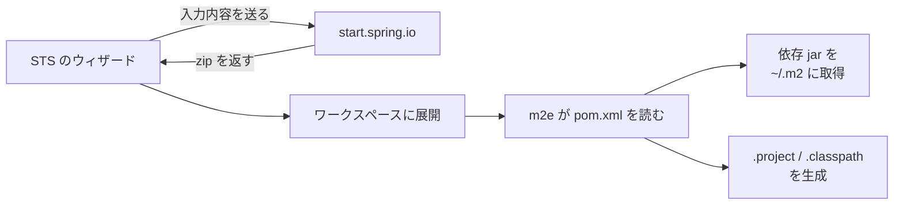

::: haru
New を押したら「Java Project」「Maven Project」「Spring Starter Project」……。どれを選べば正解なんすか?
:::

::: sensei
仕事で Spring Boot をやるなら、ほぼ毎回 Spring Starter Project。ただ、3つの違いが分かってないと、エラーが出たときに「どこを直せばいいか」が分からない。そこからいこう。
:::

前回は STS を入れて画面の見方を覚えました。今回は **プロジェクト**(STS が1つのまとまりとして扱うフォルダ。ソース・設定・ビルドのルールを持つ)を作る・取り込む・起動する、までやります。

## 3種類のプロジェクトの違い

| 種類 | ビルドと依存の管理 | 向いている用途 |
|---|---|---|
| Java Project | STS(Eclipse)だけ | 文法の練習・小さな実験 |
| Maven Project | `pom.xml`(Maven) | Spring を使わない Java |
| Spring Starter Project | `pom.xml` + Boot の雛形 | Spring Boot アプリ |

- **Java Project** は Eclipse 独自の設定だけで動きます。ライブラリ(jar)は手で追加し、コンパイル結果は `bin/` に出ます。STS の外ではビルドできません。
- **Maven Project** は **Maven**(Java の定番ビルドツール)の約束に従います。`pom.xml` に「使うライブラリ」を書けば、Maven が **Maven Central**(公開ライブラリの倉庫)から取ってきます。コンパイル結果は `target/` です。STS がなくても `mvnw` でビルドできるので、チーム開発や CI の標準です。
- **Spring Starter Project** は、Spring Boot 用の Maven プロジェクトを **Spring Initializr**(`start.spring.io`)で生成して取り込むウィザードです。中身は「設定済みの Maven Project」です。

::: sensei
つまり Starter Project も、作ったあとは普通の Maven プロジェクト。だから困ったら `pom.xml` が正解の置き場所、と覚えておくといい。
:::

## Spring Starter Project を作る

**File > New > Spring Starter Project**(ファイル > 新規 > Spring スターター・プロジェクト)で、主に次を入力します。

| 項目 | 例 | 意味 |
|---|---|---|
| Name | `demo` | STS 上のプロジェクト名 |
| Type | Maven | ビルドツール |
| Java Version | 21 | 使う Java のバージョン |
| Group | `com.example` | 組織を表す名前(ドメインの逆順) |
| Artifact | `demo` | 成果物(jar)の名前 |
| Package | `com.example.demo` | メインクラスのパッケージ |

次の画面で **依存(Dependencies)** を選びます。今回は **Web > Spring Web** にチェック。これで Web サーバ(Tomcat)入りの Spring MVC が使えるようになります。**Finish** を押すと、裏ではこう動いています。



**m2e** は STS に入っている Maven 連携機能です。`pom.xml` を読んで、Eclipse が理解できる設定ファイルを作り、依存ライブラリをダウンロードします(保存先はユーザーフォルダの `.m2\repository`)。インターネットに繋がっていないとここで失敗します。

## 生成されたフォルダの読み方

```text
demo/
├─ pom.xml            ← プロジェクトの設計図(依存・Java版)
├─ mvnw / mvnw.cmd    ← Maven Wrapper
├─ .mvn/wrapper/      ← Wrapper が使う Maven の版の指定
└─ src/
   ├─ main/java/com/example/demo/
   │   └─ DemoApplication.java
   ├─ main/resources/
   │   ├─ application.properties
   │   ├─ static/     ← CSS・画像など
   │   └─ templates/  ← 画面テンプレート
   └─ test/java/com/example/demo/
       └─ DemoApplicationTests.java
```

- `src/main/java`:本番のコード。フォルダ階層 = **パッケージ**。`com/example/demo/` に置いたクラスは先頭に `package com.example.demo;` が必要です
- `src/main/resources`:Java 以外のファイル。ビルド時にクラスと一緒に jar に入ります
- `src/test/java`:テストコード。jar には入りません
- `mvnw`:**Maven Wrapper**。PC に Maven が入っていなくても、`.mvn/wrapper/` で指定された版の Maven を自動で取ってきて実行します。「人によって Maven の版が違う」事故を防ぐ仕組みです

生成された `DemoApplication.java` はこれだけです。

```java
package com.example.demo;

import org.springframework.boot.SpringApplication;
import org.springframework.boot.autoconfigure.SpringBootApplication;

@SpringBootApplication
public class DemoApplication {
    public static void main(String[] args) {
        SpringApplication.run(DemoApplication.class, args);
    }
}
```

普通の `main` メソッドから Spring Boot が起動します。`@SpringBootApplication` の中身は第3部「Bootの起動の仕組み」で分解します。

## 既存のプロジェクトをインポートする

この道場アプリ自身も Maven プロジェクトです。STS に取り込むには:

1. **File > Import...**(ファイル > インポート)
2. **Maven > Existing Maven Projects**(Maven > 既存 Maven プロジェクト)→ **Next**
3. **Root Directory** に `pom.xml` のあるフォルダを指定 → `/pom.xml` にチェックが付いていることを確認 → **Finish**

インポートしてもフォルダはワークスペースにコピーされず、**元の場所のまま** STS に登録されます。

::: warn 「Existing Projects into Workspace」を選んでしまう
**General > Existing Projects into Workspace**(一般 > 既存プロジェクトをワークスペースへ)は、`.project` ファイルがあるフォルダ用です。Git から取ってきた Maven プロジェクトには普通 `.project` が無いので、`No projects are found to import` と言われます。Maven プロジェクトは **Maven > Existing Maven Projects** から。
:::

Git リポジトリから直接取り込む入口は **File > Import... > Git > Projects from Git**(Git からのプロジェクト)です。詳しくは「Git連携」の回でやります。

## .project / .classpath / .settings は何者?

インポートすると、プロジェクト直下に次のファイルができます(Package Explorer では隠れていることがあります)。

- `.project`:Eclipse 用の「これは Java + Maven のプロジェクト」という宣言
- `.classpath`:ソースフォルダの場所と、使う JRE・ライブラリの一覧
- `.settings/`:プロジェクト単位の設定(コンパイラの Java 版、文字コードなど)

どれも **m2e が `pom.xml` から生成** したものです。だから Git には入れません。設定の正解は `pom.xml` に1つだけあればよく、生成物を入れると「IntelliJ の人には不要」「PC ごとの差分が毎回出る」「`pom.xml` と食い違う」と、いいことがありません。Spring Initializr が作る `.gitignore` にも最初から書かれています。

## エラーが消えないときの順番

`pom.xml` を直したのに赤い × が消えない。Problems ビューにこう出ていたら:

```text
Project configuration is not up-to-date with pom.xml.
Select: Maven->Update Project... from the project
context menu or use Quick Fix.
```

上から順に試します。

1. **F5**(Refresh):STS の外でファイルを変えたなら、まず再読み込み
2. プロジェクトを右クリック > **Maven > Update Project...**(Maven > プロジェクトの更新、**Alt+F5**):`pom.xml` を読み直して `.classpath` などを作り直す。依存の取得に失敗していたら **Force Update of Snapshots/Releases** にチェック
3. **Project > Clean...**(プロジェクト > クリーン):コンパイル結果を捨てて全部ビルドし直す

Update Project は「設定の作り直し」、Clean は「ビルドのやり直し」。効く場面が違います。

## Boot Dashboard で起動・停止、そして 8080

**Boot Dashboard** の **local** の下に Spring Boot プロジェクトが並びます。選んで ▶(Start)で起動、■(Stop)で停止。Console に次の行が出れば起動成功です。

```text
Tomcat started on port 8080 (http) with context path '/'
Started DemoApplication in 1.912 seconds
  (process running for 2.345)
```

ブラウザで `http://localhost:8080` を開くと、まだ画面を作っていないので **Whitelabel Error Page**(404)が出ます。これは「サーバは動いている」の証拠です。

ところが道場アプリを起動したまま demo を起動すると、こうなります。

```text
Web server failed to start.
Port 8080 was already in use.
```

**ポート** は「PC の中で、どのプログラム宛ての通信かを区別する番号」で、1つの番号を同時に使えるのは1プロセスだけです。直し方は2つ。

- 先に動いている方を止める(Boot Dashboard の ■、Console の赤い四角 **Terminate**)
- 番号を変える:`src/main/resources/application.properties` に `server.port=8081`

どのプロセスが使っているか分からないときは、コマンドプロンプトで `netstat -ano | findstr :8080` を実行し、行末の PID をタスクマネージャーで探します。

::: genba 犯人はたいてい「自分」
**Run As** を2回押して同じアプリを二重起動した、前回の STS が裏で残っていた――8080 衝突の犯人は大半が自分です。Boot Dashboard から起動・停止する習慣にすると、何が動いているか一目で分かります。
:::

::: point まとめ
- Spring Boot なら **Spring Starter Project**。中身は start.spring.io が作った **Maven プロジェクト**
- `src/main/java` = 本番コード(フォルダ = パッケージ)、`src/main/resources` = 設定・画面、`src/test/java` = テスト
- `mvnw` は Maven Wrapper。Maven 未インストールでも同じ版でビルドできる
- 取り込みは **Maven > Existing Maven Projects**。Existing Projects into Workspace ではない
- `.project` / `.classpath` / `.settings` は `pom.xml` からの生成物。**Git に入れない**
- 直らないときは **F5 → Maven > Update Project → Project > Clean**
- `Port 8080 was already in use` は先客を止めるか `server.port` を変える
:::

::: sensei
次は「デバッガ」。ブレークポイントで止めて、変数の中身を覗きながらバグを追い詰めるよ。
:::
