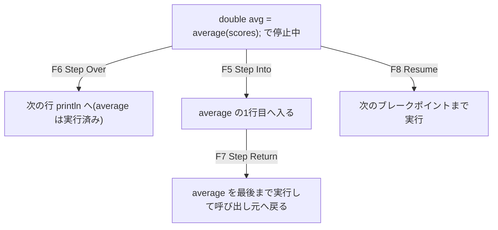

::: haru
先輩、平均点がなんか低く出るんすよ。とりあえず `System.out.println` を10個くらい仕込んで……
:::

::: sensei
ストップ。それ、終わったら10個消すんだよね? 今日は **デバッガ** で、プログラムを「一時停止」して中を覗く方法を覚えよう。
:::

## println デバッグの限界

`println` を仕込むデバッグも立派な手段ですが、弱点があります。

- 見たい変数を **事前に決めて** 書く必要がある。外れたら書き足して再実行
- 消し忘れが本番ログに混ざる(「ここ来た!」がログに残る事故は現場あるある)
- ループ1万回なら出力も1万行。どこで壊れたか探すのが一苦労

**デバッガ** は、実行中のプログラムを好きな行で止め、その瞬間の変数・呼び出し履歴をすべて見せてくれる道具です。止めたまま1行ずつ進めたり、値を書き換えて試したりもできます。コードは1文字も変えません。

## ブレークポイントで止める

題材は、平均点が低く出るこのコードです。

```java
public class Bug {
    public static void main(String[] args) {
        int[] scores = {80, 90, 70};
        double avg = average(scores);
        System.out.println(avg); // 期待: 80.0
    }

    static double average(int[] a) {
        int sum = 0;
        for (int i = 1; i < a.length; i++) {
            sum += a[i];
        }
        return (double) sum / a.length;
    }
}
```

```text
53.333333333333336
```

1. `int sum = 0;` の行番号の **左の余白(ルーラー)をダブルクリック** します。青い丸が付けば **ブレークポイント**(停止位置)の設定完了です(**Ctrl+Shift+B** でも可)
2. エディター上で右クリック → **Debug As > Java Application**(デバッグ > Java アプリケーション)。**Run As** ではないので注意
3. 「**Confirm Perspective Switch**」(パースペクティブ切り替えの確認)と聞かれたら **Switch**(切り替え)

画面が **Debug パースペクティブ** に変わり、ブレークポイントの行が緑にハイライトされて止まります。左上の **Debug** ビューに `Thread [main] (Suspended (breakpoint at line 9 in Bug))` のような表示が出ていれば成功です。

::: trivia なぜ止められるのか
Debug As で起動すると、STS は JVM に `-agentlib:jdwp=...` というオプションを付けます。JVM 内のデバッグ用エージェントが **JDWP(Java Debug Wire Protocol)** で STS とソケット通信し、「この行で止めて」「この変数の値は?」をやり取りしています。行番号や変数名が分かるのは、コンパイラが `.class` に **デバッグ情報**(行番号表・ローカル変数表)を埋め込んでいるからです。
:::

## ステップ実行:F5・F6・F7・F8

止まったら、キーで1歩ずつ進めます。

| キー | 名前 | 動き |
|---|---|---|
| F6 | Step Over | 1行進む。メソッド呼び出しは中に入らず丸ごと実行 |
| F5 | Step Into | 呼び出し先のメソッドの中に入る |
| F7 | Step Return | 今のメソッドを最後まで実行し、呼び出し元に戻る |
| F8 | Resume | 次のブレークポイントまで一気に進む |



ステップ実行しながら右上の **Variables**(変数)ビューを見ると、`i` が `1` から始まっていて、`a[0]` の 80 が一度も足されないことが分かります。犯人は `int i = 1`。**off-by-one**(1つずれ)バグです。

::: haru
F5 で `System.out.println` の中まで入っちゃいました……。
:::

::: sensei
あるある。F7 で抜ければいい。自分のコード以外に入りたくないときは、**F6 が基本、怪しい呼び出しだけ F5** と覚えよう。
:::

## 変数を見る・式を監視する・書き換える

- **Variables** ビュー:今いるメソッドのローカル変数と引数。配列やオブジェクトは ▶ で展開できます。オブジェクトには `(id=25)` のような番号が付き、**番号が同じなら同じオブジェクト** です。参照の共有バグはこれで一発で見抜けます
- **Expressions**(式)ビュー:`sum / (i + 1)` のような **任意の式** を登録して監視できます。**Window > Show View > Expressions** で開き、**Add new expression** に式を入力。エディターで式を選択して右クリック → **Watch**(監視)でも登録できます
- **値の書き換え**:Variables ビューで値をクリックして書き換えると、続きはその値で動きます。「`i` が 0 だったら正しく動く?」を、コードを直す前に試せます

さらに **Drop to Frame**(フレームにドロップ)。**Debug** ビューの呼び出し履歴(スタックフレーム)を右クリックして選ぶと、**そのメソッドの先頭から実行し直せます**。F6 を押しすぎて肝心の行を通り過ぎたときの救世主です。

::: warn Drop to Frame は「タイムマシン」ではない
JVM はスタックフレームを捨てて巻き戻すだけです。フィールドへの代入、コレクションへの追加、出力、DB更新といった **副作用は元に戻りません**。
:::

## 条件付きブレークポイントと例外ブレークポイント

ループの1000回目だけ見たいとき、F8 を1000回押すのは苦行です。

- **条件付き**:ブレークポイントの青丸を右クリック → **Breakpoint Properties...**(ブレークポイント・プロパティー)→ **Conditional**(条件付き)にチェックし、`i == 999` のような boolean 式を書きます。条件が true のときだけ止まります
- **例外ブレークポイント**:**Run > Add Java Exception Breakpoint...**(実行 > Java 例外ブレークポイントの追加)で `NullPointerException` を選ぶと、**NPE が投げられた瞬間** に止まります。行の目星がつかないときに強力です

例外ブレークポイントの何が嬉しいか。スタックトレースは「どこで落ちたか」しか教えてくれませんが、例外ブレークポイントなら **落ちた瞬間の変数が全部見える** ので、「なぜ null だったか」まで追えます。

## Spring Boot アプリを止める

Spring Boot でも手順は同じです。

1. Controller のメソッド内にブレークポイントを置く
2. **Debug As > Spring Boot App**、または **Boot Dashboard** で虫アイコンの **(Re)debug** を押す
3. ブラウザで `http://localhost:8080/...` にアクセス

ブラウザは読み込み中のまま固まり、STS 側で止まります。**Debug** ビューを見ると、止まっているのは `main` ではなく `http-nio-8080-exec-1` のような **Tomcat のリクエスト処理スレッド** です。リクエストごとに別スレッドで処理される、という Web アプリの仕組みが目で見えます。F8 で再開すればブラウザに結果が返ります。

::: genba 本番サーバーにはつながない
起動済みの JVM に後からつなぐ **リモートデバッグ**(**Debug Configurations > Remote Java Application**)もあります。ただし本番で止めると全ユーザーのリクエストが止まります。使うのは開発・検証環境だけ、が鉄則です。
:::

## 現場のデバッグの進め方

やみくもにステップ実行するより、次の順で進めると速く確実です。

1. **再現する**:バグが起きる入力を特定し、できれば **JUnit テスト** にする(赤くなるテスト)
2. **仮説を立てる**:「合計がおかしい → ループ範囲が怪しい」
3. **止めて確かめる**:テストクラスを右クリック → **Debug As > JUnit Test** で、仮説の場所にブレークポイント
4. **直してテストを緑にする**:同じテストが、今後の再発も見張ってくれる

```java
@Test
void 先頭の要素も平均に含める() {
    // バグを再現する最小の入力
    assertEquals(80.0,
        Bug.average(new int[] {80, 90, 70}));
}
```

テストから動かせば、画面を操作して同じ状況を作る手間が要りません。Web アプリで「3画面目で入力して確定を押したときだけ落ちる」ようなバグも、ロジックをテストから呼べれば一瞬で止められます。

::: trivia 止めたまま直せる「ホットコードリプレース」
デバッグ中にメソッドの中身を書き換えて **Ctrl+S** すると、STS は変更したクラスを実行中の JVM に送り込み、再起動なしで差し替えます(**Hot Code Replace**)。差し替え後は、変更したメソッドの先頭からやり直しになります。ただし JVM の制約で、メソッドやフィールドの追加・削除のような「クラスの形」が変わる修正はできず、「Hot Code Replace Failed」というダイアログが出ます。そのときは再起動しましょう。
:::

## よくあるミス

- **Run As で起動して「止まらない!」**:ブレークポイントは Debug As のときだけ有効です
- **止めっぱなしでタイムアウト**:Web アプリで長く止めると、ブラウザや呼び出し元がタイムアウトします
- **ブレークポイントの置き忘れ**:次回のデバッグで想定外の所で止まります。**Breakpoints** ビューで一覧・一括削除、**Skip All Breakpoints**(Ctrl+Alt+B)で一時無効化できます
- **Variables の表示で値が変わる**:ビューは `toString()` を呼んで表示します。`toString()` に副作用があるクラスだと、見ただけで状態が変わります

::: point まとめ
- **Debug As** で起動し、行番号の左を **ダブルクリック** してブレークポイント
- **F6** Step Over / **F5** Step Into / **F7** Step Return / **F8** Resume
- **Variables** で値を見る、**Expressions** で式を監視、値を書き換えて仮説を試す
- `(id=…)` が同じなら同じオブジェクト。参照の共有バグの発見に
- **条件付き**・**例外ブレークポイント** で「止めたい瞬間」だけ止める
- **Drop to Frame** はメソッドの先頭からやり直し。副作用は戻らない
- Spring Boot は **Debug As > Spring Boot App**。リクエストは Tomcat のスレッドで止まる
:::

::: sensei
次はショートカットとリファクタリング。デバッガで原因を見つけたら、今度は「安全に直す」技を覚えよう。
:::
