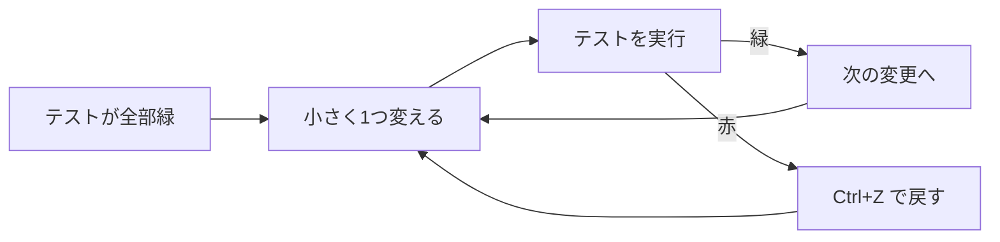

::: haru
先輩、import 文って毎回手で書いてます? `java.util.List` とか、もう指が覚えちゃいました。
:::

::: sensei
指が覚えるべきなのは **Ctrl+Shift+O** のほう。今日は「IDE に任せられることは任せる」キーと、コードを安全に作り変える **リファクタリング機能** を覚えよう。
:::

## まず覚える12個

全部で数百あるショートカットのうち、毎日使うのはこのくらいです。表のキーは Windows 版 STS 4 の標準設定です。

| キー | 機能 | 使いどころ |
|---|---|---|
| Ctrl+Space | 補完(Content Assist) | 名前の途中で押す |
| Ctrl+1 | クイックフィックス | 赤線の上で押す |
| Ctrl+Shift+O | インポート整理 | import の追加・不要分の削除 |
| Ctrl+Shift+F | フォーマット | インデント・空白を整える |
| Ctrl+Shift+R | リソースを開く | ファイル名で開く(yml なども) |
| Ctrl+Shift+T | 型を開く | クラス名で開く(ライブラリも) |
| F3 | 定義へ移動 | Ctrl+クリックでも可 |
| Ctrl+Alt+H | 呼び出し階層 | 誰がこのメソッドを呼んでいる? |
| Ctrl+D | 行削除 | カーソル行を丸ごと消す |
| Alt+↑ / ↓ | 行移動 | 選択行を上下に動かす |
| Ctrl+/ | 行コメント切替 | `//` を付け外し |
| Ctrl+Shift+L | ショートカット一覧 | 忘れたらこれ |

特に **Ctrl+1** は万能です。未定義のメソッドを書いて Ctrl+1 → **Create method**、未処理の例外に Ctrl+1 → **Surround with try/catch**、ローカル変数に Ctrl+1 → **Convert local variable to field** と、「今ここで困っていること」の解決策を一覧で出してくれます。

::: trivia Ctrl+Shift+T と Ctrl+Shift+R の違い
**T**(Type)は Java の型だけを、JDK や Maven で取ってきたライブラリの中まで含めて探します。**R**(Resource)はワークスペース内のファイルなら何でも探せますが、ライブラリの中は対象外です。`String` のソースを読みたいなら T、`application.properties` を開きたいなら R です。
:::

## テンプレートで「型」ごと書く

入力して **Ctrl+Space** を押すと、決まった形のコードを展開してくれます。

| 入力 | 展開されるもの |
|---|---|
| `main` | `public static void main(String[] args)` |
| `sysout` | `System.out.println();` |
| `syserr` | `System.err.println();` |
| `foreach` | 直近の配列やコレクションを回す拡張 for |

展開後は変数名などの部分が枠で囲まれた状態になり、**Tab** で次の枠へ移動、**Enter** で確定です。テンプレートは **Window > Preferences > Java > Editor > Templates** で一覧・追加できます。

## リファクタリング機能

**リファクタリング** とは、**外から見た振る舞いを変えずに** 内部の構造を改善することです。「名前を良くする」「長いメソッドを分ける」が代表例です。STS には専用の機能があります。

| キー | 機能 |
|---|---|
| Alt+Shift+R | 名前変更(Rename) |
| Alt+Shift+M | メソッド抽出(Extract Method) |
| Alt+Shift+L | ローカル変数抽出(Extract Local Variable) |
| Alt+Shift+I | インライン化(Inline) |
| Alt+Shift+S | ソース生成メニュー(Source) |
| Alt+Shift+T | リファクタリングメニュー |

例えばメソッド抽出。次のコードの「小計を求める3行」を選択して **Alt+Shift+M** を押し、名前に `subtotal` と入力します。

```java
// 前
static int total(int[] prices) {
    int sum = 0;
    for (int p : prices) {
        sum += p;
    }
    return sum + sum / 10;
}
```

```java
// 後(STS が自動で書き換えた結果)
static int total(int[] prices) {
    int sum = subtotal(prices);
    return sum + sum / 10;
}

private static int subtotal(int[] prices) {
    int sum = 0;
    for (int p : prices) {
        sum += p;
    }
    return sum;
}
```

引数(`prices`)と戻り値(`sum`)は STS が **データの流れを解析して** 決めてくれます。選択範囲の中で値を代入した変数のうち、後ろでも使うものが2つ以上あると、Java のメソッドは戻り値を1つしか返せないので抽出できません(`Ambiguous return value` というエラー)。そのときは選択範囲を変えましょう。

- **Alt+Shift+L**:式を選択して押すと、`int tax = sum / 10;` のような変数に切り出す(同じ式が他にもあれば一緒に置き換えられる)
- **Alt+Shift+I**:その逆。変数やメソッドを使っている箇所に中身を埋め戻す
- **Alt+Shift+S**:**Generate Getters and Setters**、**Generate Constructor using Fields**、**Generate toString()** などのコード生成。フィールドを書いたら、残りはここから

::: sensei
名前変更を「検索と置換」でやるのは危険。`count` を置換したら `account` まで `acnumber` になった、なんて事故が起きる。
:::

### なぜ IDE のリファクタリングは安全なのか

STS(の中の Eclipse JDT)はソースを **構文木(AST)** に解析し、「この `count` はどの宣言を指しているか」(**バインディング**)まで把握しています。Alt+Shift+R は文字列ではなく **同じ宣言を指している箇所だけ** を書き換えるので、同名の別の変数や、文字列・コメントの中は変わりません。別ファイルの呼び出し元もまとめて直り、クラス名を変えればファイル名も変わります。

逆に言うと、**Java の文法として見えない所は追えません**。リフレクションで `"getName"` と文字列で指定している箇所、Thymeleaf のテンプレート、`application.yml` に書いたクラス名などは書き換わらないので、名前変更の後はテストと全文検索(**Ctrl+H**)で確認します。

## リファクタリングとテストはセット

IDE の機能が正確でも、「選択範囲を間違えた」「インライン化で評価回数が変わった」といったミスは起きます。振る舞いが変わっていないと保証してくれるのは **テスト** です。



ポイントは **1回の変更を小さく** すること。名前変更1つ、抽出1つごとにテストを回せば、赤になったとき原因は直前の1手だけです。テストがないコードは、まずテストを書いてから直す。これが現場の順番です。

## 保存時アクション(Save Actions)

**Window > Preferences > Java > Editor > Save Actions**(ウィンドウ > 設定 > Java > エディター > 保存アクション)で **Perform the selected actions on save** にチェックし、**Format source code** と **Organize imports** を選ぶと、**Ctrl+S のたびに** フォーマットとインポート整理が自動で走ります。

::: genba 既存コードでは「Edited lines」
古いプロジェクトでファイル全体をフォーマットすると、1行直しただけなのに差分が数百行になり、レビューで「どこを変えたの?」と怒られます。既存コードでは **Format edited lines**(編集した行だけ)を選ぶのが無難。フォーマット設定はチームで1つの XML(**Formatter** の **Export**)を共有して揃えます。
:::

## よくあるミス

- **Ctrl+Alt+↓ で画面が回転**:STS では「行の複製」ですが、Intel のグラフィックドライバーの画面回転ショートカットと衝突することがあります。ドライバー側のホットキーを無効にしましょう
- **ショートカットが効かない**:日本語入力(IME)がオンのままだと、一部のキーが IME に取られることがあります。コードを書くときは IME をオフに
- **リネームしたら画面でエラー**:Thymeleaf テンプレートの `${user.name}` や設定ファイルの中の名前は追従しません(前述)

::: point まとめ
- 毎日使うのは **Ctrl+Space / Ctrl+1 / Ctrl+Shift+O / Ctrl+Shift+F** と、移動系の **Ctrl+Shift+T・R / F3 / Ctrl+Alt+H**。忘れたら **Ctrl+Shift+L**
- `main` `sysout` `foreach` + **Ctrl+Space** でテンプレート展開
- リファクタリングは **振る舞いを変えずに構造を改善** すること。**Alt+Shift+R / M / L / I / S**
- IDE は構文木で参照を追うから安全。ただし文字列・テンプレート・設定ファイルは追えない
- **テストを緑に保ったまま、小さく1つずつ** 変える
- **Save Actions** で保存時にフォーマットとインポート整理
:::

::: sensei
次は Maven。ライブラリを手で集める時代は終わり、ってのを体験しよう。
:::
