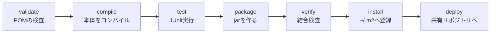

::: haru
先輩、このアプリって `./mvnw spring-boot:run` で動くじゃないですか。あの `mvnw` って何者なんすか?
:::

::: sensei
Maven っていうビルドツールの起動役。今日はこのアプリ自身の `pom.xml` を教科書にして、Maven を「なんとなく動く呪文」から「読める設定ファイル」に変えるよ。
:::

## ビルドツールとは:javac を手で打つ辛さ

第1部では `javac Hello.java` で済みました。でも Spring Boot のアプリを手でビルドしようとすると、こうなります。

```text
javac -d target/classes -cp "spring-web-6.2.19.jar;
  spring-core-6.2.19.jar;jackson-databind-2.21.4.jar;
  …(あと60個以上)" src/main/java/com/sayana/dojo/…
```

- 必要な jar を **全部探してきてダウンロード** する
- jar が使っている jar(依存の依存)も **漏れなく** 集める
- コンパイル → テスト → jar にまとめる、を **毎回同じ順番で** 実行する

これを自動化するのが **ビルドツール** です。Java では **Maven** と **Gradle** が二大勢力で、業務システムでは今も Maven が多数派です。Maven は「何を作るか」を `pom.xml`(**POM** = Project Object Model)に **宣言** するだけで、手順は Maven が知っている、という設計です。

## pom.xml を読む(このアプリ自身が教材)

プロジェクト直下の `pom.xml` を開いてください。上から順に見ていきます。

### 座標:groupId / artifactId / version

```xml
<groupId>com.sayana</groupId>
<artifactId>java-dojo</artifactId>
<version>0.1.0-SNAPSHOT</version>
```

この3つを **座標(coordinates)** と呼び、世界中のライブラリから1つを特定する住所になります。

- **groupId**:組織名。ドメインを逆にした形が慣例(パッケージ名と同じ発想)
- **artifactId**:成果物の名前。jar のファイル名になる
- **version**:`-SNAPSHOT` 付きは「開発中で中身が変わりうる版」。付かない版(`1.0.0`)は **一度公開したら中身を変えない** 約束

### parent と properties

```xml
<parent>
  <groupId>org.springframework.boot</groupId>
  <artifactId>spring-boot-starter-parent</artifactId>
  <version>3.5.16</version>
  <relativePath/>
</parent>
<properties>
  <java.version>21</java.version>
  <commonmark.version>0.24.0</commonmark.version>
</properties>
```

**parent** は「親 POM の設定を継承する」指定です。Spring Boot の親 POM には、文字コードやコンパイラ設定、そして **数百のライブラリの推奨バージョン表** が入っています(`<relativePath/>` は「親を近くのフォルダではなくリポジトリから取れ」の意味)。

**properties** は変数です。`${commonmark.version}` のように参照でき、同じバージョンを複数箇所で使うときに1か所で管理できます。`java.version` は Boot の親 POM が読み取って、コンパイラに「Java 21 でコンパイル」と伝えるための約束の名前です。

### dependencies:version が無い謎

```xml
<dependency>
  <groupId>org.springframework.boot</groupId>
  <artifactId>spring-boot-starter-web</artifactId>
</dependency>
<dependency>
  <groupId>com.anthropic</groupId>
  <artifactId>anthropic-java</artifactId>
  <version>${anthropic-java.version}</version>
</dependency>
```

::: haru
1個目、version が書いてないっすよ。書き忘れ?
:::

::: sensei
わざと。親 POM の **dependencyManagement**(バージョン表)に載っているライブラリは、version を省略するとそこから補われる。Boot が「この組み合わせなら動く」と検証済みの版がそろうんだ。
:::

Boot の表に載っていない `anthropic-java` や `commonmark` は、自分で version を書く必要があります。**表にあるものは書かない、無いものだけ書く** のが現場の作法です。表にあるのに version を書くと、検証済みの組み合わせから外れて相性問題の原因になります。

### build / plugins

```xml
<build>
  <plugins>
    <plugin>
      <groupId>org.springframework.boot</groupId>
      <artifactId>spring-boot-maven-plugin</artifactId>
    </plugin>
  </plugins>
</build>
```

Maven 本体は「段取り役」にすぎず、コンパイルもテストも実際の仕事は **プラグイン** がします(`maven-compiler-plugin`、`maven-surefire-plugin` など)。よく使うものは書かなくても組み込まれていて、ここに書くのは **追加するか設定を変えたい** ものだけです。`spring-boot-maven-plugin` は `spring-boot:run` や、依存を全部詰め込んだ実行可能 jar 作りを担当します。

## 依存関係とスコープ

新しいライブラリが欲しくなったら、**Maven Central**(https://central.sonatype.com)で検索し、表示される `<dependency>` 断片を貼るのが基本です。ダウンロードは Maven が自動でやります。

`<scope>` は「その jar を **いつ** クラスパスに載せるか」です。

| scope | コンパイル | テスト | 実行時 |
|---|---|---|---|
| compile(省略時) | ○ | ○ | ○ |
| provided | ○ | ○ | ×(実行環境が用意) |
| runtime | × | ○ | ○ |
| test | × | ○ | × |

- **runtime**:このアプリの `h2`(DB ドライバ)。コードは JPA / JDBC の標準インターフェース越しに使い、H2 のクラスを直接 import しないので、コンパイル時は不要。うっかり import するとコンパイルエラーで気づける
- **test**:`spring-boot-starter-test`(JUnit など)。本番の jar には入らない
- **provided**:Tomcat などのサーバーに WAR を置く場合のサーブレット API など。「実行時はサーバーが持っている」もの

### 推移的依存と dependency:tree

`spring-boot-starter-web` を1行書いただけで、Tomcat も Jackson も入ってきます。依存先が依存しているライブラリも自動で集まる仕組みを **推移的依存(transitive dependency)** と呼びます。全体像は次のコマンドで木として見られます。

```text
./mvnw dependency:tree

+- org.springframework.boot:spring-boot-starter-web
|  +- org.springframework.boot:spring-boot-starter-json
|  |  +- com.fasterxml.jackson.core:jackson-databind:2.21.4
|  +- org.springframework.boot:spring-boot-starter-tomcat
+- com.h2database:h2:jar:2.3.232:runtime
```

同じライブラリが別々のバージョンで要求されたら、Maven は **木の根に近い方(nearest wins)**、同じ深さなら **先に宣言した方** を採用します。「新しい方」ではない点が要注意です。dependencyManagement に載っているものは、その表の版が優先されます。

## ライフサイクルとよく使うコマンド

Maven の処理は **ライフサイクル** という決まった段階(**フェーズ**)の列になっています。代表的なフェーズはこの順です。



ルールは1つ。**フェーズを指定すると、それより前のフェーズが全部順番に実行される**。`package` を指定すれば validate → compile → test → package と進み、テストが1件でも落ちたらそこで止まって jar は作られません。`clean`(`target/` を消す)は別のライフサイクルなので、`clean package` のように並べて使います。

| コマンド | 何をする |
|---|---|
| `./mvnw clean test` | 掃除してからテストまで |
| `./mvnw package` | `target/` に jar を作る |
| `./mvnw spring-boot:run` | アプリを起動 |
| `./mvnw dependency:tree` | 依存の木を表示 |

`spring-boot:run` や `dependency:tree` のような `プラグイン:ゴール` の形は、フェーズではなくプラグインの **ゴール**(個別の仕事)を直接呼ぶ書き方です。

### Maven Wrapper と ~/.m2

`mvnw`(Windows 用は `mvnw.cmd`。PowerShell では `./mvnw`、コマンドプロンプトでは `mvnw` と打つ)は **Maven Wrapper** です。`.mvn/wrapper/maven-wrapper.properties` に書かれた版(このアプリは Maven 3.9.11)を初回に自動ダウンロードして使います。Maven をインストールしなくてよく、**全員が同じ版の Maven でビルドできる** のが現場で好まれる理由です。

ダウンロードした jar は **ローカルリポジトリ**(Windows なら `C:\Users\<名前>\.m2\repository`)にためられ、2回目からはそこから使われます。座標がそのままフォルダ構成になっています(`com/h2database/h2/2.3.232/h2-2.3.232.jar`)。

## STS での Maven

STS(中身は Eclipse + m2e というMaven連携機能)は、`pom.xml` を保存するたびに依存を読み直してクラスパスを組み立てます。主な操作は3つです(手順は下の「STSでやってみよう」で)。

- **Run As > Maven build...**:Goals 欄に `clean test` などを入れて実行。コマンドの `./mvnw` の後ろに書く部分と同じ
- **Maven > Update Project...**:pom.xml と STS の認識がズレたとき(赤い×が消えないとき)の定番の一手
- pom.xml エディタの **Dependency Hierarchy** タブ:`dependency:tree` の GUI 版。右側に「最終的に採用された jar」の一覧も出る

::: genba Update Project は「とりあえず再起動」ではない
`pom.xml` を手で直したのに STS だけエラーのまま、はよくある話。でも Update Project で直らないなら、まずコマンドで `./mvnw clean test` を試すこと。コマンドで通れば STS 側の問題、落ちるなら pom.xml の問題、と切り分けられる。
:::

## よくあるトラブル

### 依存のダウンロード失敗

```text
Could not transfer artifact com.h2database:h2:jar:2.3.232
  from/to central (https://repo.maven.apache.org/maven2)
```

会社のネットワークでは **プロキシ** 経由でないと外に出られないことが多く、`~/.m2/settings.xml` の `<proxies>` にプロキシを設定します。また一度失敗すると `.lastUpdated` という印が残り、しばらく再試行されません(`was cached in the local repository, resolution will not be reattempted…`)。`./mvnw -U …`(STS なら Update Project の **Force Update**)で強制的に取り直します。

### バージョン衝突

コンパイルは通るのに、実行時に `NoSuchMethodError` や `ClassNotFoundException`。推移的依存で **古い版が勝った** 典型例です。`dependency:tree` で誰が持ち込んだかを調べ、`<dependencyManagement>` で版を固定するか、`<exclusions>` で不要な依存を外します。

::: point まとめ
- `pom.xml` は **座標(groupId / artifactId / version)・parent・properties・dependencies・build** でできている
- Boot の **parent が推奨バージョン表を持つ** ので、表にあるライブラリは version を書かない
- scope は「いつクラスパスに載るか」。**compile / runtime / test / provided** の違いを表で覚える
- 依存の依存も自動で集まる(推移的依存)。中身は **`dependency:tree`**、衝突は **近い方が勝つ**
- フェーズを指定すると **それより前が全部走る**。`clean` は別ライフサイクル
- **mvnw** で Maven の版をそろえ、jar は **`~/.m2/repository`** にキャッシュされる
:::

::: sensei
次は Git。`target/` をなぜコミットしないのか、今日の話とつながるよ。
:::
