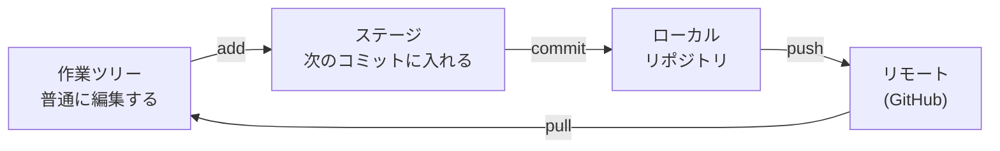

::: haru
先輩、昨日いじったコードを元に戻したいんすけど…… `Main_old2_最終版.java` ってファイルが3つあって、どれが本物か分からないっす。
:::

::: sensei
その命名、現場で見たら泣くやつ。今日は Git を覚えよう。「いつ・誰が・なぜ変えたか」を全部記録して、いつでも戻せるようにする道具だよ。
:::

## Git の基本概念:3つの場所と2つのリポジトリ

**Git** はファイルの変更履歴を管理する **バージョン管理システム** です。履歴をためておく場所を **リポジトリ** と呼び、各自の PC にある **ローカルリポジトリ** と、GitHub などのサーバーにある **リモートリポジトリ** があります。ファイルは次の場所を移動します。



- **作業ツリー(working tree)**:エディタで編集している普通のファイル
- **ステージ(staging area / index)**:「次のコミットに入れる変更」を選んで置いておく場所
- **コミット(commit)**:ステージの内容を、その時点のスナップショットとして履歴に刻んだもの。1つ1つに `9c1e4ab…` のような **ID(中身から計算したハッシュ値)** が付き、直前のコミット(親)を指している
- **ブランチ(branch)**:あるコミットを指す「名札」。コミットするたびに名札が新しいコミットへ進む。名札を作るだけなので、ブランチは一瞬で作れて軽い
- **HEAD**:「今いるブランチ」を指す特別な名札。次のコミットはここに積まれる
- **リモート(remote)**:GitHub 上のリポジトリ。慣例で `origin` という名前で登録される

::: trivia なぜ「ローカル」と「リモート」の2段構えなのか
Git は **分散型** のバージョン管理システムです。昔主流だった Subversion などの集中型は、コミットした瞬間にサーバーへ送られる仕組みでした。Git は全履歴を各自の PC に持つので、オフラインでもコミットや履歴の閲覧ができ、push するまでは手元で何度でもやり直せます。
:::

::: haru
ステージって要ります? 変えたら全部コミットすればよくないすか。
:::

::: sensei
「バグ修正」と「ついでの整形」を1つのコミットに混ぜると、後でバグ修正だけ取り消せなくなる。**1コミット1目的** に分けるためにステージがあるんだ。
:::

コマンドで書くと次のとおりです。STS の操作も、裏ではこれと同じことをしています。

| やりたいこと | コマンド |
|---|---|
| 状態を見る | `git status` |
| ステージに載せる | `git add ファイル` |
| コミット | `git commit -m "メッセージ"` |
| リモートへ送る/取る | `git push` / `git pull` |
| ブランチを作って移る | `git switch -c 名前` |
| 履歴を見る | `git log --oneline` |

迷ったらまず `git status`。今どの場所に何があるかを教えてくれます(出力は抜粋)。

```text
On branch main
Changes to be committed:
        modified:   src/main/java/.../ShippingService.java
Changes not staged for commit:
        modified:   README.md
```

`Changes to be committed` がステージにある(次のコミットに入る)もの、`Changes not staged for commit` が作業ツリーで変えただけのものです。この状態で commit すると、README.md の変更は入りません。

## .gitignore:コミットしないものを決める

**.gitignore** は「Git に管理させないファイル」の一覧です。このアプリの `.gitignore` を見てみましょう(抜粋)。

```text
# ビルド
target/
!.mvn/wrapper/maven-wrapper.jar

# 進捗・提出履歴の H2 データベース
data/

# APIキーなどの秘密情報
.env
application-local.yml

# IDE(STS / Eclipse など)
.classpath
.project
.settings/
```

- **target/**:Maven が作る成果物。`./mvnw package` でいつでも作り直せるので履歴に入れない(入れると、ビルドのたびに大量の差分が出る)
- **`!` で始まる行**:除外の取り消し。Wrapper の jar だけは配布物として残す
- **data/**:個人の学習記録。他人と共有するものではない
- **.env / application-local.yml**:APIキーなどの秘密情報。**一度でもコミットすると履歴に残る**
- **.project / .classpath**:STS(Eclipse)が環境ごとに作る設定。チームで IDE が違っても困らないよう入れず、受け取った側は **Maven プロジェクトとしてインポート** して作り直す

注意点が1つ。**すでにコミット済みのファイルは、後から .gitignore に書いても無視されません**。`git rm -r --cached target` で「管理対象から外す(ファイルは残す)」をしてからコミットします。

## STS の Git 機能

STS には **EGit** という Git 機能が最初から入っていて、コマンドを打たずに一通りの操作ができます(手順は下の「STSでやってみよう」で)。

| STS の操作 | 相当するコマンド |
|---|---|
| Git Staging ビューで Staged へ移す | `git add` |
| Team > Commit... → Commit | `git commit` |
| Team > Push to Upstream | `git push` |
| Team > Pull | `git pull` |
| Team > Switch To > New Branch... | `git switch -c` |
| Compare With > HEAD Revision | `git diff HEAD` |

Package Explorer でファイル名の前に `>` が付いていたら「最後のコミットから変更あり」の印です。**History** ビューではコミットの一覧と分岐の様子をグラフで見られます。

## GitHub との連携:パスワードではなくトークン

GitHub は 2021年8月から、Git 操作での **パスワード認証を廃止** しています。代わりに使うのが **個人アクセストークン(Personal Access Token、PAT)** です。PAT は「このリポジトリの読み書きだけ・90日間だけ」のように **権限と期限を絞れる** 合鍵で、漏れたらその鍵だけ無効化できます。

STS でクローンや push をするときは、**User にGitHubのユーザー名、Password に PAT** を入れ、**Store in Secure Store** にチェックすれば次回から聞かれません。

## コンフリクトの解消

2人が **同じファイルの同じ行** を別々に変えると、pull したときに Git はどちらを採るか決められず、**コンフリクト(衝突)** になります。ファイルにはこんな印が書き込まれます。

```text
<<<<<<< HEAD
送料無料ラインは 5000 円
=======
送料無料ラインは 3000 円
>>>>>>> 9c1e4ab
```

`HEAD` 側が自分の変更、`=======` の下が取り込んだ相手の変更です。解消の手順は次のとおり。

1. どちらが正しいか(両方必要か)を **相手と確認して** 決める。勝手に自分の方を採らない
2. 印の行(`<<<<<<<` `=======` `>>>>>>>`)を消して、正しい内容にする。STS なら **Team > Merge Tool** で左右を見比べながら直せる
3. ステージに載せて(**Team > Add to Index**)、コミットして push

印を消し忘れたままコミットすると、Java ならコンパイルエラーになりますが、設定ファイルや Markdown だと **そのまま本番に出る** ので要注意です。

## コミットメッセージとブランチ運用

コミットメッセージは、未来の自分とチームへの手紙です。

```text
送料無料ラインを 3000 円に変更

キャンペーン(10/1〜10/31)に合わせて変更。
終了後は 5000 円に戻すこと。
```

- **1行目は要約**(日本語なら30字程度まで)。History や GitHub の一覧に出るのはここだけ
- 1行空けて、**なぜ変えたか** を書く。「何を変えたか」は差分を見れば分かる
- 「修正」「wip」「あ」は書かない。半年後に誰も読めない

現場で多いのは、**main を常に動く状態に保ち、作業は feature ブランチでやる** 運用です。

1. main から `feature/free-shipping` のようなブランチを作る
2. そこでコミットを重ねて push する
3. GitHub で **プルリクエスト(PR)** を作り、レビューと自動テストを通す
4. OK が出たら main にマージ。ブランチは消す

main に直接 push できないよう、GitHub の **ブランチ保護(Branch protection)** で縛っておくのが普通です。

## よくあるミス:push が拒否された

```text
 ! [rejected]        main -> main (fetch first)
error: failed to push some refs to 'https://github.com/…'
hint: Updates were rejected because the remote contains
hint: work that you do not have locally.
```

壊れたわけではありません。**自分が pull した後に、誰かが先に push した** という意味です(STS では push 結果のダイアログに `rejected - non-fast-forward` と出ます)。Git は他人のコミットを消さないよう、先に取り込むことを求めています。正しい対処は **pull して相手の変更を取り込み(コンフリクトがあれば解消し)、それから push** です。ここで「押し通す」ために force push を使うのが、次に説明する最悪の一手です。

## やってはいけないこと

### APIキーをコミットする

公開リポジトリに push された APIキーは、自動で GitHub を巡回しているボットに **数分で** 拾われます。後から削除コミットをしても **過去のコミットには残っている** ので手遅れです。やってしまったら、**まずキーを無効化して作り直す**(Claude なら Claude Console で)。履歴の掃除はその後です。このアプリが APIキーを環境変数からしか読まないのは、そもそもファイルに書かせないためです。

### force push

`git push --force` はリモートの履歴を **自分の手元の履歴で上書き** します。他の人が push したコミットは消えます。共有ブランチ(特に main)では使わないこと。自分だけのブランチでどうしても必要なら、相手の変更があれば止まってくれる `--force-with-lease` を使います。

::: point まとめ
- ファイルは **作業ツリー → (add) → ステージ → (commit) → ローカル → (push) → リモート** と移る
- ブランチはコミットを指す **名札**。main は守り、作業は **feature ブランチ + プルリクエスト**
- **.gitignore** に target/(作り直せる)・data/(個人のもの)・秘密情報・IDE 設定を書く。コミット済みのものは `git rm --cached`
- STS では **Git Staging ビュー**・**Team > Commit / Push / Pull**・**Compare With > HEAD Revision**・**History** を使う
- GitHub の認証は **個人アクセストークン**。コンフリクトは **相手と確認して** 印を消してコミット
- **APIキーをコミットしたら即無効化**。**共有ブランチに force push しない**
:::

::: sensei
これで第2部はおしまい。STS・デバッガ・Maven・Git がそろったら、いよいよ第3部で Spring の世界に入るよ。
:::
