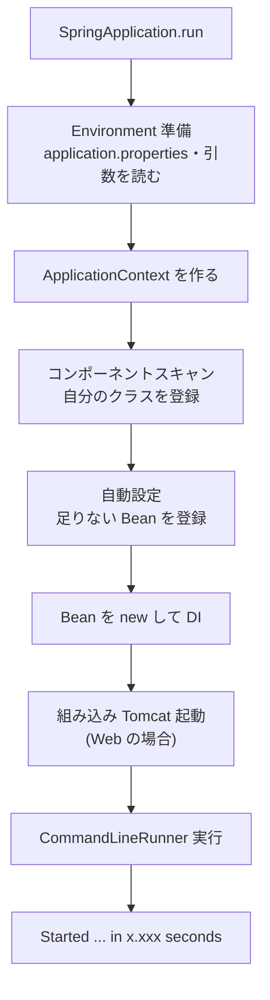

::: haru
前回の STS のやつ、`main` に `SpringApplication.run(...)` って1行あるだけでしたよね。なんで `@Service` のクラスが勝手に見つかって、勝手に動くんすか?
:::

::: sensei
「勝手に」の中身を知らないと、動かなくなったとき手も足も出ない。今日はその1行の裏側を全部開けるよ。
:::

## @SpringBootApplication の中身

Spring Starter Project が作るメインクラスはこれだけです。

```java
@SpringBootApplication
public class DemoApplication {
    public static void main(String[] args) {
        SpringApplication.run(DemoApplication.class, args);
    }
}
```

`@SpringBootApplication` は、3つのアノテーションをまとめた **合成アノテーション** です。

| アノテーション | 役割 |
|---|---|
| `@SpringBootConfiguration` | 中身は `@Configuration`。このクラスも設定クラスになる |
| `@EnableAutoConfiguration` | 自動設定を有効にする |
| `@ComponentScan` | このクラスのパッケージ以下から `@Component` 系を探す |

前回の `AnnotationConfigApplicationContext(A.class, B.class)` ではクラスを手で登録しました。Boot ではそれを **コンポーネントスキャン** が、ライブラリ側の Bean 定義を **自動設定** が肩代わりしています。

## SpringApplication.run で何が起きるか



ポイントは **D(自分のクラス)が E(自動設定)より先** なことです。これが次の「自分で定義したら自動設定は引っ込む」仕組みの前提になります。

`CommandLineRunner` は、この起動処理が **全部終わった直後に1回だけ** 呼ばれます。DI 済みの Bean が使えるので、初期データの投入や動作確認に便利です。

## 自動設定:starter を入れると Bean が用意される理由

`spring-boot-starter-web` のような **starter** は、それ自体にはほぼコードがなく、「Web アプリに必要なライブラリ一式」をまとめて引っぱってくる依存関係のセットです。

では、誰が Tomcat や JSON 変換の Bean を作るのか。それが `spring-boot-autoconfigure` という jar に入っている150個以上の **自動設定クラス** です。中身はただの `@Configuration` で、条件が付いています。一覧は jar 内の `META-INF/spring/org.springframework.boot.autoconfigure.AutoConfiguration.imports` というファイルに書かれていて、`@EnableAutoConfiguration` がこれを読み込みます。Jackson(JSON ライブラリ)用を簡略化するとこうです。

```java
@AutoConfiguration
@ConditionalOnClass(ObjectMapper.class)
public class JacksonAutoConfiguration {

    @Bean
    @ConditionalOnMissingBean
    ObjectMapper jacksonObjectMapper() {
        return new ObjectMapper();
    }
}
```

- `@ConditionalOnClass`:**そのクラスがクラスパスにあれば** この設定を使う。starter で jar を入れた瞬間に条件が成立します。
- `@ConditionalOnMissingBean`:**同じ型の Bean がまだ無ければ** 作る。

つまり「ライブラリを入れたら既定の Bean が用意され、自分で `@Bean ObjectMapper` を書けばそちらが優先されて既定は作られない」。この **後ろに引っ込む(back off)** 動きが自動設定の基本思想です。自分の Bean 定義が先に処理されるのは、まさにこの判定のためです。

::: sensei
自動設定は魔法じゃなくて「条件付きの `@Bean` の大集合」。そう思えば怖くない。
:::

## コンポーネントスキャンの範囲

`@ComponentScan` は、**付いているクラス(メインクラス)のパッケージと、そのサブパッケージ** だけを探します。

```text
src/main/java
├─ com/example/demo
│   ├─ DemoApplication.java   ← ここが起点
│   ├─ order/OrderService.java     ○ 見つかる
│   └─ mail/SmtpMailSender.java    ○ 見つかる
└─ com/example/common
    └─ AuditLogger.java            × 見つからない
```

`com.example.common` は `com.example.demo` の **下ではない** ので、`@Component` を付けても Bean になりません。使おうとすると起動時にこう言われます。

```text
Parameter 0 of constructor in
com.example.demo.order.OrderService required a bean
of type 'com.example.common.AuditLogger'
that could not be found.
```

直し方は、**クラスをメインクラスの下のパッケージへ移す** のが第一選択です。`@SpringBootApplication(scanBasePackages = "com.example")` で範囲を広げることもできますが、「メインクラスはパッケージの一番上に置く」が Spring Boot の推奨構成です。

::: warn メインクラスを default package に置かない
パッケージなしの場所にメインクラスを置くと、クラスパス上の **全 jar** をスキャンしようとして起動が遅くなったり失敗したりします。STS のウィザードは必ずパッケージを作るので、勝手に移動しないこと。
:::

## 組み込み Tomcat:サーバにデプロイしない

昔の Java Web アプリは、Tomcat などの **アプリケーションサーバ** を別にインストールし、そこに WAR ファイルを配置(デプロイ)して動かしていました。

Spring Boot は逆で、**Tomcat をライブラリとしてアプリの中に持っています**(組み込み Tomcat)。`spring-boot-starter-web` を入れると、自動設定が Tomcat を起動してポート 8080 で待ち受けます。だから `main` を実行するだけで Web サーバが立ち上がり、本番も `java -jar app.jar` で動きます。ポートは `application.properties` の `server.port=8081` で変えられます。

## 起動ログの読み方

起動ログの1行はこういう形です(実際は1行)。

```text
2026-10-11T10:00:00.123+09:00  INFO 4120 --- [demo]
  [main] c.e.demo.DemoApplication : Started ...
```

| 部分 | 意味 |
|---|---|
| `INFO` | ログレベル(`ERROR`・`WARN` は要注意) |
| `4120` | プロセス ID |
| `[main]` | 出力したスレッド名 |
| `c.e.demo...` | 出力したクラス(パッケージは省略形) |

メッセージ部分は、上から次の順に並ぶのが正常です。

```text
Starting DemoApplication using Java 21.0.5 with PID 4120
No active profile set, falling back to 1 default
  profile: "default"
Tomcat initialized with port 8080 (http)
Tomcat started on port 8080 (http) with context path '/'
Started DemoApplication in 1.873 seconds
```

`Started` が出たら起動完了。止まったときは `APPLICATION FAILED TO START` の下の **Description(原因)と Action(対処)** を読みます。定番は `Port 8080 was already in use`(前に起動したアプリが動きっぱなし)です。

## --debug で自動設定レポートを見る

起動引数に `--debug` を付ける(または `application.properties` に `debug=true`)と、**CONDITIONS EVALUATION REPORT** が出ます。どの自動設定が、なぜ使われた/使われなかったかの一覧です。

```text
Positive matches:
   JacksonAutoConfiguration matched:
      - @ConditionalOnClass found required class
        'com.fasterxml.jackson.databind.ObjectMapper'
Negative matches:
   DataSourceAutoConfiguration:
      Did not match:
         - @ConditionalOnClass did not find required
           class '...EmbeddedDatabaseType'
```

「starter を入れたのに Bean ができない」「なぜか DB に接続しにいく」といったとき、推測より先にこれを見るのが現場の作法です。

## devtools の自動再起動

依存に **Spring Boot DevTools** を入れると、クラスパス上のファイルが変わるたびにアプリが **自動で再起動** します。STS では保存すると自動ビルドされるので、「保存 → 数秒後に反映」になります。

速い理由は、クラスローダーを2つに分けているからです。変わらない jar は **base** クラスローダーに置いたまま、自分のクラスだけを **restart** クラスローダーごと作り直します。DevTools 使用時はスレッド名が `[restartedMain]` になるので、ログで見分けられます。`java -jar` で動かす本番では自動で無効になります。

::: point まとめ
- `@SpringBootApplication` = `@Configuration` + `@EnableAutoConfiguration` + `@ComponentScan`。
- `run` は Environment 準備 → スキャン → 自動設定 → DI → Tomcat 起動 → Runner 実行。
- 自動設定は条件付き `@Bean` の集まり。`@ConditionalOnClass`(jar があれば)と `@ConditionalOnMissingBean`(自分で定義していなければ)。
- スキャン範囲はメインクラスのパッケージ以下。外に置くと Bean が見つからない。
- 困ったら起動ログの Description / Action と `--debug` のレポートを読む。
:::
