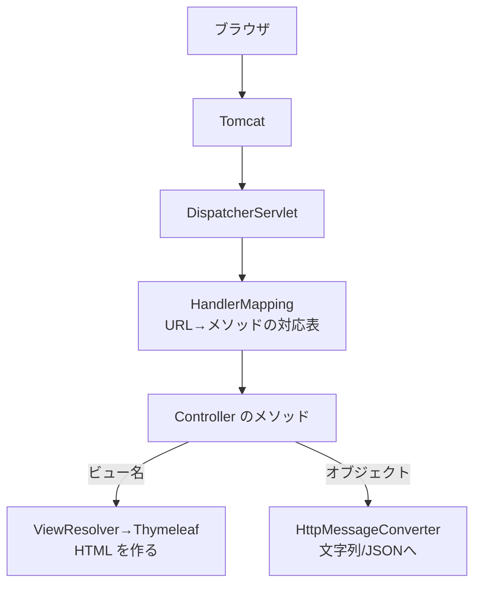

::: haru
先輩、Spring Boot が起動するところまでは分かりました。で、ブラウザで URL を開いたら、どうやって僕のメソッドが呼ばれるんすか?
:::

::: sensei
そこが今日の主役、**Controller** だ。「この URL が来たらこのメソッド」という対応表(ルーティング)をアノテーションで書く。まずは HTTP をおさらいしよう。
:::

前回は `@SpringBootApplication` から Tomcat が立ち上がるまでを見ました。今回は、届いた **HTTP リクエスト** を自分のメソッドに届けて、レスポンスを返すところまでを扱います。

## HTTP を3分でおさらい

ブラウザが `http://localhost:8080/hello?name=Haru` を開くと、サーバーには次のような **リクエスト** が届きます。

```text
GET /hello?name=Haru HTTP/1.1
Host: localhost:8080
```

| 部品 | 例 | 意味 |
|---|---|---|
| メソッド | `GET` / `POST` | 何をしたいか(取得/送信) |
| パス | `/hello` | どのリソースか |
| クエリ | `?name=Haru` | `?` 以降の `キー=値` |

クエリに日本語を入れると、ブラウザは `?name=%E3%83%8F%E3%83%AB` のように UTF-8 のバイト列を `%xx` で表した形(URL エンコード)で送り、Spring 側で元の文字列に戻してくれます。

サーバーは **ステータスコード** 付きのレスポンスを返します。よく見るのはこのあたりです。

| コード | 意味 | Spring でよくある原因 |
|---|---|---|
| 200 / 201 | 成功 / 作成した | 正常 |
| 302 | 別の URL へ行って | `redirect:` |
| 400 | リクエストが変 | 必須パラメータ無し・型変換失敗 |
| 404 | 見つからない | パスの書き間違い |
| 405 | メソッド違い | GET 用に POST した |
| 500 | サーバー内エラー | コードの例外 |

GET は「取得」なので、何度送っても結果が変わらない処理に使います。データを登録・更新するフォーム送信は POST です。

## DispatcherServlet が振り分ける

Spring MVC では、すべてのリクエストをまず **DispatcherServlet** という1つのサーブレットが受け取ります。「受付窓口を1つにして、そこから担当者に回す」この設計を **フロントコントローラー** パターンと呼びます。Spring Boot は起動時に DispatcherServlet を `/` に登録しています。



対応表(HandlerMapping)は **起動時に** `@GetMapping` などを全部読んで作られます。だから対応表に矛盾があると、リクエストを待たずに起動が失敗します(後述)。

なぜ窓口を1つにするのか。文字コードの設定、例外を 400/500 に変換する処理、JSON 変換などの **共通処理を1か所に集められる** からです。Controller は「URL ごとの固有の仕事」だけ書けばよくなります。どのメソッドにも当たらなければ 404 になり、Spring Boot ではおなじみの **Whitelabel Error Page** が表示されます。

## @Controller と @RestController

```java
@Controller                 // 戻り値は「ビュー名」
public class PageController {
    @GetMapping("/top")
    public String top() {
        return "top";       // templates/top.html を描画
    }
}

@RestController             // 戻り値は「レスポンス本体」
public class ApiController {
    @GetMapping("/ping")
    public String ping() {
        return "pong";      // 文字列 pong がそのまま返る
    }
}
```

`@RestController` は `@Controller` + `@ResponseBody` の合成アノテーションです。`@ResponseBody` は「戻り値をビュー名ではなく、レスポンスの本体として書き出せ」という指示。画面(HTML)を返すなら `@Controller`、API(文字列や JSON)なら `@RestController` と使い分けます。どちらも `@Component` の一種なので、DI のレッスンで見たとおり Bean として登録されます。

## マッピングとパラメータの受け取り

```java
@RestController
@RequestMapping("/api/items")   // クラス全体の共通プレフィックス
public class ItemController {

    @GetMapping("/{id}")        // GET /api/items/42
    public String find(@PathVariable int id) {
        return "商品 " + id;
    }

    @GetMapping                 // GET /api/items?page=2
    public String list(
            @RequestParam(defaultValue = "1") int page,
            @RequestParam(required = false) String q) {
        return "page=" + page + " q=" + q;
    }

    @PostMapping                // POST /api/items
    public String create(@RequestParam String name) {
        return "登録: " + name;
    }
}
```

- `@GetMapping` / `@PostMapping` は `@RequestMapping(method = GET)` などの省略形です。クラスに付けた `@RequestMapping` のパスは、メソッド側のパスの前に連結されます。
- **`@PathVariable`**:パスの `{id}` 部分を受け取ります。`/api/items/abc` のように `int` に変換できないと **400** です。
- **`@RequestParam`**:クエリ(や POST フォームの値)を受け取ります。**デフォルトは `required = true`** で、無いと **400**(`Required request parameter 'name' ... is not present`)。
  - `required = false` なら無いとき `null`。`int` のような基本型は `null` を入れられないので、ラッパー型(`Integer`)にするか `defaultValue` を使います。
  - `defaultValue` を付けると暗黙に `required = false` になり、**`?page=` のように空文字のときも** 既定値が使われます。

::: trivia 引数名はどこから来る?
`@PathVariable int id` の `"id"` という名前は、コンパイル時の `-parameters` オプションでクラスファイルに残された引数名を読んでいます。詳しくはコラムで。
:::

## 戻り値いろいろ:JSON・ステータス・リダイレクト

**オブジェクトを返すと JSON** になります。変換するのは HttpMessageConverter(中身は Jackson)です。

```java
record Item(int id, String name, int price) {}

@GetMapping("/api/items/{id}")
public Item find(@PathVariable int id) {
    return new Item(id, "ボールペン", 120);
}
// → {"id":1,"name":"ボールペン","price":120}
```

**ステータスコードも決めたい** ときは `ResponseEntity` で包みます。

```java
@GetMapping("/api/items/{id}")
public ResponseEntity<Item> find(@PathVariable int id) {
    Item item = items.get(id);
    if (item == null) {
        return ResponseEntity.notFound().build();  // 404
    }
    return ResponseEntity.ok(item);                // 200
}
```

`ResponseEntity.status(HttpStatus.CONFLICT).build()` のように任意のコードも返せます。

**`@Controller` で `"redirect:"` から始まる文字列** を返すと、ビュー名ではなく **リダイレクト**(302 と `Location` ヘッダー)になります。

```java
@PostMapping("/orders")
public String order(@RequestParam String item) {
    long id = orderService.place(item);
    return "redirect:/orders/" + id; // 302 → GET し直す
}
```

POST の結果画面をそのまま返すと、ユーザーが F5 を押したとき **POST がもう一度送られて二重注文** になります。そこで「POST → リダイレクト → GET で結果画面」にするのが **PRG(Post/Redirect/Get)パターン** です。F5 で再送されるのは最後の GET だけになります。

::: sensei
フォームを受ける POST は「処理したら redirect」が鉄則。「フォーム」のレッスンでも使うから覚えておいて。
:::

::: genba Controller は薄く書く
現場の Controller は「リクエストを受け取る → Service を呼ぶ → 結果をビュー名や `ResponseEntity` にする」だけの **薄い層** にします。計算や在庫チェックのような業務ロジックを Controller に書くと、HTTP なしでテストできず、画面と API で同じ処理を二重に書くことになります。層の分け方は「層分け」のレッスンで扱います。
:::

## よくあるミス

### 同じパスが2つある

```java
@GetMapping("/hello") public String a() { ... }
@GetMapping("/hello") public String b() { ... }
```

```text
java.lang.IllegalStateException: Ambiguous mapping.
Cannot map 'helloController' method
com.example.demo.HelloController#b()
to {GET [/hello]}: There is already 'helloController'
bean method com.example.demo.HelloController#a() mapped.
```

コンパイルは通りますが、**アプリの起動時** に落ちます(対応表を作る段階で矛盾に気づくため)。別クラスに同じパスがあっても同じエラーです。メソッドが違えば(GET と POST)同じパスでも OK です。

### `@Controller` で文字列を返したつもり

`@RestController` のつもりで `@Controller` と書くと、`"hello"` は **ビュー名** として扱われます。Thymeleaf 入りのプロジェクトなら `Error resolving template [hello]`、Thymeleaf が無ければ `Circular view path [hello]` という一見意味不明なエラーになります。「文字列が画面に出ない」ときはまずアノテーションを確認しましょう。

::: haru
エラーメッセージの英語、最初は怖いけど、`Required request parameter 'name'` とか、ちゃんと原因を言ってるんすね。
:::

::: point まとめ
- リクエストは **DispatcherServlet** が受け、起動時に作った対応表で Controller のメソッドに振り分ける
- `@Controller` の戻り値は **ビュー名**、`@RestController`(= `@Controller` + `@ResponseBody`)は **本体**。オブジェクトは JSON になる
- `@GetMapping` / `@PostMapping`、クラスの `@RequestMapping` はプレフィックス
- `@PathVariable` はパスの一部、`@RequestParam` はクエリ。**必須がデフォルト**で、無いと 400
- ステータスは `ResponseEntity`、POST の後は `"redirect:"` で **PRG**
- 同じメソッド+パスが2つあると **起動時に** Ambiguous mapping
:::
