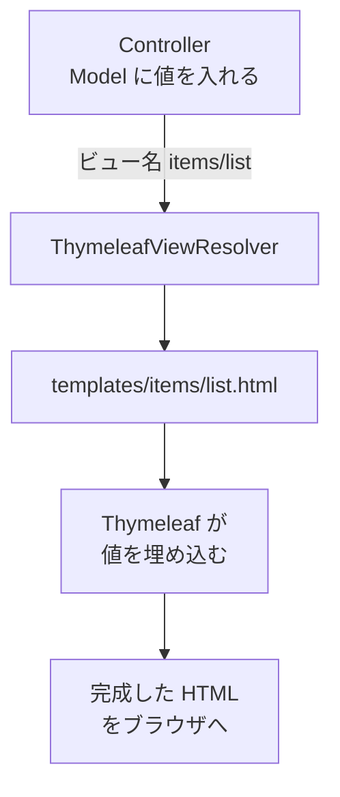

::: haru
先輩、`@Controller` で `"hello"` を返したら `Error resolving template [hello]` って怒られました……。
:::

::: sensei
ビュー名を返したのに、肝心のビュー(テンプレート)が無かったんだね。今日はその **テンプレート側**、Thymeleaf(タイムリーフ)を書けるようになろう。
:::

前回は、`@Controller` の戻り値が「ビュー名」になるところまで見ました。今回は、そのビュー名から HTML を作る **テンプレートエンジン** を扱います。

## テンプレートエンジンとは

**テンプレートエンジン** は、「HTML の雛形(テンプレート)」と「データ」を合体させて、最終的な HTML を作る部品です。Spring Boot で一番よく使われるのが **Thymeleaf** です。



HTML を作るのは **サーバー側** です。ブラウザに届くのは値が埋め込まれた普通の HTML で、`th:` の属性は残りません。

Thymeleaf の特徴は **ナチュラルテンプレート**。`th:text` などはブラウザから見ると知らない属性なので無視され、テンプレートのファイルを直接ブラウザで開いても、ダミーの文字が入った見本として表示できます。デザイナーが作った HTML に `th:` 属性を足していく、という分業がしやすいのです。

## Controller から値を渡す

```java
@Controller
public class ItemController {
    @GetMapping("/items")
    public String list(Model model) {
        model.addAttribute("title", "商品一覧");
        model.addAttribute("items", itemService.findAll());
        return "items/list";
    }
}
```

**`Model`** は、テンプレートに渡す値を入れる入れ物です(引数に書くだけで Spring が用意します)。ビュー名 `items/list` は、Spring Boot の既定の設定で `src/main/resources/templates/` + `items/list` + `.html` というファイルになります。

```html
<!DOCTYPE html>
<html xmlns:th="http://www.thymeleaf.org">
<body>
  <h1 th:text="${title}">ここにタイトル</h1>
</body>
</html>
```

`th:text` は「タグの中身をこの値で置き換えよ」という指示です。描画すると `<h1>商品一覧</h1>` になります。`xmlns:th` の行は、エディタの補完や警告のための宣言です。

## 4種類の式

| 式 | 名前 | 用途 |
|---|---|---|
| `${...}` | 変数式 | Model の値を読む |
| `*{...}` | 選択変数式 | `th:object` の中で使う |
| `@{...}` | リンク式 | URL を組み立てる |
| `#{...}` | メッセージ式 | messages.properties の文言 |

`${item.name}` の中身は Spring の式言語 **SpEL** で、`item.getName()`(record なら `item.name()`)が呼ばれます。

```html
<section th:object="${order}">
  <p th:text="*{customer}">お客様名</p>  <!-- order.customer -->
  <a th:href="@{/orders/{id}/cancel(id=*{id},
                from='detail')}">キャンセル</a>
</section>
<!-- href="/orders/1001/cancel?from=detail" -->
```

`@{...}` は、`{id}` を値で埋め、余った `( )` 内の引数をクエリにします。さらに、アプリが `/shop` のような **コンテキストパス** で公開されていれば、先頭に自動で `/shop` を付けます。`href="/orders/..."` と直書きすると、公開場所が変わったときに全部リンク切れになります。

`#{...}` は画面の文言を `messages.properties` に集めておく仕組みです(多言語対応にも使います)。

```html
<!-- messages.properties に item.title=商品一覧 -->
<h1 th:text="#{item.title}">見出し</h1>
```

文字列と値をつなぐときは、`'合計: ' + ${total}` のほか、`|合計: ${total}円|` という **リテラル置換** も使えます。

## th:text と th:utext(XSS 対策)

```java
model.addAttribute("comment",
        "<script>alert('!')</script>");
```

```html
<p th:text="${comment}"></p>
<!-- <p>&lt;script&gt;alert(&#39;!&#39;)
     &lt;/script&gt;</p> -->
<p th:utext="${comment}"></p>
<!-- <p><script>alert('!')</script></p>  ← 実行される! -->
```

`th:text` は `<` を `&lt;` のように **エスケープ** するので、文字として表示されるだけです。`th:utext`(unescaped text)はそのまま HTML として出します。ユーザーが入力した値を `th:utext` で出すと、他人のブラウザで任意のスクリプトが動く **XSS(クロスサイトスクリプティング)** の穴になります。

::: sensei
`th:utext` は「自分たちで作った、安全だと分かっている HTML」専用。ユーザー入力には絶対に使わない。迷ったら `th:text` だ。
:::

## 繰り返しと条件分岐

```html
<tr th:each="item, st : ${items}">
  <td th:text="${st.count}">1</td>
  <td th:text="${item.name}">商品名</td>
  <td th:if="${item.stock == 0}">売り切れ</td>
  <td th:unless="${item.stock == 0}"
      th:text="|残り${item.stock}個|">在庫</td>
</tr>
```

- **`th:each`** は、付けたタグごと要素の数だけ繰り返します。2つ目の変数 `st` は **ステータス変数** で、`index`(0始まり)・`count`(1始まり)・`size`・`first`・`last`・`odd`・`even` が使えます。
- **`th:if`** は条件が真のときだけタグを出し、**`th:unless`** はその逆です。真偽は Java より緩く、`null`・`false`・数値の `0`・文字列 `"false"` `"off"` `"no"` が偽、それ以外は真です。

::: genba テンプレートは「表示するだけ」に
`th:if="${o.status == 'ORDERED' and o.shippedAt == null}"` のような業務ルールをテンプレートに書き始めると危険です。テンプレートは **コンパイルされない** ので、綴りミスも型の間違いも、その画面を開くまで分かりません。JUnit でもテストしにくい。現場では判定を Java 側のメソッド(`order.cancellable()` など)にして、テンプレートは `th:if="${order.cancellable()}"` と呼ぶだけにします。
:::

## 共通レイアウト:フラグメント

ヘッダーやフッターは全ページ共通です。**フラグメント** として1か所に書き、各ページから呼び出します。

```html
<!-- templates/fragments/layout.html -->
<header th:fragment="header(title)">
  <h1 th:text="${title}">タイトル</h1>
</header>

<!-- templates/items/list.html -->
<header th:replace="~{fragments/layout :: header('商品一覧')}">
</header>
```

`~{テンプレート名 :: フラグメント名}` で指定します。`th:replace` は自分のタグごと置き換え、`th:insert` は自分のタグの **中に** 差し込みます。

このアプリ(Java道場)自身も Thymeleaf で作られていて、どのページも `th:replace="~{fragments/layout :: header}"` で共通ヘッダーを読み込んでいます。

::: trivia 「実行」ボタンの裏側は htmx + フラグメント
このアプリのコード実行は **htmx** というライブラリで動いています。`<form hx-post="/run" hx-target="#playground-out">` が POST を送り、Controller は `return "fragments/run :: result";` と **フラグメントだけ** をビュー名として返します。届いた HTML の断片で `#playground-out` の中身だけを差し替えるので、ページ全体を再読み込みせずに結果が出るのです。JavaScript をほとんど書かずに「サクサク動く画面」が作れる、最近人気の組み合わせです。
:::

## ユーティリティとキャッシュ

`#` で始まる **ユーティリティオブジェクト** で整形できます。

```html
<span th:text="${#temporals.format(order.orderedAt,
                'yyyy/MM/dd HH:mm')}">日時</span>
<span th:text="${#numbers.formatInteger(
                price, 1, 'COMMA')}">価格</span>
<!-- 1234567 → 1,234,567 -->
```

`#temporals` は `LocalDateTime` などの日時、`#numbers` は数値、ほかに `#strings`・`#lists` などがあります。

Thymeleaf は一度読んだテンプレートを **キャッシュ** します。本番では速くて良いのですが、開発中は HTML を直しても反映されず「あれ?」となります。開発中は `application.properties` に次を書きます。

```text
spring.thymeleaf.cache=false
```

Spring Boot DevTools を入れていれば、開発中は自動でこの設定になります。本番ではキャッシュを有効のままにします。

## よくあるミス

**① テンプレートが見つからない**

```text
Error resolving template [items/List], template might
not exist or might not be accessible by any of the
configured Template Resolvers
```

ビュー名とファイルのパス・大文字小文字・`templates/` の下に置いたかを確認します。ビュー名に `.html` や `templates/` は付けません。

**② プロパティ名のタイプミス・null**

```text
EL1008E: Property or field 'nmae' cannot be found on object
of type 'Item' - maybe not public or not valid?
EL1007E: Property or field 'name' cannot be found on null
```

1つ目は綴り間違いか、getter が無い(public でない)とき。2つ目は `${item.name}` の `item` 自体が `null` のときです。`null` かもしれないなら `${item?.name}` (安全ナビゲーション演算子)で `null` を返せます。

::: point まとめ
- Controller は **Model** に値を入れて **ビュー名** を返す → `templates/ビュー名.html` が描画される
- `${}` 変数、`*{}` 選択(`th:object`)、`@{}` URL(コンテキストパスも付く)、`#{}` メッセージ
- 値の表示は **`th:text`**(エスケープ)。`th:utext` はユーザー入力に使うと **XSS**
- `th:each` とステータス変数、`th:if` / `th:unless`
- 共通部品は `th:fragment` + `th:replace` / `th:insert`
- 日時・数値は `#temporals` / `#numbers`。開発中は `spring.thymeleaf.cache=false`
:::
