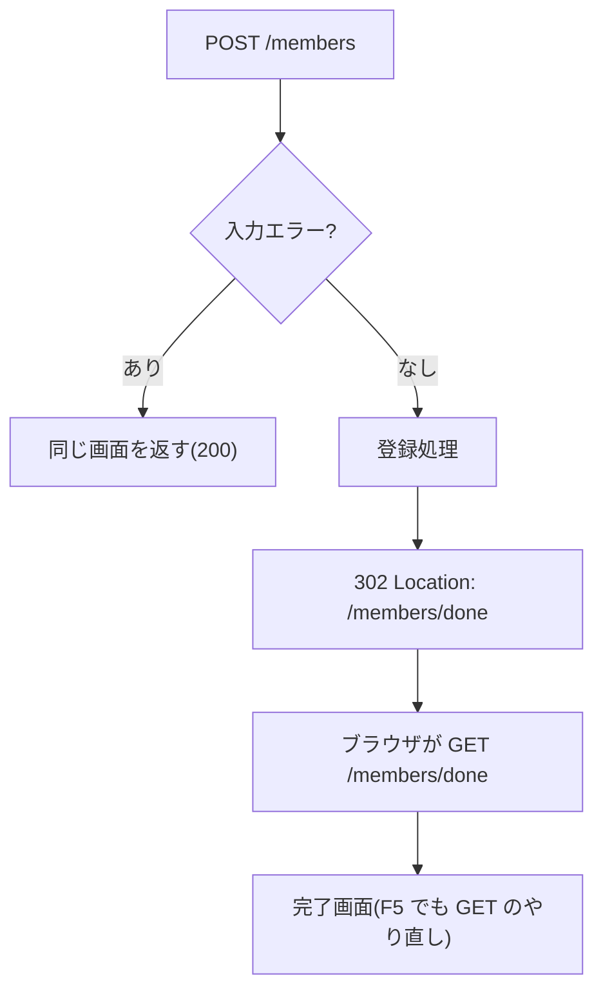

::: haru
前回 Thymeleaf で画面は出せました! 次は入力フォーム。`@RequestParam` を項目の数だけ並べればいいんすよね?
:::

::: sensei
会員登録が15項目なら引数15個。さらに「空欄チェック」「メール形式チェック」を if で15個? 今日はそれを Spring に任せる方法をやる。
:::

## フォームオブジェクトと @ModelAttribute

画面の入力欄と1対1に対応するクラスを **フォームオブジェクト**(フォームクラス)と呼びます。

```java
public class MemberForm {
    private String name;
    private String email;
    private Integer age;
    // getter / setter は省略(STS なら
    // Source > Generate Getters and Setters)
}
```

Controller の引数に置くと、Spring がリクエストパラメータ `name=...&email=...` を **同じ名前のプロパティ** に setter で詰めてくれます。これを **データバインディング** と呼び、引数に付ける `@ModelAttribute` が目印です(単純型以外の引数は、付けなくても暗黙に `@ModelAttribute` 扱い)。

```java
@GetMapping("/members/new")
public String form(Model model) {
    model.addAttribute("memberForm",
            new MemberForm());
    return "members/form";
}
```

`@ModelAttribute` で受け取ったオブジェクトは、**自動で Model にも入ります**。名前はクラス名の先頭を小文字にした `memberForm`。この性質が、後で「エラー時に入力値が残る」理由になります。

`age` を `int` でなく `Integer` にするのは、空欄を `null`(未入力)で表すためです。Spring は空文字を数値型へ変換するとき `null` にします。`"abc"` のように変換できない値は例外にならず、`typeMismatch` というエラーとして記録されます。

## th:object と th:field

テンプレート(`templates/members/form.html`)側です。

```html
<form th:action="@{/members}"
      th:object="${memberForm}" method="post">
  <input type="text" th:field="*{name}">
  <p th:if="${#fields.hasErrors('name')}"
     th:errors="*{name}">エラー</p>
  <button>登録</button>
</form>
```

- `th:object` でフォームの対象を決め、`*{name}` はその中の `name` を指す(選択変数式)
- `th:field="*{name}"` は `id`・`name`・`value` 属性を **まとめて生成**。name 属性を手書きしてプロパティ名とズレる事故が起きない
- `th:errors` はその項目のエラーメッセージを表示、`#fields.hasErrors('name')` はエラーの有無を判定

対象が Model に無いと `Neither BindingResult nor plain target object for bean name 'memberForm'` で描画が失敗します。GET でも空の `MemberForm` を入れておくのはこのためです。

## Bean Validation で入力ルールを宣言する

入力チェックは if 文ではなく、**フィールドに注釈を付けて宣言** します。これが **Bean Validation**(仕様名 Jakarta Validation、実装は Hibernate Validator)。Spring Boot では `spring-boot-starter-validation` を依存に入れると使えます。

```java
import jakarta.validation.constraints.*;

public class MemberForm {
    @NotBlank @Size(max = 20)
    private String name;
    @NotBlank @Email
    private String email;
    @NotNull @Min(18) @Max(120)
    private Integer age;
    @Pattern(regexp = "\\d{3}-\\d{4}")
    private String zipCode;
}
```

| 注釈 | チェック内容 | null のとき |
|---|---|---|
| `@NotNull` | null でない | NG |
| `@NotEmpty` | null でも長さ0でもない | NG |
| `@NotBlank` | 空白だけでもない | NG |
| `@Size` `@Min` `@Max` | 長さ・数値の範囲 | OK |
| `@Email` `@Pattern` | 形式・正規表現 | OK |

大事なのは右列。**`@NotNull` 系以外は null を OK とみなします**。「未入力かどうかは別の注釈の担当」という設計なので、必須項目は `@NotBlank` などと組み合わせます。メッセージは `@NotBlank(message = "名前を入力してください")` のように変えられます(省略時は JVM のロケールに応じた既定文。日本語環境なら「空白は許可されていません」)。

::: trivia javax から jakarta へ
古い記事の `javax.validation` は、Java EE が Eclipse 財団へ移管された際、商標の都合で `jakarta.*` に改名されたもの。Spring Boot 3 以降は `jakarta` 一択です。
:::

## @Validated と BindingResult

```java
@PostMapping("/members")
public String register(
        @Validated @ModelAttribute MemberForm form,
        BindingResult result,
        RedirectAttributes ra) {
    if (result.hasErrors()) {
        return "members/form"; // 同じ画面へ
    }
    memberService.register(form);
    ra.addFlashAttribute("message", "登録しました");
    return "redirect:/members/done";
}
```

- `@Validated`(Spring)か `@Valid`(Jakarta 標準)を付けた引数だけが検証されます。付け忘れると注釈はただの飾り。違いは `@Validated` が検証グループを指定できること
- **`BindingResult` は検証対象の直後に置く**。Spring は「直後の引数」がエラーの受け取り先かを見ます
- 受け取り先が無いままエラーになると、メソッドは呼ばれず **400 Bad Request**。ログはこうです

```text
Resolved [org.springframework.web.bind.
MethodArgumentNotValidException: Validation
failed for argument [0] ...]
```

エラー時に同じテンプレートを返すと、Model に入っている `memberForm`(入力値)と BindingResult(エラー)が使われ、**入力値を残したまま** エラー付きで再表示されます。

## PRG パターンと二重送信

成功時は、完了画面を直接返さず **`redirect:`** します。



POST の応答で画面を直接返すと、ブラウザの「最後のリクエスト」は POST のまま。F5(再読み込み)で **同じ POST がもう一度送られ**、会員が2人登録されます(二重送信)。リダイレクトを挟めば最後のリクエストは GET なので、何度再読み込みしても安全。これが **PRG(Post/Redirect/Get)パターン** です。

リダイレクト後は別リクエストなので Model の値は消えます。そこで **`RedirectAttributes.addFlashAttribute`**。値をセッションに一時保存し、**リダイレクト先の1回だけ** Model に入れて自動で消します(フラッシュ属性)。`addAttribute` のほうは `?message=...` のクエリパラメータになります。

::: sensei
PRG は F5 対策。ボタン連打は JS での無効化やトークンで別に防ぐ。決済みたいな重い処理は、サーバ側でも二重登録を弾くのが現場の常識。
:::

## エンティティを直接フォームにしない

DB のテーブルに対応する **エンティティ**(Spring Data JPA の回で扱う)を `@ModelAttribute` で直接受けるのは、現場では避けます。

- **想定外の項目まで書き換えられる**:エンティティに `role` があれば、パラメータに `role=ADMIN` を足すだけでバインドされる(マスアサインメント脆弱性)
- **画面ごとにルールが違う**:登録では必須のパスワードが編集では任意、を1クラスで表しにくい
- **画面専用の項目がある**:「パスワード(確認)」「規約に同意」は DB に保存しない

フォームクラスは画面の都合、エンティティはデータの都合。詰め替えは増えますが、変更に強くなります。

## 相関チェックの入口

「パスワードと確認用が一致」のような **複数項目にまたがるチェック** を相関チェックと呼びます。手軽なのは `@AssertTrue` を付けた `is〜` メソッドです。

```java
@AssertTrue(message = "確認用と一致しません")
public boolean isPasswordMatched() {
    return password != null
        && password.equals(passwordConfirm);
}
```

Bean Validation は getter もプロパティとして検証するので、`passwordMatched` という項目のエラーになります(表示は `th:errors="*{passwordMatched}"`)。本格的には独自のクラスレベル制約を作ります。「メールが登録済み」のように DB を見るチェックは Service 側で行い、`result.rejectValue("email", "duplicate", "登録済みです")` で BindingResult に足すのが定番です。

## よくあるミス:型と注釈が合わない

```java
@NotBlank private Integer age; // NG
```

```text
jakarta.validation.UnexpectedTypeException:
HV000030: No validator could be found for
constraint '...NotBlank' validating type
'java.lang.Integer'. Check configuration for 'age'
```

コンパイルは通り、**最初に検証したとき** 落ちます。`@NotBlank` は文字列専用。数値の必須は `@NotNull`、範囲は `@Min` / `@Max` です。

::: point まとめ
- フォームは **フォームクラス + `@ModelAttribute`**。パラメータ名とプロパティ名でバインドされ、Model にも入る
- テンプレートは **`th:object` + `th:field="*{...}"`**、エラー表示は `th:errors` / `#fields.hasErrors`
- 入力ルールは **Bean Validation の注釈** で宣言。`@NotNull` 系以外は null を OK とみなす
- **`@Validated` + 直後の `BindingResult`**。エラーなら同じ画面を返す
- 成功したら **`redirect:`(PRG)**。メッセージは **フラッシュ属性** で渡す
- エンティティを直接フォームにしない。相関チェックは `@AssertTrue` から
:::

::: sensei
次は「層分け」。今日さらっと呼んだ `memberService` の正体と、なぜ Service に分けるのかをやるよ。
:::
