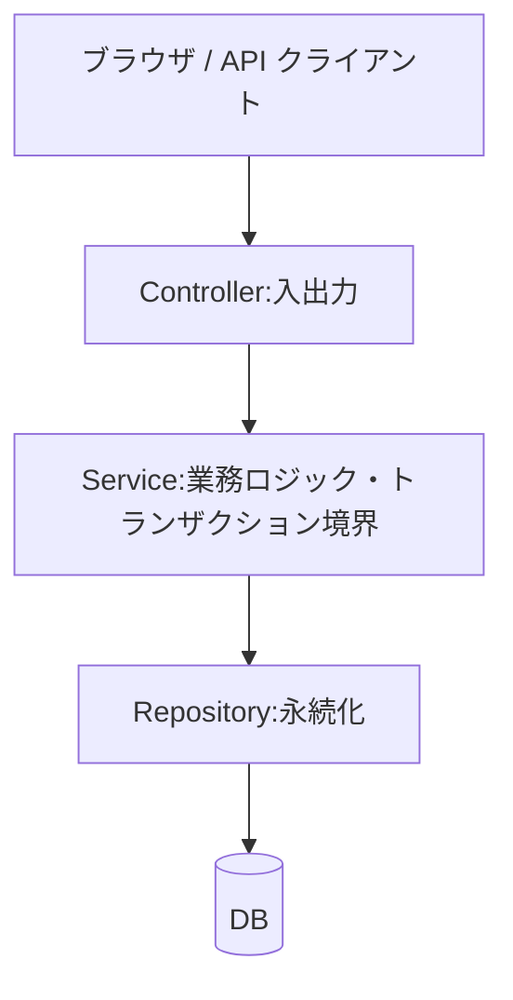

::: haru
先輩、会員登録できました! Controller のメソッドに、入力チェックも料金計算も SQL も全部書いたら動きました!
:::

::: sensei
動いた、は通過点。そのメソッド、テストするには Tomcat と DB を起動しないといけないよね? 今日はそれを「層」に分ける。
:::

## 何でも Controller に書くとどうなるか

「Controller に全部書いた」コードはこんな形になりがちです。

```java
@PostMapping("/orders")
public String order(OrderForm form, Model model) {
    // 業務ルール(送料計算)
    int subtotal = form.getPrice() * form.getQty();
    int shipping = subtotal >= 5000 ? 0 : 500;
    // 永続化(SQL)
    jdbc.update("INSERT INTO orders VALUES (?, ?)",
            form.getCustomer(), subtotal + shipping);
    model.addAttribute("total", subtotal + shipping);
    return "orders/done";
}
```

動きはします。でも次の問題が出ます。

- **再利用できない**:同じ送料計算を REST API や夜間バッチでも使いたくなると、コピペするしかない
- **テストが重い**:送料のルールを1つ確かめるだけで、HTTP リクエストと DB が必要になる
- **変更の理由が混ざる**:画面の変更・料金ルールの変更・テーブルの変更が、全部同じメソッドを書き換える

このように1つのクラスがあらゆる責務を抱え込んだ状態を **Fat Controller** と呼びます。

## 3層の責務

Spring アプリでは、処理を次の3つの **層(レイヤー)** に分けるのが定番です。



| 層 | 責務 | 注釈 |
|---|---|---|
| Controller | HTTP の受け取り・入力チェック・画面や JSON の選択 | `@Controller` |
| Service | 業務ルール・処理の手順・トランザクション境界 | `@Service` |
| Repository | 保存・検索(DB とのやりとり) | `@Repository` |

**トランザクション境界** とは「ここからここまでを、全部成功か全部失敗かの1単位にする」範囲のことです。「在庫を減らす+注文を保存」のように複数の更新をまとめるのは業務の都合なので、Service のメソッドがその単位になります(詳しくは「トランザクション」の回)。

`@Service` と `@Repository` は、どちらも `@Component` を内部に持つ注釈です。つまり Bean として登録される点では `@Component` と同じ。違いは意味づけで、`@Repository` だけは DB 固有の例外を Spring 共通の `DataAccessException` に変換する対象になる、という実際の機能も持っています。

## 依存の向きは上から下へ一方通行

呼び出し(依存)は **Controller → Service → Repository** の向きだけにします。

- **逆向き禁止**:Service が `Model` や `HttpServletRequest` を受け取ると、HTTP の無いバッチから呼べなくなる
- **層を飛ばさない**:Controller が Repository を直接呼ぶと、業務ルールを通らない更新経路ができる

依存が循環すると、Spring Boot は起動時に止まります。

```text
The dependencies of some of the beans in the
application context form a cycle:
┌─────┐
|  orderService defined in file [...]
↑     ↓
|  stockService defined in file [...]
└─────┘
```

::: sensei
Service 同士が呼び合い始めたら設計の黄信号。共通部分を別の Service に切り出すか、そもそも責務の切り方を見直すサインだよ。
:::

## DTO とエンティティを分ける

**エンティティ** はテーブルの1行に対応するクラス(次回の Spring Data JPA で作ります)。**DTO**(Data Transfer Object)は層の間や画面・API との受け渡しのためだけのクラスです。前回の「フォームクラス」も DTO の一種です。

```java
// 画面に出す分だけの DTO(record が便利)
record MemberSummary(long id, String name) {
    static MemberSummary from(Member m) {
        return new MemberSummary(m.getId(),
                m.getName());
    }
}
```

エンティティをそのまま画面や JSON に渡さない理由は3つ。

1. **見せてはいけない項目が漏れる**:パスワードのハッシュ、内部フラグなど
2. **テーブル変更が画面や API に直撃する**:列名を変えたら JSON の項目名まで変わってしまう
3. **画面の都合がエンティティに入り込む**:「表示用の名前」「確認用パスワード」などが増えていく

詰め替えのコードは増えますが、「DB の形」と「外に見せる形」を独立して変えられることのほうが価値があります。

## パッケージ構成:層別か、機能別か

```text
層別                    機能別
com.example.shop        com.example.shop
├─ controller           ├─ member
│  ├─ MemberController  │  ├─ MemberController
│  └─ OrderController   │  ├─ MemberService
├─ service              │  └─ MemberRepository
│  ├─ MemberService     └─ order
│  └─ OrderService         ├─ OrderController
└─ repository              ├─ OrderService
                           └─ OrderRepository
```

**層別** は小さいアプリで分かりやすく、入門記事にも多い形です。**機能別** は機能が増えても1か所を見れば済み、クラスを `public` にしない(パッケージプライベート)ことで「order の中身を member から直接触らせない」こともできます。小さく始めて層別、育ってきたら機能別、という移行もよくあります。どちらでも、`@SpringBootApplication` のあるパッケージの **配下** に置けばコンポーネントスキャンで見つかります。

## Service をインターフェースにするか問題

古いプロジェクトでは `MemberService`(インターフェース)+`MemberServiceImpl`(実装)の組が定番でした。かつて Spring が `@Transactional` などの機能を足す **プロキシ** を、主に JDK の仕組み(インターフェース必須)で作っていたことが理由の一つです。

今の Spring Boot は既定で CGLIB(クラスを継承してプロキシを作る仕組み)を使うので、インターフェースは必須ではありません。テストでモックが必要なときも、Mockito はクラスをそのままモックできます。そこで現場では、

- **Service**:実装が1つなら **クラスのまま** でよい
- **Repository**:**インターフェースにする**。実装を DB 版・メモリ版などに差し替えたい場所だから(Spring Data JPA では実装を Spring が自動生成する)

が今の標準的な判断です。

::: haru
じゃあ現場で `XxxServiceImpl` を見たら、古いコードってことっすか?
:::

::: sensei
古いか、そのチームの規約か。どっちにしても動きは同じだから、勝手に消して回らないこと。新しく作るなら、まずクラス1つで十分。
:::

## テストのしやすさ:Repository を差し替える

Service が Repository の **インターフェース** にだけ依存していれば、テストではメモリ実装を渡すだけで済みます。

```java
interface OrderRepository {
    Order save(Order order);
}

class InMemoryOrderRepository
        implements OrderRepository {
    final List<Order> saved = new ArrayList<>();
    public Order save(Order order) {
        saved.add(order);
        return order;
    }
}

@Test
void 送料は5000円以上で無料() {
    var repo = new InMemoryOrderRepository();
    var service = new OrderService(repo);
    Order o = service.placeOrder("山田", 2500, 2);
    assertEquals(0, o.shipping());
}
```

Spring も DB も起動しないので、テストはミリ秒で終わります。コンストラクタインジェクション(DI の回)にしておく理由がここで効いてきます。

## よくあるミス:@Service の付け忘れ

Service クラスに `@Service` を付け忘れると、Bean が登録されず起動に失敗します。

```text
Parameter 0 of constructor in com.example.shop.
order.OrderController required a bean of type
'com.example.shop.order.OrderService' that
could not be found.
```

「そのクラスの Bean が無い」と言われたら、まず注釈の付け忘れと、パッケージがメインクラスの配下にあるかを確かめます。

::: point まとめ
- 何でも Controller に書くと **再利用できず・テストが重く・変更理由が混ざる**
- **Controller = 入出力、Service = 業務ロジックとトランザクション境界、Repository = 永続化**
- 依存は **上から下への一方通行**。逆向き・層飛ばし・循環は避ける
- エンティティを外に出さず **DTO に詰め替える**
- Repository はインターフェースに。Service は実装1つならクラスのままでよい
- Repository を **メモリ実装に差し替えれば**、Service は Spring も DB も無しでテストできる
:::

::: sensei
次は Repository の本番実装、Spring Data JPA。インターフェースを書くだけで実装が生えてくる魔法の裏側を見ていこう。
:::
