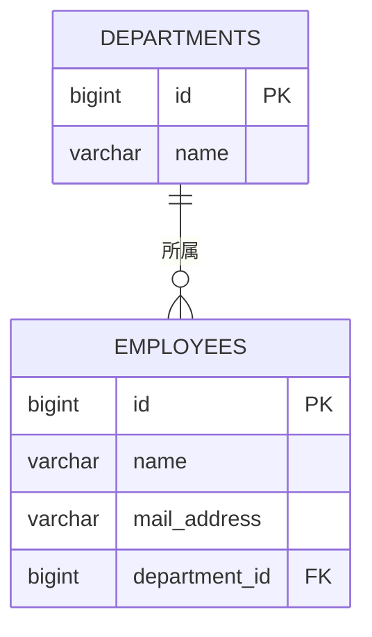

::: haru
前回の層分けで、Repository はテスト用のメモリ実装でしたよね。本物の DB にはいつ繋ぐんすか?
:::

::: sensei
今日だ。しかも Repository の実装クラスは書かない。インターフェースを書くだけで Spring が中身を作ってくれる。
:::

## JDBC 直書きのつらさと ORM

Java 標準の DB 接続 API が **JDBC** です。1件取るだけでもこうなります。

```java
String sql = "SELECT id, name FROM employees WHERE id = ?";
try (Connection con = dataSource.getConnection();
     PreparedStatement ps = con.prepareStatement(sql)) {
    ps.setLong(1, id);
    try (ResultSet rs = ps.executeQuery()) {
        if (rs.next()) {
            return new Employee(rs.getLong("id"),
                                rs.getString("name"));
        }
    }
}
```

SQL の文字列、`?` への値詰め、`ResultSet` から1列ずつ取り出す詰め替え。テーブルが20個あれば、これが20セット要ります。列を1つ足すと SQL と詰め替えを全部直すことになります。

そこで、**クラスとテーブルを対応づけて、詰め替えを自動化する** 仕組みが生まれました。これを **ORM(Object-Relational Mapping)** と呼びます。登場人物は3つです。

| 名前 | 正体 |
|---|---|
| JPA(Jakarta Persistence) | ORM の **仕様**(アノテーションと API の決まり) |
| Hibernate | JPA の **実装**。実際に SQL を作って投げる |
| Spring Data JPA | JPA の上に乗り、Repository を **自動生成** する |

## エンティティ:クラスをテーブルに対応づける

テーブルの1行に対応するクラスを **エンティティ** と呼びます。



```java
@Entity
@Table(name = "employees")
public class Employee {
    @Id
    @GeneratedValue(strategy = GenerationType.IDENTITY)
    private Long id;

    @Column(nullable = false, length = 50)
    private String name;

    @Column(name = "mail_address", unique = true)
    private String email;

    @ManyToOne(fetch = FetchType.LAZY)
    @JoinColumn(name = "department_id")
    private Department department;

    protected Employee() { } // JPA 用
    // コンストラクタ・getter は省略
}
```

- `@Entity`:JPA の管理対象にする。`@Table` で表名を指定(省略時はクラス名から決まる)。
- `@Id` が主キー。`@GeneratedValue(IDENTITY)` は採番を DB の自動増分に任せる。保存前は `null` なので型は `Long`。
- `@Column`:列名・NOT NULL・長さなど。付けなくてもフィールドは列になる。
- `@ManyToOne`:社員(多)→部署(1)。外部キー列は `@JoinColumn` で指定。

部署側から社員一覧をたどりたいなら `@OneToMany` を付けます。

```java
@OneToMany(mappedBy = "department")
private List<Employee> employees = new ArrayList<>();
```

`mappedBy` は「外部キーを持っているのは向こう(Employee の `department` フィールド)だよ」という宣言です。列名ではなく **フィールド名** を書きます。

**引数なしコンストラクタが要る理由**:Hibernate は DB の行を読むと、まず引数なしコンストラクタで空のオブジェクトを作り、リフレクションでフィールドに値を詰めます。JPA の仕様で public か protected と決まっています。

## JpaRepository:継承するだけで CRUD

```java
public interface EmployeeRepository
        extends JpaRepository<Employee, Long> {
}
```

型引数は「エンティティ, 主キーの型」。これだけで `save`、`findById`(戻り値は `Optional`)、`findAll`、`deleteById`、`count` などが使えます。実装クラスは、起動時に Spring Data が **プロキシ**(インターフェースを実装したオブジェクト)として自動生成し、Bean として登録します。DI で受け取って使うだけです。

ちなみに `save` は INSERT と UPDATE を兼ねています。id が `null` なら新規とみなして INSERT(`persist`)、値があれば既存とみなして UPDATE(`merge`)です。

## 派生クエリ:メソッド名が SQL になる

メソッド名を規則どおりに付けると、名前を解析して条件を作ってくれます。これを **派生クエリ** と呼びます。

```java
List<Employee> findByNameAndAge(String name, int age);
List<Employee> findTop3ByDepartmentNameOrderByAgeDesc(
        String deptName);
```

| キーワード | 例 | 条件 |
|---|---|---|
| And / Or | `findByNameAndAge` | `name = ? and age = ?` |
| Containing | `findByNameContaining` | `name like %?%` |
| Between | `findByAgeBetween` | `age between ? and ?` |
| LessThan | `findByAgeLessThan` | `age < ?` |
| GreaterThanEqual | `findByAgeGreaterThanEqual` | `age >= ?` |
| OrderBy | `...OrderByAgeDesc` | `order by age desc` |
| Top3 / First | `findTop3By...` | 先頭3件だけ |
| count | `countByAge` | 件数を返す |

`DepartmentName` は `department.name` とたどって JOIN してくれます。プロパティ名を間違えると **起動時に** 落ちます。

```text
No property 'nmae' found for type 'Employee';
Did you mean 'name'
```

実行時ではなく起動時に気づけるのが派生クエリの良い所です。ただし名前が長くなったら、`@Query` で **JPQL**(エンティティに対して書く SQL 風の言語)を書きます。テーブル名ではなく **クラス名とフィールド名** を使います。

```java
@Query("select e from Employee e "
     + "where e.department.name = :dept and e.age >= :age")
List<Employee> search(String dept, int age);
```

一覧画面のページングは引数に `Pageable` を足すだけです。

```java
Page<Employee> findByDepartmentName(
        String dept, Pageable pageable);

var page = repo.findByDepartmentName("開発部",
        PageRequest.of(0, 20, Sort.by("name")));
page.getContent();       // この20件
page.getTotalElements(); // 全件数(count も発行)
```

## DB の設定と ddl-auto

学習には **H2**(Java 製の組み込み DB)が手軽です。`application.properties` に書きます。

```properties
spring.datasource.url=jdbc:h2:file:./data/demo
spring.datasource.username=sa
spring.datasource.password=
spring.h2.console.enabled=true
spring.jpa.hibernate.ddl-auto=update
spring.jpa.show-sql=true
```

`jdbc:h2:file:` はファイルに保存するので再起動してもデータが残ります(`jdbc:h2:mem:` はメモリ上で、止めると消える)。`/h2-console` をブラウザで開くと中身を SQL で見られます。

`ddl-auto` は、エンティティから **テーブル定義(DDL)を自動で作るか** の設定です。

| 値 | 動き | 使い所 |
|---|---|---|
| create-drop | 起動時に作り、終了時に消す | テスト |
| create | 起動のたびに作り直す(データ消える) | 試作 |
| update | 足りない列や表を追加する | 個人の学習 |
| validate / none | 検証だけ / 何もしない | **本番** |

本番で `update` を使わないのは、**列の削除や型の変更はしてくれず、何をしたかの記録も残らない** からです。`create` は論外(起動のたびに全データ消失)。本番のテーブル変更は Flyway などのマイグレーションツールで SQL ファイルとして管理し、レビューを通すのが現場の常識です。

## 現場の三大落とし穴

### N+1 問題

```java
for (Employee e : repo.findAll()) {        // SQL 1回
    System.out.println(
        e.getDepartment().getName()); // 部署ごとに1回
}
```

```text
select ... from employees
select ... from departments where id=?
select ... from departments where id=?
... (部署の数だけ続く)
```

一覧の1回 + 関連の N 回で **N+1 問題** です。手元の10件では気づかず、本番の1万件で画面が固まります。必要な所だけ `join fetch` で一緒に取ります。

```java
@Query("select e from Employee e join fetch e.department")
List<Employee> findAllWithDepartment();
```

### 遅延ロードと LazyInitializationException

`FetchType.LAZY` の関連は、最初は中身が空の **プロキシ** で、触った瞬間に SQL を投げます(**遅延ロード**)。ところが DB との会話(セッション)が閉じた後に触ると、こう落ちます。

```text
org.hibernate.LazyInitializationException:
could not initialize proxy
[com.example.demo.Department#1] - no Session
```

`@ManyToOne` の既定は EAGER(即時ロード)ですが、使わない関連まで毎回読むので、LAZY にして必要な所だけ `join fetch` が定石です。

### エンティティを画面にそのまま渡さない

エンティティは DB の都合の形です。そのまま Thymeleaf や JSON に渡すと、遅延ロードが画面描画中に走ったり、見せたくない列が漏れたり、双方向関連で JSON が無限ループしたりします。Service で画面用の **DTO**(record が便利)に詰め替えて返しましょう。

::: sensei
「Repository はインターフェースを書くだけ」は楽だけど、どんな SQL が飛んでるかは必ず `show-sql` で見る。それがプロとの差だ。
:::

::: point まとめ
- JPA は仕様、Hibernate は実装、Spring Data JPA は Repository を自動生成する層
- `@Entity` `@Id` `@GeneratedValue` `@Column` `@ManyToOne` でクラスとテーブルを対応づける
- `JpaRepository<型, ID型>` を継承するだけで CRUD。条件はメソッド名(派生クエリ)か `@Query`
- 本番の `ddl-auto` は validate か none。変更はマイグレーションで
- N+1 は `join fetch`、エンティティは DTO に詰め替えて画面へ
:::
