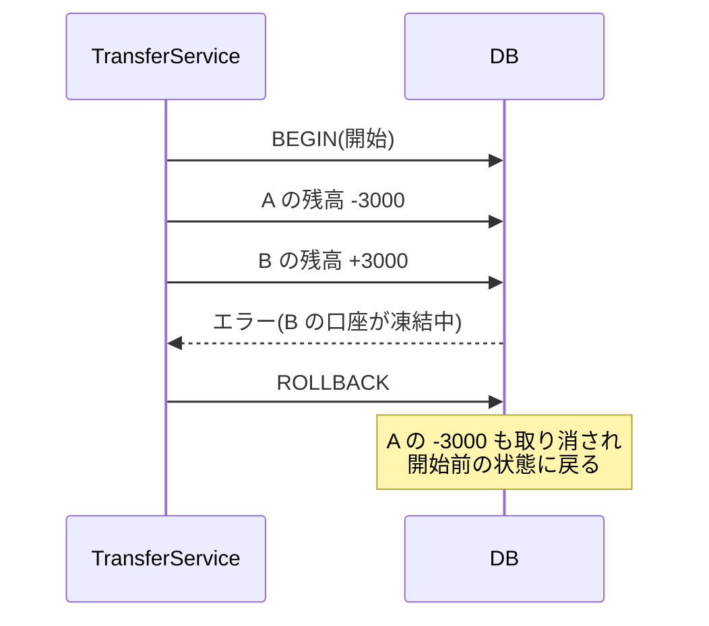
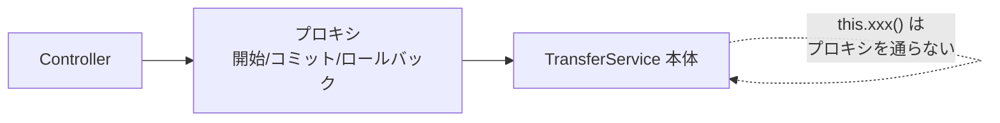

::: haru
先輩、振込処理を書いたんですけど、テスト中に例外が出たら A さんの残高だけ減って B さんに入ってないんです……お金が消えました。
:::

::: sensei
いい事故だ。本番なら始末書だけどな。今日はその「途中で失敗したら全部なかったことにする」仕組み、トランザクションをやる。
:::

## トランザクションとは

**トランザクション** は「全部成功するか、全部なかったことにするか」の、ひとまとまりの処理単位です。確定することを **コミット**、開始前の状態に戻すことを **ロールバック** と呼びます。



トランザクションが守る性質を、頭文字を取って **ACID** と呼びます。

| 性質 | 意味 |
|---|---|
| 原子性(Atomicity) | 全部成功か全部取り消しのどちらか |
| 一貫性(Consistency) | 制約(残高は0以上など)を破った状態で確定しない |
| 独立性(Isolation) | 同時に走る他の処理と干渉しない |
| 永続性(Durability) | コミットした結果は障害後も消えない |

## @Transactional を Service に付ける

Spring では、メソッドに `@Transactional` を付けるだけです。

```java
@Service
public class TransferService {
    private final AccountRepository repo;
    // コンストラクタは省略

    @Transactional
    public void transfer(long from, long to, int amount) {
        Account a = repo.findById(from).orElseThrow();
        Account b = repo.findById(to).orElseThrow();
        a.withdraw(amount);  // 残高不足なら例外
        b.deposit(amount);
    }   // ここで正常終了 → コミット
}
```

`save` を呼んでいないのに更新されるのは、トランザクション中に読んだエンティティの変更を JPA が覚えていて、コミット時に UPDATE を発行するからです(**変更検知**、dirty checking)。

付ける場所は **Service** です。前回の Repository のメソッドも1つずつはトランザクションになっていますが(`JpaRepository` の実装に `@Transactional` が付いている)、それでは `save` ごとにコミットされてしまいます。「振込」という **業務の単位** を知っているのは Service なので、そこで囲みます。

## ロールバックの条件:既定は RuntimeException だけ

`@Transactional` が既定でロールバックするのは、**RuntimeException(とその子)と Error が投げられたとき** だけです。検査例外(`Exception` の子で RuntimeException でないもの)では **コミットされます**。

```java
@Transactional
public void order(Order o) throws PaymentException {
    stockRepo.reduce(o);   // 在庫を減らす
    payment.charge(o);     // PaymentException(検査例外)
}   // 決済失敗でも在庫の減少はコミットされる!
```

これは EJB 時代からの約束事で、「検査例外は呼び出し側が対処できる業務上の想定内の結果」とみなす設計思想によるものです。検査例外でも戻したいなら明示します。

```java
@Transactional(rollbackFor = PaymentException.class)
```

::: warn 例外を握りつぶすとコミットされる
メソッドの中で `try { ... } catch (Exception e) { log... }` と例外を捕まえて正常に戻ると、Spring からは「成功」に見えるのでコミットされます。ロールバックさせたい例外は、外へ投げるのが基本です。
:::

## プロキシの仕組みと2つの罠

`@Transactional` は、DI のときに Spring が Bean を **プロキシ**(本物を包んだ代理オブジェクト。CGLIB でサブクラスを動的生成)に差し替えることで実現しています。



Controller が持っているのはプロキシなので、呼ぶと「開始 → 本体 → コミット(例外ならロールバック)」の順に動きます。ここから罠が2つ生まれます。

**罠1:同じクラスの中から呼ぶと効かない**

```java
public void importAll(List<Order> list) {
    for (Order o : list) {
        order(o);   // this.order(o)。素通り!
    }
}
@Transactional
public void order(Order o) { ... }
```

`this` はプロキシではなく本体なので、`order` の `@Transactional` は無視されます。呼び出し元(`importAll`)に付けるか、別の Bean に分けて DI 経由で呼びます。

**罠2:private メソッドに付けても効かない**

プロキシはメソッドをオーバーライドして割り込むので、オーバーライドできない `private`(や `final`)メソッドには割り込めません。エラーも出ず、黙って無視されます。

## readOnly と伝播

参照だけのメソッドには `@Transactional(readOnly = true)` を付けます。Hibernate が変更検知を省略するので速くなり、「ここは書き込まない」という意図もコードに残ります。

すでにトランザクションの中から別の `@Transactional` メソッドを(別の Bean 経由で)呼んだときの振る舞いを **伝播(propagation)** と呼びます。まずは2つだけ覚えれば十分です。

| 指定 | 動き |
|---|---|
| REQUIRED(既定) | 外側があれば参加、なければ新しく開始 |
| REQUIRES_NEW | 外側を一時停止し、別のトランザクションを開始 |

`REQUIRES_NEW` は「本処理が失敗しても、操作ログだけは残したい」ときに使います。逆に REQUIRED で参加した内側で例外が起きると、外側でその例外を catch しても全体がロールバック扱いになり、コミット時に `UnexpectedRollbackException` が出ます。

## トランザクションの中でやってはいけないこと

ロールバックで戻るのは **DB だけ** です。トランザクションの中で外部 API を呼んだりメールを送ったりすると、

- 後続の処理で失敗してロールバックしても、送ったメールは取り消せない(「ご注文ありがとうございます」が届くのに注文が無い)
- 外部 API の応答待ちの間、DB 接続とロックを握り続けて、混雑時に全体が詰まる

という事故が起きます。外部への通知は、コミットが終わってから行います(`@TransactionalEventListener` で「コミット後」に動かす方法があります)。

## 楽観ロック(@Version)の入口

トランザクションは同時更新までは防いでくれません。AさんとBさんが同じ商品を同時に編集すると、後から保存した方が黙って上書きします(**ロストアップデート**)。エンティティに `@Version` を足すと防げます。

```java
@Version
private Integer version;
```

JPA は `update ... where id = ? and version = ?` のようにバージョンを条件にして更新し、0件なら(誰かが先に更新していたら)`ObjectOptimisticLockingFailureException` を投げます。「ロックを取らずに、ぶつかったら検知する」ので **楽観ロック** と呼びます。画面には「他の人が更新しました。読み込み直してください」と出すのが定番です。

::: sensei
`@Transactional` は付けるのは一瞬、効いてるかの確認は一生。ログで開始とコミットが出ているか、一度は自分の目で見ておけ。
:::

::: point まとめ
- トランザクションは「全部成功か全部取り消し」。業務の単位を知る Service に `@Transactional`
- 既定のロールバックは RuntimeException と Error だけ。検査例外は `rollbackFor`
- プロキシ経由なので、同じクラス内の呼び出しと private メソッドには効かない
- 参照は `readOnly = true`。伝播は REQUIRED(参加)と REQUIRES_NEW(別建て)
- 外部 API・メールはコミット後に。同時更新は `@Version` で楽観ロック
:::
