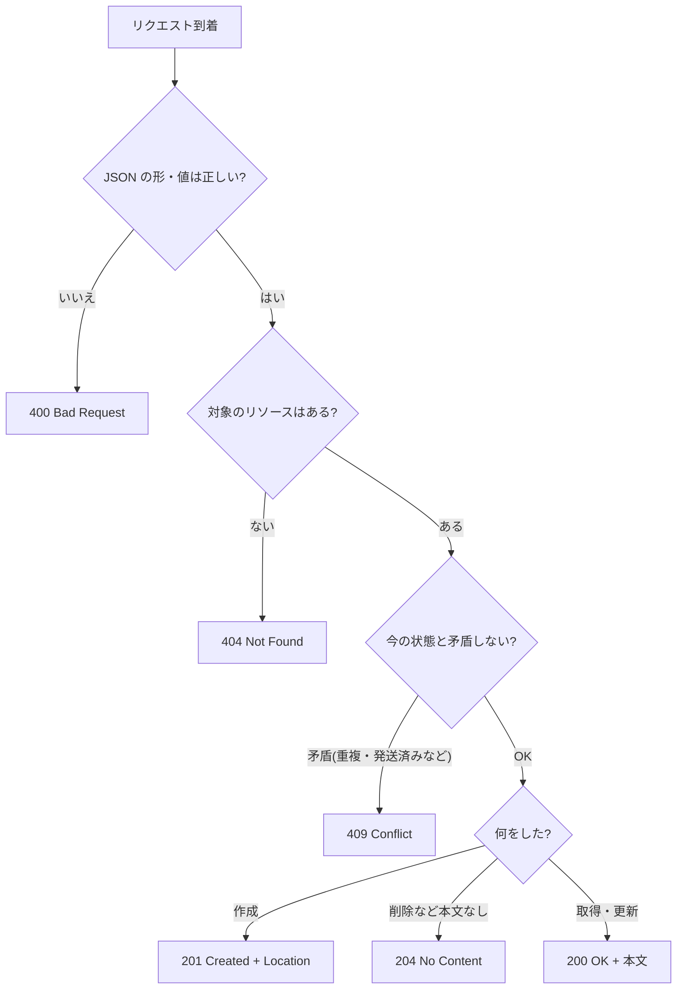

::: haru
先輩、スマホアプリのチームから「タスク一覧を JSON でください」って言われました。HTML じゃなくて?
:::

::: sensei
画面を描くのは向こうの仕事。こっちは **データだけを HTTP で渡す API** を作る。その定番の設計スタイルが REST だ。
:::

前回の「トランザクション」までで、DB に安全に読み書きする層ができました。今回はその上に、画面ではなく **JSON を返す入り口** を作ります。

## REST の考え方:URL は名詞、操作は HTTP メソッド

**REST**(Representational State Transfer)は、Web の仕組みに素直に乗る API 設計のスタイルです。中心になる考え方は3つ。

- 扱う対象を **リソース** と呼び、URL で表す(`/api/tasks` = タスクの集まり、`/api/tasks/3` = ID 3 のタスク)
- 「何をするか」は URL ではなく **HTTP メソッド** で表す
- 結果は **ステータスコード** で伝える

| メソッド | 意味 | 例 |
|---|---|---|
| GET | 取得(何度呼んでも状態は変わらない) | `GET /api/tasks/3` |
| POST | 新規作成 | `POST /api/tasks` |
| PUT | 丸ごと置き換え | `PUT /api/tasks/3` |
| PATCH | 一部だけ変更 | `PATCH /api/tasks/3` |
| DELETE | 削除 | `DELETE /api/tasks/3` |

ステータスコードは「どれを返すか」の判断順で覚えると迷いません。



## @RestController と JSON 変換

```java
public record TaskResponse(long id, String title,
        boolean done, LocalDate dueDate) {}

@RestController
@RequestMapping("/api/tasks")
public class TaskController {
    private final Map<Long, TaskResponse> store =
            new ConcurrentHashMap<>();
    private final AtomicLong seq = new AtomicLong();

    @GetMapping
    public List<TaskResponse> list() {
        return List.copyOf(store.values());
    }

    @GetMapping("/{id}")
    public ResponseEntity<TaskResponse> get(
            @PathVariable long id) {
        // 空の Optional なら 404、あれば 200 + 本文
        return ResponseEntity.of(
                Optional.ofNullable(store.get(id)));
    }
}
```

「Controller とルーティング」で見たとおり、`@RestController`(= `@Controller` + `@ResponseBody`)の戻り値は **レスポンス本文そのもの** になります。
変換するのは **HttpMessageConverter** で、クラスパスに Jackson があれば `MappingJackson2HttpMessageConverter` がオブジェクト ⇔ JSON を変換します(spring-boot-starter-web に Jackson は同梱)。どの変換器を使うかは、リクエストの `Content-Type`(送る形式)と `Accept`(欲しい形式)で決まります。
record は「アクセサ名 = JSON の項目名」になり、受け取るときは正準コンストラクタで作られるので、API の入出力にぴったりです。

`ResponseEntity<T>` は **ステータス・ヘッダ・本文** をまとめて指定するための型です。`T` を直接返すと常に 200 になるので、404 などを返し分けたいときに使います。

## POST で作成:201 Created + Location

```java
public record CreateTaskRequest(String title,
        LocalDate dueDate) {}

@PostMapping
public ResponseEntity<TaskResponse> create(
        @RequestBody CreateTaskRequest req) {
    long id = seq.incrementAndGet();
    var t = new TaskResponse(id, req.title(),
            false, req.dueDate());
    store.put(id, t);
    URI location = URI.create("/api/tasks/" + id);
    return ResponseEntity.created(location).body(t);
}
```

```text
HTTP/1.1 201 Created
Location: /api/tasks/1
Content-Type: application/json

{"id":1,"title":"請求書を送る","done":false,
 "dueDate":"2026-10-31"}
```

`@RequestBody` は「リクエスト本文の JSON を引数の型に変換して」という指示です。作成成功は 200 ではなく **201**、そして **Location ヘッダに新しいリソースの URL** を入れるのが HTTP の作法です(RFC 9110)。クライアントは本文を解析しなくても次に GET すべき URL が分かります。
受け取る型(`CreateTaskRequest`)に `id` や `done` を **持たせない** のもポイント。クライアントに ID を決めさせない設計を、型で強制しています。

## PUT と PATCH の違い

- **PUT** … 送った内容で **丸ごと置き換え** る。送らなかった項目は「空にする」意味になる。同じリクエストを何度送っても結果が同じ(**冪等**)
- **PATCH** … 送った項目 **だけ** 変える

PATCH を record で受けるなら、項目は `Boolean` や `LocalDate` のような **null になれる型** にします。`boolean` だと「送られてこなかった」が `false` に化け、勝手に未完了へ戻る事故になります。

```java
record UpdateTaskRequest(String title,
        Boolean done, LocalDate dueDate) {}
// null の項目は「変更しない」
if (req.done() != null) { entity.setDone(req.done()); }
```

## エンティティを返さず DTO を返す

JPA のエンティティをそのまま返すのは、現場ではほぼ NG です。

- 内部用の項目(パスワードハッシュ、社内メモ)まで **全部 JSON に出る**
- 双方向の関連があると `Infinite recursion (StackOverflowError)` で落ちる
- テーブルを変えると API の形まで変わり、スマホアプリが壊れる

そこで返す専用の record(**DTO** = Data Transfer Object)に詰め替えます。`TaskResponse.from(entity)` のような変換メソッドを1か所に置くのが定番です。

### 日時は ISO-8601 で

`LocalDate` などの java.time 型は、Jackson 本体だけでは変換できず、**JavaTimeModule**(jackson-datatype-jsr310)が必要です。Spring Boot はこれを自動登録し、さらに日時を `"2026-10-31"` のような **ISO-8601 文字列** で出す設定にしてくれます。素の Jackson では `[2026,10,31]` という配列になるので、Boot なしで動かすときは要注意(サンプル②で確かめられます)。形式を変えたいときは項目に `@JsonFormat(pattern = "yyyy/MM/dd")` を付けます。

::: trivia Spring Boot 4 では Jackson 3
Spring Boot 4(Spring Framework 7)は Jackson 3 が標準です。パッケージが `tools.jackson` に変わり、java.time 対応が本体に入って、日時は最初から ISO-8601 文字列になります。`@JsonFormat` などのアノテーションのパッケージは変わりません。
:::

## URL 設計の現場ルール

| NG | OK |
|---|---|
| `GET /api/getTasks` | `GET /api/tasks` |
| `POST /api/task/create` | `POST /api/tasks` |
| `POST /api/deleteTask?id=3` | `DELETE /api/tasks/3` |
| `/api/taskItems` | `/api/task-items` |

- リソース名は **複数形の名詞**。**動詞は URL に入れない**(動詞はメソッドが担う)
- 単語の区切りは小文字のハイフン(kebab-case)
- 互換性のない変更に備えて `/api/v1/tasks` のように **バージョン** を入れるチームが多い(ヘッダで切り替える流派もある)
- どうしても名詞にならない操作は `POST /api/orders/3/cancel` のようにサブリソースで表す

::: sensei
迷ったら「URL は名詞、操作はメソッド、結果はステータス」。この3点を守るだけで、API を使う側の質問が激減する。
:::

## 動作確認:ブラウザ・curl・Invoke-RestMethod

GET ならブラウザで `http://localhost:8080/api/tasks` を開くだけ。POST は Windows 10 以降に入っている `curl.exe` か PowerShell で送ります。

```text
curl.exe -i http://localhost:8080/api/tasks/1
Invoke-RestMethod -Method Post `
  -Uri http://localhost:8080/api/tasks `
  -ContentType "application/json" `
  -Body '{"title":"buy milk"}'
```

PowerShell 5.1 の `curl` は `Invoke-WebRequest` の別名なので、本物の curl は **`curl.exe`** と打ちます。詳しい手順は「STSでやってみよう」で。

## よくあるミス

**Content-Type の付け忘れ** で 415 になります。curl の `-d` は既定で `application/x-www-form-urlencoded` を送るためです。

```text
Resolved [org.springframework.web.
  HttpMediaTypeNotSupportedException: Content-Type
  'application/x-www-form-urlencoded;charset=UTF-8'
  is not supported]
```

**`-parameters` なしのコンパイル** では `@PathVariable long id` の名前が分からず、500 になります。Spring Boot の親 POM は `-parameters` を付けてくれますが、自前のビルド設定だとこう出ます。

```text
Name for argument of type [long] not specified, and
parameter name information not available via reflection.
Ensure that the compiler uses the '-parameters' flag.
```

`@PathVariable("id")` と名前を明示すれば、どちらでも動きます。

::: point まとめ
- REST は **URL = リソース(複数形の名詞)**、**操作 = HTTP メソッド**、**結果 = ステータスコード**
- `@RestController` の戻り値は本文。Jackson が record ⇔ JSON を変換する
- 作成は **201 + Location**(`ResponseEntity.created`)、見つからなければ **404**(`ResponseEntity.of(Optional)`)
- PUT は丸ごと置き換え、PATCH は一部変更。PATCH の項目は null になれる型で
- エンティティではなく **DTO(record)** を返す。日時は JavaTimeModule で **ISO-8601**
:::

::: sensei
次は「例外ハンドリング」。今は 404 を if 文で返してるけど、エラーが増えると Controller が if だらけになる。それを1か所にまとめる技を教えるよ。
:::
