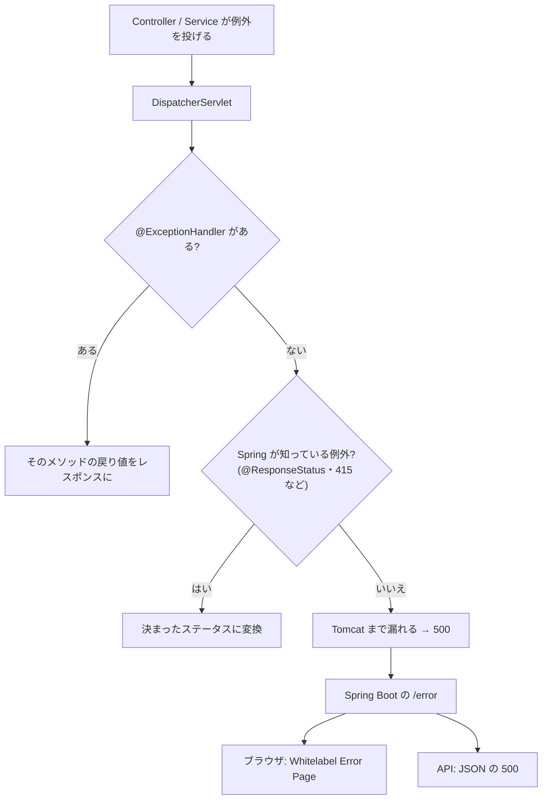

::: haru
先輩、存在しない ID で API を叩いたら 500 が返ってきました。しかも Controller が「見つからなければ 404」の if 文だらけで……。
:::

::: sensei
Controller は「投げるだけ」にして、例外を HTTP のレスポンスに変える係を1か所に置こう。それが今日の `@RestControllerAdvice` だ。
:::

前回の「REST API」では、404 を `ResponseEntity` の if 文で返しました。エラーの種類が増えると、この方式は Controller ごとにコピペが広がります。今回は **例外を投げ、まとめて受ける** 方式に切り替えます。

## 例外が Controller から漏れると何が起きる?

Service が投げた例外を誰も処理しないと、次の順に流れていきます。



この判定をしているのが `HandlerExceptionResolver` という仕組みです。最後まで処理されないと、Console にはこう出ます。

```text
Servlet.service() for servlet [dispatcherServlet] ...
 threw exception [Request processing failed:
 com.example.todo.task.TaskNotFoundException:
 タスク 99 は見つかりません] with root cause
```

ブラウザなら「Whitelabel Error Page … (type=Internal Server Error, status=500)」、curl なら `{"timestamp":"…","status":500,"error":"Internal Server Error","path":"/api/tasks/99"}` が返ります。**利用者の指定ミスなのに 500(サーバーの故障)** と報告するのは誤りです。

## @ExceptionHandler:例外をレスポンスに変える

```java
@GetMapping("/{id}")
public TaskResponse get(@PathVariable long id) {
    return service.find(id); // 無ければ例外を投げる
}

@ExceptionHandler(TaskNotFoundException.class)
public ResponseEntity<ErrorResponse> notFound(
        TaskNotFoundException ex) {
    return ResponseEntity.status(HttpStatus.NOT_FOUND)
            .body(new ErrorResponse("TASK_NOT_FOUND",
                    ex.getMessage()));
}
```

`@ExceptionHandler` を付けたメソッドは、指定した例外(とそのサブクラス)が投げられたときに呼ばれ、戻り値が通常の Controller メソッドと同じようにレスポンスになります。ただし **Controller の中に書くと、その Controller 専用** です。

## @RestControllerAdvice:全 Controller 共通にする

```java
@RestControllerAdvice
public class ApiExceptionHandler {
    @ExceptionHandler(TaskNotFoundException.class)
    public ResponseEntity<ErrorResponse> notFound(
            TaskNotFoundException ex) { /* 上と同じ */ }
}
```

`@ControllerAdvice` は「全 Controller に横から効く設定」を集めるクラスで、`@RestControllerAdvice` はそれに `@ResponseBody` を足したもの(戻り値が本文になる)です。どのハンドラが選ばれるかのルールは次のとおり。

- **投げられた例外に一番近い型** のハンドラが選ばれる(`Exception` より `TaskNotFoundException` が優先)
- **Controller 内のハンドラが Advice より優先**
- Advice が複数あるときは `@Order` の順。`@RestControllerAdvice(basePackages = "…api")` で対象を絞れる

## 業務例外とステータスの対応

「見つからない」「状態が矛盾」などを **業務例外**(`RuntimeException` のサブクラス)として作り、ステータスとの対応を Advice に集めます。

| 業務例外の例 | ステータス |
|---|---|
| `TaskNotFoundException` | 404 Not Found |
| `OrderStateException`(発送済みをキャンセル) | 409 Conflict |
| `DuplicateEmailException` | 409 Conflict |
| それ以外の想定外の例外 | 500 |

Service は HTTP を知らずに済み、画面からもバッチからも同じ Service を使えます。

手軽な方法も2つあります。

- 例外クラスに `@ResponseStatus(HttpStatus.NOT_FOUND)` を付ける(ステータスだけ決まる)
- その場で `throw new ResponseStatusException(HttpStatus.NOT_FOUND, "…")`

どちらも Advice なしで 404 になりますが、本文の形はそろえられず、Service が HTTP に依存します。小さなアプリ向けです。

## エラーの形をそろえる:ProblemDetail

エラーの JSON の形は、**RFC 9457**(Problem Details for HTTP APIs)という標準があります。Spring 6 の `ProblemDetail` がその実装です。

```java
@ExceptionHandler(TaskNotFoundException.class)
public ProblemDetail notFound(TaskNotFoundException ex) {
    ProblemDetail pd = ProblemDetail.forStatusAndDetail(
            HttpStatus.NOT_FOUND, ex.getMessage());
    pd.setTitle("タスクが見つかりません");
    return pd;
}
```

```text
404  Content-Type: application/problem+json
{"type":"about:blank","title":"タスクが見つかりません",
 "status":404,"detail":"タスク 99 は見つかりません",
 "instance":"/api/tasks/99"}
```

`type` はエラーの種類を表す URI(既定は `about:blank`)、`instance` は発生したリクエストのパスです。`setProperty("errors", …)` で独自の項目も足せます。
Advice が **`ResponseEntityExceptionHandler` を継承** すると、405・415・JSON の構文エラーなど Spring MVC 自身の例外も ProblemDetail になります(Boot なら `spring.mvc.problemdetails.enabled=true` でも可)。

## バリデーションエラーを項目ごとに返す

「フォームとバリデーション」で見たとおり、`@Valid @RequestBody` の検証に失敗すると `MethodArgumentNotValidException` が投げられます。どの項目がなぜダメかを返しましょう。

```java
@ExceptionHandler(MethodArgumentNotValidException.class)
public ProblemDetail invalid(
        MethodArgumentNotValidException ex) {
    Map<String, String> errors = new LinkedHashMap<>();
    for (FieldError fe :
            ex.getBindingResult().getFieldErrors()) {
        errors.putIfAbsent(fe.getField(),
                fe.getDefaultMessage());
    }
    ProblemDetail pd = ProblemDetail.forStatusAndDetail(
            HttpStatus.BAD_REQUEST, "入力内容を確認してください");
    pd.setTitle("入力エラー");
    pd.setProperty("errors", errors);
    return pd;
}
// → "errors":{"name":"氏名は必須です", …}
```

## ログには詳細、利用者には安全なメッセージ

想定外の例外の受け皿では、**スタックトレースはログへ、利用者には固定の文言** を返します。例外メッセージには SQL、内部のホスト名、ファイルパスが入りがちで、攻撃者へのヒントになるからです。

```java
@ExceptionHandler(Exception.class)
public ProblemDetail unexpected(Exception ex) {
    log.error("想定外のエラー", ex); // 詳細はログへ
    return ProblemDetail.forStatusAndDetail(
            HttpStatus.INTERNAL_SERVER_ERROR,
            "システムエラーが発生しました");
}
```

Spring Boot の既定の /error も、例外メッセージやスタックトレースは本文に出しません(`server.error.include-message` などの既定値は `never`)。

## 画面アプリでは error テンプレート

Thymeleaf の画面アプリなら、テンプレートを置くだけで Whitelabel を差し替えられます。Boot は次の順に探します。

- `templates/error/404.html` … ステータスちょうど
- `templates/error/5xx.html` … 500番台まとめて
- `templates/error.html` … どれにも当たらないとき

テンプレートでは `${status}`・`${error}`・`${path}` が使えます。

## よくあるミス

**`Exception.class` だけの Advice** は、405・415・壊れた JSON(本来は 400)まで 500 にしてしまいます。`ResponseEntityExceptionHandler` を継承すれば、Spring MVC の例外は親クラスが正しく処理します(サンプル②)。

その継承クラスで `@ExceptionHandler(MethodArgumentNotValidException.class)` を書くと、親と重複して **起動時に** 落ちます。

```text
IllegalStateException: Ambiguous @ExceptionHandler method
mapped for [ExceptionHandler{exceptionType=org.springframework
.web.bind.MethodArgumentNotValidException, mediaType=*/*}]
```

継承しているときは `handleMethodArgumentNotValid` を `@Override` します。

::: point まとめ
- 処理されない例外は 500 + Whitelabel / JSON。利用者の指定ミスを 500 にしない
- `@ExceptionHandler` は Controller 単位、`@RestControllerAdvice` で全体。**近い型・Controller 内が優先**
- 業務例外 → ステータスの対応を Advice に集める。手軽版は `@ResponseStatus` / `ResponseStatusException`
- エラーの形は **ProblemDetail(RFC 9457)** でそろえ、入力エラーは `errors` に項目ごと
- **ログには詳細、利用者には安全な固定文言**。画面アプリは `templates/error/404.html`
:::

::: sensei
次は「設定ファイルとプロファイル」。`spring.mvc.problemdetails.enabled` みたいな設定を、開発用と本番用で切り替える方法をやるよ。
:::
