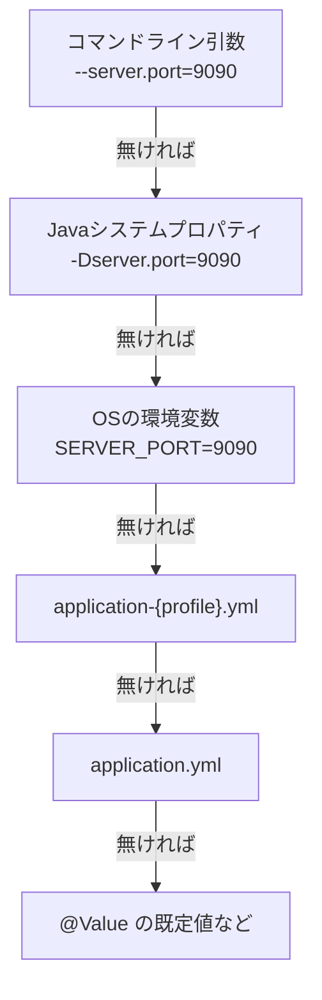

::: haru
先輩、本番サーバーの DB の URL ってどこに書きます? とりあえず Java のコードに直書きしました!
:::

::: sensei
それだと「開発用DB」と「本番DB」を切り替えるたびにビルドし直しだね。値はコードの外、**設定ファイル**に出す。今日は Spring Boot の設定の仕組みを一通りやろう。
:::

前回の「例外ハンドリング」までで、アプリの中身は一通り書けるようになりました。今回は、同じ jar を **環境ごとに違う設定で動かす** 仕組みです。

なぜ「同じ jar」にこだわるのか。テストで確かめた jar と本番に置く jar が別物だと、「テストでは動いたのに」の原因がビルドの差なのか設定の差なのか切り分けられないからです。**コード(jar)は1つ、違いは設定だけ** にしておけば、本番で起きた問題を手元で再現しやすくなります。

## application.properties と application.yml

Spring Boot は起動時に `src/main/resources/application.properties` か `application.yml` を読みます。中身は同じ「キーと値」で、書き方が違うだけです。

```properties
server.port=8080
spring.datasource.url=jdbc:h2:file:./data/dojo
spring.datasource.username=sa
logging.level.com.sayana.dojo=DEBUG
```

```yaml
server:
  port: 8080
spring:
  datasource:
    url: jdbc:h2:file:./data/dojo
    username: sa
logging:
  level:
    com.sayana.dojo: DEBUG
```

YAML は `.` 区切りを **インデント(スペース)の階層** で表します。共通の接頭辞をまとめられて読みやすいので、新規なら YAML が多数派です。同じ場所に両方あると `.properties` が優先されるので、混ぜないのが無難です。

よく使うキーはこのあたりです。

| キー | 意味 |
|---|---|
| `server.port` | Webサーバのポート(既定 8080) |
| `spring.datasource.*` | DB の URL・ユーザー・パスワード |
| `logging.level.<パッケージ>` | ログの出し具合(次回) |

このアプリ(Java道場)の `src/main/resources/application.yml` も開いてみてください。`server.address: 127.0.0.1`(PC自身からしか開けない)、H2 の保存先、それに `dojo.exec.timeout: 10s` のような **アプリ独自のキー** が並んでいます。独自キーも自由に作れます。

## @Value と @ConfigurationProperties

設定値をコードで受け取る方法は2つあります。

```java
@Service
public class ExecService {
    private final Duration timeout;

    public ExecService(
      @Value("${dojo.exec.timeout:10s}") Duration timeout) {
        this.timeout = timeout;
    }
}
```

`${キー:既定値}` は **プレースホルダ** で、キーが無ければ `:` の後ろが使われます。文字列 `"10s"` は Spring の型変換で `Duration` になります。

キーが増えてきたら、`@ConfigurationProperties` で **接頭辞ごとにまとめて** 受けます。

```java
@ConfigurationProperties("shop")
public record ShopProperties(
        String name,
        @DefaultValue("5000") int freeThreshold,
        @DefaultValue("0.10") BigDecimal taxRate) {
}
```

```yaml
shop:
  name: モカ珈琲店
  free-threshold: 3000   # ケバブ記法でも freeThreshold に入る
```

起動クラスに `@ConfigurationPropertiesScan`(または `@EnableConfigurationProperties(ShopProperties.class)`)を付けると Bean になり、コンストラクタで注入できます。record ならイミュータブルで、**型の付いた1つのオブジェクト** として扱えます。

| | `@Value` | `@ConfigurationProperties` |
|---|---|---|
| 向き | 1〜2個だけ | 関連する設定の束 |
| キーの綴り | 文字列で散らばる | 1か所に集約 |
| 緩い綴り(`max-tokens`↔`maxTokens`) | △(制限あり) | ○ |

このアプリの `DojoProperties` が `dojo.*` を丸ごと受けている実例です(こちらは setter 付きのクラス版)。

::: sensei
現場の目安は「同じ接頭辞が3つ超えたら `@ConfigurationProperties`」。`@Value` の文字列が10ファイルに散らばると、キー名変更のたびに全文検索だよ。
:::

## プロファイルで環境を切り替える

**プロファイル** は「設定のセットに付けた名前」です。`application-{名前}.yml` を置き、起動時に有効にします。

```text
src/main/resources/
  application.yml        … 全環境の共通設定
  application-dev.yml    … dev のときだけ上書き
  application-prod.yml   … prod のときだけ上書き
```

有効にする方法は `--spring.profiles.active=dev`(コマンドライン引数)や、環境変数 `SPRING_PROFILES_ACTIVE=dev` などです。プロファイル用のファイルは共通設定を **丸ごと置き換えるのではなく、書いたキーだけ上書き** します。

このアプリの `application-lan.yml` がまさにそれで、中身は2つだけです。

```yaml
server:
  address: 0.0.0.0   # 同じWi-Fiのスマホから開けるように
dojo:
  lan:
    enabled: true
```

`./mvnw spring-boot:run "-Dspring-boot.run.profiles=lan"` で起動すると、ポートや DB などはそのまま、待ち受けアドレスだけが変わります。起動ログには次の行が出ます。

```text
The following 1 profile is active: "lan"
```

何も指定しないと `No active profile set, falling back to 1 default profile: "default"` です。

### @Profile で Bean を切り替える

設定値だけでなく **Bean そのもの** も切り替えられます。

```java
@Configuration
public class MailConfig {
    @Bean @Profile("prod")
    Notifier smtp() { return new SmtpNotifier(); }

    @Bean @Profile("!prod")   // prod 以外すべて
    Notifier console() { return new ConsoleNotifier(); }
}
```

「本番以外では本物のメールを送らない」を構造で保証できます。

## 設定の優先順位と環境変数

同じキーが複数の場所にあったら、**より外側(起動する人に近い方)が勝ちます**。主なものを並べるとこうです。



おかげで「jar はそのまま、本番だけ環境変数で上書き」ができます。環境変数名はキーから次のルールで作ります。

1. `.` を `_` に
2. `-` は削除
3. 全部大文字

| キー | 環境変数 |
|---|---|
| `spring.datasource.url` | `SPRING_DATASOURCE_URL` |
| `dojo.exec.max-heap` | `DOJO_EXEC_MAXHEAP` |

### 秘密情報はファイルに書かない

DB のパスワードや API キーを `application.yml` に書いて Git に push すると、履歴に永久に残ります。秘密は **環境変数で渡す** のが基本です。

このアプリの AI 機能も、`application.yml` には「APIキーは環境変数 `ANTHROPIC_API_KEY` から読む」というコメントしかありません。実際には `AnthropicLlmClient` が `System.getenv("ANTHROPIC_API_KEY")` で読み、無ければ AI 機能だけ無効にして起動します。YAML 側で受けたいなら、プレースホルダで環境変数を参照できます。

```yaml
spring:
  datasource:
    password: ${DB_PASSWORD}   # 値は環境変数から
```

::: warn 「とりあえず」でコミットしない
GitHub 上の公開リポジトリは常にボットに走査されていて、API キーは push から数分で悪用されることがあります。消しても履歴に残るので、漏れたら **キーを無効化して作り直す** しかありません。
:::

## よくあるミス

**YAML にタブを使う**:YAML のインデントはスペースのみです。

```text
found character '\t' that cannot start any token
```

**`:` の後ろのスペース忘れ**:`port:8080` は「`port:8080` という1つの文字列」と解釈されます。`port: 8080` と書きます。

**キーの打ち間違い**:既定値なしの `@Value("${shop.nmae}")` は起動時に落ちます。

```text
Could not resolve placeholder 'shop.nmae' in value "${shop.nmae}"
```

逆に既定値付きだと **黙って既定値で動く** ので、綴りミスに気づきにくくなります。

**プロファイル用ファイルの中で `spring.profiles.active` を書く**:「dev の中で prod を有効に」は矛盾するので、Boot 2.4 以降はエラーになります(`... is invalid in a profile specific resource`)。

::: point まとめ
- 設定は `application.yml`(または `.properties`)に出す。コードに直書きしない
- 少数なら `@Value("${key:既定値}")`、束なら `@ConfigurationProperties` + record
- `application-{profile}.yml` は **差分だけ上書き**。`spring.profiles.active` で有効にする
- 優先順位は コマンドライン引数 > システムプロパティ > 環境変数 > プロファイル用 > 共通
- 環境変数名は `.`→`_`、`-`削除、大文字。**秘密情報は環境変数で渡す**
- `@Profile("!prod")` で「本番以外の Bean」を切り替えられる
:::

::: sensei
次は「ログ」。`logging.level` を今日の設定の仕組みで切り替えながら、障害を追える出力の仕方を覚えよう。
:::
