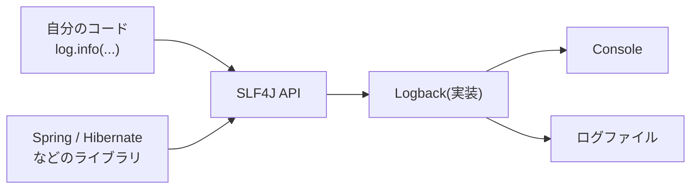

::: haru
本番で「たまに採点が失敗する」って問い合わせが来ました。とりあえず怪しい所に `System.out.println` を足して、再デプロイして……
:::

::: sensei
で、次に起きたとき「いつ・どのリクエストで・どこで」が分かる? println には時刻もスレッドも残らないし、本番では止められもしない。今日は **ロガー** を使ったログの出し方をやろう。
:::

前回の「設定ファイルとプロファイル」で覚えた `logging.level` を、今回は中身から理解します。

## なぜ System.out.println ではダメなのか

Spring Boot アプリを起動すると、Console にこんな行が流れます。

```text
2026-10-11T10:15:30.123+09:00  INFO 4321 --- [java-dojo]
  [nio-8080-exec-1] com.sayana.dojo.exec.Grader : 採点開始
```

(実際は1行)。**日時・レベル・プロセスID・アプリ名・スレッド名・ロガー名・メッセージ** が自動で付きます。これがロガーを使う理由の半分です。

| | println | ロガー |
|---|---|---|
| 日時・スレッド | 自分で書く | 自動 |
| 出す/出さない | コード修正 | 設定で切替 |
| 出力先 | 標準出力のみ | 画面・ファイル等 |
| 重要度 | 区別なし | レベルで区別 |

特に大きいのは「**コードを変えずに、設定だけで詳しさを変えられる**」ことです。本番は INFO だけ、障害調査中は特定パッケージだけ DEBUG、ができます。

## SLF4J と Logback

Java のログには「API」と「実装」の2層があります。

- **SLF4J**(Simple Logging Facade for Java):コードが呼ぶ **API(窓口)**。`Logger` インターフェースなど
- **Logback**:実際に整形して書き出す **実装**。Spring Boot の既定(`spring-boot-starter-logging` に入っている)



コードが SLF4J だけに依存していれば、実装を Log4j2 などに差し替えてもコードは1行も変わりません。ライブラリごとにバラバラなログ API も、ブリッジ(`jul-to-slf4j` など)で SLF4J に集めて、出力を一元管理しています。

ロガーはクラスごとに1つ、こう作ります。

```java
import org.slf4j.Logger;
import org.slf4j.LoggerFactory;

@Service
public class GradeService {
    private static final Logger log =
        LoggerFactory.getLogger(GradeService.class);

    public void grade(long submissionId) {
        log.info("採点開始 submissionId={}", submissionId);
    }
}
```

`getLogger(GradeService.class)` で作ったロガーの **名前は完全修飾クラス名**(`com.example.GradeService`)になります。この名前が、あとで `logging.level` で絞り込むときの鍵です。Java道場の `AnthropicLlmClient` も、この形で「AI 機能が有効です」と起動時に出しています。

::: sensei
`static final` で1つだけ持つのが定番。インスタンスごとに作る意味はないし、`private` にして他のクラスのロガーを借りないこと。借りると、ログの出どころが嘘になる。
:::

## ログレベルの使い分け

レベルは5段階。設定したレベル **以上** だけが出力されます(Spring Boot の既定は INFO)。

| レベル | 使いどころ | 例 |
|---|---|---|
| ERROR | 処理が失敗した。人が見るべき | DB接続失敗 |
| WARN | 続行できたが要注意 | リトライで成功 |
| INFO | 業務の節目 | 起動完了・注文確定 |
| DEBUG | 開発・調査用の詳細 | 引数・分岐の結果 |
| TRACE | さらに細かい追跡 | ループの各回 |

```text
設定が INFO なら → ERROR, WARN, INFO が出る
設定が DEBUG なら → 上に加えて DEBUG も出る
```

現場の目安は「**ERROR は誰かが対応する必要があるもの**」。入力ミスのような想定内のエラーまで ERROR にすると、本物の障害が埋もれ、監視の通知が鳴りっぱなしになります(オオカミ少年)。

## プレースホルダ {} と例外の渡し方

```java
log.debug("注文を処理: " + order);    // NG
log.debug("注文を処理: {}", order);   // OK
```

どちらも出力は同じですが、NG の方は **DEBUG が無効でも文字列連結が実行されます**。Java は引数を先に評価してからメソッドを呼ぶので、`order.toString()` も連結も必ず走るのです。`{}` 版は、レベルが有効だと分かってから初めて `toString()` を呼ぶ(遅延評価)ので、無効なら文字列を作りません。

引数自体の計算が重いなら、レベルを先に確かめます。

```java
if (log.isDebugEnabled()) {
    log.debug("集計: {}", buildHeavyReport());
}
```

**例外は最後の引数に** 渡します。これでスタックトレースまで出ます。

```java
log.error("採点に失敗 id={}", id, e);
```

```text
ERROR ... 採点に失敗 id=42
java.lang.IllegalStateException: 応答なし
	at com.example.GradeService.grade(GradeService.java:31)
	...
```

連結で渡すと、`e.toString()` の1行だけになり、**どこで起きたかが失われます**。

```java
log.error("採点に失敗: " + e);  // NG:スタックトレースが出ない
```

```text
ERROR ... 採点に失敗: java.lang.IllegalStateException: 応答なし
```

## 設定で絞る・ファイルに出す

`logging.level.<ロガー名>` でレベルを変えます。名前はパッケージの **前方一致**(ドット区切り)で、一番長く一致した設定が勝ちます。

```yaml
logging:
  level:
    root: WARN                    # 全体の既定
    com.sayana.dojo: DEBUG        # 自分のコードは詳しく
    com.sayana.dojo.ai: INFO      # ここだけ控えめに
    org.hibernate.SQL: DEBUG      # 発行された SQL を見る
  file:
    name: logs/dojo.log           # ファイルにも出す
```

`com.sayana.dojo.ai.AiService` は `com.sayana.dojo.ai` に一致して INFO、`com.sayana.dojo.exec.Grader` は DEBUG、`org.springframework...` はどれにも一致せず `root` の WARN です。前回の通り、本番では環境変数 `LOGGING_LEVEL_COM_SAYANA_DOJO=DEBUG` で一時的に上げることもできます。

`logging.file.name` を書くと、Console に加えてファイルにも出ます。既定では 10MB でファイルが切り替わり(ローテーション)、古いものは 7 日分残ります。

## 書いてはいけないもの、付けておきたいもの

**パスワード・API キー・カード番号・個人情報はログに出しません。** ログは画面より多くの人が見て、バックアップや外部の監視サービスにも複製され、長期間残ります。

```java
record LoginForm(String email, String password) {}

log.info("ログイン: {}", form);
// 出力: ログイン: LoginForm[email=taro@example.com,
//         password=himitsu123]   ← 丸見え!
```

record の `toString()` は **全フィールドを出す** ので、オブジェクトを丸ごと渡すと漏れます。出す項目を選ぶか、マスクします。

```java
// t***@example.com のように出す
log.info("ログイン email={}", mask(form.email()));
```

**MDC(Mapped Diagnostic Context)** は、スレッドごとに「付箋」を貼る仕組みです。リクエストの入口(Filter)でリクエストIDを入れておくと、そのリクエストの処理中に出るすべてのログに同じIDを付けられます。

```java
MDC.put("requestId", requestId);
try {
    chain.doFilter(req, res);
} finally {
    MDC.remove("requestId"); // スレッドは使い回されるので必ず消す
}
```

```yaml
logging:
  pattern:
    level: "%5p [%X{requestId}]"
```

::: genba ログで障害を追う
問い合わせが来たら、まず時刻の前後で `ERROR` を検索し、その行のリクエストIDで全行を絞り込む。そのリクエストが「どの入力で・どの順に・どこで落ちたか」が一本の線で読めます。**ログは未来の自分への手紙**。障害が起きる前に、追える形で書いておくのが勝負です。
:::

## よくあるミス

**ロガーのコピペ**:別クラスから宣言ごとコピーして `getLogger(OrderService.class)` のまま。ログのロガー名が嘘になり、`logging.level` で絞っても思った所が変わりません。

**`e.printStackTrace()`**:標準エラーに直接出るので、レベルも日時も付かず、ログファイルにも残りません。`log.error("...", e)` に置き換えます。

**ログして再スロー**:

```java
} catch (IOException e) {
    log.error("読み込み失敗", e);
    throw new UncheckedIOException(e);
}
```

呼び出し元(や `@RestControllerAdvice`)でもう一度ログすると、同じスタックトレースが2回出て、障害が2件に見えます。「**ログするなら処理を終わらせる、投げるならログしない**」が原則で、最終的に例外を受け止める1か所でログします。

::: point まとめ
- `System.out.println` ではなく SLF4J の `Logger` を使う。日時・スレッド・レベルが付き、設定で出し分けられる
- Spring Boot の既定は SLF4J(API)+ Logback(実装)。ロガーは `LoggerFactory.getLogger(自クラス.class)` を `private static final` で
- レベルは ERROR > WARN > INFO > DEBUG > TRACE。設定したレベル以上が出る
- メッセージは `{}` で組み立てる(連結しない)。**例外は最後の引数** でスタックトレースを残す
- `logging.level.<パッケージ>` は前方一致・一番長い一致が勝つ。`logging.file.name` でファイル出力
- パスワード・個人情報は出さない。record の丸ごと出力に注意。MDC でリクエストIDを付ける
:::

::: sensei
次は「Spring Security入門」。ログイン失敗のログをどう出すか、今日の話がさっそく効いてくるよ。
:::
