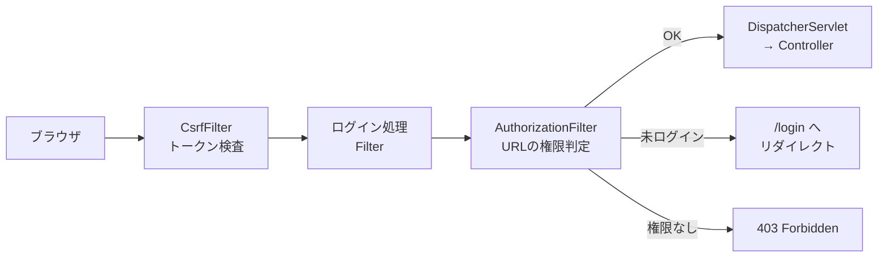

::: haru
先輩、Spring Security を依存に足しただけなのに、全部の画面がログイン画面になっちゃいました!
:::

::: sensei
それが正常。「何も設定してないなら全部閉じておく」のが Security の流儀なんだ。今日は鍵の開け方と、開けすぎない方法をやろう。
:::

前回の「ログ」で「何が起きたか」を記録できるようになりました。今回は「**誰が**、**何をしてよいか**」を守る仕組みです。

## 認証と認可

セキュリティの話は、まずこの2語を区別するところから。

| 用語 | 問い | 失敗したとき |
|---|---|---|
| 認証(Authentication) | あなたは誰? | ログイン画面へ(APIなら 401) |
| 認可(Authorization) | それをしてよい? | 403 Forbidden |

ログインに成功した = 認証済み、です。認証済みでも、一般ユーザーが管理画面を開けば認可で弾かれます。

## 依存を入れただけで全画面がロックされる理由

`spring-boot-starter-security` を入れると、Boot の自動設定が次を用意します。

- **すべての URL を「認証済みのみ」** にする
- 既定のログイン画面(`/login`)とログアウト(`/logout`)
- ユーザー `user` を1人だけ作り、パスワードを起動のたびに生成

パスワードは起動ログに出ます。

```text
Using generated security password: 8e557245-73e2-...

This generated password is for development use only.
```

「設定し忘れたら開きっぱなし」より「設定し忘れたら閉じっぱなし」の方が事故が小さい。これを **secure by default** と呼びます。

Spring Security の正体は、DispatcherServlet より **手前** に並んだ **サーブレットフィルタの列**(SecurityFilterChain)です。Controller に届く前に、全リクエストが関所を通ります。



Controller に `if (ログイン済み?)` を書かなくてよいのは、ここで先に弾いているからです。

## SecurityFilterChain を自分で定義する

既定のままでは使えないので、`@Bean` で関所のルールを書きます。Spring Security 6 では **ラムダ DSL** が標準です。

```java
@Configuration
public class SecurityConfig {

  @Bean
  SecurityFilterChain filterChain(HttpSecurity http)
      throws Exception {
    http
      .authorizeHttpRequests(auth -> auth
        .requestMatchers("/", "/css/**").permitAll()
        .requestMatchers("/admin/**").hasRole("ADMIN")
        .anyRequest().authenticated())
      .formLogin(Customizer.withDefaults())
      .logout(logout -> logout
        .logoutSuccessUrl("/"));
    return http.build();
  }
}
```

- `permitAll()` … 誰でも(未ログインでも)OK
- `hasRole("ADMIN")` … ロール ADMIN を持つ人だけ
- `authenticated()` … ログインしていれば誰でも
- `formLogin` / `logout` … ログイン画面とログアウトを有効化(`loginPage("/login")` で自作画面にも替えられる)

Spring Boot では `@EnableWebSecurity` は付けなくても有効です(自動設定が付けてくれる)。

### ログイン状態はどこに覚えている?

ログインに成功すると、認証情報(`Authentication`)は **HTTP セッション** に保存され、ブラウザには Cookie の `JSESSIONID` だけが渡ります。次のリクエストではフィルタがセッションから取り出し、**`SecurityContextHolder`**(スレッドごとの置き場。中身は `ThreadLocal`)に置きます。だから Controller でも Service でも「今の人」を取り出せます。ログイン成功時にはセッション ID を振り直し、ログイン前の ID を盗んでおく **セッション固定攻撃** も防いでいます。

### ルールの順番

**ルールは上から順に評価され、最初に一致したもので決まります**。`if / else if` と同じなので、**細かい URL ほど上** に書きます。`anyRequest()` の後ろに `requestMatchers` を書くと起動時に `Can't configure requestMatchers after anyRequest` で落ちます。

::: sensei
`hasRole("ADMIN")` は内部で `ROLE_` を付けて `ROLE_ADMIN` という権限(authority)と比べてる。だから `hasRole("ROLE_ADMIN")` と書くと起動時に怒られるよ。
:::

## ユーザーとパスワード

学習用ならメモリ上のユーザーで十分です。

```java
@Bean
PasswordEncoder passwordEncoder() {
  return new BCryptPasswordEncoder();
}

@Bean
UserDetailsService users(PasswordEncoder enc) {
  var haru = User.withUsername("haru")
      .password(enc.encode("haru-pass"))
      .roles("USER").build();
  var mocha = User.withUsername("mocha")
      .password(enc.encode("mocha-pass"))
      .roles("USER", "ADMIN").build();
  return new InMemoryUserDetailsManager(haru, mocha);
}
```

`UserDetailsService` の Bean を定義すると、生成パスワードの `user` は消えます。実務では `UserDetailsService` を自分で実装し、`loadUserByUsername` で **DB(Repository)からユーザーを引いて** 返します。

### パスワードは平文で保存しない

DB が漏れた瞬間、平文なら全員のパスワードが即バレです。保存するのは **ハッシュ**(元に戻せない一方向の変換結果)。さらに:

- **ソルト**:ユーザーごとのランダム値を混ぜてからハッシュ化。同じパスワードでも別の値になり、事前計算表(レインボーテーブル)が効かない
- **わざと遅くする**:SHA-256 は速すぎて総当たりに弱い。BCrypt は計算回数(コスト)を上げられる

```java
var enc = new BCryptPasswordEncoder();
String a = enc.encode("haru-pass");
String b = enc.encode("haru-pass");
System.out.println(a.equals(b));  // false(ソルトが違う)
System.out.println(enc.matches("haru-pass", b)); // true
```

照合は `equals` ではなく **`matches`**。保存値の中にソルトが入っているので、それを使って計算し直して比べます。

## CSRF とフォーム

**CSRF**(クロスサイト・リクエスト・フォージェリ)は、罠サイトがログイン中のあなたのブラウザに勝手に POST を送らせる攻撃です。Cookie は自動で付くので、サーバーからは本人の操作に見えます。

Spring Security は POST などの更新系リクエストに **CSRF トークン**(サーバーが発行した推測できない値)を要求し、無ければ **403** で拒否します。Thymeleaf なら `th:action` を使うだけで隠し項目が自動で入ります。

```html
<form th:action="@{/orders}" method="post">
<!-- 描画結果に自動で入る -->
<input type="hidden" name="_csrf" value="4bfd...">
```

素の `action="/orders"` だとトークンが入らず 403 です。ログアウトも CSRF 有効時は **POST /logout** にします。

## メソッド単位の認可とログイン中のユーザー

URL だけでなく、Service のメソッドにも鍵をかけられます。設定クラスに `@EnableMethodSecurity` を付けて:

```java
@PreAuthorize("hasRole('ADMIN')")
public void deleteUser(long id) { ... }
```

権限がなければ `AccessDeniedException`(画面では 403)。画面の作り忘れで URL が漏れても、最後の砦になります。

ログイン中のユーザーは引数で受け取れます。

```java
@GetMapping("/mypage")
String mypage(@AuthenticationPrincipal UserDetails me,
              Model model) {
  model.addAttribute("name", me.getUsername());
  return "mypage";
}
```

::: haru
画面から送られてきた `userId` を信じちゃダメなんすね。
:::

::: sensei
そう。「自分の注文」を出すなら、ID はリクエストじゃなく `me` から取る。書き換えられた ID で他人のデータを見られる事故は今も多いんだ。
:::

## よくあるミス

- **とりあえず `anyRequest().permitAll()`**:動くけど何も守っていない。最初は閉じて、必要な所だけ開ける
- **理由なく `csrf(csrf -> csrf.disable())`**:403 が消えるのは守りを外したから。正解は `th:action` を使うこと
- **`@EnableMethodSecurity` 忘れ**:`@PreAuthorize` が **黙って無視される**。エラーが出ないので気づかない
- **パスワードを `equals` で比較**:ハッシュ値は毎回違うので必ず不一致。`matches` を使う

::: point まとめ
- **認証**=誰か、**認可**=何をしてよいか。未ログインはログイン画面へ、権限不足は 403
- 依存を入れると **全 URL がログイン必須**(secure by default)。生成パスワードは起動ログに出る
- `SecurityFilterChain` の `@Bean` で `permitAll` / `hasRole` / `authenticated` を書く。**上から最初に一致したルール** が効く
- パスワードは **BCrypt でハッシュ化**(ソルト入り・わざと遅い)。照合は `matches`
- 更新系は **CSRF トークン** が必須。Thymeleaf は `th:action` で自動
- `@PreAuthorize` でメソッドにも鍵を。ユーザーは `@AuthenticationPrincipal` で受け取る
:::

::: sensei
次は第3部のラスト「MockMvc によるテスト」。今日の「この人はこの画面に入れるか」も、テストで守れるようになるよ。
:::
