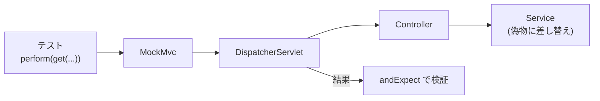

::: haru
Controller のテストって、アプリを起動してブラウザで叩けば十分じゃないっすか?
:::

::: sensei
それを画面50個 × 修正のたびにやる? 第1部の JUnit を、Web の世界に持ち込む道具が **MockMvc** だ。第3部の締めくくりにふさわしいだろ。
:::

前回の「Spring Security入門」で、URL ごとに鍵をかけました。今回は「この URL を叩くと、この結果が返る」を **自動テスト** で守ります。

## Controller のテスト、どれを選ぶ?

Controller のテスト方法は大きく4つ。**速さと範囲のトレードオフ** です。

| 方式 | 動くもの | 速さ |
|---|---|---|
| 素の単体テスト | `new` した Controller だけ | 一瞬 |
| MockMvc standaloneSetup | 指定した Controller + Spring MVC | 速い |
| `@WebMvcTest` | Web 層の Bean だけ(Service は偽物) | 数秒 |
| `@SpringBootTest` | アプリ全部(DB も) | 遅い |

素の単体テストでは `@GetMapping` の URL、`@RequestParam` の変換、JSON 化、ステータスコードが確かめられません。そこを確かめたいときの主役が **MockMvc** です。

MockMvc は **Tomcat を起動しません**。偽物のリクエスト/レスポンス(`MockHttpServletRequest` など)を作って、DispatcherServlet に直接渡します。ネットワークもポートも使わないので速いのです。



## MockMvc の基本:perform → andExpect

形は「**リクエストを投げて(perform)、結果を期待する(andExpect)**」の一択です。

```java
mvc.perform(get("/stocks/A001"))
   .andExpect(status().isOk())
   .andExpect(jsonPath("$.name").value("ボールペン"));

mvc.perform(post("/stocks/A001/ship")
        .param("qty", "3"))
   .andExpect(status().isOk())
   .andExpect(content()
       .string("出荷しました(残り 9)"));
```

よく使う検証(`MockMvcResultMatchers` の static メソッド)はこれだけ覚えれば十分です。

| 書き方 | 確かめること |
|---|---|
| `status().isOk()` / `isNotFound()` | ステータス |
| `content().string(...)` | 本文 |
| `jsonPath("$.items[0].name")` | JSON の一部 |
| `view().name("orders/list")` | 画面の名前 |
| `model().attribute("total", 1500)` | Model の中身 |
| `redirectedUrl("/orders")` | リダイレクト先 |

`get` / `post` は `MockMvcRequestBuilders` の static import です。STS の補完で別クラスの `get` を選ぶと、コンパイルは通るのに型が合わず混乱するので注意。

## standaloneSetup と @WebMvcTest

**standaloneSetup** は Spring の DI を使わず、自分で `new` した Controller を MockMvc に載せます。

```java
MockMvc mvc = MockMvcBuilders
    .standaloneSetup(new OrderController(stub))
    .build();
```

依存(Service)は手で渡すので、**決まった値を返す偽物(スタブ)** を自分で書いて渡せます。速くて仕組みが丸見えなのが長所です。

**@WebMvcTest** は Spring Boot のテスト用アノテーションで、Web 層の Bean(Controller・`@ControllerAdvice`・フィルタなど)**だけ** で小さなアプリを起動します。`@Service` や `@Repository` は作られないので、偽物を `@MockitoBean` で差し込みます。

```java
@WebMvcTest(OrderController.class)
class OrderControllerTest {
  @Autowired MockMvc mvc;
  @MockitoBean OrderService service;

  @Test
  void 注文一覧() throws Exception {
    when(service.findByCustomer("C001"))
        .thenReturn(List.of(
            new Order("O-1", "ペン", 300)));

    mvc.perform(get("/customers/C001/orders"))
       .andExpect(status().isOk())
       .andExpect(jsonPath("$[0].item").value("ペン"));

    verify(service).findByCustomer("C001");
  }
}
```

ここで出てきたのが **Mockito**(偽物を作るライブラリ)です。

- `when(...).thenReturn(...)` … 「この引数で呼ばれたらこれを返せ」と仕込む。仕込まなければ `null`・`0`・空のリストが返る
- `verify(service).findByCustomer("C001")` … 「この引数で呼ばれたか」を確かめる

`@MockitoBean` は Spring Framework 6.2(Spring Boot 3.4 以降)の書き方です。古い記事の **`@MockBean` は 3.4 で非推奨** になりました。

::: sensei
`@WebMvcTest` は Security のフィルタも載る。前回のルールがそのまま効くから、ログイン前提の画面は `@WithMockUser`(spring-security-test)で「ログイン済みの人」を用意するんだ。
:::

## テストデータは「意図が読める最小限」

```java
private static Order pen() {
  return new Order("O-1", "ボールペン", 300);
}
```

- テストに関係ない項目まで毎回並べない。**名前付きのメソッド** やビルダーにまとめる
- 境界値(在庫ちょうど・0件・5000円ちょうど)を必ず入れる
- テスト同士で状態を共有しない(`@BeforeEach` で毎回作り直す)

## 日本語が「??」になる

standaloneSetup で日本語の文字列を返すと、こうなります。

```text
Response content expected:<合計 1,500円>
 but was:<?? 1,500?>
```

`StringHttpMessageConverter` の既定の文字コードが **ISO-8859-1**(HTTP の古い仕様の名残)だからです。standaloneSetup では UTF-8 を明示します。

```java
.setMessageConverters(
    new StringHttpMessageConverter(UTF_8),
    new MappingJackson2HttpMessageConverter())
.defaultResponseCharacterEncoding(UTF_8)
```

Spring Boot(`@WebMvcTest` や本番)では自動設定が UTF-8 にしてくれるので不要です。

## このアプリ自身のテストを読もう

このアプリ(Java道場)の `src/test/java/com/sayana/dojo/web/WebFlowTest.java` は、`@SpringBootTest` + `@AutoConfigureMockMvc` で **アプリ全体** を起動して MockMvc を使っています。

```java
mvc.perform(get("/lessons/no-such-lesson"))
   .andExpect(status().isNotFound());
```

「読む → 動かす → 書く → 確かめる → 復習」を1本のテストで通しています。復習の「1日後」は `@Import(TestClockConfig.class)` で差し込んだ **時計の偽物**(`MutableClock`)を `advanceDays(1)` して作っています。現在時刻も「差し替えられる依存」にしておくと、テストで時間を操れるのです。

## テストが遅くなる原因とコンテキストキャッシュ

`@SpringBootTest` の起動は数秒〜数十秒。毎回やったら日が暮れます。そこで Spring のテスト基盤は、**同じ設定のテストクラス同士で ApplicationContext を使い回します**(コンテキストキャッシュ)。

ところが、次のどれかがクラスごとに違うと、**別の設定** とみなされて作り直しになります。

- `@MockitoBean` の組み合わせ
- `@ActiveProfiles` / `@TestPropertySource`
- `@DirtiesContext`(「このテストで汚した」宣言。強制的に捨てる)

ログに Spring Boot のバナーが何度も出ていたら、作り直しが起きている合図です。偽物の組み合わせを共通の親クラスに揃えるのが定番の対策です。

## よくあるミス

- **`Circular view path [orders]`**:standaloneSetup で、URL `/orders` の Controller が画面名 `"orders"` を返すと、自分自身に転送しようとして例外。画面名を `"orders/list"` にするか ViewResolver を設定する
- **`@WebMvcTest` で `No qualifying bean of type 'OrderService'`**:Service は作られないので `@MockitoBean` を忘れずに
- **正常系だけテスト**:バグは境界と異常系に潜む。404・400・ちょうどの値を書く

::: point まとめ
- Controller のテストは **単体 / standaloneSetup / @WebMvcTest / @SpringBootTest**。速さと範囲で選ぶ
- MockMvc は Tomcat なしで DispatcherServlet を呼ぶ。**perform → andExpect**
- `status` / `content` / `jsonPath` / `view` / `model` / `redirectedUrl` で検証
- `@WebMvcTest` では Service を **`@MockitoBean`**(旧 `@MockBean`)で偽物に。`when/thenReturn` で仕込み `verify` で確認
- standaloneSetup で日本語を返すなら **UTF-8 を明示**
- 設定がバラバラだと **コンテキストキャッシュ** が効かず遅くなる
:::

::: sensei
これで第3部はおしまい。DI から始めて、画面・DB・API・セキュリティ・テストまで来た。第4部の総合演習で、全部をつなげて1本のアプリにしよう。
:::
