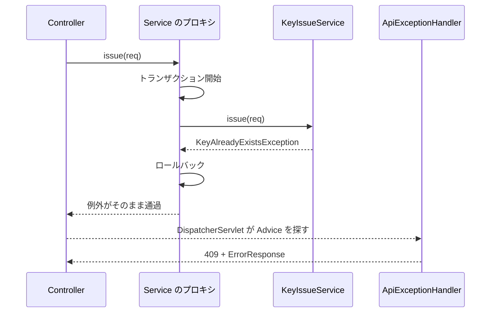

::: haru
先輩、来週から鍵管理システムの保守チームに入ります。初日から「鍵の重複チェックまわりの問い合わせを調べて」と言われたんですが、リポジトリを開いたらクラスが200個もあって……どこから読めばいいんですか?
:::

::: sensei
200個を頭から読む人はいないよ。まず地図を見て、入口を1つ決めて、1本の API を最後まで追う。今日は第3部の1〜6章で覚えた部品を、**読む側** から使い直す回だ。
:::

第3部では Spring の部品を **自分で書く** 立場で学んできました。ところが仕事で最初に任されるのは、たいてい **人が書いたコードを読む** ことです。不具合の調査も、仕様変更の影響範囲の確認も、レビューも、「読めること」が前提です。

このレッスンの目標は、**知らない Spring Boot プロジェクトを渡されても、1本の API の流れを自分で追えるようになる** ことです。

## 知らないプロジェクトに入ったら、この順に見る

いきなりクラスの中身を開かずに、外側から順に見当をつけていきます。

1. **README と起動方法**:まず手元で動かします。動けば、ログやデバッガで「実際の値」を見られます
2. **`pom.xml`(または `build.gradle`)の依存**:`spring-boot-starter-web`・`-data-jpa`・`-validation`・`-security`、`lombok`、`mybatis` など。何が入っているかで、コードに出てくるアノテーションの見当がつきます
3. **`@SpringBootApplication` のクラス**:そのパッケージ以下がコンポーネントスキャンの範囲です(第3部1章「Spring Bootの起動の仕組み」で見ました)
4. **パッケージ構成**:層ごとの役割を当たりをつけます(次の節)
5. **`application.yml` とプロファイル**:DB の接続先、URL の前に付く `server.servlet.context-path`、ログレベル(第3部5章「設定ファイルとプロファイル」)
6. **1本の API を入口から最後まで追う**:今日の本題です
7. **テストコード**:MockMvc のテストは「この API はこう動くべき」という仕様書代わりになります(第3部6章「MockMvcによるテスト」)

::: haru
全部のクラスを理解してから仕事を始めるんだと思ってました。
:::

::: sensei
それをやると3か月かかる。頼まれた API に関係する道筋だけを確実に読む。周りは「だいたいこういう役割」で十分だよ。
:::

## 層とパッケージ名から役割の見当をつける

第3部3章「Controller・Service・Repositoryの層分け」で見た層構造は、多くの業務アプリでそのままパッケージ構成になっています。

<figure class="figure"><svg viewBox="0 0 660 250" xmlns="http://www.w3.org/2000/svg" font-family="inherit"><defs><marker id="rc-ar" markerWidth="10" markerHeight="10" refX="8" refY="5" orient="auto"><path d="M0 0 L10 5 L0 10 z" fill="var(--accent)"/></marker></defs><rect x="10" y="40" width="120" height="55" rx="10" fill="var(--accent-soft)" stroke="var(--ink)" stroke-width="2"/><text x="70" y="72" font-size="13" font-weight="700" text-anchor="middle" fill="var(--ink)">Controller</text><path d="M130 67 L170 67" stroke="var(--accent)" stroke-width="2.5" marker-end="url(#rc-ar)"/><text x="150" y="58" font-size="11" text-anchor="middle" fill="var(--ink-muted)">DTO</text><rect x="175" y="40" width="120" height="55" rx="10" fill="var(--accent-soft)" stroke="var(--ink)" stroke-width="2"/><text x="235" y="72" font-size="13" font-weight="700" text-anchor="middle" fill="var(--ink)">Service</text><path d="M295 67 L335 67" stroke="var(--accent)" stroke-width="2.5" marker-end="url(#rc-ar)"/><text x="315" y="58" font-size="11" text-anchor="middle" fill="var(--ink-muted)">Entity</text><rect x="340" y="40" width="130" height="55" rx="10" fill="var(--accent-soft)" stroke="var(--ink)" stroke-width="2"/><text x="405" y="72" font-size="13" font-weight="700" text-anchor="middle" fill="var(--ink)">Repository</text><path d="M470 67 L505 67" stroke="var(--accent)" stroke-width="2.5" marker-end="url(#rc-ar)"/><rect x="510" y="40" width="60" height="55" rx="10" fill="var(--surface-2)" stroke="var(--ink)" stroke-width="2"/><text x="540" y="72" font-size="13" font-weight="700" text-anchor="middle" fill="var(--ink)">DB</text><rect x="60" y="140" width="130" height="45" rx="10" fill="var(--surface-2)" stroke="var(--line)" stroke-width="2" stroke-dasharray="5 3"/><text x="125" y="167" font-size="12" text-anchor="middle" fill="var(--ink)">Config(設定)</text><rect x="250" y="140" width="150" height="45" rx="10" fill="var(--surface-2)" stroke="var(--line)" stroke-width="2" stroke-dasharray="5 3"/><text x="325" y="167" font-size="12" text-anchor="middle" fill="var(--ink)">Exception(例外ハンドラ)</text><rect x="460" y="140" width="120" height="45" rx="10" fill="var(--surface-2)" stroke="var(--line)" stroke-width="2" stroke-dasharray="5 3"/><text x="520" y="167" font-size="12" text-anchor="middle" fill="var(--ink)">Util(共通処理)</text><path d="M125 140 L100 95" stroke="var(--line)" stroke-width="1.5" stroke-dasharray="3 3"/><path d="M325 140 L235 95" stroke="var(--line)" stroke-width="1.5" stroke-dasharray="3 3"/><path d="M520 140 L405 95" stroke="var(--line)" stroke-width="1.5" stroke-dasharray="3 3"/><text x="330" y="225" font-size="12" text-anchor="middle" fill="var(--ink-muted)">点線の3つ(Config/Exception/Util)はどの層からも使われうる、横断的な部品</text></svg><figcaption>典型的な層構造。実線が1本の API の主な流れ、点線は全体から使われる部品</figcaption></figure>

| パッケージ名の例 | 推測される役割 |
|---|---|
| `...controller` / `...web` / `...api` | HTTP の入口(`@RestController` / `@Controller`) |
| `...service` | 業務ロジック(`@Service`) |
| `...repository` / `...mapper` | DB アクセス(`JpaRepository`、MyBatis の Mapper) |
| `...dto` / `...form` | リクエスト・レスポンスの入れ物 |
| `...entity` / `...domain` | テーブルに対応するクラス(`@Entity`) |
| `...config` | 設定クラス(`@Configuration`)、`SecurityFilterChain` など |
| `...exception` / `...handler` | 業務例外、`@RestControllerAdvice` |
| `...util` / `...common` | どの層にも属さない共通処理 |

機能ごとに `key/`・`card/` と分け、その中に層を置くプロジェクトもあります。どちらでも、**クラス名の末尾(`〜Controller`・`〜Service`・`〜Repository`)と付いているアノテーション** を見れば層は分かります。

## 1本の API を最初から最後まで追う

例として、カードに暗号鍵を発行する `POST /api/keys` を追います。追う順番は、**リクエストが実際に流れる順** です。

### ステップ1:URL から Controller を見つける

まず、どのメソッドが呼ばれるのかを特定します。IDE の全文検索で URL の一部を探すのが早道です。

```java
@RestController
@RequestMapping("/api/keys")      // URL の前半
@RequiredArgsConstructor          // Lombok:final フィールドのコンストラクタを生成
public class KeyIssueController {
    private final KeyIssueService keyIssueService;

    @PostMapping                  // パス指定なし → POST /api/keys そのもの
    public ResponseEntity<KeyIssueResponse> issue(
            @Valid @RequestBody KeyIssueRequest request) {
        return ResponseEntity.status(HttpStatus.CREATED)
                .body(keyIssueService.issue(request));
    }
}
```

URL は **クラスの `@RequestMapping` + メソッドの `@PostMapping`** の連結でした(第3部2章「Controllerとルーティング」)。`"/api/keys"` で検索しても見つからないときは、`"/api"` と `"/keys"` に分かれていたり、定数になっていたり、`context-path` が前に付いていたりします。`"keys"` のように短くして探し直しましょう。

`@RequiredArgsConstructor` は第3部1章のコラムで触れた **Lombok** です。コンストラクタはソースに見えませんが、コンパイル時に作られ、`KeyIssueService` がコンストラクタインジェクションで渡されます。この Controller は分岐も計算もせず、本体を Service に丸ごと任せています。

### ステップ2:リクエスト DTO の形と制約を見る

次に `@RequestBody` の型を開き、**どんなデータが、どんな制約付きで** 入ってくるかを確認します。

```java
public record KeyIssueRequest(
        @NotBlank String cardId,
        @NotNull @Min(1) @Max(255) Integer keyVersion) {
}
```

`@Valid` が付いているので、制約に違反したリクエストは **Service に入る前に** `MethodArgumentNotValidException` になり、400 で返ります(第3部2章「フォームとバリデーション」)。つまり Service を読むときは「`cardId` は空ではない」「`keyVersion` は 1〜255」を前提にしてよい、ということです。逆に、制約が書かれていない項目は `null` も来ると思って読みます。

### ステップ3:Service で分岐と例外を全部拾う

Service は **この API の本体** です。呼び出し・分岐・例外を1行ずつ確認します。

```java
@Service
@RequiredArgsConstructor
public class KeyIssueService {
    private final KeyRepository keyRepository;
    private final CryptoClient cryptoClient;

    @Transactional
    public KeyIssueResponse issue(KeyIssueRequest req) {
        if (keyRepository.existsByCardIdAndStatus(
                req.cardId(), "ACTIVE")) {           // 分岐(異常系)
            throw new KeyAlreadyExistsException(req.cardId());
        }
        byte[] key = cryptoClient.generateKey();        // 外部装置の呼び出し
        KeyEntity saved = keyRepository.save(
                new KeyEntity(req.cardId(), req.keyVersion(), key));
        return new KeyIssueResponse(saved.getKeyId(), saved.getStatus());
    }
}
```

読むときに書き出すのは次の4つです。

- **呼び出し先**:`existsByCardIdAndStatus` → `generateKey` → `save` の順
- **分岐**:ACTIVE な鍵があれば例外(異常系)
- **例外**:`KeyAlreadyExistsException` を投げている。誰が受けるかはステップ5で探す
- **見えない処理**:`@Transactional` があるので、このメソッド全体が1つのトランザクション

::: warn 正常系だけ読んで満足しない
「暗号装置(仕事では HSM。コードの CryptoClient は HsmClient)で鍵を作って保存するだけ」と読むと、重複のときの動きを見落とします。`if`・`throw`・`for`・`catch` が出てきたら必ず立ち止まり、**どの条件で、どこへ分かれるか** を確かめてください。問い合わせの多くは異常系から来ます。
:::

### ステップ4:Repository はメソッド名と継承元を見る

```java
public interface KeyRepository
        extends JpaRepository<KeyEntity, Long> {
    boolean existsByCardIdAndStatus(String cardId, String status);
}
```

| Service からの呼び出し | SQL としての意味 |
|---|---|
| `existsByCardIdAndStatus(id, "ACTIVE")` | `WHERE card_id = ? AND status = ?` が1件でもあるか |
| `save(entity)` | 新規なら INSERT、既存なら UPDATE |
| `findById(id)` | 主キーで1件。**このファイルには書かれていない** |

第3部3章「Spring Data JPA」の派生クエリなので、実装クラスはありません。`save` や `findById` は **継承元の `JpaRepository`** から来ています。インターフェースが短くても、使えるメソッドはずっと多いことを忘れないでください。`@Query` が付いていれば、そこに書かれた JPQL / SQL が正です。

### ステップ5:レスポンスと例外の行き先

正常に終われば `KeyIssueResponse` が Jackson で JSON になり、201 で返ります。では `KeyAlreadyExistsException` はどうなるでしょう。Controller にも Service にも try-catch はありません。

```java
@RestControllerAdvice
public class ApiExceptionHandler {
    @ExceptionHandler(KeyAlreadyExistsException.class)
    public ResponseEntity<ErrorResponse> handleDuplicate(
            KeyAlreadyExistsException e) {
        return ResponseEntity.status(HttpStatus.CONFLICT)
                .body(new ErrorResponse("E409", e.getMessage()));
    }
}
```

答えは第3部4章「例外ハンドリング」の `@RestControllerAdvice` です。例外クラス名でプロジェクト全体を検索し、**`@ExceptionHandler` でその型(または親の型)を受けている所** を探します。見つからなければ、その例外は 500 になります。

::: haru
try-catch が無いのを見て「エラー処理が抜けてる!」ってレビューに書くところでした。
:::

::: sensei
業務例外は「投げっぱなしで Advice が受ける」のが Spring の普通の形だ。書く前に、例外クラス名で検索する癖をつけよう。
:::

## 例外とトランザクションの境界

ステップ3の Service には `@Transactional` が付いていました。例外が投げられたとき、**どの順番で何が起きるか** を図にします。



業務コードを読むときは、次の4つを確かめます(どれも第3部3章「トランザクション」の内容です)。

- **境界はプロキシの入口と出口**:`@Transactional` の public メソッドが外から呼ばれた所で始まり、戻る所で終わります。Controller が Service を2回呼べば、トランザクションも2つです
- **ロールバックが決まるのは、例外がプロキシの外へ出たとき**:`RuntimeException` と `Error` は既定でロールバック、検査例外は既定ではコミットです
- **中で catch して普通に return すると、成功扱いでコミット**:ログも出さずに握りつぶしていれば、DB だけ中途半端な状態で残ります(演習2)
- **Advice が動くのはロールバックが済んだ後**:Advice の中で DB に書いても、元のトランザクションには含まれません

## ログとスタックトレースから逆にたどる

調査の依頼は「この API を読んで」ではなく、**エラーログ付き** で来ることがほとんどです。このときは入口からではなく、例外が起きた場所から逆向きにたどります。

```text
ERROR [nio-8080-exec-7] [requestId=7f3a9c] o.a.c.c.C.[.[.[/].[dispatcherServlet]
  : Servlet.service() ... threw exception [Request processing failed: ...]
com.example.keys.exception.KeyIssueFailedException: 鍵の発行に失敗しました
    at com.example.keys.service.KeyIssueService.issue(KeyIssueService.java:41)
    at ...KeyIssueService$$SpringCGLIB$$0.issue(<generated>)
    at com.example.keys.controller.KeyIssueController.issue(KeyIssueController.java:24)
    at org.springframework.web.method.support.InvocableHandlerMethod.doInvoke(...)
    ...
Caused by: com.example.keys.crypto.CryptoException: 暗号装置に接続できません
    at com.example.keys.crypto.CryptoClient.generateKey(CryptoClient.java:57)
    at com.example.keys.service.KeyIssueService.issue(KeyIssueService.java:38)
    ... 92 common frames omitted
```

読む順番はこうです。

1. **1行目**:何の例外か、メッセージは何か
2. **一番下の `Caused by`**:根本原因。第1部5章「例外処理」で見たとおり、ここが本当の失敗箇所です
3. **自分たちのパッケージ(`com.example.keys`)の最初の行**:ファイル名と行番号を開きます。上の例なら `CryptoClient.java:57`、それを呼んだのが `KeyIssueService.java:38`
4. **Spring の行は読み飛ばす。ただし「通った部品の地図」として使う**:`$$SpringCGLIB$$` や `TransactionInterceptor` があればトランザクションの中、`InvocableHandlerMethod` や `DispatcherServlet` は Controller の呼び出し、`FilterChain` や `security` の行は Filter・Spring Security(第3部6章)を通ったことを表します
5. **同じ `requestId` のログを集める**:第3部5章「ログ」の MDC で付けた ID で検索すると、そのリクエストの入力値や途中の INFO ログが時系列で並び、呼び出し順を再現できます

::: point 逆から読むときの合言葉
「1行目・一番下の Caused by・最初の自分の行」。行番号が分かったら、そこから呼び出し元へ1段ずつ戻り、**その値がどこから来たか** を確かめます。NPE なら「どこで止めるべき `null` だったか」まで戻るのがコツです(演習3)。
:::

## ソースに書かれていない「見えない処理」

Spring のコードが読みにくい一番の理由は、**書かれていないのに動いている処理** が多いことです。アノテーションを見たら、裏で何が起きるかを思い出してください。

| 見えない処理 | 目印 | 確かめ方 |
|---|---|---|
| Lombok の生成物 | `@RequiredArgsConstructor`・`@Data`・`@Getter` | IDE の Outline で生成されたメソッドを見る |
| DI で渡される実装 | コンストラクタ引数がインターフェース | 実装クラスを探す。複数なら `@Primary`・`@Qualifier`(第3部1章) |
| AOP | `@Transactional` など | スタックトレースの `$$SpringCGLIB$$`、トランザクションのログ |
| JSON 変換(Jackson) | `@RequestBody`・`@RestController` | DTO のフィールド名がそのまま JSON のキー(第3部4章) |
| 入力チェック | `@Valid` + 制約アノテーション | 違反すると Service に入らず 400 |
| Filter・Security | `SecurityFilterChain`・`OncePerRequestFilter` | Controller より前で 401 / 403 になる(第3部6章) |
| 自動設定 | `application.yml`・starter の依存 | 起動時の `--debug` レポート(第3部1章) |

## 仕様書と突き合わせて、メモを残す

業務システムには、項番付きの「処理詳細」がよくあります。読みながら **項番をコードの行にコメントで書き込む**(`// 2. 重複確認` のように)と、どの仕様がどの行に当たるかが一目で分かり、変更の影響範囲も見えてきます。逆に、**どの項番にも当たらない行** や **順番が入れ替わっている行** は、バグか仕様書の更新漏れのどちらかです(演習1)。メモには「クラス名と層・一言の役割・呼び出し先・入出力のデータの形」を書いておくと、次に読む人(半年後の自分)が助かります。

::: point まとめ:1本の API を追うときのチェックリスト
- パッケージ名とクラス名の末尾で、まず層の見当をつけたか
- URL(クラス + メソッドのマッピング)から Controller のメソッドを特定したか
- リクエスト DTO の制約と `@Valid` を確認したか
- Service の分岐・例外・外部呼び出しを全部書き出したか
- Repository のメソッド名(と継承元・`@Query`)から SQL の意味を読んだか
- `@Transactional` の範囲と、ロールバックされる条件を確認したか
- 投げられる例外ごとに、受けている `@ExceptionHandler` を見つけたか
- エラーログからは「1行目・一番下の Caused by・最初の自分の行」の順に逆にたどったか
:::

::: sensei
第3部の部品を、今度は「読む道具」として使えるようになった。第4部の総合演習では、自分で書いたコードをこの順番で読み返してレビューしてみよう。
:::
