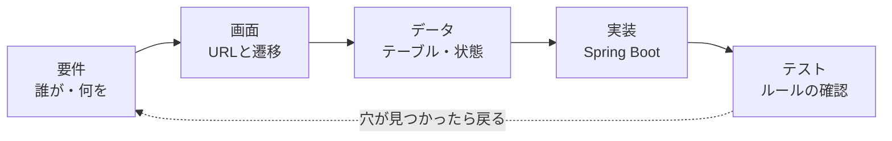
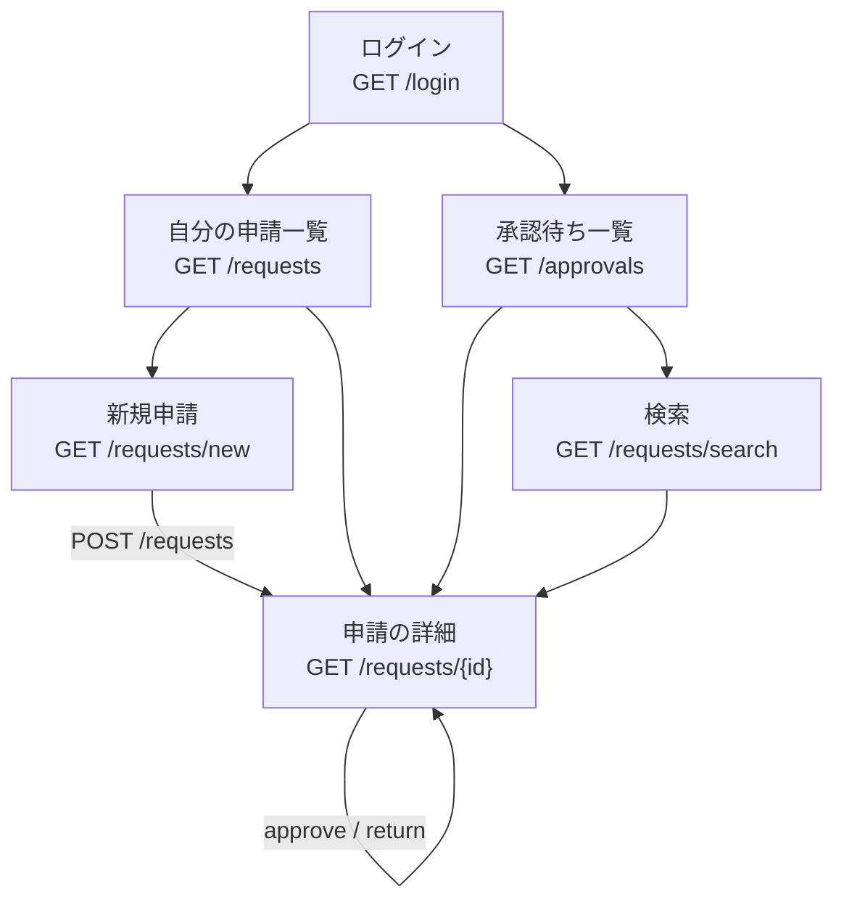
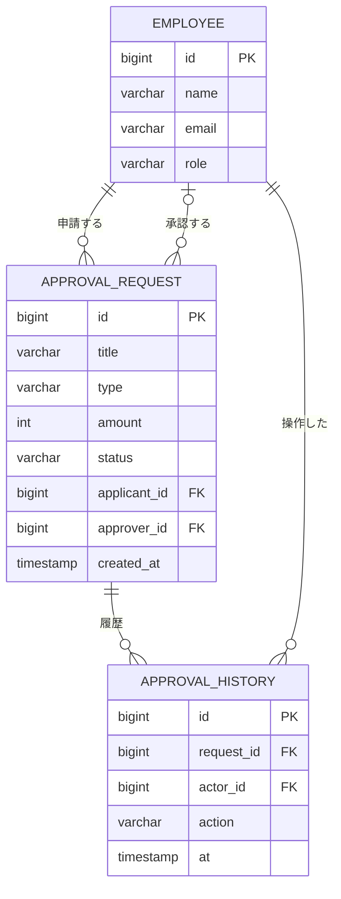
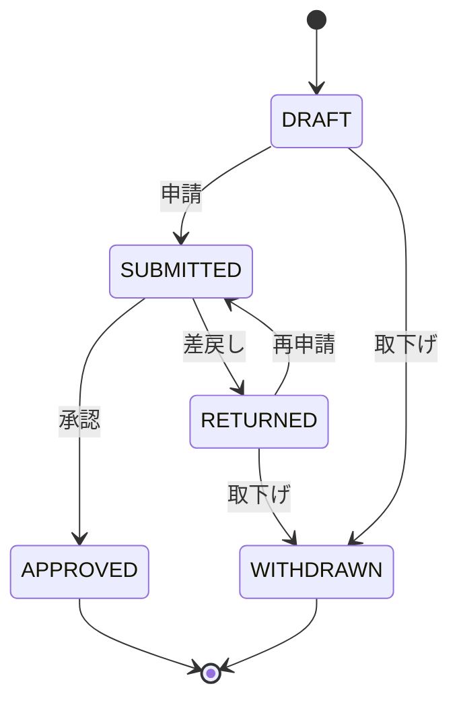

::: haru
第4部は総合演習! いよいよ業務システムっすね。とりあえず Spring Starter Project 作っていいすか?
:::

::: sensei
ストップ。今日はコードを1行も書かない。業務システムで一番高くつくバグは「仕様の勘違い」だ。それは紙の上で潰すのが一番安い。
:::

::: haru
え、今日コード無しっすか……。
:::

::: sensei
最後に演習で enum を1個だけ書いてもらう。設計がそのままコードになる瞬間を見せたいからね。
:::

第4部では、社内の「申請 → 承認/差戻し」を管理するミニ業務システム **承認くん** を、レッスンごとに機能を足しながら完成させます。今回はその設計図を描く回です。

## 業務システムはこの順で作る



- **要件**:誰が(役割)、何を(対象)、どういう流れで(手順)扱うか。
- **画面**:要件を「どのURLで何を見せるか」に落とす。
- **データ**:画面に出す・保存する項目をテーブルにする。**状態** もここで決める。
- **実装 → テスト**:業務ルールをコードにし、テストで守られていることを確かめる。

左から順にしか進めない、という意味ではありません(戻り矢印のとおり)。ただ、**画面とデータが決まらないうちに書いたコードは、ほぼ書き直しになる** のが現場の経験則です。

## 承認くんの要件:誰が・何を・どう流れる

登場人物は3つの **役割(Role)** です。

| Role | 役割 | できること |
|---|---|---|
| `APPLICANT` | 申請者 | 申請・取下げ・再申請 |
| `APPROVER` | 承認者 | 承認・差戻し |
| `ADMIN` | 管理者 | 承認者の権限+高額の承認 |

承認者や管理者も、自分の経費は申請します(だから「自分の申請は承認できない」というルールが要ります)。

申請の種類(`RequestType`)は `EXPENSE`(経費精算)・`LEAVE`(休暇)・`PURCHASE`(備品購入)の3つ。金額 `amount` は経費と備品で必須、休暇では `null` です。

ここから **ユースケース**(利用者がシステムで達成したい1つの目的)を書き出します。

- 申請者が、経費を下書きして申請する
- 申請者が、差し戻された申請を直して再申請する/取り下げる
- 承認者が、承認待ち一覧から申請を開き、承認または差戻しする
- 承認者が、状態・種類・キーワードで申請を検索する

主語と目的語がはっきりした文にするのがコツです。「承認機能」のような名詞だけだと、誰が何をするかが抜けます。

## 画面遷移図:URL まで決める



状態を変える操作はすべて **POST**(`POST /requests/{id}/approve` など)です。GET は「見るだけ」。ブラウザのプリフェッチやリンクの踏み直しで承認されたら事故だからです。

## ER 図:テーブルと関係



(列は一部省略。全項目は CAPSTONE の設計どおり `reason`・`comment`・`submittedAt`・`decidedAt` も持ちます。)

ポイントは **履歴を別テーブルにする** こと。申請テーブルは「今の姿」、履歴テーブルは「いつ誰が何をしたか」。差戻し → 再申請 → 承認と何度も行き来しても、経緯が消えません。監査で「この10万円、誰が通したの?」と聞かれたときに答えられるのは履歴だけです。

## 状態遷移図:enum に写せる形で



この図はそのまま Java の enum になります。STS では `com.example.approval.domain` パッケージの `RequestStatus.java` です。

```java
public enum RequestStatus {
    DRAFT, SUBMITTED, APPROVED, RETURNED, WITHDRAWN;

    public boolean canTransitionTo(RequestStatus next) {
        return switch (this) {
            case DRAFT ->
                next == SUBMITTED || next == WITHDRAWN;
            case SUBMITTED ->
                next == APPROVED || next == RETURNED;
            // 残りは演習で
        };
    }
}
```

なぜ switch **式** なのか。enum の switch 式は全定数を網羅しないとコンパイルエラーになります(`the switch expression does not cover all possible input values`)。将来 `CANCELLED` を足したとき、**遷移を決め忘れた場所をコンパイラが全部教えてくれる** のです。`if` の連鎖だと黙って `false` が返ります。

::: sensei
状態を `boolean approved; boolean returned;` みたいなフラグで持つと、「承認済みかつ差戻し」なんてありえない組み合わせが作れてしまう。enum なら同時に1つの値しか持てない。型で矛盾を防ぐんだ。
:::

## 業務ルールと「仕様の穴」

設計で決めた業務ルールは7つ。第4部の演習の採点対象にもなります。

1. 申請・取下げ・再申請は **申請者本人** だけ
2. 承認・差戻しは `APPROVER` か `ADMIN`。**自分の申請は承認できない**
3. **100,000円以上** の承認は `ADMIN` だけ
4. **差戻しにはコメント必須**(空白だけは不可)
5. `APPROVED` と `WITHDRAWN` は以後変更できない
6. 状態を変える操作は必ず `ApprovalHistory` を1件残す(同じトランザクションで)
7. ルール違反は `BusinessRuleException`(日本語メッセージ)

ルールを書いたら、**境界と例外ケースを突っついて穴を探します**。

| 穴(質問) | 承認くんの答え |
|---|---|
| ちょうど10万円は? | 「以上」なので ADMIN。`>=` で比べる |
| 再申請の承認者は? | 指名しない。承認待ちに戻り、誰が承認してもよい |
| 申請中に取り下げたい | 図に矢印がない。差し戻してもらってから取下げ |
| ADMIN 自身の高額申請 | ルール2で本人は不可。別の ADMIN が承認 |
| 休暇の金額は? | `null`。ルール3の対象外 |

「再申請の承認者」の答えから、`approver` 列は「担当者」ではなく **最後に判断した人** だと決まります。前回差し戻した人と今回承認した人が違っても、経緯は履歴テーブルに残るので問題ありません。こうして穴を1つ塞ぐたびに、列の意味がはっきりしていきます。

::: haru
「ちょうど10万円」なんて、言われなきゃ気づかないっすね。
:::

::: sensei
だから設計レビューでは「ちょうど」「空っぽ」「本人」「2回目」を必ず聞く。この4つでたいていの穴は見つかる。
:::

## 第3部の知識マップ

| 第4部 | 作るもの | 使う第3部の知識 |
|---|---|---|
| setup | エンティティ・初期データ | Spring Data JPA・設定 |
| apply | 申請フォームと一覧 | Controller・Thymeleaf・バリデーション |
| approve | 承認・差戻し | 層分け・トランザクション |
| search | 検索とページング | Spring Data JPA |
| security | ログインとロール | Spring Security |
| api-test | REST API とテスト | REST・例外処理・MockMvc |
| release | 仕上げ | 例外処理・プロファイル・ログ |

新しい技術はほぼ出てきません。第4部は「知っている部品を、業務ルールに沿って組み立てる」練習です。

## よくあるミス

::: warn 画面だけでルールを守る
「承認ボタンは承認者にしか表示しない」だけでは不十分です。`POST /requests/5/approve` は curl でも送れます。ボタンの出し分けは親切、**ルールの本体は Service で必ずチェック** します(capstone-approve で実装)。
:::

::: warn 状態チェックを if で散らかす
Controller・Service・画面のあちこちに `if (status == SUBMITTED || ...)` を書くと、遷移を1本足したときに直し漏れます。遷移の可否は `RequestStatus.canTransitionTo` の1か所に集めます。
:::

::: point まとめ
- 業務システムは 要件 → 画面 → データ → 実装 → テスト の順で考える(戻ってよい)
- 状態遷移図は enum + switch 式にそのまま写せる。網羅チェックが味方になる
- 申請は「今の姿」、履歴は「経緯」。テーブルを分ける
- 「ちょうど」「空っぽ」「本人」「2回目」で仕様の穴を探す
:::
