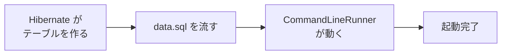

::: haru
設計図はできた! 今日こそ Spring Starter Project っすね。依存は全部チェック入れときます!
:::

::: sensei
全部はやめとけ。Spring Security を今入れると、全画面がいきなりログイン必須になって H2 コンソールすら開けなくなる。依存は「今使うもの」だけだ。
:::

今回は承認くんの土台を作ります。プロジェクト作成 → 設定 → エンティティ → Repository → 初期データ → H2 コンソールで確認、までです。画面はまだ作りません。

## プロジェクトを作る:依存は今使うものだけ

STS の **File > New > Spring Starter Project** で、設計どおりに作ります。

| 項目 | 値 |
|---|---|
| Name | `approval-app` |
| Group / Package | `com.example` / `com.example.approval` |
| Java / Type | 21 / Maven |

依存はこの6つ。Spring Security は capstone-security で `pom.xml` に足します。

| 依存 | 何に使う | 本格的に使う回 |
|---|---|---|
| Spring Web | Controller・REST | apply・api-test |
| Thymeleaf | 画面のテンプレート | apply |
| Validation | 入力チェック | apply |
| Spring Data JPA | エンティティ・Repository | 今回 |
| H2 Database | 組み込み DB | 今回 |
| DevTools | 保存で自動再起動 | ずっと |

## パッケージ構成

```text
com.example.approval
├─ ApprovalAppApplication.java  ← 起動クラス
├─ domain      エンティティ・enum・例外
├─ repository  Spring Data の Repository
├─ service     業務ルール(approve で作る)
├─ web         画面の Controller
│   └─ api     REST API
└─ config      設定クラス
```

**起動クラスより下にパッケージを置く** のが絶対ルールです。`@SpringBootApplication` は自分のパッケージ以下だけをコンポーネントスキャンし、エンティティと Repository も同じ範囲から探します。`com.example.domain` のように外に出すと、`Not a managed type` や「Repository の Bean が見つからない」で起動に失敗します。

## application.yml:H2 はファイルモード

`src/main/resources/application.properties` を `application.yml` にリネームして書きます。

```yaml
spring:
  datasource:
    url: jdbc:h2:file:./data/approval
    username: sa
    password: ""
  h2:
    console:
      enabled: true
  jpa:
    hibernate:
      ddl-auto: update
    show-sql: true
    defer-datasource-initialization: true
  sql:
    init:
      mode: always
      encoding: UTF-8
```

- `jdbc:h2:file:./data/approval`:プロジェクト直下の `data/approval.mv.db` に保存。再起動してもデータが残ります。
- `ddl-auto: update`:エンティティを見て、**足りないテーブル・列だけ** 作ります。既存の列の型は変えず、列の削除もしません。
- `defer-datasource-initialization`:`data.sql` を、Hibernate がテーブルを作った **後** に流します。
- `sql.init.mode: always`:Spring Boot は既定では **メモリモードの組み込み DB にしか** `data.sql` を流しません。ファイルモードなので明示します。

::: genba ddl-auto の方針
開発中は `update` で楽をし、本番は `validate`(エンティティと表が食い違えば起動を止める)か `none` にして、テーブルの変更は Flyway などの **マイグレーションツール** の SQL で管理するのが定番です。`update` は列の削除も型変更もしないので、本番の構造を任せられません。
:::

## エンティティ:状態は文字列で、関連は LAZY で

中心の `ApprovalRequest`(`domain/ApprovalRequest.java`)です。getter は省略しています。

```java
@Entity
public class ApprovalRequest {
    @Id
    @GeneratedValue(strategy = GenerationType.IDENTITY)
    private Long id;

    @Column(nullable = false, length = 100)
    private String title;

    @Enumerated(EnumType.STRING)
    @Column(nullable = false, length = 20)
    private RequestType type;

    private Integer amount;          // LEAVE では null

    @Enumerated(EnumType.STRING)
    @Column(nullable = false, length = 20)
    private RequestStatus status = RequestStatus.DRAFT;

    @ManyToOne(fetch = FetchType.LAZY, optional = false)
    @JoinColumn(name = "applicant_id")
    private Employee applicant;

    @ManyToOne(fetch = FetchType.LAZY)
    @JoinColumn(name = "approver_id")
    private Employee approver;       // 決まるまで null

    @Column(nullable = false, updatable = false)
    private LocalDateTime createdAt;
    // reason・comment・submittedAt・decidedAt も同様

    protected ApprovalRequest() { }  // JPA 用

    @PrePersist
    void onCreate() {
        if (createdAt == null) {
            createdAt = LocalDateTime.now();
        }
    }
}
```

**なぜ `@Enumerated(EnumType.STRING)` か**。付けないと既定の `ORDINAL` になり、enum の **宣言順の番号**(DRAFT=0, SUBMITTED=1…)が保存されます。後で誰かが `DRAFT` と `SUBMITTED` の間に定数を1つ足すと、既存の「1」の意味が一斉に変わります。データは1バイトも変わっていないのに、申請中だった申請が別の状態として表示されるのです。`STRING` なら `'SUBMITTED'` という名前で入るので、並びを変えても壊れません。

::: haru
番号の方が DB の容量は小さくて済むんじゃ……?
:::

::: sensei
数バイトをケチって、データの意味が壊れるリスクを買うのか? それに SQL で `WHERE status = 'SUBMITTED'` と読めるのは、障害調査のときに本当に効く。
:::

`@ManyToOne` は既定が **EAGER**(申請を読むたびに社員も必ず読む)です。一覧画面で無駄な SELECT が増えるので LAZY を明示します。`@PrePersist` は INSERT の直前に Hibernate が呼ぶメソッドで、作成日時の入れ忘れを防ぎます。

`Employee`(`name`・`email`・`role`)と `ApprovalHistory`(`request`・`actor`・`action`・`comment`・`at`)も同じパターンで書きます(全文は STS の手順に載せています)。テーブル名と列名は、Spring Boot の命名規則でキャメルケースがスネークケースになり、`approval_request` や `created_at` になります。

## Repository:画面ごとの検索を名前で宣言

```java
public interface ApprovalRequestRepository
        extends JpaRepository<ApprovalRequest, Long> {

    // 自分の申請一覧(新しい順)
    List<ApprovalRequest> findByApplicantOrderByCreatedAtDesc(
            Employee applicant);

    // 承認待ち一覧(待たせている順)
    List<ApprovalRequest> findByStatusOrderBySubmittedAtAsc(
            RequestStatus status);

    // 件数バッジ
    long countByStatus(RequestStatus status);
}
```

`EmployeeRepository` には `Optional<Employee> findByEmail(String email)`(ログインで使う)、`ApprovalHistoryRepository` には `findByRequestOrderByAtAsc(ApprovalRequest request)`(詳細画面の履歴)を宣言します。

関連は **エンティティそのもの** で絞れます。`findByApplicant(haru)` は `where applicant_id = ?` になります。承認待ちを古い順にするのは「待たせている人から片づける」ためで、これも画面から逆算した仕様です。

## 初期データ:data.sql と CommandLineRunner

`src/main/resources/data.sql` に社員3人を入れます。

```sql
MERGE INTO employee (name, email, role) KEY (email) VALUES
  ('ハル', 'haru@example.com', 'APPLICANT'),
  ('モカ', 'moka@example.com', 'APPROVER'),
  ('ボス', 'boss@example.com', 'ADMIN');
```

起動時の順番はこうです。`defer-datasource-initialization: true` が、最初の2つの順序(テーブルが先)を決めています。



ファイルモードでは `data.sql` が **起動のたびに** 流れます。`INSERT` だと2回目の起動で同じ社員が増えるので、H2 の `MERGE ... KEY(email)`(同じ email があれば更新、なければ追加)にしています。

動作確認は起動クラスに `CommandLineRunner` を足します(コードは STS の手順)。2回目の起動では申請が増えず、こう出れば成功です。

```text
社員: ハル / APPLICANT
社員: モカ / APPROVER
社員: ボス / ADMIN
申請: 客先訪問の交通費 / DRAFT / 2026-10-11T09:48:15.78
```

## H2 コンソールで中身を見る

起動中に `http://localhost:8080/h2-console` を開き、**JDBC URL を `jdbc:h2:file:./data/approval` に書き換えて** 接続します。`SELECT * FROM APPROVAL_REQUEST;` で、`STATUS` 列に `DRAFT` が文字列で入っていることを確かめてください。

## よくあるミス

::: warn data.sql が流れない・早すぎる
`sql.init.mode` を書き忘れると、`data.sql` は **黙って無視** されます。`findByEmail(...).orElseThrow()` が `NoSuchElementException: No value present` で落ちて初めて気づきます。逆に `defer-datasource-initialization` を忘れると、テーブル作成より先に流れて `Table "EMPLOYEE" not found (this database is empty)` です。
:::

::: warn enum に定数を足したら INSERT が通らない
Hibernate は H2 の `STATUS` 列を `enum ('APPROVED','DRAFT',...)` 型で作ります。後で `Role` に `AUDITOR` を足しても `update` は既存の列を変えないので、`Value not permitted for column "('ADMIN', 'APPLICANT', 'APPROVER')": "AUDITOR"` になります。開発中なら停止して `data` フォルダを消せば作り直されます。
:::

::: point まとめ
- 依存は今使うものだけ。パッケージは起動クラスの下に
- H2 ファイルモードでは `ddl-auto`・`sql.init.mode`・`defer-datasource-initialization` を明示する
- enum は `@Enumerated(EnumType.STRING)`、`@ManyToOne` は LAZY、作成日時は `@PrePersist`
- Repository は画面ごとの検索を派生クエリで宣言し、関連はエンティティで絞る
:::
