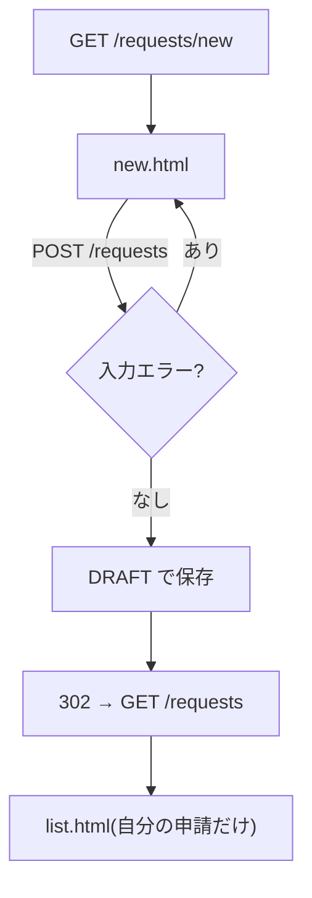

::: haru
エンティティも初期データもできました! 今日はいよいよ申請画面っすね。
:::

::: sensei
第3部のフォームとバリデーションの総復習だ。ただし今回は「金額は種類によって必須」という、業務システムらしいルールが1つ混ざる。
:::

## 今回作るもの

申請者が **下書きを登録** し、**自分の申請の一覧** を見られるところまで作ります。STS のプロジェクト `approval-app` に足すファイルはこれだけです。

| ファイル | パッケージ | 役割 |
|---|---|---|
| `RequestForm.java` | `web` | 入力欄とチェック |
| `RequestController.java` | `web` | URL と画面 |
| `RequestService.java` | `service` | 保存と検索 |
| `new.html` / `list.html` | `templates/requests` | 画面 |

(パッケージはすべて `com.example.approval.` の下。テンプレートは `src/main/resources/templates/requests/` に置きます。)



## 設計の考え方:誰が何を決めるか

- **フォーム**(`RequestForm`)は画面の入力欄だけを持つ。`status` や `applicant` の欄は **作らない**。作るとパラメータに `status=APPROVED` を足すだけで「承認済み」の申請が作れてしまいます(マスアサインメント)。
- **状態と申請者は Service が決める**。新規は必ず `DRAFT`、申請者は「ログイン中の人」。
- **ログインはまだ無い**。当面は Controller の定数 `CURRENT_EMPLOYEE_ID = 1L`(初期データの社員の id)で代用し、capstone-security で **ログインユーザーに置き換え** ます。

::: sensei
仮の実装は「どこが仮か」を1か所に閉じ込めるのがコツ。定数1個なら、後で置き換える場所を grep で一発で探せる。
:::

## RequestForm:入力ルールと相関チェック

`com.example.approval.web.RequestForm` です(getter / setter は **Source > Generate Getters and Setters** で生成)。

```java
public class RequestForm {
    @NotBlank(message = "件名を入力してください")
    @Size(max = 50,
          message = "件名は50文字以内で入力してください")
    private String title;

    @NotNull(message = "種類を選んでください")
    private RequestType type;

    @Min(value = 1,
         message = "金額は1円以上で入力してください")
    private Integer amount;

    @NotBlank(message = "理由を入力してください")
    private String reason;

    @AssertTrue(
        message = "経費精算・備品購入は金額が必須です")
    public boolean isAmountEntered() {
        if (type == null || !type.requiresAmount()) {
            return true; // 未選択は @NotNull の担当
        }
        return amount != null;
    }

    public ApprovalRequest toEntity() {
        ApprovalRequest r = new ApprovalRequest();
        r.setTitle(title);
        r.setType(type);
        r.setAmount(type.requiresAmount() ? amount : null);
        r.setReason(reason);
        return r;
    }
}
```

金額は「経費精算・備品購入なら必須、休暇なら不要」。**他の項目(type)の値で必須かどうかが変わる** ので、フィールドに `@NotNull` は付けられません。こういう複数項目にまたがるチェックが **相関チェック** です。`@AssertTrue` を付けた `isAmountEntered()` は、Bean Validation から `amountEntered` という項目として検証されます。

`RequestType` には、domain パッケージで表示名と判定メソッドを足しておきます。

```java
public enum RequestType {
    EXPENSE("経費精算"), LEAVE("休暇"),
    PURCHASE("備品購入");
    // label フィールドとコンストラクタは省略
    public String label() { return label; }
    public boolean requiresAmount() {
        return this != LEAVE;
    }
}
```

`RequestStatus` にも同じく `label()`(下書き・申請中・承認済・差戻し・取下げ)を持たせます。

## Service:DRAFT で保存し、自分の申請だけ返す

`com.example.approval.service.RequestService` です。

```java
@Service
@Transactional
public class RequestService {
    private final ApprovalRequestRepository requests;
    private final EmployeeRepository employees;
    // コンストラクタ(2つを受け取る)は省略

    public ApprovalRequest createDraft(
            Long applicantId, ApprovalRequest r) {
        Employee me = employees.findById(applicantId)
            .orElseThrow(() -> new BusinessRuleException(
                "社員が見つかりません"));
        r.setApplicant(me);
        r.setStatus(RequestStatus.DRAFT);
        r.setCreatedAt(LocalDateTime.now());
        return requests.save(r);
    }

    @Transactional(readOnly = true)
    public List<ApprovalRequest> findMine(Long id) {
        return requests
            .findByApplicantIdOrderByCreatedAtDesc(id);
    }
}
```

`findByApplicantIdOrderByCreatedAtDesc` は Spring Data JPA の **派生クエリ** です。`ApplicantId` は「`applicant` の `id`」とプロパティをたどって解釈されます。`ApprovalRequestRepository` に宣言を1行足すだけで、SQL は書きません。

::: genba Service がフォームを知らない理由
`createDraft(Long, RequestForm)` にしたくなりますが、そうすると service が web に依存します。REST API(capstone-api-test)から同じ処理を呼ぶとき、JSON 用のクラスを RequestForm に詰め直す羽目に。依存は **web → service → domain** の一方向に保ちます。
:::

## Controller:3つのハンドラと PRG

```java
@Controller
@RequestMapping("/requests")
public class RequestController {
    // TODO capstone-security でログインユーザーに置き換え
    static final Long CURRENT_EMPLOYEE_ID = 1L;
    private final RequestService requestService;
    // コンストラクタは省略

    @ModelAttribute("types")
    public RequestType[] types() {
        return RequestType.values();
    }

    @GetMapping
    public String list(Model model) {
        model.addAttribute("requests",
            requestService.findMine(CURRENT_EMPLOYEE_ID));
        return "requests/list";
    }

    @GetMapping("/new")
    public String newForm(Model model) {
        model.addAttribute("requestForm",
            new RequestForm());
        return "requests/new";
    }

    @PostMapping
    public String create(
            @Validated @ModelAttribute RequestForm form,
            BindingResult result, RedirectAttributes ra) {
        if (result.hasErrors()) {
            return "requests/new";
        }
        ApprovalRequest saved = requestService.createDraft(
            CURRENT_EMPLOYEE_ID, form.toEntity());
        ra.addFlashAttribute("message",
            "下書きを保存しました(No." + saved.getId() + ")");
        return "redirect:/requests";
    }
}
```

`@ModelAttribute` を **メソッド** に付けると、このクラスの **全ハンドラの前に呼ばれて** 戻り値が Model に入ります。種類の選択肢をここで入れておけば、入力エラーで `requests/new` を返したときも選択肢が消えません。

## 画面:new.html と list.html

`new.html` の要所です(全文は「STSでやってみよう」)。

```html
<select th:field="*{type}">
  <option value="">選択してください</option>
  <option th:each="t : ${types}" th:value="${t}"
          th:text="${t.label()}">経費精算</option>
</select>
<span th:errors="*{type}" class="err"></span>
<input type="number" th:field="*{amount}">
<span th:errors="*{amountEntered}" class="err"></span>
```

- `th:value="${t}"` は enum の名前(`EXPENSE`)を送り、表示は `label()`。名前と表示を分けておけば、表示名を変えても DB の値は変わりません。
- 「選択してください」の空文字は、Spring が enum へ変換するとき `null` になり、`@NotNull` が働きます。
- `th:errors` はエラーが無いと **タグごと消える** ので、`th:if` を書かなくても空の span は残りません。

`list.html` では状態を日本語で出します。

```html
<tr th:each="r : ${requests}">
  <td th:text="${r.title}">交通費</td>
  <td th:text="${r.status.label()}">下書き</td>
</tr>
```

`${r.status}` のままだと画面に `DRAFT` と出ます。利用者にとって enum の名前は意味不明な英単語です。

## よくあるミス

::: warn エラーで戻ると選択肢が空
`types` を `newForm` の中だけで `addAttribute` していると、POST でエラーになったとき Model に入っておらず、セレクトボックスが「選択してください」だけになります。`@ModelAttribute` メソッドにすれば全ハンドラで入ります。
:::

::: warn enum に @NotBlank
コンパイルは通り、**最初に検証したとき** 落ちます。

```text
jakarta.validation.UnexpectedTypeException: HV000030:
No validator could be found for constraint
'jakarta.validation.constraints.NotBlank'
validating type '...RequestType'.
```

`@NotBlank` は文字列専用。enum や数値の必須は `@NotNull` です。
:::

::: warn 一覧に他人の申請が出る
`findAll()` で全件出すのは、テストデータが自分の分しか無いと気づけません。初期データに **別の社員の申請を1件入れて** 確認するのが鉄則です。
:::

::: point まとめ
- フォームは入力欄だけ。**状態と申請者は Service が決める**(新規は `DRAFT`)
- 他の項目で必須が変わるルールは **`@AssertTrue` の相関チェック**
- 依存は **web → service → domain**。フォームからエンティティへの詰め替えは web 側で
- 選択肢など全画面で要るものは **`@ModelAttribute` メソッド** で Model へ
- 成功したら **PRG**、一覧は **自分の申請だけ**。ログインの代わりの固定IDは capstone-security で置き換える
:::

::: sensei
次は承認・差戻し。今日の DRAFT が SUBMITTED → APPROVED と動き出す。業務ルールの本番だ。
:::
