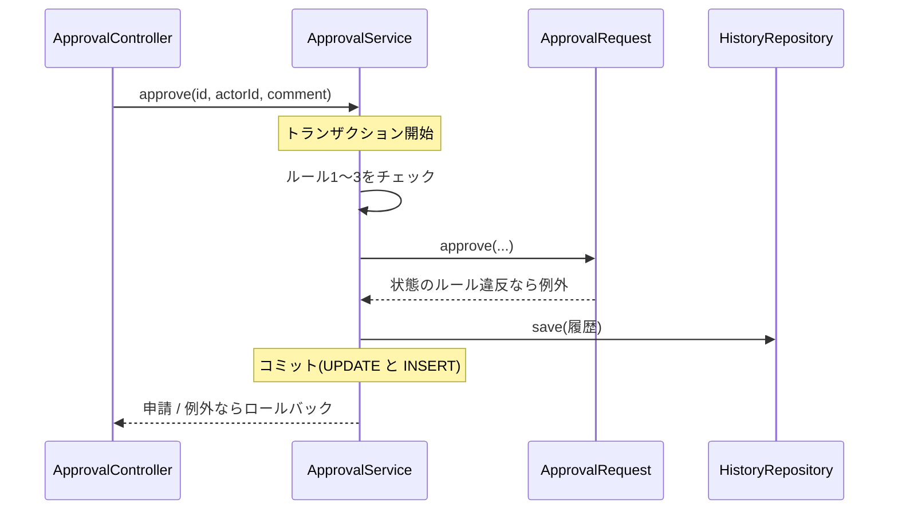

::: haru
申請は下書きで保存できました! 承認ボタンは `status = APPROVED` って代入するだけっすよね?
:::

::: sensei
その1行の前後に、業務ルールが7つぶら下がってる。どれを、どこで守るか。今日は承認くんの心臓部だ。
:::

## 今回作るもの

下書きを **申請** し、承認者が **承認・差戻し**、申請者が **取下げ** できるようにします。操作のたびに履歴が残ります。

| ファイル | パッケージ | 役割 |
|---|---|---|
| `ApprovalRequest.java` | `domain` | 状態を変えるメソッド・`@Version` |
| `ApprovalService.java` | `service` | 業務ルールと履歴 |
| `ApprovalController.java` | `web` | 承認待ち一覧・承認/差戻し |
| `detail.html` ほか | `templates` | 詳細画面のボタン |

申請・取下げ(`POST /requests/{id}/submit`・`/withdraw`)と詳細画面(`GET /requests/{id}`)は、前回の `RequestController` に足します。

## 業務ルールをどこで守るか

| ルール | 守る場所 | 理由 |
|---|---|---|
| 4 差戻しはコメント必須 | エンティティ | 申請自身のデータで判定できる |
| 5 確定後は変更不可 | エンティティ | 状態の整合性そのもの |
| 1・2・3 誰が操作できるか | Service | 操作する人(ログイン情報)が要る |
| 6 履歴を残す | Service | 別テーブルへの保存とトランザクション |

判断の基準は **「申請が自分のデータだけで判定できるか」** です。状態の矛盾(承認済みを取り下げる)は、どの画面・API から呼ばれても起きてはいけないので、エンティティ自身が例外で拒否します。「誰が」は操作する人の情報が必要なので Service の担当です(capstone-security では、この「誰が何をできるか」を `AccessPolicy` として整理します)。

::: sensei
エンティティに setter しかないと、Service のどこかで `setStatus(APPROVED)` を書けば何でも通る。状態を変える入口をメソッドに絞ると、ルールの抜け道がなくなるんだ。
:::

## エンティティ:状態の変え方を自分で守る

capstone-requirements の `ApprovalFlow.next`(遷移できなければ例外)を使います。`ApprovalRequest` の `setStatus` は消しておきます。

```java
public void approve(Employee approver, String comment,
                    LocalDateTime now) {
    status = ApprovalFlow.next(status, Action.APPROVE);
    decide(approver, comment, now);
}

public void returnBack(Employee approver, String comment,
                       LocalDateTime now) {
    if (comment == null || comment.isBlank()) {
        throw new BusinessRuleException(
            "差戻しにはコメントが必要です");
    }
    status = ApprovalFlow.next(status, Action.RETURN);
    decide(approver, comment, now);
}
// submit(now) と withdraw() も同じ形。decide は
// approver・comment・decidedAt を代入するだけ
```

チェックを **全部済ませてから代入** するのがポイント。途中で例外が出ても、中途半端な状態が残りません。`return` は予約語なので、メソッド名は `returnBack` です。

## ApprovalService:誰がやってよいかと履歴

`com.example.approval.service.ApprovalService` です。

```java
@Service
@Transactional
public class ApprovalService {
    // requests・employees・histories の3つの
    // Repository をコンストラクタで受け取る(省略)

    public ApprovalRequest approve(Long requestId,
            Long actorId, String comment) {
        ApprovalRequest r = findRequest(requestId);
        Employee actor = findEmployee(actorId);
        requireApprover(actor);                // ルール2
        if (r.getApplicant().getId()
                .equals(actor.getId())) {
            throw new BusinessRuleException(
                "自分の申請は承認できません");
        }
        if (ApprovalFlow.requiresAdmin(r.getAmount())
                && actor.getRole() != Role.ADMIN) {
            throw new BusinessRuleException(  // ルール3
                "100,000円以上の申請は管理者しか承認できません");
        }
        LocalDateTime now = LocalDateTime.now();
        r.approve(actor, comment, now);        // ルール4・5
        histories.save(new ApprovalHistory(    // ルール6
            r, actor, Action.APPROVE, comment, now));
        return r;
    }
}
```

`submit`・`returnBack`・`withdraw` も「探す → 誰かを確かめる → エンティティを呼ぶ → 履歴」の同じ並びです(コードは「STSでやってみよう」)。時刻を1回だけ取ってエンティティと履歴に渡すので、両者の日時がずれません。

`r` を `save` していないのに気づきましたか? トランザクションの中で取得したエンティティは JPA が **管理状態** にしていて、コミット時に変更を検出して UPDATE を出します(**ダーティチェック**)。

## @Transactional:状態と履歴は一蓮托生



クラスに付けた `@Transactional` で、全メソッドが1つのトランザクションになります。状態の UPDATE と履歴の INSERT は **両方成功するか、両方なかったことになるか** のどちらか。「承認済みなのに履歴が無い」はありえません(ルール6)。

Spring がロールバックするのは、既定では **RuntimeException(と Error)** が外へ出たときだけ。チェック例外ならコミットされます。`BusinessRuleException` を `RuntimeException` にしたのはこのためです(ルール7)。

## 画面:承認待ち一覧とボタン

`ApprovalController`(`web`)は、`GET /approvals` で `SUBMITTED` の申請を一覧にし、承認と差戻しを受けます。

```java
@PostMapping("/requests/{id}/approve")
public String approve(@PathVariable Long id,
        @RequestParam(required = false) String comment,
        RedirectAttributes ra) {
    try {
        approvalService.approve(
            id, CURRENT_APPROVER_ID, comment);
        ra.addFlashAttribute("message", "承認しました");
    } catch (BusinessRuleException e) {
        ra.addFlashAttribute("error", e.getMessage());
    } catch (ObjectOptimisticLockingFailureException e) {
        ra.addFlashAttribute("error",
            "他の人が先に操作しました。開き直してください");
    }
    return "redirect:/requests/" + id;
}
```

ルール違反は例外のメッセージをそのまま画面へ。2つ目の catch は後で説明する楽観ロックの失敗です。

`CURRENT_APPROVER_ID` は前回と同じく **ログインの代わりの固定ID**(初期データの承認者)で、capstone-security で置き換えます。詳細画面のボタンは状態で出し分けます。

```html
<form th:if="${req.status.name() == 'SUBMITTED'}"
      th:action="@{/requests/{id}/approve(id=${req.id})}"
      method="post">
  <input type="text" name="comment">
  <button>承認</button>
  <button th:formaction=
      "@{/requests/{id}/return(id=${req.id})}">差戻し</button>
</form>
```

ボタンを隠すのは **親切**、ルールを守るのは **Service**。POST は curl でも送れるからです。

## 二重承認と楽観ロック

太郎と部長が同じ申請を同時に承認したら? 両方のトランザクションが「申請中」を読めば、ルール5のチェックは両方とも通ります。結果は承認2回・履歴2件です。

これを防ぐのが **楽観ロック**。エンティティにバージョン番号の列を足すだけです。

```java
@Version
private Long version;
```

JPA は UPDATE に `WHERE id=? AND version=?`(読んだときの番号)を付け、成功したら番号を1増やします。後から来た方は更新 **0件** になり、Spring は `ObjectOptimisticLockingFailureException` を投げてロールバックします。もちろん履歴の INSERT も消えます。

::: trivia 楽観と悲観
「めったにぶつからない」と楽観して、ぶつかったときだけ失敗させるのが楽観ロック。`SELECT ... FOR UPDATE` で先に行をロックして待たせるのが悲観ロック。承認のように衝突がまれな業務は楽観ロックが定番です。
:::

## よくあるミス

::: warn 履歴を先に保存する
`histories.save(...)` を `r.approve(...)` より前に書くと、承認が例外で失敗しても「承認した」履歴が先に保存されます。トランザクションがあればロールバックで消えますが、それは保険。`@Transactional` を付け忘れた瞬間に「承認していないのに承認した」履歴が残ります。**成功した後に記録** が筋です。
:::

::: warn チェック例外でロールバックされない
`BusinessRuleException extends Exception` にすると、例外が出ても **コミット** されます(`rollbackFor` を指定しない限り)。業務ルール違反は RuntimeException で表します。
:::

::: warn 同じクラスの中から呼ぶ
メソッド単位で `@Transactional` を付けたクラスで、付いていないメソッドから `this.approve(...)` を呼んでもトランザクションは始まりません。`@Transactional` は Spring が作る **プロキシ** を通った呼び出しにだけ効き、`this` の呼び出しはプロキシを通らないからです。
:::

::: point まとめ
- 状態のルール(4・5)は **エンティティ**、誰がのルール(1〜3)と履歴(6)は **Service**
- 状態を変える入口は `approve` などのメソッドだけ。チェックを済ませてから代入
- `@Transactional` で **状態の変更と履歴を1つのトランザクションに**。RuntimeException でロールバック
- ボタンの出し分けは親切、ルールの本体は Service
- 同時操作は **`@Version` の楽観ロック** で防ぐ
:::

::: sensei
次は検索とページング。承認者が「今月の10万円以上の経費」を探せるようにするよ。
:::
