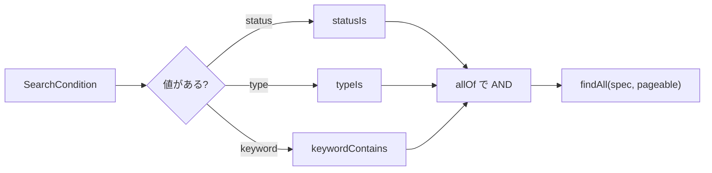

::: haru
申請が300件を超えて、承認待ち一覧のスクロールがつらいっす。「出張」で探したいだけなのに!
:::

::: sensei
今日は検索とページングを付けよう。地味だけど業務システムで一番使われる画面で、一番 SQL 事故が起きる画面でもある。
:::

## 今回作るもの

承認者向けの検索画面 **`GET /requests/search`** です。

- 条件は **状態(status)・種類(type)・キーワード(keyword)**。キーワードは件名か理由の部分一致。**すべて任意** で、空なら絞り込まない
- 結果は1ページ20件、新しい順。「全 N 件中 X〜Y 件目」と「前へ/次へ」
- 条件とページは URL に残す(`/requests/search?status=SUBMITTED&keyword=出張&page=1`)

| ファイル(`com.example.approval` 配下) | 役割 |
|---|---|
| `service/SearchCondition.java` | 検索条件 |
| `repository/ApprovalRequestSpecs.java` | 条件の部品 |
| `repository/ApprovalRequestRepository.java` | 検索メソッドを追加 |
| `service/RequestSearchService.java` | 条件を組み立てる |
| `web/PagingParams.java` | page・size・sort の検査 |
| `web/RequestSearchController.java` | 画面の入口 |
| `templates/requests/search.html` | 画面 |

`SearchCondition` を `web` でなく `service` に置くのは、Service が画面のパッケージに依存しないようにするためです(REST API からも同じ条件で検索できます)。

## 設計①:任意条件をどう組み立てるか

派生クエリで書こうとすると、3つの条件それぞれ「使う/使わない」で **2³ = 8 本** のメソッドが要ります。`findByStatusAndTypeAndTitleContaining`、`findByStatusAndType`、`findByType`……。条件が1つ増えるたびに倍になる、**組み合わせ爆発** です。

| 方法 | 向いている所 | 弱点 |
|---|---|---|
| JPQL で `(:s is null or r.status = :s)` | 1メソッドで済む | 条件が増えると読めない |
| Query by Example | 完全一致の検索 | OR・範囲・関連先が苦手 |
| **Specification** | 条件を部品にしてつなぐ | Criteria API に慣れが要る |

承認くんは **Specification** を使います。`Specification<T>` は、JPA 標準の **Criteria API**(クエリを Java のオブジェクトで組み立てる API)の条件(`Predicate`)を作る関数を1つの型にしたものです。理由は3つ。

1. **条件1つ = メソッド1つ**。単体で読めて、名前で意味が分かる
2. 「指定されたときだけ足す」を Java の `if` で素直に書ける
3. 「金額◯円以上」を足すときも、部品を1つ増やすだけで既存のコードは触らない



## 設計②:ページングとソート

- **`Pageable`** は「何ページ目を・何件ずつ・どの順で」という要求。実装は `PageRequest.of(page, size, sort)`。**page は 0 始まり** です
- **`Page<T>`** は結果。中身(`getContent()`)に加えて総件数・総ページ数・`hasNext()` を持ちます。総件数を知るため **count クエリをもう1回** 発行します(要らなければ `Slice`)
- **size には上限を付けます**。`size=100000` を送られると10万行を読み込んで DB とメモリを圧迫するからです。承認くんは 1〜50
- **sort は許可した項目だけ**。何でも受け付けると、存在しない項目で 500 エラー、見せたくない項目で並べ替えられて値を推測される、が起きます
- 既定は **`createdAt` の降順**、2番目のキーに **`id` の降順**。SQL の `ORDER BY` は同じ値の行の順番を保証しないので、日時が同じ行があるとページをまたいで重複・抜けが出ます。一意なキーを最後に足して順番を固定します

## STS での実装

### 条件の部品(Specification)

Repository に `JpaSpecificationExecutor` を足すと、`findAll(spec, pageable)` が使えます。

```java
// repository/ApprovalRequestRepository.java
public interface ApprovalRequestRepository
        extends JpaRepository<ApprovalRequest, Long>,
                JpaSpecificationExecutor<ApprovalRequest> {

    @Override
    @EntityGraph(attributePaths = "applicant")
    Page<ApprovalRequest> findAll(
            Specification<ApprovalRequest> spec,
            Pageable pageable);
}
```

```java
// repository/ApprovalRequestSpecs.java
public final class ApprovalRequestSpecs {
    private ApprovalRequestSpecs() {}

    public static Specification<ApprovalRequest>
            statusIs(RequestStatus s) {
        return (root, q, cb) ->
                cb.equal(root.get("status"), s);
    }

    public static Specification<ApprovalRequest>
            typeIs(RequestType t) {
        return (root, q, cb) ->
                cb.equal(root.get("type"), t);
    }

    public static Specification<ApprovalRequest>
            keywordContains(String kw) {
        String p =
            "%" + escape(kw.strip().toLowerCase()) + "%";
        return (root, q, cb) -> cb.or(
            cb.like(cb.lower(root.get("title")), p, '\\'),
            cb.like(cb.lower(root.get("reason")), p, '\\'));
    }

    // % と _ を「ただの文字」にする
    private static String escape(String s) {
        return s.replace("\\", "\\\\")
                .replace("%", "\\%").replace("_", "\\_");
    }
}
```

### Service と Controller

```java
// service/RequestSearchService.java
@Service
@Transactional(readOnly = true)
public class RequestSearchService {
    private final ApprovalRequestRepository repo;
    // コンストラクタは省略

    public Page<ApprovalRequest> search(
            SearchCondition c, Pageable pageable) {
        var specs = new ArrayList<
                Specification<ApprovalRequest>>();
        if (c.getStatus() != null)
            specs.add(statusIs(c.getStatus()));
        if (c.getType() != null)
            specs.add(typeIs(c.getType()));
        if (c.hasKeyword())
            specs.add(keywordContains(c.getKeyword()));
        return repo.findAll(
                Specification.allOf(specs), pageable);
    }
}
```

`allOf` は空のリストなら「条件なし(全件)」になります。`SearchCondition` は `status`・`type`・`keyword` のフィールドと getter/setter、`hasKeyword()`(null でも空白だけでもない)を持つ普通のクラスです。

```java
// web/RequestSearchController.java
@GetMapping("/requests/search")
public String search(
        @ModelAttribute("cond") SearchCondition cond,
        BindingResult binding,
        @RequestParam(required = false) String page,
        @RequestParam(required = false) String size,
        @RequestParam(required = false) String sort,
        Model model) {
    PageRequest pr = PagingParams.of(page, size, sort);
    model.addAttribute("page", service.search(cond, pr));
    // プルダウン用の statuses・types も入れる(STS 手順)
    return "requests/search";
}
```

`PagingParams.of` は演習1で作る「文字列から安全な `PageRequest` を作る」メソッドです。`BindingResult` を `cond` の直後に置くと、`status=FOO` のような不正値でも 400 にならず「指定なし」として検索できます。

### 画面:件数表示と前へ/次へ

検索フォームは **`method="get"`** にします。条件がそのまま URL に載るので、ブックマークもブラウザの「戻る」も効きます。POST にすると、戻るたびに「フォームを再送信しますか?」と聞かれ、URL を共有しても同じ結果を出せません。

```html
<p th:if="${page.numberOfElements > 0}"
   th:with="from=${page.number * page.size + 1},
            to=${from + page.numberOfElements - 1}"
   th:text="|全 ${page.totalElements} 件中 ${from}〜${to} 件目|">
</p>

<a th:if="${page.hasNext()}"
   th:href="@{/requests/search(status=${cond.status},
     type=${cond.type},keyword=${cond.keyword},
     page=${page.number + 1},size=${page.size},
     sort=${param.sort})}">次へ</a>
```

`@{...(名前=値)}` は値を自動で URL エンコードします(`出張` → `%E5%87%BA%E5%BC%B5`)。「前へ」は `page.hasPrevious()` と `page.number - 1` で同じように書きます。

### N+1 と @EntityGraph の入口

一覧に申請者名(`r.applicant.name`)を出すと、`applicant` が LAZY なので **20行に対して最大20回** 追加の SELECT が飛びます(N+1)。Repository の `@EntityGraph(attributePaths = "applicant")` は「この検索では applicant も JOIN して一緒に取る」指定です。`@ManyToOne` なら JOIN しても行数が増えないので、ページングと安全に組み合わせられます。

::: warn コレクションを fetch するとページングが壊れる
`@OneToMany` の履歴まで JOIN で取ると行数が増えるため、Hibernate は **全件をメモリに読んでからページを切る** 動きになります(警告 `HHH90003004`)。一覧で要るのは多対一だけにしましょう。
:::

## 動作確認

`application.properties` に `spring.jpa.show-sql=true` を入れて起動し、次を確かめます。

- `/requests/search` → 全件が新しい順、「全 N 件中 1〜20 件目」
- `?status=SUBMITTED&keyword=出張` → SQL の where が2条件だけになる
- `?size=100000` → 50件ずつ。`?page=-1&sort=password` → エラーにならず先頭ページ
- 「次へ」を押しても条件と並び順が URL に残っている
- 申請者名を出しても、SELECT は社員テーブルを `join` した1本(+count)だけ

::: sensei
`/requests/search` と `/requests/{id}` が同居しても大丈夫。Spring MVC は変数のない **より具体的なパターンを優先** するから、`search` が `{id}` に吸われることはない。
:::

## よくあるミス

::: warn 「次へ」で条件が消える
ページのリンクに `page` だけを付けると、2ページ目から全件検索に戻ります。`status`・`type`・`keyword`・`size`・`sort` をすべて引き継ぎます。
:::

::: warn LIKE のエスケープ忘れ
自分で `like` を書くと、`50%` を検索したとき `%` がワイルドカードになり、全件ヒットします。派生クエリの `Containing` は自動でエスケープしますが、Criteria API では自分でやります。
:::

::: warn page を 1 始まりと思い込む
`PageRequest.of(1, 20)` は **2ページ目** です。画面には `page.number + 1` を出し、URL とコードは 0 始まりで統一します。
:::

::: point まとめ
- 任意条件は Specification の部品を「値があるときだけ」`allOf` でつなぐ
- `Pageable` は要求、`Page` は結果。page は0始まり、size には上限、sort は許可制
- 並び順の最後に `id` を足して、ページ間の重複・抜けを防ぐ
- 検索は GET。条件をリンクに引き継いで URL に残す
- 一覧に関連先を出すなら `@EntityGraph`(多対一だけ)
:::
